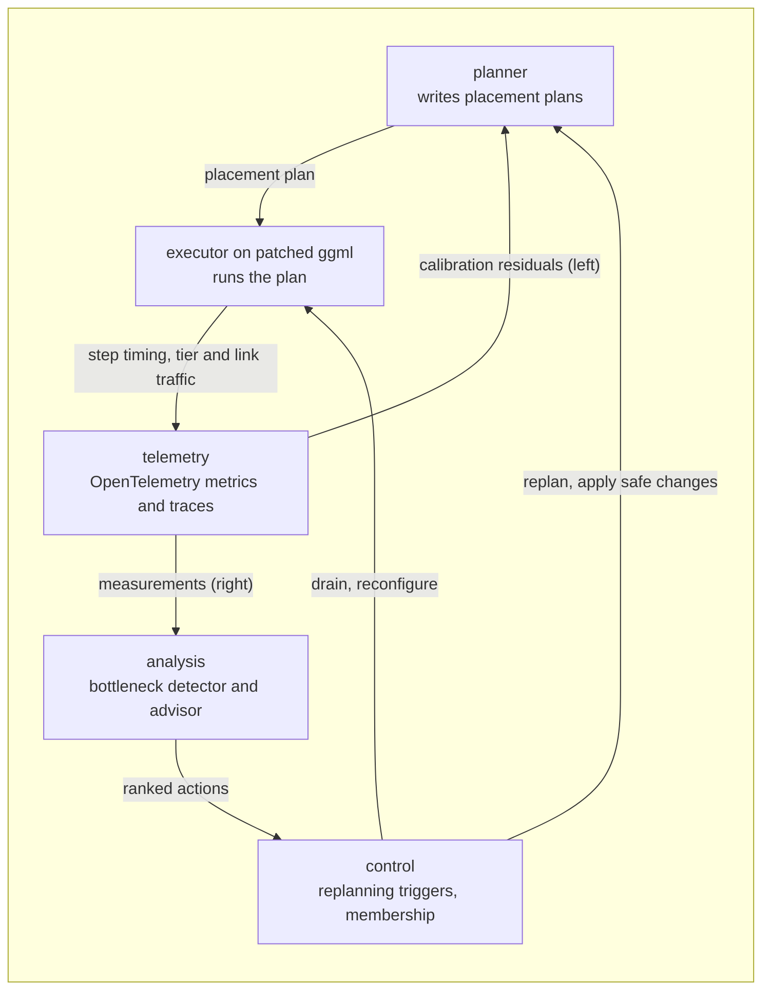

# Tetraeder: build plan

Oct 29, 2026 · @Pierre

This file is the maintained design. It started as an export of the Claude Doc "Tetraeder: build plan" (rev 105); since Oct 29, 2026 changes go here, and the Claude Doc is the older version.

Tetraeder is an LLM inference engine in Rust on a patched ggml: one placement plan expresses every parallel mode and memory tier, a measured-cost planner chooses it for whatever mix of GPUs, CPUs, VRAM, RAM, NVMe and nodes you have, and built-in OpenTelemetry observability finds the bottleneck and proposes the fix.

## Goals and principles

Tetraeder runs any supported model on any mix of hardware you hand it, picks the placement itself, tells you where the time goes, and stays maintainable by one person with Claude Code.

### What "always does the right thing" means

- **Never** breaks a hard constraint: memory per device and tier, a pinned placement, a rule about which node may see what.
- **Optimal within the cost model** for the space it searches; real instances are small enough (about 100 layers, a few hundred experts, a few dozen devices) for exact or bounded search.
- **Close to optimal in reality:** scored by regret, the gap between the plan it picked and the best plan measured. Target: at most 10%.
- **Never worse than a safe fallback plan** (one node, layer split, RAM offload).
- **Explains itself:** predicted numbers, the binding bottleneck, the runner-up and why it lost.
- **Shows its work at runtime:** every prediction is compared with OpenTelemetry measurements; drift triggers recalibration or replanning.

### Principles

1. **One plan, many shapes.** Tensor, pipeline, expert, data and context parallel, offload and tiering are shapes of one placement plan, not separate code paths.
2. **Measure, don't assume.** Costs come from measured curves on your hardware; datasheets are only priors for what-if questions.
3. **Reuse before build.** Kernels from ggml, model graphs, GGUF and tokenizers from llama.cpp, collectives from NCCL and RCCL, QUIC from quinn, solvers from HiGHS.
4. **Patch, never fork.** ggml changes are a short, ordered patch queue against a pinned version, kept private for now and written cleanly enough to upstream later if you decide to.
5. **Strangler path.** Start by driving llama.cpp's library from Rust for dense models; write the first own graph builder (one MoE family) as early as Phase 2, because expert streaming needs it; then replace scheduler, KV cache and executor piece by piece, each step behind a benchmark.
6. **Observable by default.** Every layer emits OpenTelemetry metrics and traces from the first commit; the bottleneck detector and the planner read the same data.

### Non-goals

- Training or fine-tuning.
- Tensor parallel across GPU vendors (pipeline across vendors is in scope).
- Python at runtime (offline test tooling only).
- Untrusted public meshes; every node is yours or explicitly trusted.
- Beating vLLM or SGLang on peak NVIDIA datacenter throughput at high concurrency; they stay benchmark baselines and an optional backend for that case.

### First targets

Models: Qwen3 dense, then Qwen3 MoE, then GLM and DeepSeek-style MoE. Formats: GGUF first, safetensors later. Backends: CUDA and CPU until M2; HIP, Vulkan and Metal for own graph builders in Phase 8. Hardware: your Linux host and Windows desktop, then rented multi-GPU machines.

## Feature map

All 52 wanted features have a home and a phase; the MVP (M1, after Phase 3b) covers one MoE family plus dense models on CUDA and CPU, with tiered memory, expert streaming, the planner, observability and the bottleneck detector on one machine.

| # | Feature | Built in | Phase |
| --- | --- | --- | --- |
| 1 | Tiered weights across VRAM, RAM, NVMe | `memory`, own graph builder | 2 |
| 2 | MoE-aware expert placement and streaming | `memory`, `planner`, own graph builder | 2 |
| 3 | KV cache tiers (VRAM, RAM, NVMe, remote) | `kvcache` | 4, remote in 6 |
| 4 | Prefix caching, shared across nodes | `kvcache` | 4, cross-node in 6 |
| 5 | Weight and KV quantization, chosen per unit with placement (see Quantization and quality) | ggml formats, `planner` | 1 whole-model, 2 per unit |
| 6 | Fast model loading | `model` (aligned direct reads, parallel I/O) | 2 |
| 7 | Tensor parallel | own executor, NCCL, all-reduce patch | 5 |
| 8 | Pipeline parallel (layer split) | `executor` | 1 in a node, 6 across nodes |
| 9 | Expert parallel | own executor, `memory` | 5, across nodes in 6 |
| 10 | Sequence or context parallel | ggml patch (attention with log-sum-exp) | 9 |
| 11 | Data parallel replicas | `control`, `gateway` | 6 |
| 12 | CPU as a compute device | ggml CPU backend; free choice per shard with own executor | 1, free in 5 |
| 13 | Prefill and decode on different hardware | `executor`, `kvcache` | 7 |
| 14 | Mixed GPU sizes and vendors | ggml backends, `planner` | sizes 1, vendors after the Phase 0 spike, own builders on HIP, Vulkan, Metal in 8 |
| 15 | Interconnect-aware placement, PCIe topology included | `profiler`, `costmodel` | 3a |
| 16 | Multiple nodes | `transport`, `control` | 6 |
| 17 | Automatic node discovery | `control` (static list, mDNS) | 6 |
| 18 | Live node join and leave | `control`, `planner` | 6 |
| 19 | Fault tolerance | replicas, `control` | 6 |
| 20 | Security (mTLS, node trust rules) | `transport`, `control` | 6 |
| 21 | Automatic hardware discovery | `profiler` | 0 |
| 22 | Measured-cost planner | `profiler`, `costmodel`, `planner` | 3a |
| 23 | Objective as limits (target tok/s, quality floor, device cost) plus a position on the speed and quality front | `planner` | 3a |
| 24 | Live replanning | `planner`, `control` | 3a as drain-and-restart, 7 live |
| 25 | Continuous batching | `scheduler` | 4 |
| 26 | Chunked prefill | `scheduler` | 4 |
| 27 | Speculative decoding (n-gram, draft; MTP where the GGUF has heads) | `scheduler` | 4 |
| 28 | Optimized kernels, CUDA graphs | ggml; graphs survive expert streaming only on cache hits | 1, 2, 4 |
| 29 | Several models at once, on demand | `gateway`, `planner` | 9 |
| 30 | LoRA hot swap, batched multi-LoRA | `executor`, ggml patch | 9 |
| 31 | Priorities, quotas, auth | `gateway` | 9 |
| 32 | OpenAI and Anthropic API | `gateway` | 3b |
| 33 | Tool calling, structured output | `gateway` (minijinja, llguidance) | 3b |
| 34 | Multimodal, embeddings | llama.cpp mtmd, `gateway` | 9 |
| 35 | Metrics, traces, logs (OpenTelemetry) | `telemetry` | 0, extended every phase |
| 36 | No forced telemetry | design rule: OTLP only to endpoints you configure | 0 |
| 37 | Windows and Linux, container image | build, packaging | 1, packages in 9 |
| 38 | Live change of parallel layout | migration DAGs | 7 |
| 39 | Live replica scaling | `control` | 7 |
| 40 | Separate layouts for prefill and decode | `planner`, `executor` | 7 |
| 41 | Bottleneck detection (ranked, with confidence) | `analysis` | 3a |
| 42 | Improvement advisor (ranked actions, what-if) | `analysis`, `planner` | 3a, auto-apply in 7 |
| 43 | Detailed profiling | step timing always; per-op calibration runs; CUPTI or rocprof in profiling mode | 1, 3a |
| 44 | Per-request cost accounting (GPU-seconds, bytes streamed) | `telemetry`, `gateway` | 3b |
| 45 | SLO burn-rate alerts | `telemetry`, dashboards | 3a |
| 46 | Process isolation per device | `executor` (one worker process per device) | 5 |
| 47 | Request cancellation and backpressure | `gateway`, `scheduler` | 3b |
| 48 | Quality profile per model (measured drift per tensor group and format) | `profiler`, calibration job | 2, used by the planner in 3a |
| 49 | Load-time conversion from F16 or BF16 with a disk cache | `model` | 2, safetensors with the own loaders |
| 50 | 1 to 2 bit formats (IQ1, IQ2, TQ, Q1\_0) as planner choices | ggml formats, `planner` | 2 |
| 51 | Natively ternary model families (BitNet b1.58) | libllama, own builder | 1 via libllama, own builder in 9 |
| 52 | Self-speculative decoding (low-bit draft of the same model) | `scheduler`, `planner` | 4 |

## Architecture

The planner writes placement plans, the executor runs them on patched ggml, and telemetry feeds measurements back to the planner and the bottleneck detector, closing the loop.



Measurements flow down into telemetry and back up: to the planner for calibration (left) and to the detector and advisor (right), which act through the control plane.

| Crate | Job | Built on |
| --- | --- | --- |
| `plan` | Placement plan IR, validator, diff, migration DAGs | Own |
| `ggml-sys` | Rust bindings to the pinned, patched ggml | bindgen; ggml patch queue |
| `model` | GGUF loading, architecture graph builders, tokenizer, chat templates | libllama first (strangler path), then own builders where needed; minijinja |
| `memory` | Per-device arenas, tiers (VRAM, RAM, NVMe, remote), expert slot cache, direct I/O, prefetch | Own; ggml backend buffers; io\_uring on Linux, unbuffered overlapped I/O or IoRing on Windows |
| `executor` | One worker per device, runs plan stages, async copies, weight streaming | ggml backend scheduler until Phase 5; then own executor, one worker process per device (ADR 0016, 0017) |
| `kvcache` | Chunked or paged KV, prefix tree, quantized KV, tiers, migration | Own from Phase 4; llama.cpp's cache before |
| `scheduler` | Continuous batching, chunked prefill, speculative decoding, priorities | Own from Phase 4 |
| `transport` | One trait for collectives and point-to-point: NCCL or RCCL, QUIC, RDMA, shared memory | NCCL, RCCL, quinn or iroh |
| `profiler` | Hardware discovery and measurement: per-op curves, bandwidth per tier, link latency and bandwidth | Own; NVML, amdsmi |
| `costmodel` and `sim` | Predicts step times; discrete-event simulator for load | Own |
| `planner` | Search, hints, explain, what-if, replanning | Own; HiGHS |
| `telemetry` | OpenTelemetry metrics, traces, logs; GPU and host metrics | opentelemetry-rust, tracing |
| `analysis` | Bottleneck detection, improvement advisor | Own |
| `control` | Discovery, membership, failover, replanning triggers, mTLS | Own; step-ca for certificates |
| `gateway` | OpenAI and Anthropic API, tool calls, structured output, auth, quotas, routing | axum; llguidance |

### The placement plan

The plan is the contract between planner and executor; every mode is a shape of it.

- **Units:** the model split into embedding, attention block, MLP, each expert, LM head; each records weight bytes, FLOPs per token, activation bytes and KV bytes per token.
- **Shards:** a unit split into k pieces along a chosen dimension. Each shard has a home (device and tier) and a compute device chosen independently, CPU included (executable from Phase 5; before that compute follows the weight buffer, apart from ggml's own fixed offload heuristic).
- **Stages and edges:** units grouped into stages; every boundary is an edge with a transport and a measured cost.
- **Expert map:** per expert its tier (VRAM, RAM, NVMe, remote node), cache slots per layer, pinned hot set.
- **Replica groups:** copies of a sub-plan behind a router.
- **Phase plans:** prefill and decode may differ while sharing weights. First form (Phase 2): per-device prefill and decode budgets for slots and workspace, so prefill borrows slot VRAM and decode gets it back (ADR 0031).
- **Knobs:** batch limits, KV budget per device and tier, speculative decoding settings.

Plans are TOML, hand-editable (the strongest hint), and a diff between two plans compiles to a migration DAG: moves ordered per shard, independent across shards, drained first, finished with a two-phase commit.

### What each phase can execute

The IR is richer than what can run early; the planner only proposes fields the current phase can execute.

| Plan field | Phase 1 (libllama) | Phases 2 to 4 (own graph builder) | Phase 5 on (own executor) |
| --- | --- | --- | --- |
| Layer split and GPU ratios | Yes (tensor split, split mode) | Yes | Yes |
| Tensor-to-buffer overrides (offload, experts to CPU) | Yes (buffer-type overrides by regex) | Yes | Yes |
| Expert tiers and slot cache | No | Yes, for the own MoE family | Yes |
| Prefill and decode budgets for slots and workspace | No | Yes | Yes |
| Compute device per shard | No (follows the buffer; ggml copies CPU weights to the GPU at larger batches, not tunable) | Partly | Yes |
| Tensor and expert parallel | No | No | Yes |
| Replicas, stages across nodes | No | No | Phase 6 |

The Phase 3a regret test uses only executable fields: per hardware fixture, every candidate the planner enumerates (at least 20 plans) is benchmarked, and regret and rank correlation are measured over that set.

### Platform constraints

- NCCL, RCCL, GPUDirect Storage, io\_uring and RDMA verbs are Linux only. Windows machines are API clients, workers or pipeline stages. Tensor parallel and expert parallel across nodes need NCCL or RDMA and run on Linux; expert parallel inside one Windows machine works without NCCL.
- Windows keeps VRAM headroom for the desktop compositor; the arena reserves it.
- llama.cpp's RPC transport is plaintext; Tetraeder uses its own transport with mTLS instead.

## Engine on ggml

Rust owns everything outside the kernels; ggml supplies the kernels for every backend through a short private patch queue; libllama carries dense models at first, own graph builders arrive in Phase 2 because expert streaming needs them, and an own executor replaces ggml's scheduler in Phase 5 because tensor parallel needs it.

### Rust and C boundary

- `ggml-sys` is the only crate with raw FFI to ggml and libllama; `unsafe` stays in `ggml-sys` and `memory`.
- Tensors and buffers are Rust types that own their lifetime per device and tier; the executor never frees memory the arena did not allocate.
- One pin: a llama.cpp commit, which vendors ggml. One weekly CI job rebases both the libllama binding and the ggml patch queue.

### Strangler path

1. **Phase 1, libllama for dense models.** llama.cpp loads, builds the graph, keeps the KV cache and batches. Tetraeder sets placement through its parameters (layer split, split mode, buffer-type overrides, mmap) and measures step times.
2. **Phase 2, first own graph builder.** Qwen3 MoE, written in Rust on ggml ops, CUDA and CPU only, validated against libllama logits. It owns the expert tensors as slot tensors, reads the router's top-k back and remaps it to slots; that is what makes expert streaming possible, since libllama allocates full expert tensors and runs top-k inside its graph with no public hook.
3. **Phase 4, own KV cache and scheduler,** plus a second builder (Qwen3 dense), still CUDA and CPU.
4. **Phase 5, own executor** replaces ggml's backend scheduler, which issues splits one after another from one host thread. The own executor runs one worker process per device, issues per-device subgraphs concurrently with NCCL group semantics and no host sync between ranks; this is what tensor parallel and free compute placement need.
5. **Phase 8, backend parity:** own builders on HIP, Vulkan and Metal, with parity tests.
6. **libllama stays** as the parity reference and as the fallback for model families without an own builder.

### ggml patch queue (private)

Each patch has an ADR and tests on every backend it touches. Nothing is upstreamed for now (ADR 0011); every rebase is ours, so out-of-tree code is preferred wherever it works.

| Patch | Why | Needed in | Worth upstreaming later |
| --- | --- | --- | --- |
| All-reduce as a graph op | Tensor parallel without host round trips; only useful together with the own executor | Phase 5 | Medium: llama.cpp avoids an NCCL dependency |
| Attention over chunked or paged KV | KV tiers, prefix sharing, migration; only if contiguous chunks are not enough | Phase 4, if the experiment says so | Medium |
| Attention returning log-sum-exp | Merge partial attention for context parallel | Phase 9 | Medium |
| Batched multi-LoRA matmul | Many adapters in one batch | Phase 9 | Medium |

No patch needed: expert slot remapping (inside the own builder), KV pack, unpack and head re-layout (small out-of-tree kernels).

### Timing without perturbing what is measured

Timing events inside a captured CUDA graph do not give usable per-op times, and disabling graphs changes the fixed per-op cost. So: production steps record whole-step time with graphs on; calibration runs record per-op times with graphs off; the cost model keeps c0 for both modes; deep profiling uses CUPTI or rocprof from outside, in profiling mode only. No timing patch.

### Kernel coverage

| Feature | Kernel | Status |
| --- | --- | --- |
| Quantized weights, layer split, mixed GPUs | Quantized matmul per backend | ggml today |
| Pipeline across vendors | Activation copies between backends | ggml, if the Phase 0 multi-backend spike passes |
| RAM and NVMe tiers, CPU computing cold experts | Copies plus CPU kernels | ggml today |
| MoE and expert parallel | Grouped expert matmul | ggml today; expert parallel needs the own executor |
| Tensor parallel | Sliced matmul plus all-reduce | All-reduce patch plus own executor |
| Quantized KV, multimodal | Various | ggml and llama.cpp today |
| Speculative decoding | Batched verification with masks | ggml today |
| Paged KV | Attention over scattered blocks | Patch, only if needed |
| Context parallel | Attention with log-sum-exp | Patch |
| Many LoRAs per batch | Batched multi-LoRA | Patch |
| Peak NVIDIA throughput at high concurrency | Marlin, FlashInfer, CUTLASS-class kernels | Not pursued; vLLM or SGLang only as an external process behind the gateway |

## Memory tiers and expert streaming

Every byte of weights and KV lives in one of four tiers, and the planner places it so that the slowest tier delivers as few bytes per token as possible; across nodes, activations travel to the experts instead of experts to the compute.

| Tier | Typical bandwidth | Holds |
| --- | --- | --- |
| VRAM | hundreds of GB/s to a few TB/s | Dense layers, hot experts, active KV |
| RAM | tens to about 100 GB/s per node | Warm experts, overflow KV, prefix cache |
| NVMe | a few GB/s per drive | Cold experts, cold KV, model files |
| Remote node | link bandwidth plus latency per hop | Experts and KV that live on another machine |

The bandwidths are orders of magnitude for planning; the profiler measures the real ones. The paths between tiers are links in the hardware graph too: NVMe to RAM and RAM to VRAM both cross the PCIe root complex, and on consumer boards a second GPU and the NVMe often share lanes.

### Per-device memory budget

The planner works with a measured reserve per device: CUDA context, cuBLAS workspaces, graph pools, fragmentation, and the desktop compositor on Windows are measured at startup and subtracted before planning. While libllama allocates its own buffers (Phase 1), the budget is checked after loading, not guaranteed; from Phase 2 the own builder allocates from per-device arenas sized by the plan, with headroom.

### Expert streaming on ggml

The design follows Colibri, ported to ggml through the own graph builder (Phase 2):

1. Experts are read by file offset from GGUF; in current conversions each expert is a contiguous slab of its layer's stacked tensor, three slabs per expert (gate, up, down). Older GGUFs with per-expert tensors are repacked once at import.
2. GGUF aligns tensors to 32 bytes, while O\_DIRECT needs sector or page alignment: reads cover the aligned enclosing range into bounce buffers, or an import step writes a 4 KiB-aligned expert file. Windows uses FILE\_FLAG\_NO\_BUFFERING with overlapped I/O or IoRing, sector-aligned.
3. Each MoE layer has a slot tensor with K slots per tier (VRAM, RAM) and a table from expert to slot. The builder reads the router's top-k, remaps it to slots and loads misses.
4. **One segment per MoE layer, whole-step graphs once hit rates allow** (ADR 0030). A layer only runs without the host when all its top-k experts are resident; at top-8 of 128 and an 80% per-expert hit rate that is about 17% of layers, so a whole step almost never would. The step therefore runs as one segment per MoE layer: the host reads the router's top-k, remaps to slots, starts loads for misses, and the next segment (a CUDA graph each) follows. The next layer's likely experts are prefetched from the hot set and from routing correlations between layers. A device-side slot table with one miss check per step comes only when the measured per-layer full-hit rate makes it pay. Hit rates are first-class metrics.
5. Expert-aware cache instead of the OS page cache: pinned hot set from measured routing frequencies, LRU per layer, deep I/O queues (256-expert models have small slabs, so IOPS matter as much as bandwidth).
6. Streamed experts are computed where it is cheapest: on the GPU after upload at larger batch, on the CPU where they sit at batch 1.
7. **Routing profiles:** hot sets differ by workload (code versus chat), so the planner keeps one profile per workload class and switches the pinned set when traffic changes.

### Experts across nodes

When several machines hold experts, each computes its own and only activations cross the network (dispatch and combine, a few KB per token per MoE layer). Throughput is bounded by the slowest tier:

```latex
\text{tok/s} \le \min_{\text{tier}} \frac{B_{\text{tier}}}{\text{bytes per token served by that tier}}
```

Cross-node expert parallel adds one round trip per MoE layer per token: about 12 to 25 ms per token on a LAN with about 60 MoE layers, more with userspace QUIC, which costs hundreds of microseconds and CPU per hop. Phase 0 measures QUIC, TCP with TLS and RDMA before the transport is chosen.

Example, estimates only: GLM-5.2 needs about 11 GB of routed expert weights per token at int4 in the worst case. From one NVMe at 7 GB/s with no cache hits that is under 1 tok/s, Colibri's cold range. Spread over four nodes with about 96 GB RAM each, every node reads about 3 GB per token from RAM at 50 to 100 GB/s, a ceiling of about 15 to 30 tok/s before network and compute.

### Parallel shapes across slow links

Machines that are not on one LAN (rented boxes in different data centres, 10 to 150 ms round trip) are still useful, depending on the parallel shape:

| Shape | Traffic between machines per token | Over a high-latency link |
| --- | --- | --- |
| Data-parallel replicas (independent prompts) | none | Ideal; any latency is fine |
| Pipeline parallel with many requests in flight | one activation per stage boundary (about 8 to 16 KB) | Good throughput once micro-batches in flight are at least the number of stages. A single stream pays one one-way latency per hop, the hop back to stage 1 included: S stages on S sites add S times RTT/2 per token (two machines: one RTT) |
| Prefill on one machine, decode on another | the KV cache once per request | Workable for long prompts; KV size and bandwidth decide |
| Expert parallel across machines | one round trip per MoE layer (about 60 per token) | Correctness only: about 60 RTT per token is seconds per token |
| Tensor parallel across machines | an all-reduce per layer | Not supported (ADR 0008) |

The planner sees these costs through the per-link latency and bandwidth; the simulator checks the pipeline numbers.

### What the planner cannot fix

- Total fast memory across all machines smaller than the experts in regular use: the disk is the limit again; the planner minimizes misses.
- Network latency per layer when experts are remote.
- Skewed expert popularity: the planner spreads or replicates popular experts.

`plan what-if` answers which purchase helps most in those cases: RAM, a faster NVMe, a second NVMe for striping, or another node.

## Quantization and quality

Quantization is not one global setting. The planner chooses a format for every unit (tensor, layer slice, expert) together with its device and tier, and measures what each choice costs in quality (ADR 0024). Fewer bytes per weight mean less to read from the slowest tier per token, and free memory for KV cache, larger batches and more pipeline stages in flight.

### Formats

At the pin (llama.cpp b11976) ggml offers the usual 8, 6, 5 and 4 bit formats (Q8\_0, Q6\_K, Q5\_K, Q4\_K and others), the importance-weighted IQ4, IQ3 and IQ2 families, and five formats near one bit: IQ1\_S and IQ1\_M (about 1.6 and 1.75 bits per weight), TQ1\_0 and TQ2\_0 (ternary), and Q1\_0. The IQ formats below 4 bits need an importance matrix from calibration text. They damage small models badly and work reasonably on very large MoE models, so they are formats the planner may choose where the quality profile says the loss is small, not a mode of their own.

Natively ternary models (BitNet b1.58 and similar) are different: they are trained with ternary weights, so nothing is lost by storing them that way. They are a model family. libllama loads BitNet at the pin, so they run through the Phase 1 path; an own builder with faster ternary kernels comes with the other families in Phase 9.

### Mixed formats across layers, devices and tiers

GGUF already gives every tensor its own format, and activations cross stage and device boundaries in f16 or f32 whatever the weight format. So a model can be partly quantized: one stage on a large GPU in Q8\_0, another on a smaller GPU or the CPU in Q4\_K, with no conversion at the boundary.

For MoE models the format follows the tier. Hot experts stay in VRAM at high precision; rarely used experts move to RAM or NVMe at low precision. The bytes read from the slowest tier per token drop by the compression ratio, while most tokens only touch high-precision experts. The router, attention and shared experts, which every token uses, stay at high precision.

In Phase 1 on libllama only its tensor-type overrides are available; the full per-unit choice comes with the own graph builder and plan IR in Phase 2.

### Which tensors take fewer bits

Some tensors lose much more quality when squeezed than others. llama.cpp's mixed presets (Q4\_K\_M and others) encode fixed rules: more bits for the token embeddings and output head, and for some attention-value and FFN-down tensors, especially in the first and last layers. These rules are the prior when nothing is measured.

The planner works from a **quality profile** per model instead:

- For each tensor group (per layer, or per expert group for MoE) and each candidate format, the calibration job quantizes only that group and measures the KL divergence of the output logits from the full-precision model on a calibration set.
- The same run writes the importance matrix the IQ formats need.
- The profile is a file next to the model, keyed by model hash, calibration set and ggml version, so it can be shared and a model is profiled once. It runs as a batch job on a rented GPU box.
- Profiles can be per workload (code, chat, long context), like routing profiles, since which experts and layers matter depends on the text. A profile from another workload is still better than the fixed rules.
- A plan's quality loss is estimated as the sum over its units. This additivity is an assumption, so a test compares the summed estimate with the measured divergence of the whole mix on every profiled model.

With the profile, picking formats is a knapsack: squeeze first the units that lose the least quality per byte saved, until the plan meets its speed or memory limit. The planner does this inside each placement skeleton, so format and placement are decided together.

### Load-time conversion

If only an F16 or BF16 model is on disk, the engine converts it at load time to the formats the plan chose, with ggml's per-tensor quantization on all CPU cores. Simple formats convert quickly; the IQ formats and the importance matrix take much longer, so every conversion is cached on disk, keyed by source hash, format, importance-matrix hash and ggml version. The planner counts a missing conversion as a one-time switch cost, not a per-token cost.

Conversion only goes downward: requantizing an already quantized model loses more than converting from full precision, so the engine always starts from the most precise copy available and records it. Hugging Face safetensors need a tensor-name mapping per architecture, which comes with the own loaders and builders from Phase 2; until then the source is a GGUF.

### Self-speculative decoding

A low-bit copy of the same model drafts several tokens and the high-precision copy verifies them in one batched step. The output is exactly what the high-precision model would produce, at a speed between the two. It needs memory for both copies, or a low-bit copy of only some layers, so it is a plan option the planner weighs like any other (Phase 4, with speculative decoding).

## Planner and optimizer

The planner turns measured hardware, the model, the workload and your hints into a plan in seconds, confirms close calls with a real benchmark, and re-solves when telemetry shows the world changed.

### Inputs

- **Hardware graph:** per device and tier the capacity, bandwidth and per-op cost curves; per link (GPU pairs, host to device, NVMe to host, network) the latency α and bandwidth β, measured under load, with shared PCIe lanes detected. Measured on startup with repeats, medians and drift detection (clocks, thermals, power limits, NUMA, page cache, Proxmox co-tenants). A priors database scaled from measured same-class devices answers what-if questions about hardware you do not have.
- **Model graph:** units with sizes and costs; for MoE, measured routing frequencies per expert.
- **Workload profile:** arrival rate, prompt and output length distributions, prefix reuse, concurrency; measured online from telemetry, seeded by hints.
- **Quality profile** per model (see Quantization and quality): quality loss per tensor group and format.
- **Objective and SLOs**, **hints**, and the **current plan** (for switch costs, including weight conversions that are not cached yet).

Everything the cost model uses is measured, not assumed: compute per device; capacity, bandwidth and request-size curves (IOPS for small reads) per tier (VRAM, RAM, NVMe, remote); latency and bandwidth per link (PCIe, NVLink, network), including what each link delivers when several streams share it (two GPUs or a GPU and an NVMe behind one PCIe root, several transfers on one network card).

### Cost model

Each op costs a fixed launch and sync term plus a term in M, the tokens in the step, measured per op, shape, weight format and device (a 4 bit and a 1.6 bit matrix multiply on the same device are different curves, especially on the CPU):

```latex
t_{\text{op}}(M) = c_0 + f_{\text{op,dev}}(M)
```

At batch 1 the fixed term dominates, which is why CUDA graphs matter; quantized GEMV at M = 1 and GEMM at M = 64 differ by an order of magnitude. The roofline max(FLOPs / F, bytes / B) is only the prior before measurements. The same curves give the GPU versus CPU crossover per shard. c0 is kept separately for steps with and without CUDA graphs, and expert-cache hit rate decides which applies.

Transfers cost latency plus size over bandwidth; a ring all-reduce over p GPUs:

```latex
t_{\text{allreduce}} = 2(p-1)\,\alpha + \frac{2(p-1)}{p}\cdot\frac{n}{\beta}
```

Decode all-reduces are latency-bound, so α matters most. A request through S pipeline stages pays per token:

```latex
t_{\text{token}} = \sum_{s=1}^{S} \left( t_s + \alpha_s + \frac{a}{\beta_s} \right)
```

with a the activation size per hop. Tier streaming costs bytes over tier bandwidth and is free only while it overlaps compute. Every device and tier must satisfy:

```latex
W_{\text{shards}} + \text{KV}(\text{batch} \times \text{context}) + \text{workspace} \le \text{capacity}
```

Quantization enters both sides: smaller formats shrink the weight shards, which leaves room for KV and larger batches, and change the per-op curves. Each plan also gets a quality loss Q(plan), the sum of its units' entries in the quality profile, and a resource cost from the device cost hints; the objective (see Hints) trades speed against quality and cost.

Latency under load comes from a discrete-event simulator that replays the workload profile against a candidate plan and schedules micro-batches explicitly. Telemetry residuals (predicted minus measured, per op and per stage) feed learned correction factors.

### Search

1. **Enumerate skeletons:** tensor, pipeline, expert and data parallel degrees per device group. Tensor parallel only within one vendor on Linux with a fast link; degrees only as divisors of heads and experts.
2. **Prune** by memory lower bounds (after the measured reserve), hard hints, and fields the current phase cannot execute.
3. **Solve each skeleton:** layer split across uneven stages by dynamic programming (minimize the slowest stage); expert placement and tiers as a mixed-integer program over routing frequencies, with greedy or large-neighbourhood search under a time limit when it does not close; KV budgets per tier; weight formats per unit by a greedy knapsack over the quality profile (least quality lost per byte saved first) until the skeleton meets its limits.
4. **Score** survivors analytically; run the top 20 through the simulator. The survivors' speed and quality form the Pareto front that `plan explain` shows.
5. **Benchmark for real** only when the top two are within the model's error band, on the pinned replay trace; knob-only candidates without reloading the model.
6. **Replan online** when telemetry shows drift, load shift, an SLO miss or a node change. Switch only if the predicted gain over the planning horizon exceeds the switch cost times a safety factor; cheap moves (batch limits, KV budget, hot set, replicas) before resharding.

The planner is scored by regret and rank correlation over the candidate set defined in Architecture, not by mean prediction error.

### Hints

| Kind | Example | Effect |
| --- | --- | --- |
| Objective and SLO | `objective = "latency"`, `p95_ttft_ms = 2000`, `target_tok_s = 20` | Regime and hard limits (ADR 0025): among plans that meet them, best quality first, then lowest resource cost, then extra speed; a target tok/s alone is enough |
| Quality floor | `max_quality_loss = 0.02` (KL divergence), `min_format = "Q4_K"`, `min_format layers 0..2 = "Q8_0"` | Hard limit on quantization |
| Trade-off | `tradeoff = 0.7` | Picks a point on the speed and quality front: 0 the fastest plan, 1 the best-quality plan; a view on the front, not a weight |
| Pin | `pin layers 0..8 -> gpu0` | Hard constraint |
| Forbid | `forbid tier nvme for dense`, `forbid node laptop` | Hard constraint, also privacy |
| Prefer | `prefer node rack1 weight 0.2` | Soft cost term |
| Workload | `prefix_reuse = high`, `typical_prompt = 30000`, `concurrency = 4` | Seeds the profile |
| Partial plan | A plan file with open fields | Planner fills only those |
| Stability | `max_switches_per_hour = 1`, freeze 09:00 to 18:00 | Limits replanning |
| Power and cost | `max_watts = 900`, `cost node laptop 0.8`, `cost gpu1 0.3` | Resource budget; device costs decide how much slow or shared hardware a plan may use |
| Advisor policy | `auto_apply = ["batch", "kv_budget", "hot_set"]` | Which advisor actions run without asking |

### Explain, diff, what-if

- `plan explain`: predicted numbers per stage, the binding bottleneck, the runner-up and why it lost, the format per unit and its quality cost, and the speed and quality front with the chosen point.
- `plan diff`: what moves between two plans and how long the switch takes.
- `plan what-if --add gpu:4090 --add ram:256G --remove node:laptop`: solve for hardware you don't have, from the priors database.

## Observability

Every layer emits OpenTelemetry metrics, traces and logs from the first commit; the same data drives dashboards, SLO alerts, per-request cost accounting, the bottleneck detector and the planner's recalibration, within an overhead budget measured every night on a GPU host.

### Signals

- **Metrics** over OTLP, following the OpenTelemetry GenAI semantic conventions where they exist (status: experimental, names may change) and a `tetraeder.*` namespace for engine internals.
- **Traces:** one trace per request (gateway, queue, prefill chunks, sampled decode steps, per-stage spans, transfers); trace context crosses nodes in the transport. Sampling is tail-based in the collector: all slow, failed and SLO-violating requests are kept, a small share of the rest.
- **Logs** through Rust's `tracing`, bridged to OpenTelemetry logs and correlated with trace IDs.
- **Step timing** in production (whole steps, CUDA graphs on); **per-op timing** in calibration runs (graphs off); **CUPTI or rocprof** from outside in profiling mode.
- **Continuous profiling** of host code with perf or eBPF (bpftrace) in profiling mode; Tracy during development.
- **Hardware:** GPU utilization, memory, clocks, power, temperature and throttle reasons via NVML and amdsmi (or DCGM); PCIe link width and speed; CPU, RAM bandwidth, NVMe and network from the host.

### Metric catalog

| Metric | Type | Key attributes | Feeds |
| --- | --- | --- | --- |
| `gen_ai.server.time_to_first_token` | histogram | `gen_ai.request.model`, `gen_ai.operation.name` | SLOs, dashboards |
| `gen_ai.server.time_per_output_token` | histogram | `gen_ai.request.model` | SLOs, dashboards |
| `gen_ai.server.request.duration` | histogram | `gen_ai.request.model`, `error.type` | SLOs |
| `tetraeder.tokens` | counter | model, direction (input, output), cache (hit, miss) | throughput, cost (no server token counter in semconv yet) |
| `tetraeder.step.duration` | histogram | phase (prefill, decode), stage, graphs (on, off) | detector, planner |
| `tetraeder.op.duration` | histogram, calibration runs only | op, device, backend, batch bucket | cost model |
| `tetraeder.device.busy` | gauge (fraction) | device | detector |
| `tetraeder.device.throttle` | gauge | device, reason (thermal, power, clocks) | detector (checked first) |
| `tetraeder.memory.used`, `.capacity` | gauge | device, tier, kind (weights, KV, workspace, reserve) | planner, alerts |
| `tetraeder.tier.read.bytes` | counter | device, tier | detector, cost model |
| `tetraeder.link.bytes`, `.latency` | counter, histogram | source, destination, transport | detector, cost model |
| `tetraeder.expert.cache.requests` | counter | layer, tier, result (hit, miss) | detector, hot-set sizing, CUDA-graph survival |
| `tetraeder.expert.load.duration` | histogram | tier, source | detector |
| `tetraeder.expert.routing` | summary: top 16 experts per layer | layer, expert | planner (placement) |
| `tetraeder.kv.blocks` | gauge | device, tier, state | detector, planner |
| `tetraeder.kv.prefix.hits` | counter | node | advisor |
| `tetraeder.scheduler.queue.depth`, `.batch.size` | gauge, histogram | node, priority | detector |
| `tetraeder.spec.acceptance` | histogram | method (draft, n-gram, MTP) | advisor |
| `tetraeder.request.cost` | histogram | caller, model, resource (GPU-seconds, bytes streamed) | cost accounting, bottleneck attribution per caller |
| `tetraeder.plan.residual` | histogram | stage | recalibration |
| `tetraeder.plan.regret` | gauge | plan | planner quality |

Full per-expert and per-op-instance data stays in an in-process ring buffer; only aggregates and the top 16 per layer leave the process.

### Alerts, dashboards, export

- **SLO burn-rate alerts** (multi-window, for time to first token, time per output token and error rate) instead of one alert per component; component alerts only for hard failures (device lost, out of memory, link down).
- Grafana dashboards in the repo: overview, per node, per device, experts and cache, KV, planner (predicted versus measured), cost per caller.
- OTLP to any collector; a ready config for VictoriaMetrics with the OpenTelemetry Collector, plus Jaeger or Grafana Tempo for traces.
- Exemplars from slow histogram buckets to traces, if opentelemetry-rust supports them well enough (checked in Phase 0).
- `tetraeder top` shows the same view in a terminal without any backend.

### Rules

- Nothing leaves the machine unless you configure an OTLP endpoint; no phone-home of any kind.
- Overhead budgets per mode, measured nightly on a GPU host: under 2% in production mode, under 10% in calibration mode, unbounded in profiling mode.
- Every new component ships with its metrics and dashboard panel in the same PR; alerts go through the SLO set.

## Bottleneck detection and improvement advisor

The detector produces a ranked list of limiting resources with their share of step time and a confidence interval, or says plainly that the system is balanced; the advisor turns the top entries into ranked actions with predicted gains, applies the safe ones itself and rolls back anything that does not deliver.

### How the detector decides

1. **Rule out the environment first.** Throttling (thermal, power, clocks), co-tenants on the host, degraded PCIe links and swapping are checked before anything else, because they also produce prediction residuals.
2. **Pick the regime.** Under load, resources work concurrently and service demand per resource explains throughput (utilization law). At batch 1 through a layer split, devices run one after another, so throughput is the inverse of the summed demands and the critical path explains it instead:

```latex
\text{under load: } X_{\max} = \frac{1}{\max_r D_r} \qquad \text{serialized at batch 1: } X = \frac{1}{\sum_r D_r}
```

D\_r is resource r's busy time per token: each GPU's compute, each tier's bandwidth, each link, each NVMe, host CPU.

3. **Critical path per step:** the longest chain of dependent spans, split into kernel compute, launch overhead, weight streaming wait, expert load wait, all-reduce wait, pipeline idle, host scheduling, sampling and tokenization.
4. **Roofline position per op** (calibration runs): compute-bound, bandwidth-bound or launch-bound.
5. **Capacity signals:** KV full (preemptions, evictions), memory headroom, queue growth.
6. **Then the model check:** a residual left after steps 1 to 5 means the cost model is wrong; recalibrate before blaming a resource.
7. **Rank with uncertainty:** repeated windows give a confidence interval per share; when no resource stands clearly above the rest, the verdict is "balanced" and the advisor proposes scaling, not tuning.

The output is a bottleneck report: ranked resources with shares and confidence, the regime, the evidence (metrics and an example trace), and, through `tetraeder.request.cost`, which callers contribute most.

### Bottleneck types and typical actions

| Bottleneck | Signal | Typical actions |
| --- | --- | --- |
| Expert loads from NVMe | High miss rate, expert load wait on the critical path, CUDA graphs broken | Larger hot set, more RAM slots, better prefetch, routing profile per workload, stripe NVMe, move experts to another node's RAM |
| VRAM bandwidth (decode) | Bandwidth-bound ops near peak | Lower weight quant, tensor or expert parallel, speculative decoding |
| Launch overhead | Launch-bound ops at batch 1 | Keep CUDA graphs whole (fewer expert misses), larger batch |
| PCIe or link | All-reduce or transfer wait dominant, shared lanes | Fewer TP ranks across that link, pipeline instead, move the stage or the NVMe, fix link width |
| Network between nodes | Remote expert round trips dominant | Fewer remote layers, replicate hot experts locally, faster transport |
| KV capacity | Preemptions, evictions, queue growth | Quantized KV, KV tier in RAM, shorter context limit, another replica |
| Misconfiguration | A feature is available but off (flash attention, CUDA graphs), or ubatch far below the measured best | Turn it on, use the measured best setting |
| Host CPU | Scheduling or sampling spans dominant | Pin threads, NUMA placement, move tokenization off the hot path |
| Environment | Throttle reasons, co-tenants, link degraded | Power limit, cooling, move co-tenant VMs, reseat or reconfigure |

### Improvement advisor

1. **Generate** candidate actions from the top bottlenecks and the hints.
2. **Evaluate** each with the cost model and simulator: predicted gain, switch cost (time, reload), risk.
3. **Rank** by gain over the planning horizon minus switch cost.
4. **Act** by policy:
   - Auto-apply (if allowed in hints): batch limits, KV budget, hot-set size, prefetch depth, speculative decoding on or off.
   - Ask first: replanning, moving experts, changing tensor or pipeline degrees, adding a replica.
   - Report only: hardware purchases with predicted tokens per second gained (and per euro if you give prices), and host settings such as PCIe link width, resizable BAR, peer-to-peer, NUMA pinning, power limits.
5. **Verify:** measure after each change and roll back if the gain misses the prediction by more than the error band; advisor accuracy (predicted versus achieved gain) is itself a metric.

### How the detector is tested

Fault-injection fixtures, in the simulator in CI and on real hardware nightly: throttled NVMe, PCIe x4, power limit, co-tenant CPU load, a slow link. The exit test counts correct top-1 attributions on single faults, the false-positive rate on a no-fault control (target: "balanced" or no actionable bottleneck in at least 9 of 10 runs), and both faults in the top 3 on two-fault fixtures.

Interfaces: `tetraeder doctor` (one-shot report), `tetraeder advise` (ranked actions), the same data on a dashboard panel and as OpenTelemetry events.

## Roadmap

Eleven phases in four milestones; every phase ends in an exit test run from the pinned benchmark spec (engine commits, flags, batch, prompt and output lengths, locked clocks, page-cache policy, repeated runs, noise band).

| Milestone | Ends after | You get |
| --- | --- | --- |
| M1: MVP | Phase 3b | One machine, CUDA and CPU: dense models via libllama, one MoE family with own builder, tiered memory, expert streaming, planner, observability, bottleneck report, both APIs |
| M2: Full speed on one machine | Phase 5 | Own KV cache and scheduler, prefix cache, speculative decoding, own executor, tensor and expert parallel |
| M3: Homelab cluster | Phase 6 | Several nodes, experts and stages across machines, replicas, failover, mTLS |
| M4: Self-tuning | Phase 7 | Advisor applies safe changes itself, live replanning and resharding |

Phases 8 and 9 (backend parity, breadth) can run in parallel with M3 and M4.

| Phase | Deliverables | Exit test |
| --- | --- | --- |
| 0. Foundations | Repo, AGENTS.md, ADRs, CI plus a nightly GPU host; benchmark spec and harness with llama.cpp (also with expert offload overrides), ik\_llama.cpp, KTransformers, Colibri and vLLM as baselines; reference logits; simulator skeleton; hardware discovery; telemetry skeleton and first dashboard. Spikes: two ggml backends in one process (CUDA plus Vulkan or HIP); QUIC versus TCP with TLS versus RDMA latency; exemplars in opentelemetry-rust | Harness runs the spec; dashboard shows live GPU and host metrics; each spike ends in an ADR |
| 1. Engine core on libllama | Rust drives libllama for dense models; placement through llama.cpp parameters; mixed GPU sizes and CPU; step timing; OpenTelemetry metrics and traces | Within 5% of llama.cpp at the same parameters; production telemetry overhead under 2% |
| 2. Own MoE builder, tiers, expert streaming | Plan IR and validator; Qwen3 MoE graph builder in Rust (CUDA, CPU); per-device arenas with measured reserve; VRAM, RAM and NVMe tiers; slot cache with prefetch, one segment per MoE layer (ADR 0030); prefill and decode memory budgets (ADR 0031); aligned direct I/O on Linux and Windows; format per unit in the plan IR; load-time conversion with a disk cache; quality profile format and calibration job | Logit parity with libllama; a MoE larger than RAM (Qwen3-235B-A22B Q4\_K\_M on a box with at most 128 GB RAM) at least as fast as the best tuned baseline that runs it (Colibri, llama.cpp with expert overrides, ik\_llama.cpp), reporting per-layer full-hit rate and decode speed right after a 32K prefill |
| 3a. Planner and detector | Profiler with PCIe topology; cost model with c0 per graph mode; simulator; planner with hints, explain, what-if; formats per unit from the quality profile, limits and Pareto front (ADR 0025); bottleneck detector and advisor (report only); SLO burn-rate alerts; drain-and-restart replanning | Regret at most 10% and rank correlation at least 0.8 over at least 20 candidates per fixture; detector: correct top-1 in 9 of 10 single-fault runs, at most 1 false positive in 10 no-fault runs, both faults in the top 3 on two-fault fixtures; at the byte budget of a llama.cpp preset (Q4\_K\_M), the planner's format mix has no higher KL divergence than the preset on every profiled model, and summed profile estimates stay within a stated band of the measured divergence |
| 3b. Gateway | OpenAI and Anthropic API, streaming, tool calls, structured output (llguidance), chat templates, cancellation, backpressure, per-request cost accounting | Conformance tests for both APIs; a week of Claude Code use logged |
| 4. Own KV and scheduler | Qwen3 dense builder; chunked or paged KV (decided by experiment); prefix cache; continuous batching; chunked prefill; speculative decoding (n-gram, draft, self-speculative with a low-bit copy; MTP where available) | At least llama.cpp server throughput at concurrency 4; prefix hits cut time to first token on a Claude Code replay |
| 5. Own executor, multi-GPU | Executor replacing ggml's backend scheduler; worker process per device; all-reduce patch; tensor, expert and tensor-times-pipeline parallel | Planner picks the measured winner among layer split, tensor and expert parallel; predictions within 15% |
| 6. Multi-node | Transport chosen in Phase 0; discovery; mTLS; pipeline and experts across nodes; remote KV; replicas; failover | A model larger than any single node runs within 15% of prediction; killing a node with a replica keeps new requests flowing, in-flight requests on it fail cleanly |
| 7. Online loop | Advisor auto-apply with rollback; live replica scaling; live reshard via migration DAGs; prefill and decode on different hardware | Day-long trace: at least 10% more goodput than the best static plan, at most 1 switch per hour, zero failed requests |
| 8. Backend parity | Own builders on HIP, Vulkan, Metal; more model families (GLM, DeepSeek with MLA-aware KV) | Parity per backend and split point; within 15% of llama.cpp per backend |
| 9. Breadth | Several models, natively ternary families (BitNet) with an own builder, batched multi-LoRA, context parallel, multimodal, embeddings, auth and quotas, Windows and Linux packages, container image | Feature tests per item; packages install cleanly on both systems |

## Effort

M1 is about 9 to 14 full-time person-months and the whole plan about 29 to 43, so at about 10 hours a week M1 alone takes 3 to 4.5 years; this is the main cost of building an own engine, and the plan is built so that each milestone is worth having if you stop there.

| Phase | Person-months | Main cost |
| --- | --- | --- |
| 0. Foundations and spikes | 1 to 1.5 | Harness, baselines, nightly GPU host, three spikes |
| 1. Engine core on libllama | 1.5 to 2.5 | Bindings and builds on Windows and Linux |
| 2. Own MoE builder, tiers, streaming | 3 to 4.5 | Graph builder with parity, aligned I/O on two OSes, cache and prefetch tuning |
| 3a. Planner and detector | 2.5 to 3.5 | Calibration loops on real hardware, fault injection |
| 3b. Gateway | 1 to 2 | Two APIs, tool calls, structured output |
| 4. Own KV and scheduler | 3 to 4.5 | Second builder, batching, speculative decoding |
| 5. Own executor, multi-GPU | 4 to 6 | Replacing ggml's scheduler, process per device, NCCL |
| 6. Multi-node | 3 to 4 | Transport, membership, failure cases |
| 7. Online loop | 3.5 to 5 | Live reshard correctness |
| 8. Backend parity | 3 to 5 | Three more backends, two more families |
| 9. Breadth | 3 to 4.5 | Many smaller features |

| Milestone | Full-time | At about 10 h a week |
| --- | --- | --- |
| M1 | 9 to 14 months | 3 to 4.5 years |
| M2 | 16 to 25 months | 5 to 8 years |
| Everything | 29 to 43 months | 9 to 14 years |

Rating: **M1 7 of 10, full plan 9 of 10.**

What drives the numbers:

- Calibration and benchmarking cost hardware time that Claude Code cannot speed up; loading a 100 GB model takes minutes per run.
- Parity across backends and split points, and the own executor, are most of Phases 4, 5 and 8.
- Parallel Claude Code sessions help on independent parts (gateway, telemetry, dashboards, simulator) but not on hardware loops.
- Rented multi-GPU and multi-node time for Phases 5 to 7: a few hundred to a few thousand euros.
- Estimates from comparable projects, not measurements; re-estimate after Phase 1.

The honest options: stop at M1 (a useful single-machine engine with streaming, planner and detector), or treat M2 to M4 as a multi-year hobby track.

## How Claude Code works in this repo

Correctness is proven by reference logits, speed by committed benchmarks, planner and detector quality by a simulator and fault injection that run in CI without GPUs and are confirmed nightly on a GPU host.

### Repo layout

```
crates/
  plan/        placement plan IR, validator, diff, migration DAGs
  ggml-sys/    bindings to the pinned, patched ggml
  model/       GGUF, graph builders, tokenizer, chat templates
  memory/      arenas, tiers, expert slot cache, direct I/O
  executor/    own executor from Phase 5, worker process per device
  kvcache/     chunked or paged KV, prefix tree, tiers, migration
  scheduler/   batching, chunked prefill, speculative decoding
  transport/   NCCL, RCCL, QUIC, RDMA, shared memory behind one trait
  profiler/    hardware discovery and measurement
  costmodel/   per-op curves, corrections
  sim/         discrete-event simulator
  planner/     search, hints, explain, what-if
  telemetry/   OpenTelemetry metrics, traces, logs, GPU and host metrics
  analysis/    bottleneck detector, advisor
  control/     discovery, membership, replanning, mTLS
  gateway/     OpenAI and Anthropic API, auth, quotas, routing
third_party/ggml-patches/   ordered patch queue (private)
tools/refgen/  Python, offline only: reference logits
bench/         spec, harness, committed results (JSON)
fixtures/hw/   simulated hardware: 1x24GB, 2x24GB mixed, 4x80GB NVLink,
               2 nodes on 10GbE, CPU plus NVMe, injected faults
dashboards/    Grafana JSON, alert rules
docs/adr/      one ADR per decision
docs/prior-art.md
```

### Rules for AGENTS.md

1. Start every phase with an ADR and the interfaces it touches; failing tests before code.
2. Numerical parity per op and end to end against reference logits, per backend and per split point; greedy golden sequences for regressions.
3. No optimization without a benchmark run from the pinned spec; results committed as JSON; CI fails on a regression beyond the noise band.
4. Planner and detector changes are tested on every simulated hardware fixture and fault first; real hardware confirms nightly.
5. Property tests on plans: memory never exceeded, every unit computed exactly once, every migration DAG ends in its target plan.
6. Every new component ships with its metrics, a dashboard panel and an alert rule in the same PR.
7. `unsafe` only in `ggml-sys` and `memory`, each block with a safety comment.
8. A ggml change goes into the patch queue with an ADR and backend tests; nothing is upstreamed; never edit vendored ggml in place.
9. Tests are labelled by the hardware they need and skip cleanly without it.
10. Small PRs naming the phase and exit test they move; plain, short docs; no em dashes.

### Session prompt template

```
Phase <n>, item <x>. Read docs/plan.md (section <s>) and docs/adr/<nnnn>.
Write the failing test first, then implement, then run
`cargo test`, `bench run <spec>` and check the dashboard panel.
Update the ADR if a decision changed. Report exit-test numbers.
```

### Hardware

Phases 0 to 4 on your Linux host and Windows desktop, with one Linux GPU machine as the nightly CI runner (parity, overhead budgets, fault injection, benchmarks with locked clocks); scripted hourly rentals for multi-GPU and multi-node runs in Phases 5 to 7 (set up, benchmark, upload results, shut down).

## Architecture decision records

Twenty-five decisions are made; Phase 0 writes each as `docs/adr/00NN-<slug>.md` (status, context, decision, consequences) so Claude Code can cite them.

| ADR | Decision | Why | Consequence |
| --- | --- | --- | --- |
| 0001 | Own Rust engine on ggml, reached by a strangler path from libllama; vLLM or SGLang only as an external process behind the gateway | Tiered memory, expert streaming, one plan for all modes and deep observability need control no existing engine gives | libllama for dense models first; own pieces replace it phase by phase |
| 0002 | Rust for all host code; kernels stay in C, C++ and CUDA | Performance lives in kernels; one static binary for Windows and Linux, memory safety, no GC pauses, the needed crates | `ggml-sys` FFI; no Python at runtime |
| 0003 | No interaction combinators, HVM, Bend2 or e-graph search | Dense matrix math with known shapes; these runtimes do not use tensor cores; Bend2 is experimental; e-graph gains are small here | Their order-independent local rewriting survives only as the design rule for migration DAGs |
| 0004 | No Java with TornadoVM, no Mojo for now | TornadoVM lags tuned kernels and lacks NCCL, attention and MoE kernels; JVM on every node; Mojo is young and not fully open | Revisit Mojo if it matures |
| 0005 | Inside the engine, ggml is the only kernel base; no FlashInfer or CUTLASS | Three kernel ecosystems have incompatible KV and quant layouts; FlashInfer has no stable C ABI | Peak NVIDIA throughput comes only from an external vLLM or SGLang process (ADR 0001) |
| 0006 | One placement plan IR; plan diffs compile to migration DAGs; each phase declares which fields it can execute | Every mode is a shape of one structure; the planner must not propose what cannot run | Validator, property tests, per-phase capability table |
| 0007 | Cost model from measured per-op curves, c0 plus f(M), with c0 per graph mode; planner scored by regret and rank correlation over a defined candidate set | Fixed per-op cost dominates decode at batch 1; ranking matters more than absolute error | Calibration runs, residual tracking, roofline only as a prior |
| 0008 | Tensor parallel and cross-node expert parallel are Linux only; expert parallel inside one Windows machine is allowed | NCCL, RCCL, RDMA and io\_uring do not exist on Windows; single-machine expert parallel needs none of them | Windows nodes are clients, workers or pipeline stages |
| 0009 | Replanning is drain-and-restart until Phase 7, then live | Live reshard is the hardest correctness problem | Hysteresis in minutes until Phase 7 |
| 0010 | Name Tetraeder, license Apache-2.0 | Four faces for tensor, pipeline, expert and data parallel; matches your other projects | Check crates.io and GitHub in Phase 0 |
| 0011 | ggml is modified only through a private ordered patch queue; one pin, a llama.cpp commit that vendors ggml; never a long-lived fork | ggml changes almost daily; nothing is upstreamed for now | One weekly rebase job for libllama binding and patches; patches kept clean so upstreaming stays possible later |
| 0012 | OpenTelemetry for metrics, traces and logs from the first commit; GenAI semantic conventions with their attribute names; tail sampling; SLO burn-rate alerts; nothing leaves the machine unless configured | One data path for dashboards, alerts, detector and planner; works with your VictoriaMetrics and OTel stack | Overhead budgets per mode measured nightly on a GPU host |
| 0013 | Bottleneck detection checks the environment first, picks the regime (load or batch 1), and outputs a ranked list with confidence or "balanced"; the advisor acts by policy with verification and rollback | Demand explains throughput under load, critical path explains batch 1; a detector without false-positive control is not trustworthy | Fault-injection fixtures with no-fault and two-fault controls |
| 0014 | Expert streaming needs an own graph builder, so the first one (Qwen3 MoE, CUDA and CPU) comes in Phase 2; sync only on a miss, with predictive prefetch | libllama allocates full expert tensors and runs top-k in its graph with no public hook; a sync per layer would break CUDA graphs | Hit rate is a first-class metric; Colibri is the reference design |
| 0015 | Own graph builders in Rust per family; libllama stays as parity reference and fallback | llama.cpp's builders are internal C++ without a stable API | Parity tests against libllama per family and backend |
| 0016 | An own executor replaces ggml's backend scheduler in Phase 5 | ggml issues splits sequentially from one host thread; tensor parallel needs concurrent per-device subgraphs with NCCL group semantics | The all-reduce patch is only useful together with it |
| 0017 | One worker process per device | A sticky CUDA error or driver fault must not take down the whole engine | IPC between workers through shared memory; supervisor restarts a failed worker |
| 0018 | Transport is chosen by measurement in Phase 0 (quinn, iroh, TCP with TLS, RDMA where present) | Userspace QUIC costs latency and CPU per hop, which matters for per-layer expert round trips | ADR records the measured numbers |
| 0019 | M1 scope: dense models via libllama plus one MoE family with an own builder, CUDA and CPU only | Keeps M1 reachable; other backends and families come in Phase 8 | Mixed vendors in M1 only if the Phase 0 multi-backend spike passes |
| 0020 | No timing patch: whole-step timing with CUDA graphs in production, per-op timing in calibration runs without graphs, CUPTI or rocprof from outside in profiling mode | Timing inside captured graphs is unusable and disabling graphs changes what is measured | Two c0 values per op in the cost model |
| 0021 | All GPU work runs on ephemeral Vast boxes; nightly GPU CI is a scheduled Vast job on a prebuilt image | No own GPU host; one box at a time under a price cap | Paired same-box benchmarks instead of locked clocks; Windows GPU runtime untested |
| 0022 | No OpenTelemetry exemplars for now | opentelemetry-rust 0.33 emits none | Slow traces kept by tail sampling in the collector |
| 0023 | Transport spike: QUIC versus TCP with TLS versus plain TCP (Proposed) | Per-hop latency matters for cross-node experts | WAN numbers between two boxes still pending |
| 0024 | Quantization is a planner choice per unit; quality is measured per model as KL divergence per tensor group and format (Proposed) | Sensitivity differs per tensor; the format should follow the tier | Calibration job and quality profile per model; conversion cache |
| 0025 | The objective is hard limits plus a position on the speed and quality front, no weighted score (Proposed) | Speed and quality have unrelated scales | A target tok/s alone is enough; `tradeoff` picks a point on the front |

## Risks and open decisions

The largest risk is calendar time; next come cost-model accuracy, ggml drift and the own executor, each with a gate or test that catches it early.

| Risk | Why it matters | Mitigation |
| --- | --- | --- |
| Calendar time | M1 takes 3 to 4.5 years at 10 hours a week | Every milestone is useful alone; parallel Claude Code sessions on independent crates; stop at M1 or M2 if the next gate is not worth it |
| Cost model accuracy | Planner and advisor are only as good as their predictions | Measured curves, c0 per graph mode, residual tracking, regret over a defined candidate set |
| ggml drift | Patches and bindings break as upstream moves; nothing is upstreamed | One pin, weekly rebase CI, short patch queue, out-of-tree code first |
| libllama internals | Only its C API is stable | Own MoE builder from Phase 2; libllama only through its C API for dense models |
| CUDA graphs versus streaming | Each expert miss breaks the graph at batch 1 | Predictive prefetch, sync only on miss, hit rate as a metric and planner input |
| Own executor (Phase 5) | Replacing ggml's scheduler is a large change | Simulator first, process per device, parity tests per split point |
| Parity across backends | Numerics differ between CUDA, HIP, Vulkan, Metal and CPU, and at split points | CUDA and CPU only until M2; parity phase 8 with per-backend tolerances |
| Hardware access | Phases 5 to 7 need multi-GPU and multi-node machines | Simulator for logic, nightly GPU host, scripted hourly rentals |
| Telemetry overhead | Timing can slow decode | Step timing only in production, per-op only in calibration, budgets measured nightly |
| Detector false positives | Wrong blame leads to wrong actions | No-fault and two-fault controls in the exit test; "balanced" verdict |
| Advisor harm | An automatic change makes things worse | Auto-apply only cheap, reversible knobs; verify and roll back |
| Quality estimate | Summed per-tensor drift may not predict the drift of a whole mix | Additivity test on every profiled model; fall back to preset rules where it fails |
| Live reshard bugs | Moving weights and KV under load can corrupt state | Migration DAGs as data, property tests, simulator first, drain before move |

### Open decisions

- **KV layout in Phase 4:** contiguous chunks on unmodified attention, or paged blocks with a patch; decided by experiment.
- **Mixed vendors in M1:** decided by the Phase 0 multi-backend spike.
- **Transport:** decided by the Phase 0 latency measurement.
- **Quality profile granularity:** per layer, per tensor or per expert group; decided by profiling cost against planner gain in Phase 2.
- **Trace backend:** Jaeger or Grafana Tempo next to VictoriaMetrics.
- **Name check:** confirm Tetraeder is free on crates.io and GitHub.

## References

Every link below was checked by Fable on 2026-10-29; venues marked "unverified" are best knowledge, the links themselves resolve. Note: the OpenTelemetry GenAI conventions are at status Development, so metric names may still change.

### Engines and kernels

| Project | Role in Tetraeder |
| --- | --- |
| [llama.cpp](https://github.com/ggml-org/llama.cpp) | libllama in Phases 1 to 3, parity reference, fallback, baseline |
| [ggml](https://github.com/ggml-org/ggml) | Kernel base (patch queue) |
| [ik\_llama.cpp](https://github.com/ikawrakow/ik_llama.cpp) | Reference for MoE on CPU plus GPU, baseline |
| [KTransformers](https://github.com/kvcache-ai/ktransformers) | Reference for expert tiering, baseline |
| [Colibri](https://github.com/JustVugg/colibri) | Reference design for NVMe expert streaming, baseline |
| [PowerInfer](https://github.com/SJTU-IPADS/PowerInfer) | Reference for hot and cold parts across GPU and CPU |
| [vLLM](https://github.com/vllm-project/vllm) | Baseline, optional backend for peak NVIDIA throughput |
| [SGLang](https://github.com/sgl-project/sglang) | Reference for prefix cache and scheduling, baseline |
| [TensorRT-LLM](https://github.com/NVIDIA/TensorRT-LLM) | Reference for batching and kernel tricks |
| [FlashInfer](https://github.com/flashinfer-ai/flashinfer), [CUTLASS](https://github.com/NVIDIA/cutlass), [Marlin](https://github.com/IST-DASLab/marlin) | References for attention and quantized matmul kernels (not linked, ADR 0005) |
| [NCCL](https://github.com/NVIDIA/nccl), [RCCL](https://github.com/ROCm/rccl) | Collectives inside a node (RCCL now lives in ROCm/rocm-systems) |
| [ExLlamaV2](https://github.com/turboderp-org/exllamav2), [ExLlamaV3](https://github.com/turboderp-org/exllamav3), [TabbyAPI](https://github.com/theroyallab/tabbyAPI) | Reference for tensor parallel on mismatched GPUs |
| [Punica](https://github.com/punica-ai/punica), [S-LoRA](https://github.com/S-LoRA/S-LoRA) | Reference for batched multi-LoRA (patch 5) |

### Distributed serving and caches

| Project | Role in Tetraeder |
| --- | --- |
| [Mesh LLM](https://github.com/Mesh-LLM/mesh-llm) | Reference for discovery, split serving, Flash-MoE SSD plugin |
| [NVIDIA Dynamo](https://github.com/ai-dynamo/dynamo) | Reference for prefill and decode split, KV-aware routing (also Rust) |
| [LMCache](https://github.com/LMCache/LMCache), [Mooncake](https://github.com/kvcache-ai/Mooncake) | Reference for KV tiers and KV transfer |
| [Petals](https://github.com/bigscience-workshop/petals), [exo](https://github.com/exo-explore/exo), [distributed-llama](https://github.com/b4rtaz/distributed-llama) | References for inference across home machines |

### Rust libraries

| Library | Used for |
| --- | --- |
| [tokio](https://github.com/tokio-rs/tokio) | Async runtime |
| [quinn](https://github.com/quinn-rs/quinn), [iroh](https://github.com/n0-computer/iroh) | QUIC transport, NAT traversal |
| [HF tokenizers](https://github.com/huggingface/tokenizers) | Tokenization where not via libllama |
| [minijinja](https://github.com/mitsuhiko/minijinja) | Chat templates |
| [llguidance](https://github.com/guidance-ai/llguidance) | Structured output |
| [HiGHS](https://github.com/ERGO-Code/HiGHS) and the [highs crate](https://github.com/rust-or/highs) | Mixed-integer placement |
| [OR-Tools](https://github.com/google/or-tools) | Alternative solver (CP-SAT), not planned |
| [egg](https://github.com/egraphs-good/egg) | Not used (ADR 0003) |
| [candle](https://github.com/huggingface/candle), [mistral.rs](https://github.com/EricLBuehler/mistral.rs) | References for Rust inference structure |

### Observability and operations

| Tool | Used for |
| --- | --- |
| [opentelemetry-rust](https://github.com/open-telemetry/opentelemetry-rust) | Metrics, traces, logs SDK |
| [OTel GenAI semantic conventions](https://github.com/open-telemetry/semantic-conventions-genai) | Metric and span names for LLM serving |
| [VictoriaMetrics](https://github.com/VictoriaMetrics/VictoriaMetrics), [Grafana](https://github.com/grafana/grafana) | Metrics storage and dashboards |
| [NVML](https://developer.nvidia.com/management-library-nvml), [DCGM](https://github.com/NVIDIA/DCGM), [dcgm-exporter](https://github.com/NVIDIA/dcgm-exporter), [amdsmi](https://github.com/ROCm/amdsmi) | GPU metrics (amdsmi now lives in ROCm/rocm-systems) |
| [Tracy](https://github.com/wolfpld/tracy), [Nsight Systems](https://docs.nvidia.com/nsight-systems/index.html), [bpftrace](https://github.com/bpftrace/bpftrace) | Deep profiling during development |
| [liburing](https://github.com/axboe/liburing) | io\_uring for direct expert reads |
| [step-ca](https://github.com/smallstep/certificates) | Certificates for mTLS |

### Papers

| Paper | Venue | Relevance |
| --- | --- | --- |
| [Alpa](https://arxiv.org/abs/2201.12023) | OSDI 2022 | Automatic inter- and intra-operator parallelism |
| [FlexGen](https://arxiv.org/abs/2303.06865) | ICML 2023 | LP-planned offloading across GPU, CPU, disk |
| [Helix](https://arxiv.org/abs/2406.01566) | ASPLOS 2025 | Max-flow placement over heterogeneous GPUs and links |
| [HexGen](https://arxiv.org/abs/2311.11514) | ICML 2024 (unverified) | Asymmetric TP and PP on heterogeneous hardware |
| [Metis](https://www.usenix.org/conference/atc24/presentation/um) | USENIX ATC 2024 | Heterogeneity-aware parallelism search |
| [DistServe](https://arxiv.org/abs/2401.09670) | OSDI 2024 | Prefill and decode disaggregation |
| [Splitwise](https://arxiv.org/abs/2311.18677) | ISCA 2024 (unverified) | Phase splitting across machine pools |
| [SpotServe](https://arxiv.org/abs/2311.15566) | ASPLOS 2024 (unverified) | Reparallelization under node churn |
| [LoongServe](https://arxiv.org/abs/2404.09526) | SOSP 2024 | Elastic sequence parallelism |
| [Sarathi-Serve](https://arxiv.org/abs/2403.02310) | OSDI 2024 | Chunked prefill, stall-free batching |
| [PagedAttention](https://arxiv.org/abs/2309.06180) | SOSP 2023 | Paged KV memory management |
| [SGLang](https://arxiv.org/abs/2312.07104) | NeurIPS 2024 | RadixAttention prefix caching |
| [Mooncake](https://arxiv.org/abs/2407.00079) | FAST 2025 (unverified) | KV-centric disaggregation |
| [Megatron-LM](https://arxiv.org/abs/1909.08053) | arXiv 2019 | Tensor parallelism |
| [GPipe](https://arxiv.org/abs/1811.06965) | NeurIPS 2019 | Micro-batch pipeline parallelism |
| [PipeDream](https://www.microsoft.com/en-us/research/publication/pipedream-generalized-pipeline-parallelism-for-dnn-training/) | SOSP 2019 | Stage partitioning and scheduling |
| [GShard](https://arxiv.org/abs/2006.16668) | ICLR 2021 | Expert parallelism |
| [DeepSpeed-MoE](https://proceedings.mlr.press/v162/rajbhandari22a.html) | ICML 2022 | MoE inference and expert placement |
| [Ring Attention](https://arxiv.org/abs/2310.01889) | ICLR 2024 | Context parallel attention |
| [FlashAttention](https://arxiv.org/abs/2205.14135), [FlashAttention-2](https://arxiv.org/abs/2307.08691), [FlashAttention-3](https://arxiv.org/abs/2407.08608) | NeurIPS 2022, ICLR 2024, NeurIPS 2024 | IO-aware attention, log-sum-exp merging |
| [Medusa](https://arxiv.org/abs/2401.10774) | ICML 2024 | Speculative decoding heads |
| [EAGLE](https://arxiv.org/abs/2401.15077), [EAGLE-2](https://arxiv.org/abs/2406.16858), [EAGLE-3](https://arxiv.org/abs/2503.01840) | ICML 2024, EMNLP 2024, NeurIPS 2025 | Draft-model speculation |
| [Multi-token prediction](https://arxiv.org/abs/2404.19737) | ICML 2024 | MTP for self-speculation |
| [LLM in a flash](https://arxiv.org/abs/2312.11514) | arXiv 2023 | Weights on flash, windowing |
| [PowerInfer](https://arxiv.org/abs/2312.12456) | SOSP 2024 (unverified) | Hot and cold neurons across GPU and CPU |
| [TASO](https://par.nsf.gov/biblio/10129637), [Tensat](https://arxiv.org/abs/2101.01332) | SOSP 2019, MLSys 2021 | Graph rewriting (not used, ADR 0003) |
| [Roofline model](https://www.osti.gov/pages/servlets/purl/1407073) | CACM 2009 | Compute versus bandwidth bound |
| [Operational analysis of queueing networks](https://researchr.org/publication/DenningB78) | ACM Computing Surveys 1978 | Utilization law, bottleneck analysis |
| [Critical path analysis](https://ftp1.cs.wisc.edu/par-distr-sys/papers/CritPath-ICDCS1988.pdf) | ICDCS 1988 | Critical path profiling |
| [Universal Scalability Law](https://arxiv.org/abs/0808.1431) | arXiv 2008 | Contention and coherency in scaling |

## Reviews

Fable reviewed the plan twice; its central finding in round 2 was that expert streaming and a real planner need an own graph builder and later an own executor, so the first builder moved into Phase 2 and the executor got its own phase and ADR.

### Round 1 (orchestrator draft)

Round 1 recommended orchestrating llama.cpp, vLLM and SGLang first. You decided on an own engine instead (ADR 0001); its other findings stayed: cost per op as c0 plus f(M), Windows as an architecture constraint, ggml as the only kernel base, regret instead of mean error, pinned benchmark spec, migration as an ordered DAG, priors database for what-if, CPU as a free compute device.

### Round 2 (own-engine plan)

| Finding | Change made |
| --- | --- |
| Expert streaming is impossible through libllama's C API | First own graph builder (Qwen3 MoE, CUDA and CPU) in Phase 2; ADR 0014 rewritten |
| A host sync per MoE layer breaks CUDA graphs | Predictive prefetch, sync only on a miss, hit rate as a metric |
| Per-op timing inside CUDA graphs corrupts the cost model | No timing patch; step timing in production, per-op in calibration runs, CUPTI or rocprof outside (ADR 0020) |
| The plan IR is far richer than libllama can execute | Per-phase capability table; regret measured over a defined candidate set |
| Tensor parallel needs an own executor, not just an all-reduce op | Own executor replaces ggml's scheduler in Phase 5 (ADR 0016) |
| Phase 3 overloaded | Split into 3a (planner, detector) and 3b (gateway) |
| Phase 4 too optimistic | CUDA and CPU only until M2; backend parity and more families moved to Phase 8 |
| Calendar time hidden | Effort section states full-time and part-time years per milestone |
| Detector misreads batch 1, no false-positive control | Regimes, environment check first, ranked list with confidence, "balanced" verdict, no-fault and two-fault tests (ADR 0013) |
| Memory claim false while libllama allocates | Measured reserve per device; guarantee only from own arenas |
| PCIe topology missing | Host-to-device and NVMe-to-host links, shared lanes in the hardware graph |
| "Expert parallel beats layer split" not generally true | Exit test: planner picks the measured winner |
| GGUF alignment, Windows I/O | 32-byte alignment handled with bounce buffers or an aligned import; FILE\_FLAG\_NO\_BUFFERING or IoRing on Windows |
| GenAI attribute names, cardinality, exemplars | Semconv attribute names; top 16 experts per layer; exemplars checked in Phase 0 |
| Missing: process isolation, cancellation, backpressure, burn-rate alerts, cost accounting, tail sampling, benchmark noise control, routing profiles, nightly GPU CI, stronger baselines | All added (ADRs 0012, 0017; Observability; Roadmap; Memory) |
| ADR contradictions (0001 versus 0005, single pin, Windows expert parallel) | Resolved in ADRs 0001, 0005, 0008, 0011; new ADRs 0016 to 0020 |

Where Fable was unsure: exact CUDA semantics of events inside captured graphs, MTP head availability per GGUF family, and exemplar support in opentelemetry-rust; each is checked in Phase 0 or the phase that needs it.
