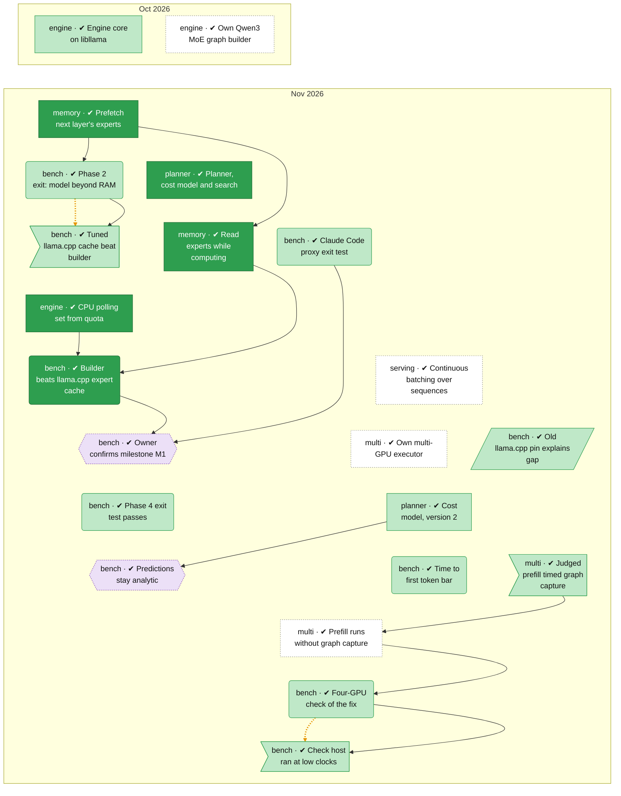

# Roadmap

Everything between the GENERATED markers is rebuilt from `roadmap/nodes.yaml`; edit that file, not the regions. Text outside the markers is kept.

## Legend

```mermaid
flowchart TB
    %% legend
    subgraph lg_g0["Done: colour is the rating"]
        direction LR
        lg_s0["✔ very successful"]
        lg_s1["✔ successful, or fixed"]
        lg_s2["✔ mixed"]
        lg_s3["✔ bad (regression)"]
        lg_s4["✔ done, not rated"]
    end
    subgraph lg_g1["Closed"]
        direction LR
        lg_s5["✖ dead end"]
        lg_s6["↷ superseded"]
    end
    subgraph lg_g2["Open: colour is the state"]
        direction LR
        lg_s7["▶ in progress"]
        lg_s8["⏳ built, waiting"]
        lg_s9["○ next"]
        lg_s10["⛔ blocked"]
        lg_s11["⏸ parked"]
        lg_s12>"⚠ open, never rated"]
    end
    subgraph lg_shape["Shape: kind"]
        direction LR
        lg_k0["○ feature"]
        lg_k1[/"○ experiment"/]
        lg_k2("○ session")
        lg_k3["○ refactor"]
        lg_k4["○ tooling"]
        lg_k5>"⚠ defect"]
        lg_k6{{"○ owner-decision<br/>(open, not drawn)"}}
        lg_k7{{"✔ owner-decision<br/>(decided)"}}
    end
    subgraph lg_edge["Arrow (in the trees every arrow points down, forward in time)"]
        direction LR
        lg_e0a["prerequisite"]
        lg_e0b["depends on it"]
        lg_e1a["old design"]
        lg_e1b["replaced by"]
        lg_e2a["rated node"]
        lg_e2b["qualified by a later finding"]
    end
    lg_g0 ~~~ lg_g1 ~~~ lg_g2 ~~~ lg_shape ~~~ lg_edge
    lg_e0a --> lg_e0b
    lg_e1a -.-> lg_e1b
    lg_e2a -.-> lg_e2b
    linkStyle 6 stroke:#e69500,stroke-width:3px,stroke-dasharray:2 3
    classDef vsucc fill:#2e9e4f,stroke:#1b6b34,color:#fff
    classDef succ fill:#bfe8c8,stroke:#2e9e4f,color:#111
    classDef mixed fill:#ffd37a,stroke:#c98a00,color:#111
    classDef bad fill:#f28b82,stroke:#b3261e,color:#111
    classDef dead fill:#e6e6e6,stroke:#777,stroke-dasharray:5 5,color:#555
    classDef inprog fill:#a8cdf5,stroke:#1f6fc5,color:#111
    classDef next fill:#fff,stroke:#333,color:#111
    classDef blocked fill:#fff,stroke:#b3261e,stroke-dasharray:2 2,color:#111
    classDef parked fill:#f3f3f3,stroke:#999,color:#555
    classDef unrated fill:#fff,stroke:#333,stroke-dasharray:1 3,color:#111
    classDef gate fill:#d9c2f0,stroke:#7b3fb5,color:#111
    classDef decided fill:#ece0f7,stroke:#7b3fb5,stroke-dasharray:2 2,color:#111
    classDef finding fill:#ffe0b2,stroke:#d84315,stroke-width:2px,color:#111
    classDef waiting fill:#e3f2fd,stroke:#1f6fc5,stroke-dasharray:5 5,color:#111
    class lg_s0 vsucc
    class lg_s1 succ
    class lg_s2 mixed
    class lg_s3 bad
    class lg_s4 unrated
    class lg_s5,lg_s6 dead
    class lg_s7 inprog
    class lg_s8 waiting
    class lg_s9,lg_k0,lg_k1,lg_k2,lg_k3,lg_k4,lg_e0a,lg_e0b,lg_e1a,lg_e1b,lg_e2a,lg_e2b next
    class lg_s10 blocked
    class lg_s11 parked
    class lg_s12,lg_k5 finding
    class lg_k6 gate
    class lg_k7 decided
```

<!-- BEGIN GENERATED: legend -->

Owner calls are the purple shape. A decided owner call is drawn in the overview only, never in the track trees; an open one is listed under *Waiting on the owner*. The prefix on an overview box is its track. A prerequisite implied by a longer chain is not drawn; the node tables keep every edge.
<!-- END GENERATED: legend -->

## Ratings

<!-- BEGIN GENERATED: ratings -->
0 of 32 rated nodes are confirmed by the owner.

Not yet confirmed: `engine-libllama`, `engine-overflow-passes`, `engine-cpu-poll`, `memory-pair-groups`, `memory-prefetch`, `memory-conversion`, `memory-io-service`, `memory-low-bit-kv`, `memory-ram-freq`, `memory-ram-pool`, `memory-adaptive-tier`, `planner-quality`, `planner-core`, `planner-exit`, `planner-detector`, `planner-cost-v2`, `planner-cost-v4`, `multi-decode-toggles`, `serving-speculative`, `serving-kv-layout`, `serving-c4-gap`, `serving-prefix-save`, `bench-phase2-exit`, `bench-m1-point1`, `bench-m1-point3`, `bench-phase3b-proxy`, `bench-d2a-rerun`, `bench-pin-ab`, `bench-phase4-exit`, `bench-ttft`, `bench-s2-step0`, `bench-s3f2`.
<!-- END GENERATED: ratings -->

## Overview

<!-- BEGIN GENERATED: overview -->

<!-- END GENERATED: overview -->

## In plain words

<!-- BEGIN GENERATED: plain-words -->
| title | status | in plain words |
|---|---|---|
| Engine core on libllama | ✔ done · successful | Phase 1: Rust drives llama.cpp's library (libllama) for dense models; the exit test asks for prompt and generation speed within 5% of llama.cpp. |
| Own Qwen3 MoE graph builder | ✔ done · unrated | Tetraeder builds the compute graph of the Qwen3 mixture-of-experts (MoE) model itself in Rust, one segment per MoE layer, so it can place and stream experts on its own. |
| CPU polling set from quota | ✔ done · very-successful | Rented boxes limit CPU time by a container quota; busy-polling worker threads burned that quota and got throttled. Turning polling off under a quota removed the throttling and sped up decode. |
| Prefetch next layer's experts | ✔ done · very-successful | While one layer computes, predict which experts the next layer will need and start reading them early. |
| Read experts while computing | ✔ done · very-successful | An I/O service reads missing experts in the background and computes experts in the order they arrive, so disk reads overlap compute; on by default in serve. |
| Planner, cost model and search | ✔ done · very-successful | Phase 3a: the planner enumerates candidate placements, prices each with a cost model calibrated on the machine, and explains, diffs and answers what-if questions. |
| Cost model, version 2 | ✔ done · successful | Version 2 prices experts, the output head, all-reduce latency and pipelined prefill separately; on a two-GPU rehearsal every candidate came within the 15% the Phase 5 test allows. |
| Price decode at measured clocks | ○ next | A GPU kept partly idle by a layer split runs at a lower clock than one GPU alone, so the 30B four-way layer split decodes slower than predicted wherever the single GPU boosts; the cost model has to price decode at the clock each layout actually gets. |
| Prefill runs without graph capture | ✔ done · unrated | Every judged prefill had timed the call in which ggml records a CUDA graph, which serialized the pipeline stages; prefill steps now run directly and decode keeps graph replay. |
| Own multi-GPU executor | ✔ done · unrated | Phase 5: Tetraeder runs its own executor instead of ggml's backend scheduler: one program per GPU (rank), NCCL collectives, and the engine in a worker process. |
| Judged prefill timed graph capture | ✔ fixed | ggml-cuda records a CUDA graph on a range's second call; every judged prefill timed that recording call, which with an NCCL kernel pending serialized the pipeline stages, so earlier prefill verdicts measured a slow state serving never sees. |
| Accept the prefill capture fix | ○ next | ADR 0081 is Proposed; its GPU test and the s3f2 confirmation passed, so it waits for the owner's acceptance. |
| Continuous batching over sequences | ✔ done · unrated | Phase 4: the scheduler admits and retires requests every step and decodes several sequences in one batched step, on libllama and the own builders. |
| Phase 2 exit: model beyond RAM | ✔ done · successful ⚠ | Qwen3-235B, larger than the box's RAM, against the best tuned baselines: the builder passed the Phase 2 exit at decode parity with KTransformers. |
| Tuned llama.cpp cache beat builder | ✔ fixed | The Phase 2 verdict never measured llama.cpp's own expert cache (--moe-cache-mib) as a baseline; once added, and after M1 was first declared on 2026-11-10, the cache tuned to share 0.95 led the builder, so the Phase 2 verdict's point 1 reopened and M1 waited for new sessions. |
| Builder beats llama.cpp expert cache | ✔ done · very-successful | M1 point 1: the builder against llama.cpp's expert cache at its best share, in clean paired sessions on two hosts; many attempts were void (OOM, slow disk, co-tenants, thrash). |
| Claude Code proxy exit test | ✔ done · successful | Phase 3b exit: Claude Code works through Tetraeder's gateway for a few hours, solving at least as many tasks and reusing as much prompt cache as llama-server. |
| Owner confirms milestone M1 | ✔ done · n/a | M1 (one machine, MVP) is reached: the owner counted the builder with free VRAM filled with expert slots as its configuration against KTransformers. |
| Old llama.cpp pin explains gap | ✔ done · successful | A/B of llama.cpp versions on one box: part of the concurrency-4 gap was the older pinned version, so moving the pin went onto the critical path before the verdict. |
| Phase 4 exit test passes | ✔ done · successful | Phase 4 verdict of record: throughput at one and four concurrent requests at least llama-server's on the 8B dense and 30B MoE, and prefix reuse cuts time to first token on a Claude Code replay. |
| Time to first token bar | ✔ done · successful | Time to first token (TTFT) on the Claude Code replay against llama-server: median and p90 at most 1.15x and saves at most 10% of TTFT; met after seven replays and fixes. |
| Predictions stay analytic | ✔ done · n/a | ADR 0076 proposed judging predictions from lines fitted to runs of each candidate; the owner kept the 15% test on the planner's analytic predictions made before the candidates run. |
| Four-GPU check of the fix | ✔ done · successful ⚠ | With prefill run without graph capture, one round of every four-GPU candidate stayed within 15%; the first attempt (s3f) stopped at a gate. |
| Check host ran at low clocks | ✔ fixed | The s3f2 host held every GPU at 1590 MHz all session, single GPU included, so its layer-4 decode result (0.995) does not show the earlier layer-split decode miss fixed; cost model version 5 is back on. |
| Two-GPU verdict session | ▶ in progress | The judged Phase 5 session on two GPUs (cases D2 and M2): every candidate within 15% of its prediction and the pick in the winner set, two clean rounds each. |
| Admission probe on final main | ○ next | The admission path changed after the Phase 4 verdict commit, so one D2a run on final main confirms the Phase 4 result still holds before M2 is reported. |
| Four-GPU verdict, first box | ⛔ blocked | The judged session on four GPUs (cases D4 and M4) on a host other than 20210, run alone; the owner allowed one box up to 1.70 USD/h for it. |
| Four-GPU verdict, second box | ⛔ blocked | The second four-GPU session, so every configuration has two clean rounds on a clean host. |
| Report milestone M2 | ⛔ blocked | M2 ends Phase 5: the owner judges the verdicts together with the list of rule changes made after failed sessions (docs/notes/phase5-rule-changes.md). |
<!-- END GENERATED: plain-words -->

## Ready now

<!-- BEGIN GENERATED: ready-now -->
**local**

- `planner-cost-model-v5`: Price decode at measured clocks

**box**

- `bench-d2a-probe`: Admission probe on final main
<!-- END GENERATED: ready-now -->

## Running

<!-- BEGIN GENERATED: running -->
**box**

- `bench-v2-verdict`: Two-GPU verdict session
<!-- END GENERATED: running -->

## Built, waiting

<!-- BEGIN GENERATED: built-waiting -->
_None._
<!-- END GENERATED: built-waiting -->

## Waiting on the owner

<!-- BEGIN GENERATED: waiting-on-owner -->
- `multi-accept-adr-0081`: Accept the prefill capture fix
- `bench-m2-report`: Report milestone M2
<!-- END GENERATED: waiting-on-owner -->

## Queue

<!-- BEGIN GENERATED: queue -->
1. `bench-v2-verdict`: Two-GPU verdict session
2. `bench-d2a-probe`: Admission probe on final main
3. `bench-v4a-verdict`: Four-GPU verdict, first box
4. `bench-v4b-verdict`: Four-GPU verdict, second box
<!-- END GENERATED: queue -->

## Timeline

<!-- BEGIN GENERATED: timeline -->
[The timeline](roadmap/timeline.md) shows every dated node as a bar from its start to its end.

Generated on 2026-11-20.
<!-- END GENERATED: timeline -->

## Done, by month

<!-- BEGIN GENERATED: done-by-month -->

<b>Nov 2026</b>: 80 done, 2 abandoned

- `engine-overflow-passes`: Extra passes for overflow experts (↷ superseded). When a token needs more experts than there are GPU slots, run extra exact passes; bitwise correct, but replaced two days later by expert pair groups.
  - Exact overflow passes (ADR 0034) (2026-11-01)
- `memory-pair-groups`: Expert pair groups, CPU experts (✔ done · mixed). Experts missing from GPU slots run on the CPU in groups instead of extra GPU passes; correct on the GPU run, but the CPU path was slow at first.
  - Expert pair groups and CPU experts (ADR 0035) (2026-11-01)
  - On-demand expert upload too slow, move to CPU experts (2026-11-01)
- `engine-cpu-threadpool`: One CPU threadpool, one step graph (✔ done · unrated). CPU work shares one threadpool and a fully resident step runs as one graph, which fixed a CPU path that got slower with more threads; ADR 0039 kept CPU expert weights unrepacked for now.
  - CPU speed: one threadpool and one-graph resident step (ADR 0036) (2026-11-01)
  - CUDA topk-moe fusion fix for the one-graph step (2026-11-01)
  - ADR 0039: no AVX2 repack of builder CPU weights (2026-11-02)
- `engine-cuda-graphs`: Decode replays CUDA graphs (✔ done · unrated). The builder's decode step had never used CUDA graphs (recorded GPU work replayed with little CPU overhead); step graphs are now reused so ggml can capture and replay them.
  - CUDA graph replay via set_rows and step graph reuse (2026-11-02)
- `memory-conversion`: Convert formats at load time (✔ done · very-successful). Weights are converted to the format the plan picks per tensor role when loading, with a disk cache; the converter is faster than llama.cpp's and byte-identical.
  - Formats per role and load-time conversion cache (ADR 0041/0047) (2026-11-03)
  - Quality profiles and conversion speed on 8B and 30B (box rounds) (2026-11-03)
- `memory-prefetch`: Prefetch next layer's experts (✔ done · very-successful). While one layer computes, predict which experts the next layer will need and start reading them early.
  - Predicted next-layer expert prefetch (ADR 0038) (2026-11-02)
  - Prefetch levers and default on (ADR 0038) (2026-11-03)
- `memory-tiers`: Memory tiers and expert slots (✔ done · unrated). Per-device memory arenas, a cache of expert slots on the GPU, a RAM tier and direct disk reads, so a MoE model larger than RAM can run with experts streamed in.
  - Memory arenas, expert slot cache and RAM tier (2026-10-31)
  - Lessons from a 125B MoE tuning log (2026-10-31)
  - Phase 2 exit prep: split GGUF, byte-budget slot tiers, miss reads (ADR 0037) (2026-11-01)
  - Dio test ranges (2026-11-03)
- `planner-core`: Planner, cost model and search (✔ done · very-successful). Phase 3a: the planner enumerates candidate placements, prices each with a cost model calibrated on the machine, and explains, diffs and answers what-if questions.
  - Phase 3a planner, cost model, detector and replanner (ADRs 0040-0042) (2026-11-03)
  - Planner search, explain, diff and what-if (2026-11-03)
- `serving-real-engines`: Real engines behind the gateway (✔ done · unrated). The gateway serves real models through libllama and the MoE builder, with an SDK conformance suite and paired runs against llama-server.
  - Lenient Anthropic input in the gateway (2026-11-03)
  - Phase 3b: real engines behind the gateway (ADR 0046) (2026-11-03)
  - Phase 3b gateway exit run on RTX 3090 (2026-11-03)
- `serving-speculative`: Speculative decoding (✔ done · mixed). A cheap drafter guesses several tokens and the model checks them in one step; exact, but slower on the 235B with streamed experts until an op-offload fix, rerun still open.
  - Op offload gated by step tokens (ADR 0044) (2026-11-03)
  - Speculative decoding in the scheduler (ADR 0043) (2026-11-03)
  - Speculation results on the 235B (ADR 0043) (2026-11-03)
- `engine-iqk-kernels`: Faster AVX-512 decode kernels (✔ done · unrated). AVX-512 VNNI kernels for 4- and 6-bit weights taken from ik_llama.cpp, as ggml patch 0002, to close the CPU decode gap.
  - iqk AVX-512 VNNI Q4_K/Q6_K decode kernels as patch 0002 (ADR 0053) (2026-11-09)
- `engine-isa-dispatch`: Pick CPU kernels at run time (✔ done · unrated). One binary carries CPU kernels for several instruction sets (AVX2, AVX-512) and picks the best at start, as a ggml patch (patch 0001).
  - Runtime CPU ISA dispatch (ADR 0052, patch 0001) (2026-11-09)
- `engine-kt-gap`: Find the gap to KTransformers (✔ done · unrated). Diagnosis of why the builder decoded slower than KTransformers (another engine for MoE models on CPU plus GPU) on some CPUs, and fixes for the decode gap found on an RTX A6000 box.
  - KTransformers decode gap and 235B logit offset (ADR 0045 addendum) (2026-11-03)
  - KTransformers decode design read from source (2026-11-08)
  - A6000 decode gap fixes and decode profile (2026-11-09)
  - Diagnose the KTransformers decode gap (2026-11-09)
- `bench-phase2-exit`: Phase 2 exit: model beyond RAM (✔ done · successful). Qwen3-235B, larger than the box's RAM, against the best tuned baselines: the builder passed the Phase 2 exit at decode parity with KTransformers.
  - Phase 2 exit run: Qwen3-235B (2026-11-02)
  - Phase 2 exit runs and verdict (ADR 0045) (2026-11-03)
  - b1c quota-tight pair and Phase 2 verdict with CPU matched (2026-11-10)
  - b1-exit session on box 60042169 and Phase 2 verdict (2026-11-10)
- `memory-low-bit-kv`: Low-bit KV cache per layer (✔ done · successful). The KV cache (the stored attention keys and values) can use fewer bits per attention layer; the quality gate first failed, then was fixed to score unseen text and the cost above the unquantized floor.
  - KV Hadamard rotation for a quantized KV cache (ADR 0050 addendum) (2026-11-09)
  - Low-bit KV per attention unit (ADR 0050 b) (2026-11-09)
  - b2-proxy rerun on box 60050186 after ADR 0057 (2026-11-10)
  - kv-quality scored a verbatim repeat at 32K; now scores unseen text (2026-11-10)
  - kv-quality gates on cost above the F16-with-rotation floor (2026-11-10)
  - b2-proxy on box 59998776 (A6000): proxy parity, kv-quality fails at 8K (2026-11-10)
- `planner-exit`: Planner exit test (✔ done · successful). The planner's predicted ranking against measured runs of 24 candidates on a box: its pick was the real best (regret 0) and the ranks agreed.
  - Phase 3a planner exit test on measured MoE and dense fixtures (ADR 0040) (2026-11-03)
  - b3-planner session on box 59977867: dense exit test (2026-11-10)
- `planner-quality`: Quality profile per tensor (✔ done · successful). A measured profile of how much each tensor loses at each bit width lets the planner mix formats; at the same bytes the mix beats llama.cpp's presets and ik_llama.cpp's types.
  - Design: per-unit quantization and quality profiles (2026-10-29)
  - Quality profile, log-power correction and mix at budget (ADR 0040/0048) (2026-11-09)
  - Importance-matrix quantization deferred until after M1 (2026-11-09)
  - Phase 3a profile mix vs ik_llama IQ4_KS and IQ4_K on Qwen3-8B (2026-11-10)
- `planner-tier-cost`: Disk cost and virtual clock (✔ done · unrated). The cost model learns a disk and tier term, keeps a ledger of calibration runs, and replays plans on a virtual clock so tests run fast.
  - ADR 0056 cost model design: tier and disk term, virtual clock, ledger (2026-11-09)
  - ADR 0056 parts A-C: calibration ledger, tier term, replay output (2026-11-09)
  - ADR 0056 parts D-F: virtual-clock replay, replanner clock, box stages (2026-11-09)
  - Cost model predicted different RAM-tier sizes as equal (2026-11-09)
  - ADR 0056 parts D-F: virtual clock, replan clock, restart cut wait (2026-11-10)
- `bench-noise-bands`: Measured noise bands per GPU (✔ done · unrated). Same-engine A/A pairs measure how much a GPU class varies run to run; verdicts and regressions are judged beyond that band.
  - Weekly GPU smoke profile with measured noise bands (2026-11-09)
  - Measured noise bands from the 20261110 A/A pairs (2026-11-11)
- `bench-owner-proxy-rules`: Owner sets proxy test rules (✔ done · n/a). The owner chose a few-hour Claude Code proxy run instead of a week of use, and later ruled the tasks clause means no worse beyond the run-to-run spread, and that slow disks are a scope limit, not a failed result.
  - Shorter Claude Code proxy run instead of a week-long test (2026-11-03)
  - Owner decisions on the tasks clause and slow disks (2026-11-11)
- `bench-phase3b-proxy`: Claude Code proxy exit test (✔ done · successful). Phase 3b exit: Claude Code works through Tetraeder's gateway for a few hours, solving at least as many tasks and reusing as much prompt cache as llama-server.
  - Claude Code proxy kit and run on RTX A6000 (2026-11-03)
  - B2 proxy box session could not rent a 48 GB GPU (2026-11-09)
  - Phase 3b proxy rerun 4 on box 60067423 without the billing header (2026-11-10)
  - Phase 3b proxy rerun 20261111d on box 60205005 (A6000) (2026-11-11)
- `memory-io-service`: Read experts while computing (✔ done · very-successful). An I/O service reads missing experts in the background and computes experts in the order they arrive, so disk reads overlap compute; on by default in serve.
  - ADR 0050 decode levers and briefs (2026-11-09)
  - I/O service and arrival-order expert compute (ADR 0054) (2026-11-09)
  - b1b-levers session on box 60057461 (ADR 0054 levers) (2026-11-10)
  - serve: prefetch, io-service and overlap on by default with a RAM tier (2026-11-10)
  - Hidden share: urgent_first option and read-wait split by class (2026-11-11)
- `serving-tool-calls`: Repair and count tool calls (✔ done · unrated). The gateway repairs malformed tool calls Qwen models emit (empty calls, Python-literal arguments, a missing opening tag) and counts each outcome per request.
  - Gateway tool-call outcomes and empty-call repair (ADR 0051) (2026-11-09)
  - Qwen3-Coder Python-literal tool arguments typed per schema (ADR 0057) (2026-11-10)
  - Phase 3b proxy gaps: Qwen XML call without opener, tool-error classes (2026-11-11)
  - Tool-call outcome counts in request log and proxy summary (2026-11-11)
- `bench-defect-tuned-cache`: Tuned llama.cpp cache beat builder (✔ fixed). The Phase 2 verdict never measured llama.cpp's own expert cache (--moe-cache-mib) as a baseline; once added, and after M1 was first declared on 2026-11-10, the cache tuned to share 0.95 led the builder, so the Phase 2 verdict's point 1 reopened and M1 waited for new sessions.
  - Phase 2 verdict missed llama.cpp's expert cache baseline (2026-11-05)
  - m1-open: M1 declared reached on 2026-11-10 (2026-11-10)
  - m1-open: points awaiting the owner, M1 not declared (2026-11-12)
  - Session 20261112a: builder vs llama.cpp cache at share 0.95 (2026-11-12)
- `memory-adaptive-tier`: Admit CPU misses into VRAM (✔ done · mixed). During decode, copy a share of experts that ran on the CPU into GPU slots; it worked as designed, but the uploads cost more than they saved, so it stays off.
  - Async admission uploads (ADR 0059 addendum) (2026-11-12)
  - Session 20261112c: adaptive tier at 0.1 loses to its uploads (2026-11-12)
  - Adaptive compute tier: decode admits CPU misses into VRAM slots (ADR 0059) (2026-11-12)
- `memory-ram-freq`: Keep most-used experts in RAM (✔ done · mixed). Record which experts a real workload routes to and pin the most used ones in the RAM tier; judged on a replay of the routing trace, built but off by default.
  - Routing trace recorder and RAM-tier replay scorer (ADR 0050 c) (2026-11-09)
  - ram_policy freq: pin the most routed RAM experts (2026-11-12)
  - Replay of VRAM-tier policies (static, prefill, lru, freq) (2026-11-12)
- `planner-detector`: Bottleneck detector (✔ done · successful). Names the bottleneck of a running setup (paging, disk, CPU quota throttling and others) from its metrics; passed its exit test on real injected faults.
  - Detector campaign scorer and CI exit test (2026-11-09)
  - Nightly fault testbed and swapping detector (ADR 0041 addendum) (2026-11-09)
  - Fault testbed finds detector gaps the simulator hid (2026-11-09)
  - b3-detector session on box 59978288: detector exit test (2026-11-10)
  - cpu_quota_throttle fault class and testbed injection (ADR 0062) (2026-11-12)
- `planner-replan`: Replan while serving (✔ done · unrated). When latency goals are missed, serve drains, switches to a new plan and restarts (drain and restart replanning).
  - Replanning wired into serve (ADR 0055) (2026-11-09)
  - Replan engine test flake fixes (2026-11-12)
- `bench-m1-point1`: Builder beats llama.cpp expert cache (✔ done · very-successful). M1 point 1: the builder against llama.cpp's expert cache at its best share, in clean paired sessions on two hosts; many attempts were void (OOM, slow disk, co-tenants, thrash).
  - AVX2 closing run 20261110f against the llama.cpp expert cache (2026-11-10)
  - Session 20261111g: tuner timed out, cache share 0.5 pairs (2026-11-11)
  - Session 20261111e stopped at the disk gate (2026-11-11)
  - Session 20261111c: tuner OOM, cache at share 0.5 (2026-11-11)
  - llama.cpp tuner infeasible on the 235B (2026-11-11)
  - Session 20261112g: co-tenant guard, inconclusive pairing (2026-11-12)
  - Builder CPU compute variance across sessions unexplained (2026-11-12)
  - Session 20261112f invalid: RAM balloon OOM-killed (2026-11-12)
  - Session 20261111h: builder vs cache share sweep (2026-11-12)
  - Session 20261113c: dio server OOM under the balloon (2026-11-13)
  - Session 20261113b: builder vs cache at poll 0, point 1 met (2026-11-13)
  - Session 20261113a: builder vs untuned cache (2026-11-13)
  - Session 20261113g: cache thrashed under 91 GB cgroup (2026-11-13)
  - Session 20261113k: point 1 confirmed on a second host (2026-11-13)
  - Session 20261113f never started: three boxes failed (2026-11-13)
- `ops-owner-caps`: Owner raises box price caps (✔ done · n/a). The owner raised the per-box and account price caps for rented GPU boxes, which allowed larger boxes and two at once.
  - Box price caps raised for the proxy session and account (2026-11-09)
  - Box price caps raised (2026-11-13)
- `bench-m1-point3`: Builder against KTransformers, AVX-512 (✔ done · very-successful). M1 point 3: on AVX-512 CPUs KTransformers led until the builder filled free VRAM with expert slots; on a 24 GB card with no free VRAM the two tie.
  - AVX-512 attempt 20261110h, KT server never came up (2026-11-10)
  - AVX-512 closing run blocked: no AVX-512 RTX 3090 offer (2026-11-10)
  - Session 20261111b: AVX-512 repeat on a slow disk (2026-11-11)
  - Session 20261111a: AVX-512 overlap vs KTransformers, M1 reached (2026-11-11)
  - Session 20261113h: KT cannot run on Blackwell (2026-11-13)
  - Session 20261113e aborted: slow push and download (2026-11-13)
  - Session 20261113d: AVX-512 AMX, no point-3 verdict (2026-11-13)
  - Point-3 attempt on host 109790 stuck loading twice (2026-11-13)
  - M1 point 3 session 20261113o: builder against KTransformers (2026-11-14)
  - M1 point 3 sessions 20261114 and 20261114b: vramfill and poll 50 arms (2026-11-14)
- `bench-owner-m1`: Owner confirms milestone M1 (✔ done · n/a). M1 (one machine, MVP) is reached: the owner counted the builder with free VRAM filled with expert slots as its configuration against KTransformers.
  - Owner decision: M1 reached, vramfill counts as the builder configuration (2026-11-14)
- `engine-decode-dispatch`: Fewer graph dispatches per token (✔ done · unrated). Cuts the fixed cost of launching many small graph segments per decoded token; steps 0 and 1 built, the floor measured on a CI runner.
  - ADR 0064 decode dispatch: segment scheduler and one graph per token (2026-11-12)
  - Dispatch floor on the CI runner (ADR 0064) (2026-11-14)
- `memory-ram-pool`: Share RAM slots across layers (✖ dead end). One RAM expert pool shared by all layers instead of one per layer; the replay gain stayed under the bar set before measuring, so it was not built.
  - RAM-tier policies across layers in the replay (ADR 0050 c) (2026-11-14)
- `ops-telemetry`: Box and host metrics (✔ done · unrated). Box and host samplers export through the same OpenTelemetry path as the engine (OpenTelemetry: the standard metrics and traces format), plus request metrics and tier transfer counters.
  - Tier transfer metrics and GenAI semconv names (ADR 0063) (2026-11-12)
  - engine_sample CPU attribution and thread clamp (2026-11-12)
  - Box and host metrics as OTel metrics (ADR 0060) (2026-11-12)
  - OTLP box files compressed with zstd (2026-11-13)
  - Decode stall investigation (ADR 0060 addendum) (2026-11-14)
- `bench-harness`: Paired benchmark harness, baselines (✔ done · unrated). Runs Tetraeder and baseline engines (llama.cpp with its expert cache, ik_llama.cpp, KTransformers, Colibri) in interleaved pairs on one box with the same threads, quality gate and decode I/O attribution.
  - Diagnosis of slow CPU pairs and noisy GPU pairs (2026-10-30)
  - Bench harness: quality gate, equal threads, ABBA order (2026-10-31)
  - Nightly 20261031 on RTX 3090 (2026-10-31)
  - Box -ot pairs and exit-regime numbers (2026-11-01)
  - GPU run prep and 2026-11-01 RTX 3090 run (2026-11-01)
  - ik_llama.cpp as second baseline engine (2026-11-02)
  - Bench pairing: one CPU thread count for both engines (2026-11-02)
  - Colibri as an exit-run baseline (2026-11-02)
  - Baseline build with MoE cache and resume plan baselines (2026-11-09)
  - Decode I/O attribution: per-window bytes per token and io_class (ADR 0058) (2026-11-11)
  - Baseline pin b12274: llama.cpp FP8 KV cache (2026-11-12)
  - Exit harness multi-arm mode with KV snapshot (2026-11-12)
  - KT baseline: real kt-kernel variant names and build gate (2026-11-13)
  - FP8 KV cache baseline: pin check and notes (2026-11-15)
- `engine-cpu-poll`: CPU polling set from quota (✔ done · very-successful). Rented boxes limit CPU time by a container quota; busy-polling worker threads burned that quota and got throttled. Turning polling off under a quota removed the throttling and sped up decode.
  - CI poll bench for ggml polling under a CPU quota (ADR 0061) (2026-11-12)
  - CPU threadpool polling chosen from the cgroup quota (ADR 0061 phase 2) (2026-11-12)
  - pool_pause: pause CPU threadpool in GPU-only segments (2026-11-12)
  - Session 20261112e levers: poll 0 removes throttling, 1.30x decode (2026-11-12)
  - RAM tier huge pages A/B switch (ADR 0035 addendum) (2026-11-12)
  - Point-1 class session 20261115p1 on EPYC 7702 and RTX 4090 (2026-11-15)
- `ops-owner-4gpu-cap`: Owner allows dearer four-GPU boxes (✔ done · n/a). Phase 5 needs four-GPU boxes, which cost more than the standing cap; the owner allowed up to 1.20 USD/h for those.
  - Owner decision: 4-GPU boxes may cost up to 1.20 USD per hour (2026-11-15)
- `planner-fill-tier`: Fill free VRAM with experts (✔ done · unrated). The planner offers the largest number of GPU expert slots that fits in free VRAM; this vramfill setting is the builder configuration the owner counted for M1.
  - Planner fill tier (largest VRAM slot count that fits) (2026-11-15)
- `serving-batching`: Continuous batching over sequences (✔ done · unrated). Phase 4: the scheduler admits and retires requests every step and decodes several sequences in one batched step, on libllama and the own builders.
  - BatchBackend trait and step planner (C2a) (2026-11-14)
  - Continuous batching loop and multi-sequence libllama (C2b) (2026-11-14)
  - Phase 4 design: ADRs 0065 to 0067 and settled points (2026-11-14)
  - Review fixes after C2b, C3b, C4 and C5 (2026-11-15)
- `serving-prefix-cache`: Prefix cache in host RAM (✔ done · unrated). Saved model state for earlier prompts is kept in RAM, so a request that starts with a known prefix skips recomputing it; later also reused from running sequences.
  - Multi-entry prefix cache in host RAM (ADR 0049) (2026-11-03)
  - C3b: prefix reuse from busy sequences (2026-11-15)
- `bench-d2a-rerun`: First throughput check misses (✔ done · mixed). The throughput half of Phase 4 (D2a) on one RTX 3090: parity closed on both models, but four concurrent requests still trailed llama-server.
  - D2a rerun session 20261116d2a2 and dense-regress tooling (2026-11-16)
- `bench-phase4-harness`: Phase 4 verdict harness (✔ done · unrated). The box script and summary that judge Phase 4 (throughput pairs and time to first token on a Claude Code replay), with a CPU rehearsal workflow.
  - Phase 4 CPU rehearsal workflow (2026-11-15)
  - Phase 4 verdict harness and its gates (2026-11-16)
- `bench-pin-ab`: Old llama.cpp pin explains gap (✔ done · successful). A/B of llama.cpp versions on one box: part of the concurrency-4 gap was the older pinned version, so moving the pin went onto the critical path before the verdict.
  - Pin A/B: llama-server b12426 against b11976 (2026-11-16)
- `engine-dense-builder`: Own Qwen3 dense builder (✔ done · unrated). Phase 4: Tetraeder's own graph builder for dense Qwen3 models (the judged path of the Phase 4 test), sharing one attention module with the MoE builder and matching libllama's logits.
  - Shared attention module for dense and MoE builders (C1.5) (2026-11-14)
  - Qwen3 dense builder and DenseBackend (C5) (2026-11-15)
  - Dense builder: per-sequence attention and extra buffer types (ADR 0072) (2026-11-16)
- `multi-executor`: Own multi-GPU executor (✔ done · unrated). Phase 5: Tetraeder runs its own executor instead of ggml's backend scheduler: one program per GPU (rank), NCCL collectives, and the engine in a worker process.
  - Phase 5 design: verdict rules, own executor, parallel shapes (ADRs 0068 to 0070) (2026-11-15)
  - Phase 5 E1: ggml-sys executor bindings and NCCL build (2026-11-15)
  - Phase 5 E5: executor core, fallback all-reduce and comm-probe (2026-11-16)
  - Phase 5 E9: worker process behind RemoteBackend (2026-11-16)
- `multi-sharded`: Split models across GPUs (✔ done · unrated). The dense and MoE builders load weights and KV per GPU for tensor, pipeline and expert parallel; a CUDA patch lets an expert id of -1 mean no expert.
  - Phase 5 E4: CUDA mul_mat_id skips expert id -1 (patch 0004) (2026-11-16)
  - Phase 5 E6: sharded dense builder on the executor (2026-11-16)
  - Phase 5 E7: sharded resident MoE builder (2026-11-16)
- `planner-parallel-shapes`: Plan tensor and expert parallel (✔ done · unrated). Phase 5: the planner enumerates multi-GPU shapes (layer split, tensor parallel, expert parallel, pipelines of tensor groups) and prices them.
  - Phase 5 E2: tensor and expert parallel shapes in the planner (2026-11-15)
  - Phase 5 E3: multi-GPU cost model and enumeration (2026-11-16)
  - Phase 5 S2 prep: plan hw, NVML and CLI tests (2026-11-16)
- `serving-c4-gap`: Close the four-request gap (✔ done · successful). At concurrency 4 (c4) Tetraeder trailed llama-server; a CPU loop bench found benchmark artifacts and one-prompt-per-step admission, fixed with a 2048-token step budget.
  - Loop-bench workflow: scheduler loop against llama-server on CPU (2026-11-15)
  - C4 gap diagnosis: decoders and prompt chunks as separate CPU calls (2026-11-15)
  - Scheduler step budget of 2048 tokens (2026-11-16)
- `serving-moe-batch`: MoE builder serves many requests (✔ done · unrated). The MoE builder becomes a native batch backend with the shared KV pool, so the streamed 30B MoE can serve four requests at once and count on the own builder.
  - MoE follow-ups: step graph cache, hot set, rollback via KvPool (2026-11-15)
  - C4: MoE builder as a native batch backend (2026-11-16)
  - MoE selects output rows before the last layer's FFN (2026-11-16)
- `serving-spec-batching`: Speculation in the batching loop (✔ done · unrated). serve --spec runs speculative decoding inside the continuous batching loop; self-speculation with a low-bit copy and MTP heads were parked until after the Phase 4 verdict.
  - Self-speculative decoding and MTP parked until after the Phase 4 verdict (2026-11-15)
  - Speculative decoding in the batching loop (serve --spec) (2026-11-16)
- `bench-phase4-exit`: Phase 4 exit test passes (✔ done · successful). Phase 4 verdict of record: throughput at one and four concurrent requests at least llama-server's on the 8B dense and 30B MoE, and prefix reuse cuts time to first token on a Claude Code replay.
  - Phase 4 exit test accepted (ADR 0065) (2026-11-17)
  - D2a throughput session 20261117k (2026-11-17)
  - D2b session 20261117l: TTFT reuse and Claude Code recording (2026-11-17)
  - Box 20261117c: crash fixed, GPU save not faster (2026-11-17)
  - Box 20261117d: gpu_kv_save passes with huge pages (2026-11-17)
  - Box 20261117e: kv-save2 and D2a (2026-11-17)
  - Box 20261117f partial (2026-11-17)
  - Box 20261117g attempt 1 partial (2026-11-17)
  - Box 20261117i aborted at throttle gate (2026-11-17)
- `bench-phase5-harness`: Phase 5 verdict harness and rules (✔ done · unrated). The Phase 5 rules, written before any Phase 5 code (pick in the measured winner set, every prediction within 15%), and the box script with its GPU parity gate.
  - Phase 5 E8: verdict harness and ADR 0068 as built (2026-11-16)
  - gpu-parity gate in the Phase 5 box harness (2026-11-17)
- `bench-pin-confirm`: CUDA check on the new pin (✔ done · unrated). GPU session on the new pin: parity held on real models, but the dense engine crashed at four requests (fixed by padding the attention mask to whole tiles).
  - Box 60983677: new llama.cpp version confirmed on real models, two bugs found (2026-11-16)
  - Pin confirm 20261116pc on CUDA at b12426 (2026-11-17)
  - Dense attention mask padded to whole 64-row tiles (2026-11-17)
- `engine-gpu-tolerance`: GPU parity anchored on libllama (✔ done · unrated). GPU logits never match the CPU bit for bit; the parity tests now allow the gap libllama itself shows between CUDA and CPU, relative to the logit scale.
  - GPU parity smoke boxes and relative CUDA tolerance (ADR 0071) (2026-11-16)
  - Real-model batched parity anchor on CUDA (gpu_real_batched) (2026-11-16)
  - MoE multi-seq GPU test anchored on libllama gap (ADR 0071) (2026-11-17)
- `multi-graph-views`: Let CUDA fuse inside ranges (✔ done · unrated). The executor's ranges (parts of a step between collectives) become views of one graph, so CUDA's operator fusion works inside them (patch 0005).
  - Executor ranges as graph views (patch 0005, ADR 0075) (2026-11-17)
- `bench-owner-analytic`: Predictions stay analytic (✔ done · n/a). ADR 0076 proposed judging predictions from lines fitted to runs of each candidate; the owner kept the 15% test on the planner's analytic predictions made before the candidates run.
  - ADR 0076 judged predictions from anchor lines, not adopted (2026-11-18)
- `bench-s2-step0`: Two-GPU executor check (✔ done · successful). Step 0 of Phase 5 on two RTX 3090s: the own tensor-parallel executor at or above llama.cpp's tensor split on both models, so no executor redesign; four sessions failed gates first.
  - S2 step-0 session on 2x RTX 3090 stops at gpu-parity gate (2026-11-17)
  - S2b step-0 session and fixes (2026-11-18)
  - S2c step-0 and MoE tp/ep anchor fix (2026-11-18)
  - S2d step-0 on 2x RTX 3090 (2026-11-18)
  - S2e step-0 and rehearsal (2026-11-18)
  - Calibrate without CPU compute (2026-11-18)
  - S2f rehearsal and step-0 (2026-11-18)
- `bench-throttle-rules`: Judge GPU throttling per run (✔ done · unrated). Rented GPUs throttle; a 1 Hz sampler judges each run's window, throttle shares are compared between rounds of one configuration, and every GPU must run at its default power limit.
  - Session GPU sampler and idle gate (ADR 0065, 0068) (2026-11-17)
  - Throttle shares per configuration across rounds (2026-11-18)
  - Power-limit gate at SSH (2026-11-18)
- `engine-pin-b12426`: Move to llama.cpp b12426 (✔ done · unrated). The engine is built on a pinned llama.cpp release; moving the pin from b11976 to b12426 picked up upstream speedups the baseline already had.
  - Engine pin move to llama.cpp b12426 (ADR 0073) (2026-11-16)
  - AVX2 batch drift diagnostics at the pin move (2026-11-16)
  - vendor/llama.cpp gitlink follows the pin (2026-11-18)
- `serving-kv-layout`: Chunked KV beats paged KV (✔ done · successful). Experiment for the KV cache layout: paged blocks saved memory but cost too much on reads, so each sequence keeps one contiguous chunk; paged was refuted at the threshold set beforehand.
  - KV layout experiment: chunked against paged (ADR 0067 step 1) (2026-11-14)
  - Lone request whose KV run cannot grow (ADR 0067) (2026-11-18)
- `bench-owner-15pct`: Keep 15% on every candidate (✔ done · n/a). After four-GPU misses the owner kept the 15% line on every candidate and had calibration gain recorded routing frequencies and four-GPU tensor-parallel anchors instead.
  - Routing frequencies, tp-4 anchor, pp-overlap stage (2026-11-19)
- `bench-s3-rehearsal`: Four-GPU rehearsals (✔ done · unrated). First four-GPU sessions on host 20210: all gates pass, the picks are right, but tensor-pipeline and expert-parallel predictions missed 15% and one GPU throttles thermally.
  - S3 first 4-GPU session (2026-11-19)
  - S3b 4-GPU rehearsal after pipeline fixes (2026-11-19)
- `bench-ttft`: Time to first token bar (✔ done · successful). Time to first token (TTFT) on the Claude Code replay against llama-server: median and p90 at most 1.15x and saves at most 10% of TTFT; met after seven replays and fixes.
  - TTFT diagnosis ttft-20261118 on Qwen3-8B (2026-11-18)
  - ttft2-20261118 check of the no-save rule (2026-11-18)
  - ttft3-20261118 check of the no-save rules (2026-11-19)
  - ttft4-20261119 free-slot check (2026-11-19)
  - ttft5-20261119 check of admission fixes (2026-11-19)
  - ttft6-20261119 with ADR 0079 and spares-off arm (2026-11-19)
  - ttft7-20261119: TTFT bar met (2026-11-19)
- `multi-decode-toggles`: Two decode speedups made default (✔ done · successful). Two executor options for layer-split decode (range ids for graph reuse, asynchronous inputs) met their keep rule and are on by default.
  - Layer-N decode toggles (ADR 0069, 0075) (2026-11-19)
  - S3c decode toggle check and 4-GPU rehearsal (2026-11-19)
- `multi-pipelined-prefill`: Pipelined prefill in micro-batches (✔ done · unrated). With layers split across GPUs, prompt processing is cut into micro-batches so all stages work at once (GPipe schedule), issued in llama.cpp's order, with splits balanced for it.
  - Pipelined layer-N prefill (ADR 0077) (2026-11-19)
  - GPipe issue order: later stages first (2026-11-19)
  - Layer split balances pipelined prefill (2026-11-19)
- `ops-ci`: CI and test infrastructure (✔ done · unrated). Builds and tests on Windows and Linux, CUDA compile jobs, sccache, per-OS golden outputs and required model and GPU tests; small fixes and cleanups are folded here.
  - CI and build fixes for CUDA, MSVC and Linux (2026-10-31)
  - Phase 2 cleanup (2026-11-03)
  - Test infra: sccache, required model and GPU tests (track aa) (2026-11-09)
  - Small items: planner, memory trace and builder fixes (track t) (2026-11-09)
  - CI follow-up: shared ggml build dir, per-OS goldens (2026-11-10)
  - gitattributes: every text file LF (2026-11-12)
  - cpu_bench read freed memory after its scheduler dropped (2026-11-13)
  - CI runner and workflow fixes (2026-11-16)
  - dense_serve test threads start together (2026-11-19)
- `ops-owner-accepts-adrs`: Owner accepts nine design records (✔ done · n/a). The owner moved nine Proposed ADRs (CPU dispatch, AVX-512 kernels, disk cost term, dense builder, KV layout, parallel shapes, GPU tolerance, engine pin, executor graph views) to Accepted.
  - Owner accepts ADRs 0052 to 0080 (2026-11-19)
- `planner-cost-v2`: Cost model, version 2 (✔ done · successful). Version 2 prices experts, the output head, all-reduce latency and pipelined prefill separately; on a two-GPU rehearsal every candidate came within the 15% the Phase 5 test allows.
  - Cost model v2 (ADR 0070) (2026-11-18)
  - S2g rehearsal with cost model v2 and pipelined prefill (2026-11-19)
- `planner-cost-v3`: Price all-reduce latency in steps (✔ done · unrated). Version 3 adds the latency of all-reduces (the sums tensor-parallel GPUs exchange every layer) inside a step, with calibration on four-GPU anchors.
  - Cost model v3 (ADR 0078) (2026-11-19)
- `planner-cost-v4`: Price routed expert traffic (✔ done · successful). Version 4 prices the activation bytes that expert parallel moves per routed expert, which brought the four-GPU expert-parallel prefill prediction close.
  - Cost model v4 and comm probe warm-up (ADR 0080) (2026-11-19)
- `serving-own-run-attention`: Long prompts attend their own run (✔ done · unrated). A step with a single input attends only over its own KV run instead of the masked shared pool, with the mask buffer reused, which sped up long-context prefill.
  - Long-context prefill: own-run attention, mask reuse (ADR 0079) (2026-11-19)
- `bench-defect-s3f2-clock`: Check host ran at low clocks (✔ fixed). The s3f2 host held every GPU at 1590 MHz all session, single GPU included, so its layer-4 decode result (0.995) does not show the earlier layer-split decode miss fixed; cost model version 5 is back on.
  - m2-plan: s3f2 layer-4 tg not fixed, v5 back before V4a (2026-11-20)
- `bench-s3f2`: Four-GPU check of the fix (✔ done · successful). With prefill run without graph capture, one round of every four-GPU candidate stayed within 15%; the first attempt (s3f) stopped at a gate.
  - S3f stopped at gate, ggml-sys capture test in gpu-parity (2026-11-20)
  - S3f2: ADR 0081 confirmed on 4 GPUs (2026-11-20)
- `multi-defect-capture`: Judged prefill timed graph capture (✔ fixed). ggml-cuda records a CUDA graph on a range's second call; every judged prefill timed that recording call, which with an NCCL kernel pending serialized the pipeline stages, so earlier prefill verdicts measured a slow state serving never sees.
  - S3d tp2-pp2 overlap probes and decode traces (2026-11-20)
  - S3e graph-state diagnostic (2026-11-20)
- `multi-prefill-no-capture`: Prefill runs without graph capture (✔ done · unrated). Every judged prefill had timed the call in which ggml records a CUDA graph, which serialized the pipeline stages; prefill steps now run directly and decode keeps graph replay.
  - Prefill without CUDA graph capture (patch 0006, ADR 0081) (2026-11-20)
- `ops-box-driver`: Box session scripts and rules (✔ done · unrated). The scripts and written rules a box session follows: stage budgets, abort gates, host skip list, resume after a dropped connection, keep a working box.
  - Box sessions B1 to B3 plan and script review fixes (2026-11-09)
  - Hold on starting new GPU box runs, then lifted (2026-11-09)
  - Box scripts without vendor git, box lib path, run headers (2026-11-10)
  - exit_run.sh sccache start fixes (2026-11-10)
  - exit_run.sh: cache stage budget and tuner on the 235B (2026-11-11)
  - Box harness wave 20261112: stage minutes, guards, fetch fixes (2026-11-13)
  - Box-driver policy: host skips, abort gates, machine choice (2026-11-13)
  - Box rehearsal CI job (2026-11-13)
  - Box tooling: session.sh budget and box-driver disk (2026-11-14)
  - Box-driver host skip list (2026-11-19)
  - Box-driver rules: idle gate, aging, fail-soft, keep a working box (2026-11-20)
- `ops-docs`: Decisions in ADRs, numbers elsewhere (✔ done · unrated). Documentation conventions: every outside source listed, the M2 plan, ADRs hold decisions while measurements live in each session's README, and audits that bring documents to the current state.
  - Docs: sources.md complete list of external sources (2026-11-09)
  - M2 plan and housekeeping docs (2026-11-16)
  - ADRs hold decisions, measurements move to session READMEs (2026-11-18)
  - Docs audit: documents brought to current state (2026-11-19)
  - Tech tree config and generated pages (2026-11-20)
  - AGENTS local-file rules and worktree gc (2026-11-20)
- `ops-external-reads`: Read other inference engines (✔ done · unrated). Read-only studies of other engines (Surogate, InferSSD, Speedy, Kinetic, Basalt, QuixiInfer) for ideas, each ranked with the test and the ADR it would change.
  - Review of Strata and Unsloth inference engines, docs updated (2026-11-05)
  - Read-only study of Surogate (expert cache, multi-GPU, prefix cache) (2026-11-17)
  - InferSSD study notes (2026-11-19)
  - NanoQuant sub-1-bit quantization parked for Phase 9 (2026-11-19)
  - External reads notes (Speedy, Kinetic, Basalt, QuixiInfer) (2026-11-20)
- `ops-owner-v4a-cap`: One dearer box for verdict (✔ done · n/a). The only usable four-GPU host so far (20210) throttles one GPU, so the owner allowed one four-GPU verdict box (V4a) elsewhere at up to 1.70 USD/h, run alone.
  - Phase 5 notes and owner cap for V4a (2026-11-20)
- `ops-taxameter`: Rented GPU box tool (✔ done · unrated). taxameter is the project's own tool to rent and drive Vast.ai GPU boxes: price and age caps, several boxes per project, multi-GPU offers, key redaction.
  - taxameter Vast tooling and box caps (2026-11-02)
  - taxameter v0.3.0: several boxes per project (2026-11-02)
  - taxameter 0.3.0 to 0.3.2 and box sizing (2026-11-03)
  - taxameter 0.3.3 and 0.3.4 (num-gpus, offer retry, box hours) (2026-11-20)
- `serving-prefix-save`: Fast prefix-cache saves (✔ done · successful). Saving a sequence's KV for later reuse stalled admissions; saves go through pinned staging and a pool of spare buffers prepared off the admission path, and saves nobody reuses are skipped.
  - Prefix save through pinned staging (ADR 0074) (2026-11-17)
  - Huge-page advice on the fresh snapshot, then off by default (2026-11-17)
  - Snapshot buffer pool off the admission path (ADR 0074) (2026-11-17)
  - Dense backend reports kv_row_bytes (2026-11-17)
  - Box 20261117h: kv-save2 passes ADR 0074 bar, D2a probes stop (2026-11-17)
  - Overlapping the prefix save with the next step rejected (2026-11-17)
  - No save when a live hit keeps the cut (ADR 0074) (2026-11-18)
  - New conversation takes a free slot (ADR 0074) (2026-11-19)
  - Admission-path outlier fixes from ttft4 (2026-11-19)
  - Snapshot spares grow instead of replaced (2026-11-19)
  - Save metrics: preparer bytes and in-step saves (2026-11-20)

<b>Oct 2026</b>: 5 done

- `ops-foundations`: Workspace, rules and first ADRs (✔ done · unrated). Phase 0: the Cargo workspace with crate stubs from the plan, the agent rules in AGENTS.md and the first design records (ADRs 0001 to 0029).
  - Phase 0 scaffold, CI and cleanup (2026-10-30)
- `engine-libllama`: Engine core on libllama (✔ done · successful). Phase 1: Rust drives llama.cpp's library (libllama) for dense models; the exit test asks for prompt and generation speed within 5% of llama.cpp.
  - Phase 1 engine on libllama and exit (2026-10-30)
  - Split llama.rs and engine/gateway submodules (2026-10-31)
  - Engine and plan review fixes (2026-10-31)
- `engine-moe-builder`: Own Qwen3 MoE graph builder (✔ done · unrated). Tetraeder builds the compute graph of the Qwen3 mixture-of-experts (MoE) model itself in Rust, one segment per MoE layer, so it can place and stream experts on its own.
  - Qwen3 MoE builder and safe ggml surface (2026-10-31)
- `planner-plan-ir`: One placement plan format (✔ done · unrated). Every placement (which layer, expert and cache goes on which device and tier) is one plan in one format, with a validator and migration steps between plans, property-tested on every hardware fixture.
  - Phase 2 plan IR, validator and migration DAG (2026-10-31)
- `serving-gateway`: OpenAI and Anthropic gateway (✔ done · unrated). Phase 3b: an HTTP gateway with OpenAI- and Anthropic-style APIs, streaming, tool calls, chat templates and structured output.
  - Phase 3b gateway with OpenAI and Anthropic APIs (2026-10-30)
  - Gateway review cleanup (2026-10-31)

<!-- END GENERATED: done-by-month -->

## Tracks

<!-- BEGIN GENERATED: tracks -->
Each track has its own page with its tree, node table and per-node details.

- [engine - engine and builders](roadmap/tracks/engine.md): 13 nodes (12 done, 1 abandoned)
- [memory - memory and streaming](roadmap/tracks/memory.md): 9 nodes (8 done, 1 abandoned)
- [planner - planner and cost model](roadmap/tracks/planner.md): 13 nodes (12 done, 1 next)
- [multi - multi-GPU executor](roadmap/tracks/multi.md): 8 nodes (7 done, 1 next)
- [serving - serving](roadmap/tracks/serving.md): 12 nodes (12 done)
- [bench - benchmarks and verdicts](roadmap/tracks/bench.md): 28 nodes (23 done, 1 in progress, 1 next, 3 blocked)
- [ops - operations](roadmap/tracks/ops.md): 11 nodes (11 done)
<!-- END GENERATED: tracks -->
