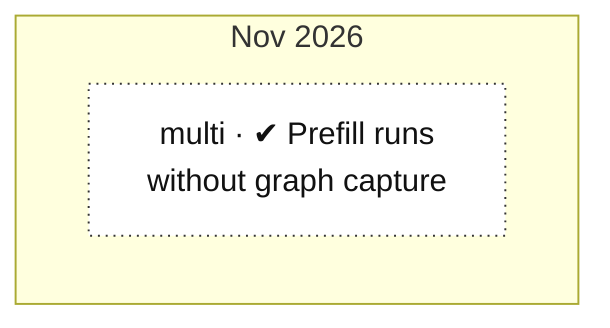

# Roadmap

Everything between the GENERATED markers is rebuilt from `roadmap/nodes.yaml`; edit that file, not the regions. Text outside the markers is kept.

## Legend

<!-- BEGIN GENERATED: legend -->

Owner calls are the purple shape. A decided owner call is drawn in the overview only, never in the track trees; an open one is listed under *Waiting on the owner*. The prefix on an overview box is its track. A prerequisite implied by a longer chain is not drawn; the node tables keep every edge.
<!-- END GENERATED: legend -->

## Ratings

<!-- BEGIN GENERATED: ratings -->
No node carries a rating yet.
<!-- END GENERATED: ratings -->

## Overview

<!-- BEGIN GENERATED: overview -->

<!-- END GENERATED: overview -->

## In plain words

<!-- BEGIN GENERATED: plain-words -->
| title | status | in plain words |
|---|---|---|
| Price decode at measured clocks | ○ next | A GPU kept partly idle by a layer split runs at a lower clock than one GPU alone, so the 30B four-way layer split decodes slower than predicted wherever the single GPU boosts; the cost model has to price decode at the clock each layout actually gets. |
| Prefill runs without graph capture | ✔ done · unrated | Every judged prefill had timed the call in which ggml records a CUDA graph, which serialized the pipeline stages; prefill steps now run directly and decode keeps graph replay. |
| Accept the prefill capture fix | ○ next | ADR 0081 is Proposed; its GPU test and the s3f2 confirmation passed, so it waits for the owner's acceptance. |
| Two-GPU verdict session | ▶ in progress | The judged Phase 5 session on two GPUs (cases D2 and M2): every candidate within 15% of its prediction and the pick in the winner set, two clean rounds each. |
| Admission probe on final main | ○ next | The admission path changed after the Phase 4 verdict commit, so one D2a run on final main confirms the Phase 4 result still holds before M2 is reported. |
| Four-GPU verdict, first box | ⛔ blocked | The judged session on four GPUs (cases D4 and M4) on a host other than 20210, run alone; the owner allowed one box up to 1.70 USD/h for it. |
| Four-GPU verdict, second box | ⛔ blocked | The second four-GPU session, so every configuration has two clean rounds on a clean host. |
| Report milestone M2 | ⛔ blocked | M2 ends Phase 5: the owner judges the verdicts together with the list of rule changes made after failed sessions (docs/notes/phase5-rule-changes.md). |
<!-- END GENERATED: plain-words -->

## Ready now

<!-- BEGIN GENERATED: ready-now -->
**local**

- `planner-cost-model-v5`: Price decode at measured clocks

**box**

- `bench-d2a-probe`: Admission probe on final main
<!-- END GENERATED: ready-now -->

## Running

<!-- BEGIN GENERATED: running -->
**box**

- `bench-v2-verdict`: Two-GPU verdict session
<!-- END GENERATED: running -->

## Built, waiting

<!-- BEGIN GENERATED: built-waiting -->
_None._
<!-- END GENERATED: built-waiting -->

## Waiting on the owner

<!-- BEGIN GENERATED: waiting-on-owner -->
- `multi-accept-adr-0081`: Accept the prefill capture fix
- `bench-m2-report`: Report milestone M2
<!-- END GENERATED: waiting-on-owner -->

## Queue

<!-- BEGIN GENERATED: queue -->
1. `bench-v2-verdict`: Two-GPU verdict session
2. `bench-d2a-probe`: Admission probe on final main
3. `bench-v4a-verdict`: Four-GPU verdict, first box
4. `bench-v4b-verdict`: Four-GPU verdict, second box
<!-- END GENERATED: queue -->

## Timeline

<!-- BEGIN GENERATED: timeline -->
[The timeline](roadmap/timeline.md) shows every dated node as a bar from its start to its end.

Generated on 2026-11-20.
<!-- END GENERATED: timeline -->

## Done, by month

<!-- BEGIN GENERATED: done-by-month -->

<b>Nov 2026</b>: 1 done

- `multi-prefill-no-capture`: Prefill runs without graph capture (✔ done · unrated). Every judged prefill had timed the call in which ggml records a CUDA graph, which serialized the pipeline stages; prefill steps now run directly and decode keeps graph replay.

<!-- END GENERATED: done-by-month -->

## Tracks

<!-- BEGIN GENERATED: tracks -->
Each track has its own page with its tree, node table and per-node details.

- [engine - engine and builders](roadmap/tracks/engine.md): 0 nodes
- [memory - memory and streaming](roadmap/tracks/memory.md): 0 nodes
- [planner - planner and cost model](roadmap/tracks/planner.md): 1 nodes (1 next)
- [multi - multi-GPU executor](roadmap/tracks/multi.md): 2 nodes (1 done, 1 next)
- [serving - serving](roadmap/tracks/serving.md): 0 nodes
- [bench - benchmarks and verdicts](roadmap/tracks/bench.md): 5 nodes (1 in progress, 1 next, 3 blocked)
- [ops - operations](roadmap/tracks/ops.md): 0 nodes
<!-- END GENERATED: tracks -->
