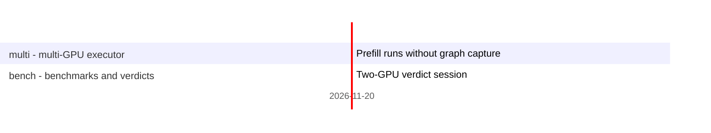

<!-- Generated by build.py from roadmap/nodes.yaml. Do not edit. -->

# Timeline

[Back to the page](../roadmap.md)

Generated on 2026-11-20. Open bars end on that date.

<!-- BEGIN GENERATED: timeline -->

Not shown (no `start`): `planner-cost-model-v5`, `multi-accept-adr-0081`, `bench-d2a-probe`, `bench-v4a-verdict`, `bench-v4b-verdict`, `bench-m2-report`
<!-- END GENERATED: timeline -->
