<!-- Generated by build.py from roadmap/nodes.yaml. Do not edit. -->

# Timeline

[Back to the page](../roadmap.md)

Generated on 2026-11-23. Open bars end on that date.

```mermaid
gantt
    dateFormat YYYY-MM-DD
    axisFormat %Y-%m-%d
    section engine - engine and builders
    Engine core on libllama :engine_libllama, 2026-10-29, 2026-10-31
    Own Qwen3 MoE graph builder :engine_moe_builder, 2026-10-31, 2026-10-31
    Extra passes for overflow experts :crit, engine_overflow_passes, 2026-11-01, 2026-11-01
    One CPU threadpool, one step graph :engine_cpu_threadpool, 2026-11-01, 2026-11-02
    Decode replays CUDA graphs :engine_cuda_graphs, 2026-11-02, 2026-11-02
    Find the gap to KTransformers :engine_kt_gap, 2026-11-03, 2026-11-09
    Pick CPU kernels at run time :engine_isa_dispatch, 2026-11-09, 2026-11-09
    Faster AVX-512 decode kernels :engine_iqk_kernels, 2026-11-09, 2026-11-09
    Fewer graph dispatches per token :engine_decode_dispatch, 2026-11-12, 2026-11-14
    CPU polling set from quota :engine_cpu_poll, 2026-11-12, 2026-11-15
    Own Qwen3 dense builder :engine_dense_builder, 2026-11-14, 2026-11-16
    GPU parity anchored on libllama :engine_gpu_tolerance, 2026-11-15, 2026-11-17
    Move to llama.cpp b12426 :engine_pin_b12426, 2026-11-16, 2026-11-18
    section memory - memory and streaming
    Memory tiers and expert slots :memory_tiers, 2026-10-31, 2026-11-03
    Expert pair groups, CPU experts :memory_pair_groups, 2026-11-01, 2026-11-01
    Prefetch next layer's experts :memory_prefetch, 2026-11-02, 2026-11-03
    Convert formats at load time :memory_conversion, 2026-11-03, 2026-11-03
    Read experts while computing :memory_io_service, 2026-11-08, 2026-11-11
    Low-bit KV cache per layer :memory_low_bit_kv, 2026-11-09, 2026-11-10
    Keep most-used experts in RAM :memory_ram_freq, 2026-11-09, 2026-11-12
    Share RAM slots across layers :crit, memory_ram_pool, 2026-11-14, 2026-11-14
    Admit CPU misses into VRAM :memory_adaptive_tier, 2026-11-12, 2026-11-12
    Planner picks the KV format :memory_kv_auto, 2026-11-23, 2026-11-23
    Disk prefix restore off the step :memory_prefix_disk_async, 2026-11-23, 2026-11-23
    Prefix cache spills to SSD :memory_prefix_ssd, 2026-11-23, 2026-11-23
    section planner - planner and cost model
    One placement plan format :planner_plan_ir, 2026-10-29, 2026-10-31
    Quality profile per tensor :planner_quality, 2026-10-29, 2026-11-10
    Planner, cost model and search :planner_core, 2026-11-03, 2026-11-03
    Planner exit test :planner_exit, 2026-11-03, 2026-11-10
    Bottleneck detector :planner_detector, 2026-11-08, 2026-11-12
    Disk cost and virtual clock :planner_tier_cost, 2026-11-09, 2026-11-10
    Replan while serving :planner_replan, 2026-11-09, 2026-11-12
    Fill free VRAM with experts :planner_fill_tier, 2026-11-14, 2026-11-15
    Plan tensor and expert parallel :planner_parallel_shapes, 2026-11-15, 2026-11-16
    Cost model, version 2 :planner_cost_v2, 2026-11-18, 2026-11-19
    Price all-reduce latency in steps :planner_cost_v3, 2026-11-19, 2026-11-19
    Price routed expert traffic :planner_cost_v4, 2026-11-19, 2026-11-19
    Price decode at measured clocks :planner_cost_model_v5, 2026-11-20, 2026-11-21
    Experts on GPU and SSD only :planner_low_ram_modes, 2026-11-23, 2026-11-23
    Recheck expert-parallel prefill error :planner_ep_prefill_recheck, 2026-11-21, 2026-11-21
    Approve the low-clock anchor :planner_owner_layer_anchor, 2026-11-21, 2026-11-21
    section multi - multi-GPU executor
    Prefill runs without graph capture :multi_prefill_no_capture, 2026-11-20, 2026-11-20
    Own multi-GPU executor :multi_executor, 2026-11-15, 2026-11-16
    Split models across GPUs :multi_sharded, 2026-11-15, 2026-11-16
    Let CUDA fuse inside ranges :multi_graph_views, 2026-11-17, 2026-11-17
    Pipelined prefill in micro-batches :multi_pipelined_prefill, 2026-11-18, 2026-11-19
    Two decode speedups made default :multi_decode_toggles, 2026-11-19, 2026-11-19
    Judged prefill timed graph capture :multi_defect_capture, 2026-11-19, 2026-11-20
    Accept the prefill capture fix :multi_accept_adr_0081, 2026-11-22, 2026-11-22
    section serving - serving
    OpenAI and Anthropic gateway :serving_gateway, 2026-10-29, 2026-10-31
    Real engines behind the gateway :serving_real_engines, 2026-11-03, 2026-11-03
    Prefix cache in host RAM :serving_prefix_cache, 2026-11-03, 2026-11-15
    Repair and count tool calls :serving_tool_calls, 2026-11-09, 2026-11-11
    Speculative decoding :serving_speculative, 2026-11-03, 2026-11-03
    Continuous batching over sequences :serving_batching, 2026-11-14, 2026-11-15
    Chunked KV beats paged KV :serving_kv_layout, 2026-11-14, 2026-11-18
    MoE builder serves many requests :serving_moe_batch, 2026-11-15, 2026-11-16
    Close the four-request gap :serving_c4_gap, 2026-11-15, 2026-11-16
    Speculation in the batching loop :serving_spec_batching, 2026-11-15, 2026-11-16
    Fast prefix-cache saves :serving_prefix_save, 2026-11-17, 2026-11-20
    Long prompts attend their own run :serving_own_run_attention, 2026-11-19, 2026-11-19
    llama-server conformance harness :serving_parity_harness, 2026-11-22, 2026-11-22
    Sampler parity with llama-server :serving_parity_sampling, 2026-11-23, 2026-11-23
    Request field parity :serving_parity_fields, 2026-11-23, 2026-11-23
    Endpoint parity :serving_parity_endpoints, 2026-11-23, 2026-11-23
    Expose libllama capabilities :serving_parity_libllama, 2026-11-23, 2026-11-23
    Recurrent models break slot reuse :serving_recurrent_reuse, 2026-11-23, 2026-11-23
    section bench - benchmarks and verdicts
    Paired benchmark harness, baselines :bench_harness, 2026-10-30, 2026-11-15
    Measured noise bands per GPU :bench_noise_bands, 2026-11-09, 2026-11-11
    Phase 2 exit - model beyond RAM :bench_phase2_exit, 2026-11-02, 2026-11-10
    Tuned llama.cpp cache beat builder :bench_defect_tuned_cache, 2026-11-05, 2026-11-12
    Builder beats llama.cpp expert cache :bench_m1_point1, 2026-11-10, 2026-11-13
    Builder against KTransformers, AVX-512 :bench_m1_point3, 2026-11-10, 2026-11-14
    Owner sets proxy test rules :bench_owner_proxy_rules, 2026-11-03, 2026-11-11
    Claude Code proxy exit test :bench_phase3b_proxy, 2026-11-03, 2026-11-11
    Owner confirms milestone M1 :bench_owner_m1, 2026-11-14, 2026-11-14
    Phase 4 verdict harness :bench_phase4_harness, 2026-11-14, 2026-11-16
    First throughput check misses :bench_d2a_rerun, 2026-11-16, 2026-11-16
    Old llama.cpp pin explains gap :bench_pin_ab, 2026-11-16, 2026-11-16
    CUDA check on the new pin :bench_pin_confirm, 2026-11-16, 2026-11-17
    Phase 4 exit test passes :bench_phase4_exit, 2026-11-17, 2026-11-17
    Time to first token bar :bench_ttft, 2026-11-18, 2026-11-19
    Phase 5 verdict harness and rules :bench_phase5_harness, 2026-11-15, 2026-11-17
    Judge GPU throttling per run :bench_throttle_rules, 2026-11-17, 2026-11-18
    Two-GPU executor check :bench_s2_step0, 2026-11-17, 2026-11-18
    Predictions stay analytic :bench_owner_analytic, 2026-11-18, 2026-11-18
    Four-GPU rehearsals :bench_s3_rehearsal, 2026-11-19, 2026-11-19
    Keep 15% on every candidate :bench_owner_15pct, 2026-11-19, 2026-11-19
    Four-GPU check of the fix :bench_s3f2, 2026-11-20, 2026-11-20
    Check host ran at low clocks :bench_defect_s3f2_clock, 2026-11-20, 2026-11-20
    Two-GPU verdict session :bench_v2_verdict, 2026-11-20, 2026-11-21
    Admission probe on final main :bench_d2a_probe, 2026-11-21, 2026-11-22
    Four-GPU verdict, first box :bench_v4a_verdict, 2026-11-21, 2026-11-21
    Four-GPU verdict, second box :crit, bench_v4b_verdict, 2026-11-21, 2026-11-21
    30B admission probe rerun :bench_d2a_30b, 2026-11-22, 2026-11-22
    30B same-box A/B :bench_ab30b, 2026-11-22, 2026-11-22
    Report milestone M2 :bench_m2_report, 2026-11-22, 2026-11-22
    Strata against llama-server on Qwen3.6 :bench_strata_q36, 2026-11-23, 2026-11-23
    Readmit host 20210 for verdicts :bench_owner_host_20210, 2026-11-21, 2026-11-21
    Two-GPU cases on a four-GPU box :bench_owner_two_of_four, 2026-11-21, 2026-11-21
    section ops - operations
    Workspace, rules and first ADRs :ops_foundations, 2026-10-29, 2026-10-30
    CI and test infrastructure :ops_ci, 2026-10-30, 2026-11-19
    Rented GPU box tool :ops_taxameter, 2026-10-30, 2026-11-20
    Box session scripts and rules :ops_box_driver, 2026-11-03, 2026-11-20
    Box and host metrics :ops_telemetry, 2026-11-12, 2026-11-14
    Decisions in ADRs, numbers elsewhere :ops_docs, 2026-11-09, 2026-11-20
    Read other inference engines :ops_external_reads, 2026-11-05, 2026-11-20
    Owner raises box price caps :ops_owner_caps, 2026-11-09, 2026-11-13
    Owner allows dearer four-GPU boxes :ops_owner_4gpu_cap, 2026-11-15, 2026-11-15
    One dearer box for verdict :ops_owner_v4a_cap, 2026-11-20, 2026-11-20
    Owner accepts nine design records :ops_owner_accepts_adrs, 2026-11-19, 2026-11-19
    Review the parity batch :ops_review_parity_batch, 2026-11-23, 2026-11-23
    section cluster - multi-node cluster
    Transport latency between two boxes :active, cluster_transport_wan, 2026-11-23, 2026-11-23
```

<!-- BEGIN GENERATED: timeline -->

Not shown (no `start`): `engine-backend-parity`, `engine-glm-builder`, `engine-deepseek-builder`, `engine-bitnet-builder`, `engine-qwen35moe-builder`, `engine-one-graph-per-token`, `engine-dense-amx`, `memory-safetensors`, `memory-kv-tiers`, `memory-kv-host`, `memory-prefill-misses`, `memory-typed-slots`, `planner-cost-model-v5-host2`, `planner-live-replan`, `planner-advisor-auto`, `planner-split-layouts`, `planner-low-bit-formats`, `planner-ep-split`, `planner-ram-slots-zero`, `planner-slot-campaign`, `planner-replan-part-b`, `multi-live-reshard`, `multi-split-hardware`, `multi-context-parallel`, `serving-parity-owner-scope`, `serving-multi-model`, `serving-multi-lora`, `serving-auth-quotas`, `serving-multimodal`, `serving-owner-drafters`, `serving-mtp-drafts`, `serving-self-spec`, `serving-strata-owner-scope`, `serving-prefix-first`, `bench-30b-c4-gap`, `bench-phase6-exit`, `bench-m3-report`, `bench-phase7-exit`, `bench-m4-report`, `bench-phase8-exit`, `bench-phase9-exit`, `bench-spec-rerun`, `bench-strata-pairing`, `bench-d1-session`, `bench-open-records`, `ops-packages`, `ops-profiling-mode`, `cluster-owner-transport`, `cluster-transport`, `cluster-mtls`, `cluster-discovery`, `cluster-join-leave`, `cluster-pipeline-nodes`, `cluster-experts-nodes`, `cluster-remote-kv`, `cluster-replicas`, `cluster-failover`, `cluster-replica-scaling`
<!-- END GENERATED: timeline -->
