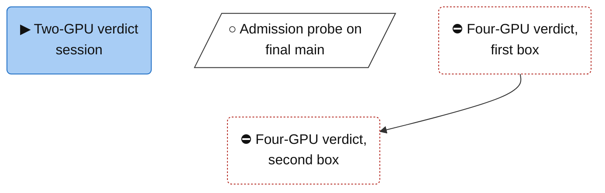

<!-- Generated by build.py from roadmap/nodes.yaml. Do not edit. -->

# bench - benchmarks and verdicts

Scope: pinned specs, paired runs, exit tests and verdict sessions, baselines.

[Back to the page](../../roadmap.md) · [legend](../../roadmap.md#legend)

<!-- BEGIN GENERATED: track-bench -->

<!-- END GENERATED: track-bench -->

## Node table

<!-- BEGIN GENERATED: table-bench -->
| id | title | kind | lane | state | outcome | start | end | depends_on | replaced_by | qualified_by | headline | evidence |
|---|---|---|---|---|---|---|---|---|---|---|---|---|
| `bench-v2-verdict` | Two-GPU verdict session | session | box | in-progress | unrated | 2026-11-20 |  | multi-prefill-no-capture |  |  |  |  |
| `bench-d2a-probe` | Admission probe on final main | experiment | box | next | unrated |  |  |  |  |  |  |  |
| `bench-v4a-verdict` | Four-GPU verdict, first box | session | box | blocked | unrated |  |  | planner-cost-model-v5, multi-prefill-no-capture |  |  |  |  |
| `bench-v4b-verdict` | Four-GPU verdict, second box | session | box | blocked | unrated |  |  | bench-v4a-verdict |  |  |  |  |
| `bench-m2-report` | Report milestone M2 | owner-decision | owner | blocked | n/a |  |  | bench-v2-verdict, bench-v4a-verdict, bench-v4b-verdict, bench-d2a-probe |  |  |  |  |

### Details per node

| id | title | verdict | headline | in plain words | notes | confirmed | waiting on | queue order | order reason |
|---|---|---|---|---|---|---|---|---|---|
| `bench-v2-verdict` | Two-GPU verdict session |  |  | The judged Phase 5 session on two GPUs (cases D2 and M2): every candidate within 15% of its prediction and the pick in the winner set, two clean rounds each. | Done when: verdict.json for v2-20261120 with both cases judged under ADR 0068. |  |  | 1 |  |
| `bench-d2a-probe` | Admission probe on final main |  |  | The admission path changed after the Phase 4 verdict commit, so one D2a run on final main confirms the Phase 4 result still holds before M2 is reported. |  |  |  | 2 |  |
| `bench-v4a-verdict` | Four-GPU verdict, first box |  |  | The judged session on four GPUs (cases D4 and M4) on a host other than 20210, run alone; the owner allowed one box up to 1.70 USD/h for it. |  |  |  | 3 |  |
| `bench-v4b-verdict` | Four-GPU verdict, second box |  |  | The second four-GPU session, so every configuration has two clean rounds on a clean host. |  |  |  | 4 |  |
| `bench-m2-report` | Report milestone M2 |  |  | M2 ends Phase 5: the owner judges the verdicts together with the list of rule changes made after failed sessions (docs/notes/phase5-rule-changes.md). |  |  |  |  |  |
<!-- END GENERATED: table-bench -->
