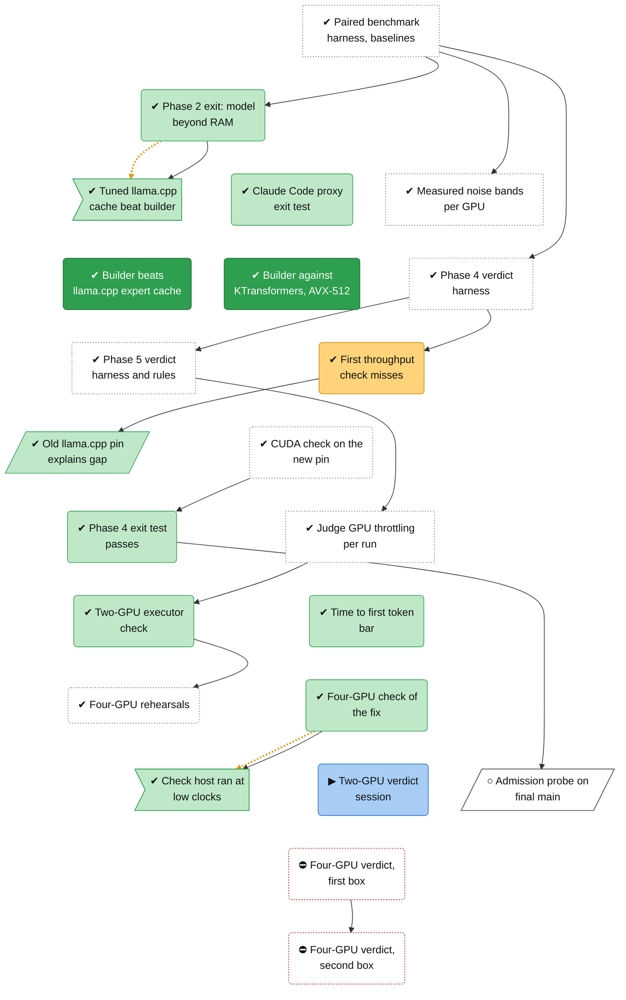

<!-- Generated by build.py from roadmap/nodes.yaml. Do not edit. -->

# bench - benchmarks and verdicts

Scope: pinned specs, paired runs, exit tests and verdict sessions, baselines.

[Back to the page](../../roadmap.md) · [legend](../../roadmap.md#legend)

<!-- BEGIN GENERATED: track-bench -->

<!-- END GENERATED: track-bench -->

## Node table

<!-- BEGIN GENERATED: table-bench -->
| id | title | kind | lane | state | outcome | start | end | depends_on | replaced_by | qualified_by | headline | evidence |
|---|---|---|---|---|---|---|---|---|---|---|---|---|
| `bench-harness` | Paired benchmark harness, baselines | tooling | none | done | unrated | 2026-10-30 | 2026-11-15 | ops-foundations |  |  |  | docs/testing.md; docs/adr/0058-decode-io-attribution.md |
| `bench-noise-bands` | Measured noise bands per GPU | tooling | none | done | unrated | 2026-11-09 | 2026-11-11 | bench-harness |  |  |  | docs/testing.md |
| `bench-phase2-exit` | Phase 2 exit: model beyond RAM | session | none | done | successful | 2026-11-02 | 2026-11-10 | memory-prefetch, memory-pair-groups, bench-harness |  | bench-defect-tuned-cache |  | docs/adr/0045-phase2-exit-verdict.md; bench/results/20261102/README.md; bench/results/20261103/README.md |
| `bench-defect-tuned-cache` | Tuned llama.cpp cache beat builder | defect | none | done | unrated | 2026-11-05 | 2026-11-12 | bench-phase2-exit |  |  |  | docs/m1-open.md; bench/results/20261112a/README.md |
| `bench-m1-point1` | Builder beats llama.cpp expert cache | session | none | done | very-successful | 2026-11-10 | 2026-11-13 | engine-cpu-poll, memory-io-service |  |  | builder 1.21-1.52x the cache | bench/results/20261113k/README.md; bench/results/20261113b/README.md; docs/m1-open.md |
| `bench-m1-point3` | Builder against KTransformers, AVX-512 | session | none | done | very-successful | 2026-11-10 | 2026-11-14 | planner-fill-tier |  |  | vramfill 1.29-1.65x KT | bench/results/20261114/README.md; bench/results/20261114b/README.md; docs/m1-open.md |
| `bench-owner-proxy-rules` | Owner sets proxy test rules | owner-decision | owner | done | n/a | 2026-11-03 | 2026-11-11 |  |  |  |  | docs/adr/0046-serving-real-engines-behind-the-gateway.md |
| `bench-phase3b-proxy` | Claude Code proxy exit test | session | none | done | successful | 2026-11-03 | 2026-11-11 | serving-real-engines, serving-tool-calls, serving-prefix-cache |  |  | tasks 15/20 vs 14/20 | bench/results/20261110d/README.md; docs/adr/0046-serving-real-engines-behind-the-gateway.md |
| `bench-owner-m1` | Owner confirms milestone M1 | owner-decision | owner | done | n/a | 2026-11-14 | 2026-11-14 | bench-m1-point1, bench-m1-point3, bench-phase3b-proxy, planner-exit, planner-detector |  |  |  | docs/m1-open.md; docs/adr/0045-phase2-exit-verdict.md |
| `bench-phase4-harness` | Phase 4 verdict harness | tooling | none | done | unrated | 2026-11-14 | 2026-11-16 | bench-harness |  |  |  | docs/phase4-briefs.md |
| `bench-d2a-rerun` | First throughput check misses | session | none | done | mixed | 2026-11-16 | 2026-11-16 | serving-moe-batch, engine-dense-builder, bench-phase4-harness |  |  |  | bench/results/20261116d2a2/README.md |
| `bench-pin-ab` | Old llama.cpp pin explains gap | experiment | none | done | successful | 2026-11-16 | 2026-11-16 | bench-d2a-rerun |  |  |  | bench/results/20261116pinab/README.md |
| `bench-pin-confirm` | CUDA check on the new pin | session | none | done | unrated | 2026-11-16 | 2026-11-17 | engine-pin-b12426 |  |  |  | bench/results/20261116pc/README.md |
| `bench-phase4-exit` | Phase 4 exit test passes | session | none | done | successful | 2026-11-17 | 2026-11-17 | bench-pin-confirm, serving-c4-gap, serving-prefix-save, engine-gpu-tolerance |  |  |  | bench/results/20261117k/README.md; bench/results/20261117l; docs/adr/0065-phase4-verdict-multi-sequence-backend-continuous-batching.md |
| `bench-ttft` | Time to first token bar | session | none | done | successful | 2026-11-18 | 2026-11-19 | serving-prefix-save, serving-own-run-attention |  |  |  | bench/results/ttft7-20261119/README.md; docs/adr/0074-prefix-save-through-pinned-staging.md |
| `bench-phase5-harness` | Phase 5 verdict harness and rules | tooling | none | done | unrated | 2026-11-15 | 2026-11-17 | bench-phase4-harness |  |  |  | docs/adr/0068-phase5-verdict-rules.md; docs/phase5-briefs.md |
| `bench-throttle-rules` | Judge GPU throttling per run | tooling | none | done | unrated | 2026-11-17 | 2026-11-18 | bench-phase5-harness |  |  |  | docs/notes/phase5-rule-changes.md; docs/adr/0068-phase5-verdict-rules.md |
| `bench-s2-step0` | Two-GPU executor check | session | none | done | successful | 2026-11-17 | 2026-11-18 | multi-sharded, multi-graph-views, bench-throttle-rules |  | multi-defect-capture |  | bench/results/s2f-20261118-step0/README.md; docs/adr/0069-own-executor-rank-programs.md |
| `bench-owner-analytic` | Predictions stay analytic | owner-decision | owner | done | n/a | 2026-11-18 | 2026-11-18 | planner-cost-v2 |  |  |  | docs/adr/0076-judged-predictions-from-per-shape-anchor-lines.md; docs/notes/phase5-rule-changes.md |
| `bench-s3-rehearsal` | Four-GPU rehearsals | session | none | done | unrated | 2026-11-19 | 2026-11-19 | planner-cost-v3, bench-s2-step0 |  | multi-defect-capture |  | bench/results/s3-20261119/README.md; bench/results/s3b-20261119/README.md; bench/results/s3c-20261119/README.md |
| `bench-owner-15pct` | Keep 15% on every candidate | owner-decision | owner | done | n/a | 2026-11-19 | 2026-11-19 | bench-s3-rehearsal |  |  |  | docs/notes/phase5-rule-changes.md; docs/adr/0078-allreduce-in-step-latency.md |
| `bench-s3f2` | Four-GPU check of the fix | session | none | done | successful | 2026-11-20 | 2026-11-20 | multi-prefill-no-capture |  | bench-defect-s3f2-clock |  | bench/results/s3f2-20261120/README.md |
| `bench-defect-s3f2-clock` | Check host ran at low clocks | defect | none | done | unrated | 2026-11-20 | 2026-11-20 | bench-s3f2 |  |  |  | docs/m2-plan.md; bench/results/s3f2-20261120/README.md |
| `bench-v2-verdict` | Two-GPU verdict session | session | box | in-progress | unrated | 2026-11-20 |  | multi-prefill-no-capture, bench-throttle-rules |  |  |  |  |
| `bench-d2a-probe` | Admission probe on final main | experiment | box | next | unrated |  |  | bench-phase4-exit |  |  |  |  |
| `bench-v4a-verdict` | Four-GPU verdict, first box | session | box | blocked | unrated |  |  | planner-cost-model-v5, multi-prefill-no-capture, ops-owner-v4a-cap |  |  |  |  |
| `bench-v4b-verdict` | Four-GPU verdict, second box | session | box | blocked | unrated |  |  | bench-v4a-verdict |  |  |  |  |
| `bench-m2-report` | Report milestone M2 | owner-decision | owner | blocked | n/a |  |  | bench-v2-verdict, bench-v4a-verdict, bench-v4b-verdict, bench-d2a-probe |  |  |  |  |

### Details per node

| id | title | verdict | headline | in plain words | notes | confirmed | waiting on | queue order | order reason |
|---|---|---|---|---|---|---|---|---|---|
| `bench-harness` | Paired benchmark harness, baselines |  |  | Runs Tetraeder and baseline engines (llama.cpp with its expert cache, ik_llama.cpp, KTransformers, Colibri) in interleaved pairs on one box with the same threads, quality gate and decode I/O attribution. |  |  |  |  |  |
| `bench-noise-bands` | Measured noise bands per GPU |  |  | Same-engine A/A pairs measure how much a GPU class varies run to run; verdicts and regressions are judged beyond that band. |  |  |  |  |  |
| `bench-phase2-exit` | Phase 2 exit: model beyond RAM | ADR 0045: Phase 2 exit verdict (pass; decode parity with KTransformers on the 91.6 GB box) |  | Qwen3-235B, larger than the box's RAM, against the best tuned baselines: the builder passed the Phase 2 exit at decode parity with KTransformers. |  |  |  |  |  |
| `bench-defect-tuned-cache` | Tuned llama.cpp cache beat builder |  |  | The Phase 2 verdict never measured llama.cpp's own expert cache (--moe-cache-mib) as a baseline; once added, and after M1 was first declared on 2026-11-10, the cache tuned to share 0.95 led the builder, so the Phase 2 verdict's point 1 reopened and M1 waited for new sessions. |  |  |  |  |  |
| `bench-m1-point1` | Builder beats llama.cpp expert cache | 20261113k confirms point 1 on a second host (builder 1.21-1.52x the cache) | builder 1.21-1.52x the cache | M1 point 1: the builder against llama.cpp's expert cache at its best share, in clean paired sessions on two hosts; many attempts were void (OOM, slow disk, co-tenants, thrash). |  |  |  |  |  |
| `bench-m1-point3` | Builder against KTransformers, AVX-512 | 20261114 point-3 readings (vramfill 1.29-1.65x KT, poll50 1.16-1.21x) | vramfill 1.29-1.65x KT | M1 point 3: on AVX-512 CPUs KTransformers led until the builder filled free VRAM with expert slots; on a 24 GB card with no free VRAM the two tie. |  |  |  |  |  |
| `bench-owner-proxy-rules` | Owner sets proxy test rules | owner decisions on the tasks clause (no worse beyond spread, 73 vs 74 over five runs) and slow disks (scope, not result) |  | The owner chose a few-hour Claude Code proxy run instead of a week of use, and later ruled the tasks clause means no worse beyond the run-to-run spread, and that slow disks are a scope limit, not a failed result. |  |  |  |  |  |
| `bench-phase3b-proxy` | Claude Code proxy exit test | Phase 3b met (tasks 15/20 vs 14/20, cache 95.8% vs 94.2%, 0 400s) | tasks 15/20 vs 14/20 | Phase 3b exit: Claude Code works through Tetraeder's gateway for a few hours, solving at least as many tasks and reusing as much prompt cache as llama-server. |  |  |  |  |  |
| `bench-owner-m1` | Owner confirms milestone M1 | M1 reached: owner decision on point 3 (vramfill is the builder's configuration against KTransformers) |  | M1 (one machine, MVP) is reached: the owner counted the builder with free VRAM filled with expert slots as its configuration against KTransformers. |  |  |  |  |  |
| `bench-phase4-harness` | Phase 4 verdict harness |  |  | The box script and summary that judge Phase 4 (throughput pairs and time to first token on a Claude Code replay), with a CPU rehearsal workflow. |  |  |  |  |  |
| `bench-d2a-rerun` | First throughput check misses | D2a rerun misses at c4; builders cleared, loop and pin under test |  | The throughput half of Phase 4 (D2a) on one RTX 3090: parity closed on both models, but four concurrent requests still trailed llama-server. |  |  |  |  |  |
| `bench-pin-ab` | Old llama.cpp pin explains gap | The pin: llama-server built from b11976 is slower than b12426 at c4 (level at c1), and so is libllama's 4-sequence decode step. |  | A/B of llama.cpp versions on one box: part of the concurrency-4 gap was the older pinned version, so moving the pin went onto the critical path before the verdict. |  |  |  |  |  |
| `bench-pin-confirm` | CUDA check on the new pin | q8b dense c4 seed 94 aborts with a CUDA illegal memory access (repro 4 of 4) |  | GPU session on the new pin: parity held on real models, but the dense engine crashed at four requests (fixed by padding the attention mask to whole tiles). |  |  |  |  |  |
| `bench-phase4-exit` | Phase 4 exit test passes | The Phase 4 exit test passes: throughput for both counting models in `20261117k`, TTFT in `20261117l`. |  | Phase 4 verdict of record: throughput at one and four concurrent requests at least llama-server's on the 8B dense and 30B MoE, and prefix reuse cuts time to first token on a Claude Code replay. |  |  |  |  |  |
| `bench-ttft` | Time to first token bar | TTFT bar met in two default rounds |  | Time to first token (TTFT) on the Claude Code replay against llama-server: median and p90 at most 1.15x and saves at most 10% of TTFT; met after seven replays and fixes. |  |  |  |  |  |
| `bench-phase5-harness` | Phase 5 verdict harness and rules |  |  | The Phase 5 rules, written before any Phase 5 code (pick in the measured winner set, every prediction within 15%), and the box script with its GPU parity gate. |  |  |  |  |  |
| `bench-throttle-rules` | Judge GPU throttling per run |  |  | Rented GPUs throttle; a 1 Hz sampler judges each run's window, throttle shares are compared between rounds of one configuration, and every GPU must run at its default power limit. |  |  |  |  |  |
| `bench-s2-step0` | Two-GPU executor check | step-0 passed on both models (s2f-20261118-step0) |  | Step 0 of Phase 5 on two RTX 3090s: the own tensor-parallel executor at or above llama.cpp's tensor split on both models, so no executor redesign; four sessions failed gates first. |  |  |  |  |  |
| `bench-owner-analytic` | Predictions stay analytic | Not adopted (owner, 2026-11-18): judged predictions stay the planner's analytic predictions before the candidates run (ADR 0068) |  | ADR 0076 proposed judging predictions from lines fitted to runs of each candidate; the owner kept the 15% test on the planner's analytic predictions made before the candidates run. |  |  |  |  |  |
| `bench-s3-rehearsal` | Four-GPU rehearsals |  |  | First four-GPU sessions on host 20210: all gates pass, the picks are right, but tensor-pipeline and expert-parallel predictions missed 15% and one GPU throttles thermally. |  |  |  |  |  |
| `bench-owner-15pct` | Keep 15% on every candidate | 15% stays on every candidate. |  | After four-GPU misses the owner kept the 15% line on every candidate and had calibration gain recorded routing frequencies and four-GPU tensor-parallel anchors instead. |  |  |  |  |  |
| `bench-s3f2` | Four-GPU check of the fix | s3f2 passed (ADR 0081 confirmed on 4 GPUs; no 4-GPU candidate past 15%) |  | With prefill run without graph capture, one round of every four-GPU candidate stayed within 15%; the first attempt (s3f) stopped at a gate. |  |  |  |  |  |
| `bench-defect-s3f2-clock` | Check host ran at low clocks |  |  | The s3f2 host held every GPU at 1590 MHz all session, single GPU included, so its layer-4 decode result (0.995) does not show the earlier layer-split decode miss fixed; cost model version 5 is back on. |  |  |  |  |  |
| `bench-v2-verdict` | Two-GPU verdict session |  |  | The judged Phase 5 session on two GPUs (cases D2 and M2): every candidate within 15% of its prediction and the pick in the winner set, two clean rounds each. | Done when: verdict.json for v2-20261120 with both cases judged under ADR 0068. |  |  | 1 |  |
| `bench-d2a-probe` | Admission probe on final main |  |  | The admission path changed after the Phase 4 verdict commit, so one D2a run on final main confirms the Phase 4 result still holds before M2 is reported. |  |  |  | 2 |  |
| `bench-v4a-verdict` | Four-GPU verdict, first box |  |  | The judged session on four GPUs (cases D4 and M4) on a host other than 20210, run alone; the owner allowed one box up to 1.70 USD/h for it. |  |  |  | 3 |  |
| `bench-v4b-verdict` | Four-GPU verdict, second box |  |  | The second four-GPU session, so every configuration has two clean rounds on a clean host. |  |  |  | 4 |  |
| `bench-m2-report` | Report milestone M2 |  |  | M2 ends Phase 5: the owner judges the verdicts together with the list of rule changes made after failed sessions (docs/notes/phase5-rule-changes.md). |  |  |  |  |  |

### Folded items per node

- `bench-harness`: Paired benchmark harness, baselines
  - Diagnosis of slow CPU pairs and noisy GPU pairs (2026-10-30, session record)
  - Bench harness: quality gate, equal threads, ABBA order (2026-10-31, commit a03f199e3c, commit 0e2b841ead, commit a3e8a892f3, commit 2f24855700, commit 5b7f1608e2, commit 8337612441, commit 2c123343cd, commit e639050f1f, commit f2eeae504b)
  - Nightly 20261031 on RTX 3090 (2026-10-31, commit 0333cf3f9b)
  - Box -ot pairs and exit-regime numbers (2026-11-01, commit 4a312f6905, commit 9edb830cc3, commit 4e1661e056)
  - GPU run prep and 2026-11-01 RTX 3090 run (2026-11-01, commit 2992f4126f, commit 4bff0429f3, commit 694a4ba6d6, commit 6728552338, commit 7a2d2a5bb4, commit 6148b4ca08, commit 0b3a6337df, commit f1a6a6fed5, commit a595547c9a, commit 8526ba13fb)
  - ik_llama.cpp as second baseline engine (2026-11-02, commit e15433ada0, commit 8512dfeaee, commit 7c628413a8, commit 11780fe2b9, commit 6f864a1aba, commit edfdca27e2)
  - Bench pairing: one CPU thread count for both engines (2026-11-02, commit abfb7a74c6, commit 996c6bceec)
  - Colibri as an exit-run baseline (2026-11-02, commit 6daf36a619, commit 2455feff89, commit bfb9fc53b3)
  - Baseline build with MoE cache and resume plan baselines (2026-11-09, commit f3c3f3ea82, commit 20b6f7b20d, commit 68b98e4096)
  - Decode I/O attribution: per-window bytes per token and io_class (ADR 0058) (2026-11-11, commit 0e9d331a28, commit ceb697300b, commit 3d8338e5e9, commit a2ca5bb667, commit d4cb998878)
  - Baseline pin b12274: llama.cpp FP8 KV cache (2026-11-12, commit a2fc68ad96, commit b435bf9c8e, commit 06cba9eef6, commit e45c8352b7, commit a0c9ffceef)
  - Exit harness multi-arm mode with KV snapshot (2026-11-12, commit 13a5daadc4, commit 670d513aaa)
  - KT baseline: real kt-kernel variant names and build gate (2026-11-13, commit 3018488eb6, commit d3bf6079c4, commit 210c8e0083)
  - FP8 KV cache baseline: pin check and notes (2026-11-15, commit 244c69d2d0, commit ee4b026f24, commit c5694aab1f)
- `bench-noise-bands`: Measured noise bands per GPU
  - Weekly GPU smoke profile with measured noise bands (2026-11-09, commit 76c4b84a4b, commit 2a4a5867d9, commit 5121e18a34, commit a37183b764)
  - Measured noise bands from the 20261110 A/A pairs (2026-11-11, commit a55432850a, commit c6dc94fbfc)
- `bench-phase2-exit`: Phase 2 exit: model beyond RAM
  - Phase 2 exit run: Qwen3-235B (2026-11-02, commit 67ecac00cd, commit a2cfdba78d, commit e1baa1d71e, commit 98119118bb, commit 98d370afaa, commit bff3868181, commit 8a19d838aa)
  - Phase 2 exit runs and verdict (ADR 0045) (2026-11-03, commit 9f99a41b15, commit 1c8e6d6c2a, commit ced6996bd2, commit 217885557e, commit 891b713240, commit aad6cf2cb0, commit 9a3cedec3e, commit f576313ee9, commit cc11229488, commit 0d8bf4bf38)
  - b1c quota-tight pair and Phase 2 verdict with CPU matched (2026-11-10, commit 39e5e05e97, commit dbc2bc4571, commit d30e0e7287)
  - b1-exit session on box 60042169 and Phase 2 verdict (2026-11-10, commit ec6af2d7a1, commit 31c466dac5, commit fec6f5486c)
- `bench-defect-tuned-cache`: Tuned llama.cpp cache beat builder
  - Phase 2 verdict missed llama.cpp's expert cache baseline (2026-11-05, session record)
  - m1-open: M1 declared reached on 2026-11-10 (2026-11-10, commit 4c9feb240b, commit fbb69f2b55, commit a72fc5d745, commit 45b6de50a7)
  - m1-open: points awaiting the owner, M1 not declared (2026-11-12, commit ccea29252e, commit 3655464824, commit 3cfe150059)
  - Session 20261112a: builder vs llama.cpp cache at share 0.95 (2026-11-12, commit fdf393b8d2, commit 4f36c0294b)
- `bench-m1-point1`: Builder beats llama.cpp expert cache
  - AVX2 closing run 20261110f against the llama.cpp expert cache (2026-11-10, commit c3d0c8a220, commit 7f01f7b2f6, commit ca84487e8c)
  - Session 20261111g: tuner timed out, cache share 0.5 pairs (2026-11-11, commit 04fb868044, commit f99e9d4301, commit 439047582f, commit 104198161f)
  - Session 20261111e stopped at the disk gate (2026-11-11, commit 425129aa61, commit de70b20142)
  - Session 20261111c: tuner OOM, cache at share 0.5 (2026-11-11, commit 0b344c53d7, commit b2e3483806, commit 22e2952b26)
  - llama.cpp tuner infeasible on the 235B (2026-11-11, session record)
  - Session 20261112g: co-tenant guard, inconclusive pairing (2026-11-12, commit 99d5d1999c, commit d1ccdcdcea, commit ea9f7b6995, commit bba851b575)
  - Builder CPU compute variance across sessions unexplained (2026-11-12, commit 909e2dd7a5, commit 273741ff61, commit 7112625196, commit 42b3ef2da6)
  - Session 20261112f invalid: RAM balloon OOM-killed (2026-11-12, commit 442f0ad7de, commit dbcc18676d, commit 490ce4338c)
  - Session 20261111h: builder vs cache share sweep (2026-11-12, commit 3e819f204e, commit b4a4e194ad)
  - Session 20261113c: dio server OOM under the balloon (2026-11-13, commit a435489595, commit ef06f98a35)
  - Session 20261113b: builder vs cache at poll 0, point 1 met (2026-11-13, commit da2c5e9618, commit f9a77641d8)
  - Session 20261113a: builder vs untuned cache (2026-11-13, commit 1ab510e35e, commit 530a3d4d51)
  - Session 20261113g: cache thrashed under 91 GB cgroup (2026-11-13, commit c1ce8643aa, commit 57f3f14492, commit 793f833a2f)
  - Session 20261113k: point 1 confirmed on a second host (2026-11-13, commit 029a4b942a, commit 62fe6e0e39, commit 44fd293788)
  - Session 20261113f never started: three boxes failed (2026-11-13, session record)
- `bench-m1-point3`: Builder against KTransformers, AVX-512
  - AVX-512 attempt 20261110h, KT server never came up (2026-11-10, commit 5fc53b1160, commit 00a2881ae1, commit 67e3ce742b, commit 7ec96c4516, commit 9da370f573, commit ed389dfb72)
  - AVX-512 closing run blocked: no AVX-512 RTX 3090 offer (2026-11-10, session record)
  - Session 20261111b: AVX-512 repeat on a slow disk (2026-11-11, commit a07e32eff0, commit fbadc033fc, commit ac86990674)
  - Session 20261111a: AVX-512 overlap vs KTransformers, M1 reached (2026-11-11, commit 2056a0601f, commit 355facffec, commit a9588ef595)
  - Session 20261113h: KT cannot run on Blackwell (2026-11-13, commit 62a678c278, commit 8b8da11a53)
  - Session 20261113e aborted: slow push and download (2026-11-13, commit bd9933eb4b, commit d80ed118bb, commit 0b01e3b9da)
  - Session 20261113d: AVX-512 AMX, no point-3 verdict (2026-11-13, commit d72636697f, commit c80811494b)
  - Point-3 attempt on host 109790 stuck loading twice (2026-11-13, session record)
  - M1 point 3 session 20261113o: builder against KTransformers (2026-11-14, commit 417c184017, commit a23f9ed30c)
  - M1 point 3 sessions 20261114 and 20261114b: vramfill and poll 50 arms (2026-11-14, commit ff7ee80d7a, commit 0143d1705d, commit d78316702d, commit caf258593c, commit 2309bdc1db, commit 9d8e64418d)
- `bench-owner-proxy-rules`: Owner sets proxy test rules
  - Shorter Claude Code proxy run instead of a week-long test (2026-11-03, session record)
  - Owner decisions on the tasks clause and slow disks (2026-11-11, commit 1f60010b7e)
- `bench-phase3b-proxy`: Claude Code proxy exit test
  - Claude Code proxy kit and run on RTX A6000 (2026-11-03, commit 96abee17e5, commit 63b57228d6, commit 7395f04eaf, commit a5fb1fb6be, commit 8b8264a3b6, commit 429416ecc0)
  - B2 proxy box session could not rent a 48 GB GPU (2026-11-09, session record)
  - Phase 3b proxy rerun 4 on box 60067423 without the billing header (2026-11-10, commit 7fd4f19782, commit c61b487a71, commit 8b70fa2876, commit 130dfd4af7, commit 3e04ebfa42)
  - Phase 3b proxy rerun 20261111d on box 60205005 (A6000) (2026-11-11, commit 5ac6a38a63, commit 1466275555, commit 79c73f5a6b)
- `bench-owner-m1`: Owner confirms milestone M1
  - Owner decision: M1 reached, vramfill counts as the builder configuration (2026-11-14, commit 1d36cc4239, commit 8e6382c069)
- `bench-phase4-harness`: Phase 4 verdict harness
  - Phase 4 CPU rehearsal workflow (2026-11-15, commit 0a963ba7a6, commit 832c122720, commit d8648c593c, commit 4de2f02c56, commit 486e8af04a)
  - Phase 4 verdict harness and its gates (2026-11-16, commit cf318460e7, commit 37d1a91d3a, commit 2bf1414cc6, commit d5ee72768a, commit 6ff5a528b1, commit ce1340823b, commit 0152eb9c5a, commit d1dfbece75, commit 0fa225def7, commit bb79be8565, commit 04df6cda70)
- `bench-d2a-rerun`: First throughput check misses
  - D2a rerun session 20261116d2a2 and dense-regress tooling (2026-11-16, commit 370efdc2bb, commit 8a87689a25, commit e37463d9fe, commit 07c9827160, commit 86e58528e7, commit ec19cfb7c8)
- `bench-pin-ab`: Old llama.cpp pin explains gap
  - Pin A/B: llama-server b12426 against b11976 (2026-11-16, commit 28914ad332, commit 04bc3a6f6b, commit d3a6913538, commit 7a98f0b412, commit 68fa45418d)
- `bench-pin-confirm`: CUDA check on the new pin
  - Box 60983677: new llama.cpp version confirmed on real models, two bugs found (2026-11-16, session record)
  - Pin confirm 20261116pc on CUDA at b12426 (2026-11-17, commit 1d75822c5a, commit 26790f2006, commit 401e62b9e6)
  - Dense attention mask padded to whole 64-row tiles (2026-11-17, commit b1c5bf8019, commit 728ebecf89, commit 30cfe090af, commit cff830fff7)
- `bench-phase4-exit`: Phase 4 exit test passes
  - Phase 4 exit test accepted (ADR 0065) (2026-11-17, commit e8dbd1695c, commit 547a171818)
  - D2a throughput session 20261117k (2026-11-17, commit 8b6db939b2, commit 66f64a6820, commit 1d09caae09)
  - D2b session 20261117l: TTFT reuse and Claude Code recording (2026-11-17, commit 83a38f9664)
  - Box 20261117c: crash fixed, GPU save not faster (2026-11-17, commit fd856b9cbe, commit 9fa5c76907, commit b3b15d3f53)
  - Box 20261117d: gpu_kv_save passes with huge pages (2026-11-17, commit 1d1449090a, commit 269d46e640, commit 6f9f950442)
  - Box 20261117e: kv-save2 and D2a (2026-11-17, commit e99db4d2c1)
  - Box 20261117f partial (2026-11-17, commit d8b560bb14)
  - Box 20261117g attempt 1 partial (2026-11-17, commit cbee1a7dab)
  - Box 20261117i aborted at throttle gate (2026-11-17, commit a835626375)
- `bench-ttft`: Time to first token bar
  - TTFT diagnosis ttft-20261118 on Qwen3-8B (2026-11-18, commit 7b64e47735, commit 099b7928c7, commit 1d47f37aa7, commit ab32bebc3c, commit 0b89af019e)
  - ttft2-20261118 check of the no-save rule (2026-11-18, commit a20598f83c, commit d9b10ac6b7)
  - ttft3-20261118 check of the no-save rules (2026-11-19, commit bedbf2e095, commit 0e66b2e716)
  - ttft4-20261119 free-slot check (2026-11-19, commit c0cca8d9a2, commit 77066c1385)
  - ttft5-20261119 check of admission fixes (2026-11-19, commit bf3543f955, commit 224576e73d)
  - ttft6-20261119 with ADR 0079 and spares-off arm (2026-11-19, commit 528efd2fea, commit eb5bcdf87b)
  - ttft7-20261119: TTFT bar met (2026-11-19, commit b0f0757c15, commit 3738a924d4, commit 8479badaea)
- `bench-phase5-harness`: Phase 5 verdict harness and rules
  - Phase 5 E8: verdict harness and ADR 0068 as built (2026-11-16, commit d7a6072bdc, commit 57f83f7b47, commit 0c6eb948b6, commit 5645ee40d9, commit da57ed851d, commit b6f08f1ae7)
  - gpu-parity gate in the Phase 5 box harness (2026-11-17, commit a8297bcc3a, commit 0e98bafd68)
- `bench-throttle-rules`: Judge GPU throttling per run
  - Session GPU sampler and idle gate (ADR 0065, 0068) (2026-11-17, commit a0dd2e370a, commit f2b2f866a5, commit dbb427e896, commit 361b346838, commit e0758c7791, commit e4dd103494, commit 8ce7c13797, commit 6b07795889)
  - Throttle shares per configuration across rounds (2026-11-18, commit 840d9b381e, commit 0d61896072, commit 694e20e6a0)
  - Power-limit gate at SSH (2026-11-18, commit a29b2b85a4, commit 0ff4acc9f8, commit e677409fc8)
- `bench-s2-step0`: Two-GPU executor check
  - S2 step-0 session on 2x RTX 3090 stops at gpu-parity gate (2026-11-17, commit 1324f80384)
  - S2b step-0 session and fixes (2026-11-18, commit c27cb872c3, commit 18eac59ac5, commit 382c1370ef, commit 50130a5aeb, commit 64f532984a, commit ed075574bc, commit 3728dcae25)
  - S2c step-0 and MoE tp/ep anchor fix (2026-11-18, commit 06be3fa585, commit dfc24b747f, commit 723519f352)
  - S2d step-0 on 2x RTX 3090 (2026-11-18, commit 36591c6aed, commit 658c8ad683)
  - S2e step-0 and rehearsal (2026-11-18, commit 4b12355a2f, commit cf3cffb00a, commit 5de0acb7ae)
  - Calibrate without CPU compute (2026-11-18, commit bec39ef57f, commit 218e58e212, commit e6e5775cd3)
  - S2f rehearsal and step-0 (2026-11-18, commit d69a035d65, commit 9bc032efc6, commit 47ba678a12)
- `bench-owner-analytic`: Predictions stay analytic
  - ADR 0076 judged predictions from anchor lines, not adopted (2026-11-18, commit 46f7c78547, commit 9d9e1f4804, commit 91a3bdb73c)
- `bench-s3-rehearsal`: Four-GPU rehearsals
  - S3 first 4-GPU session (2026-11-19, commit 3e7b3f423c, commit 3f29e49649, commit 1055682deb, commit 7ea433f3f8)
  - S3b 4-GPU rehearsal after pipeline fixes (2026-11-19, commit d3e476f02b, commit 9780c89d72)
- `bench-owner-15pct`: Keep 15% on every candidate
  - Routing frequencies, tp-4 anchor, pp-overlap stage (2026-11-19, commit e25b1fcbff, commit 27c6e00284, commit b1b8b1b622)
- `bench-s3f2`: Four-GPU check of the fix
  - S3f stopped at gate, ggml-sys capture test in gpu-parity (2026-11-20, commit ddb614600e, commit ca0934acb8, commit 98795ee71e, commit cdecf2b49d, commit 59b002082e, commit 6e0c670c41, commit b3165e3be8, commit 0c031ebb20)
  - S3f2: ADR 0081 confirmed on 4 GPUs (2026-11-20, commit ce527cce53, commit be0426979c, commit cea2d9bc32, commit fe14d25fa8, commit 347b1693fa)
- `bench-defect-s3f2-clock`: Check host ran at low clocks
  - m2-plan: s3f2 layer-4 tg not fixed, v5 back before V4a (2026-11-20, commit ef0130e3a2)
<!-- END GENERATED: table-bench -->
