<!-- Generated by build.py from roadmap/nodes.yaml. Do not edit. -->

# bench - benchmarks and verdicts

Scope: pinned specs, paired runs, exit tests and verdict sessions, baselines.

[Back to the page](../../roadmap.md) · [legend](../../roadmap.md#legend)

```mermaid
flowchart TB
    bench_harness["✔ Paired benchmark<br/>harness, baselines"]
    bench_phase2_exit("✔ Phase 2 exit: model<br/>beyond RAM")
    bench_defect_tuned_cache>"✔ Tuned llama.cpp<br/>cache beat builder"]
    bench_phase3b_proxy("✔ Claude Code proxy<br/>exit test")
    bench_noise_bands["✔ Measured noise bands<br/>per GPU"]
    bench_m1_point1("✔ Builder beats<br/>llama.cpp expert cache")
    bench_m1_point3("✔ Builder against<br/>KTransformers, AVX-512")
    bench_phase4_harness["✔ Phase 4 verdict<br/>harness"]
    bench_phase5_harness["✔ Phase 5 verdict<br/>harness and rules"]
    bench_d2a_rerun("✔ First throughput<br/>check misses")
    bench_pin_ab[/"✔ Old llama.cpp pin<br/>explains gap"/]
    bench_pin_confirm("✔ CUDA check on the<br/>new pin")
    bench_phase4_exit("✔ Phase 4 exit test<br/>passes")
    bench_throttle_rules["✔ Judge GPU throttling<br/>per run"]
    bench_s2_step0("✔ Two-GPU executor<br/>check")
    bench_ttft("✔ Time to first token<br/>bar")
    bench_s3_rehearsal("✔ Four-GPU rehearsals")
    bench_s3f2("✔ Four-GPU check of<br/>the fix")
    bench_defect_s3f2_clock>"✔ Check host ran at<br/>low clocks"]
    bench_v2_verdict("✔ Two-GPU verdict<br/>session")
    bench_d2a_probe[/"✔ Admission probe on<br/>final main"/]
    bench_v4b_verdict("↷ Four-GPU verdict,<br/>second box")
    bench_v4a_verdict("✔ Four-GPU verdict,<br/>first box")
    bench_d2a_30b("✔ 30B admission probe<br/>rerun")
    bench_ab30b("✔ 30B same-box A/B")
    bench_strata_q36[/"✔ Strata against<br/>llama-server on<br/>Qwen3.6"/]
    bench_regression_gate("✔ Regression gate on<br/>final main")
    bench_235b_stream_predict[/"✔ Predict the 235B on<br/>one box"/]
    bench_235b_segment_confirm[/"✔ Confirm one exit<br/>segment"/]
    bench_235b_segment_confirm_2[/"✔ Rerun the segment<br/>confirmation"/]
    bench_phase6_rehearsal("✔ First two-box<br/>cluster session")
    bench_30b_c4_gap[/"○ 30B concurrency-4<br/>gap"/]
    bench_phase6_exit("⛔ Phase 6 exit: multi-<br/>node test")
    bench_phase7_exit("⛔ Phase 7 exit: day-<br/>long trace")
    bench_phase8_exit("⏸ Phase 8 exit: parity<br/>per backend")
    bench_phase9_exit("⏸ Phase 9 exit:<br/>feature tests")
    bench_spec_rerun("⏸ Speculative rerun<br/>with a draft pair")
    bench_magnitude_q36[/"○ Magnitude against<br/>llama-server on<br/>Qwen3.6"/]
    bench_strata_pairing("⏸ Pair against the<br/>Strata engine")
    bench_d1_session("⏸ Session on a 48 GB<br/>box")
    bench_open_records("⏸ Box checks for open<br/>design records")
    bench_harness ~~~ bench_phase2_exit
    bench_phase2_exit ~~~ bench_defect_tuned_cache
    bench_phase2_exit ~~~ bench_phase3b_proxy
    bench_phase2_exit ~~~ bench_noise_bands
    bench_defect_tuned_cache ~~~ bench_m1_point1
    bench_phase3b_proxy ~~~ bench_m1_point3
    bench_noise_bands ~~~ bench_phase4_harness
    bench_m1_point1 ~~~ bench_phase5_harness
    bench_m1_point3 ~~~ bench_d2a_rerun
    bench_phase4_harness ~~~ bench_d2a_rerun
    bench_phase5_harness ~~~ bench_pin_ab
    bench_d2a_rerun ~~~ bench_pin_confirm
    bench_pin_ab ~~~ bench_phase4_exit
    bench_pin_confirm ~~~ bench_throttle_rules
    bench_phase4_exit ~~~ bench_s2_step0
    bench_throttle_rules ~~~ bench_ttft
    bench_s2_step0 ~~~ bench_s3_rehearsal
    bench_ttft ~~~ bench_s3f2
    bench_s3_rehearsal ~~~ bench_defect_s3f2_clock
    bench_s3f2 ~~~ bench_v2_verdict
    bench_s3f2 ~~~ bench_d2a_probe
    bench_defect_s3f2_clock ~~~ bench_v4b_verdict
    bench_v2_verdict ~~~ bench_v4b_verdict
    bench_d2a_probe ~~~ bench_v4b_verdict
    bench_v4b_verdict ~~~ bench_v4a_verdict
    bench_v4b_verdict ~~~ bench_d2a_30b
    bench_v4a_verdict ~~~ bench_ab30b
    bench_d2a_30b ~~~ bench_strata_q36
    bench_d2a_30b ~~~ bench_regression_gate
    bench_ab30b ~~~ bench_235b_stream_predict
    bench_strata_q36 ~~~ bench_235b_segment_confirm
    bench_regression_gate ~~~ bench_235b_segment_confirm
    bench_235b_stream_predict ~~~ bench_235b_segment_confirm_2
    bench_235b_segment_confirm ~~~ bench_235b_segment_confirm_2
    bench_235b_segment_confirm_2 ~~~ bench_phase6_rehearsal
    bench_235b_segment_confirm_2 ~~~ bench_30b_c4_gap
    bench_phase6_rehearsal ~~~ bench_phase6_exit
    bench_30b_c4_gap ~~~ bench_phase7_exit
    bench_30b_c4_gap ~~~ bench_phase8_exit
    bench_phase6_exit ~~~ bench_phase9_exit
    bench_phase7_exit ~~~ bench_spec_rerun
    bench_phase8_exit ~~~ bench_magnitude_q36
    bench_phase9_exit ~~~ bench_strata_pairing
    bench_spec_rerun ~~~ bench_d1_session
    bench_magnitude_q36 ~~~ bench_open_records
    bench_harness --> bench_phase2_exit
    bench_phase2_exit -.-> bench_defect_tuned_cache
    bench_phase2_exit --> bench_defect_tuned_cache
    bench_harness --> bench_noise_bands
    bench_harness --> bench_phase4_harness
    bench_phase4_harness --> bench_phase5_harness
    bench_phase4_harness --> bench_d2a_rerun
    bench_d2a_rerun --> bench_pin_ab
    bench_pin_confirm --> bench_phase4_exit
    bench_phase5_harness --> bench_throttle_rules
    bench_throttle_rules --> bench_s2_step0
    bench_s2_step0 --> bench_s3_rehearsal
    bench_s3f2 -.-> bench_defect_s3f2_clock
    bench_s3f2 --> bench_defect_s3f2_clock
    bench_phase4_exit --> bench_d2a_probe
    bench_v4b_verdict -.-> bench_v4a_verdict
    bench_d2a_probe --> bench_d2a_30b
    bench_d2a_30b --> bench_ab30b
    bench_harness --> bench_strata_q36
    bench_235b_segment_confirm --> bench_235b_segment_confirm_2
    bench_235b_segment_confirm_2 --> bench_phase6_rehearsal
    bench_v2_verdict --> bench_30b_c4_gap
    bench_v4a_verdict --> bench_30b_c4_gap
    bench_ab30b --> bench_30b_c4_gap
    bench_phase6_rehearsal --> bench_phase6_exit
    bench_strata_q36 --> bench_magnitude_q36
    bench_ttft --> bench_open_records
    linkStyle 46,57 stroke:#e69500,stroke-width:3px,stroke-dasharray:2 3
    classDef vsucc fill:#2e9e4f,stroke:#1b6b34,color:#fff
    classDef succ fill:#bfe8c8,stroke:#2e9e4f,color:#111
    classDef mixed fill:#ffd37a,stroke:#c98a00,color:#111
    classDef bad fill:#f28b82,stroke:#b3261e,color:#111
    classDef dead fill:#e6e6e6,stroke:#777,stroke-dasharray:5 5,color:#555
    classDef inprog fill:#a8cdf5,stroke:#1f6fc5,color:#111
    classDef next fill:#fff,stroke:#333,color:#111
    classDef blocked fill:#fff,stroke:#b3261e,stroke-dasharray:2 2,color:#111
    classDef parked fill:#f3f3f3,stroke:#999,color:#555
    classDef unrated fill:#fff,stroke:#333,stroke-dasharray:1 3,color:#111
    classDef gate fill:#d9c2f0,stroke:#7b3fb5,color:#111
    classDef decided fill:#ece0f7,stroke:#7b3fb5,stroke-dasharray:2 2,color:#111
    classDef finding fill:#ffe0b2,stroke:#d84315,stroke-width:2px,color:#111
    classDef waiting fill:#e3f2fd,stroke:#1f6fc5,stroke-dasharray:5 5,color:#111
    class bench_harness,bench_noise_bands,bench_phase4_harness,bench_phase5_harness,bench_pin_confirm,bench_throttle_rules,bench_s3_rehearsal,bench_strata_q36,bench_phase6_rehearsal unrated
    class bench_phase2_exit,bench_defect_tuned_cache,bench_phase3b_proxy,bench_pin_ab,bench_phase4_exit,bench_s2_step0,bench_ttft,bench_s3f2,bench_defect_s3f2_clock,bench_v2_verdict,bench_v4a_verdict,bench_ab30b,bench_235b_segment_confirm_2 succ
    class bench_m1_point1,bench_m1_point3 vsucc
    class bench_d2a_rerun,bench_d2a_probe,bench_d2a_30b,bench_regression_gate,bench_235b_segment_confirm mixed
    class bench_v4b_verdict dead
    class bench_235b_stream_predict bad
    class bench_30b_c4_gap,bench_magnitude_q36 next
    class bench_phase6_exit,bench_phase7_exit blocked
    class bench_phase8_exit,bench_phase9_exit,bench_spec_rerun,bench_strata_pairing,bench_d1_session,bench_open_records parked
```

<!-- BEGIN GENERATED: track-bench -->

<!-- END GENERATED: track-bench -->

## Node table

<!-- BEGIN GENERATED: table-bench -->
| id | title | kind | lane | state | outcome | start | end | depends_on | replaced_by | qualified_by | headline | evidence |
|---|---|---|---|---|---|---|---|---|---|---|---|---|
| `bench-harness` | Paired benchmark harness, baselines | tooling | none | done | unrated | 2026-10-30 | 2026-11-15 | ops-foundations |  |  |  | docs/testing.md; docs/adr/0058-decode-io-attribution.md |
| `bench-noise-bands` | Measured noise bands per GPU | tooling | none | done | unrated | 2026-11-09 | 2026-11-11 | bench-harness |  |  |  | docs/testing.md |
| `bench-phase2-exit` | Phase 2 exit: model beyond RAM | session | none | done | successful | 2026-11-02 | 2026-11-10 | memory-prefetch, memory-pair-groups, bench-harness |  | bench-defect-tuned-cache |  | docs/adr/0045-phase2-exit-verdict.md; bench/results/20261102/README.md; bench/results/20261103/README.md |
| `bench-defect-tuned-cache` | Tuned llama.cpp cache beat builder | defect | none | done | unrated | 2026-11-05 | 2026-11-12 | bench-phase2-exit |  |  |  | docs/m1-open.md; bench/results/20261112a/README.md |
| `bench-m1-point1` | Builder beats llama.cpp expert cache | session | none | done | very-successful | 2026-11-10 | 2026-11-13 | engine-cpu-poll, memory-io-service |  |  | builder 1.21-1.52x the cache | bench/results/20261113k/README.md; bench/results/20261113b/README.md; docs/m1-open.md |
| `bench-m1-point3` | Builder against KTransformers, AVX-512 | session | none | done | very-successful | 2026-11-10 | 2026-11-14 | planner-fill-tier |  |  | vramfill 1.29-1.65x KT | bench/results/20261114/README.md; bench/results/20261114b/README.md; docs/m1-open.md |
| `bench-owner-proxy-rules` | Owner sets proxy test rules | owner-decision | owner | done | n/a | 2026-11-03 | 2026-11-11 |  |  |  |  | docs/adr/0046-serving-real-engines-behind-the-gateway.md |
| `bench-phase3b-proxy` | Claude Code proxy exit test | session | none | done | successful | 2026-11-03 | 2026-11-11 | serving-real-engines, serving-tool-calls, serving-prefix-cache |  |  | tasks 15/20 vs 14/20 | bench/results/20261110d/README.md; docs/adr/0046-serving-real-engines-behind-the-gateway.md |
| `bench-owner-m1` | Owner confirms milestone M1 | owner-decision | owner | done | n/a | 2026-11-14 | 2026-11-14 | bench-m1-point1, bench-m1-point3, bench-phase3b-proxy, planner-exit, planner-detector |  |  |  | docs/m1-open.md; docs/adr/0045-phase2-exit-verdict.md |
| `bench-phase4-harness` | Phase 4 verdict harness | tooling | none | done | unrated | 2026-11-14 | 2026-11-16 | bench-harness |  |  |  | docs/phase4-briefs.md |
| `bench-d2a-rerun` | First throughput check misses | session | none | done | mixed | 2026-11-16 | 2026-11-16 | serving-moe-batch, engine-dense-builder, bench-phase4-harness |  |  |  | bench/results/20261116d2a2/README.md |
| `bench-pin-ab` | Old llama.cpp pin explains gap | experiment | none | done | successful | 2026-11-16 | 2026-11-16 | bench-d2a-rerun |  |  |  | bench/results/20261116pinab/README.md |
| `bench-pin-confirm` | CUDA check on the new pin | session | none | done | unrated | 2026-11-16 | 2026-11-17 | engine-pin-b12426 |  |  |  | bench/results/20261116pc/README.md |
| `bench-phase4-exit` | Phase 4 exit test passes | session | none | done | successful | 2026-11-17 | 2026-11-17 | bench-pin-confirm, serving-c4-gap, serving-prefix-save, engine-gpu-tolerance |  |  |  | bench/results/20261117k/README.md; bench/results/20261117l; docs/adr/0065-phase4-verdict-multi-sequence-backend-continuous-batching.md |
| `bench-ttft` | Time to first token bar | session | none | done | successful | 2026-11-18 | 2026-11-19 | serving-prefix-save, serving-own-run-attention |  |  |  | bench/results/ttft7-20261119/README.md; docs/adr/0074-prefix-save-through-pinned-staging.md |
| `bench-phase5-harness` | Phase 5 verdict harness and rules | tooling | none | done | unrated | 2026-11-15 | 2026-11-17 | bench-phase4-harness |  |  |  | docs/adr/0068-phase5-verdict-rules.md; docs/phase5-briefs.md |
| `bench-throttle-rules` | Judge GPU throttling per run | tooling | none | done | unrated | 2026-11-17 | 2026-11-18 | bench-phase5-harness |  |  |  | docs/notes/phase5-rule-changes.md; docs/adr/0068-phase5-verdict-rules.md |
| `bench-s2-step0` | Two-GPU executor check | session | none | done | successful | 2026-11-17 | 2026-11-18 | multi-sharded, multi-graph-views, bench-throttle-rules |  | multi-defect-capture |  | bench/results/s2f-20261118-step0/README.md; docs/adr/0069-own-executor-rank-programs.md |
| `bench-owner-analytic` | Predictions stay analytic | owner-decision | owner | done | n/a | 2026-11-18 | 2026-11-18 | planner-cost-v2 |  |  |  | docs/adr/0076-judged-predictions-from-per-shape-anchor-lines.md; docs/notes/phase5-rule-changes.md |
| `bench-s3-rehearsal` | Four-GPU rehearsals | session | none | done | unrated | 2026-11-19 | 2026-11-19 | planner-cost-v3, bench-s2-step0 |  | multi-defect-capture |  | bench/results/s3-20261119/README.md; bench/results/s3b-20261119/README.md; bench/results/s3c-20261119/README.md |
| `bench-owner-15pct` | Keep 15% on every candidate | owner-decision | owner | done | n/a | 2026-11-19 | 2026-11-19 | bench-s3-rehearsal |  |  |  | docs/notes/phase5-rule-changes.md; docs/adr/0078-allreduce-in-step-latency.md |
| `bench-s3f2` | Four-GPU check of the fix | session | none | done | successful | 2026-11-20 | 2026-11-20 | multi-prefill-no-capture |  | bench-defect-s3f2-clock |  | bench/results/s3f2-20261120/README.md |
| `bench-defect-s3f2-clock` | Check host ran at low clocks | defect | none | done | unrated | 2026-11-20 | 2026-11-20 | bench-s3f2 |  |  |  | docs/m2-plan.md; bench/results/s3f2-20261120/README.md |
| `bench-v2-verdict` | Two-GPU verdict session | session | none | done | successful | 2026-11-20 | 2026-11-21 | multi-prefill-no-capture, bench-throttle-rules |  |  |  | bench/results/v2c-20261121/README.md; bench/results/v2c-20261121/phase5/verdict.json |
| `bench-d2a-probe` | Admission probe on final main | experiment | box | done | mixed | 2026-11-21 | 2026-11-22 | bench-phase4-exit |  |  |  | bench/results/d2a-20261121/README.md; bench/results/d2a-20261121/phase4/verdict.json |
| `bench-v4a-verdict` | Four-GPU verdict, first box | session | none | done | successful | 2026-11-21 | 2026-11-21 | planner-cost-model-v5, multi-prefill-no-capture |  |  |  | bench/results/v4a-20261121/README.md; bench/results/v4a-20261121/phase5/verdict.json |
| `bench-v4b-verdict` | Four-GPU verdict, second box | session | box | abandoned | superseded | 2026-11-21 | 2026-11-21 |  | bench-v4a-verdict |  |  | bench/results/v4a-20261121/README.md |
| `bench-d2a-30b` | 30B admission probe rerun | session | box | done | mixed | 2026-11-22 | 2026-11-22 | bench-d2a-probe |  |  |  | bench/results/d2a30b-20261122/README.md; bench/results/d2a30b-20261122/phase4/probe.json |
| `bench-ab30b` | 30B same-box A/B | session | box | done | successful | 2026-11-22 | 2026-11-22 | bench-d2a-30b |  |  |  | bench/results/ab30b-20261122/README.md; bench/results/ab30b-20261122/ab/ab-summary.json |
| `bench-m2-report` | Report milestone M2 | owner-decision | owner | done | n/a | 2026-11-22 | 2026-11-22 | bench-v2-verdict, bench-v4a-verdict, bench-d2a-probe, bench-d2a-30b, bench-ab30b |  |  |  | docs/m2-report.md |
| `bench-30b-c4-gap` | 30B concurrency-4 gap | experiment | box-later | next | unrated |  |  | bench-m2-report |  |  |  |  |
| `bench-235b-stream-predict` | Predict the 235B on one box | experiment | box | done | bad | 2026-11-24 | 2026-11-24 |  |  |  | e_pp +0.35 and e_tg -0.45 with every expert in RAM; +1.32 and -0.95 streamed from NVMe | bench/results/stream-predict-20261124/README.md; bench/results/stream-predict-20261124/errors.json; bench/results/stream-predict-20261124/predictions/FROZEN.sha256; bench/results/stream-predict-20261124/predictions/d2/FROZEN.sha256 |
| `bench-phase6-rehearsal` | First two-box cluster session | session | cluster | done | unrated | 2026-11-25 | 2026-11-25 | cluster-pipeline-nodes, cluster-failover, cluster-join-leave, cluster-mtls, cluster-owner-phase6-design, bench-235b-stream-predict, bench-235b-segment-confirm-2, cluster-integration, ops-review-phase6-serving |  |  | two boxes, 30B split parity 8 of 8, three failovers clean, rejoin fails twice | bench/results/phase6-rehearsal-20261125/README.md; bench/results/phase6-rehearsal-20261125/a/caseF/result-worker.json; bench/results/phase6-rehearsal-20261125/a/caseF/result-daemon.json; bench/results/phase6-rehearsal-20261125/a/caseF/result-stop.json; bench/results/phase6-rehearsal-20261125/a/probe-auto.json |
| `bench-phase6-exit` | Phase 6 exit: multi-node test | session | cluster | blocked | unrated |  |  | bench-phase6-rehearsal, cluster-remote-kv, bench-235b-segment-confirm-2, planner-costmodel-v6-rest, cluster-pipeline-prefill, cluster-judged-round-cmd |  |  |  |  |
| `bench-m3-report` | Report milestone M3 | owner-decision | owner | blocked | n/a |  |  | bench-phase6-exit |  |  |  |  |
| `bench-phase7-exit` | Phase 7 exit: day-long trace | session | cluster | blocked | unrated |  |  | planner-advisor-auto, cluster-replica-scaling, multi-live-reshard, multi-split-hardware, planner-split-layouts, planner-live-replan |  |  |  |  |
| `bench-m4-report` | Report milestone M4 | owner-decision | owner | blocked | n/a |  |  | bench-phase7-exit |  |  |  |  |
| `bench-phase8-exit` | Phase 8 exit: parity per backend | session | none | parked | unrated |  |  | engine-backend-parity, engine-glm-builder, engine-deepseek-builder |  |  |  |  |
| `bench-phase9-exit` | Phase 9 exit: feature tests | session | none | parked | unrated |  |  | multi-context-parallel, serving-multi-model, serving-multi-lora, serving-auth-quotas, serving-multimodal, ops-packages, engine-bitnet-builder, planner-low-bit-formats |  |  |  |  |
| `bench-spec-rerun` | Speculative rerun with a draft pair | session | box-later | parked | unrated |  |  | serving-spec-batching |  |  |  |  |
| `bench-strata-q36` | Strata against llama-server on Qwen3.6 | experiment | box-later | done | unrated | 2026-11-23 | 2026-11-23 | bench-harness |  |  | Strata c1 1.503x, c4 0.837x | bench/results/strata-q36-20261123/README.md; bench/results/strata-q36-20261123/summary.json |
| `bench-regression-gate` | Regression gate on final main | session | box | done | mixed | 2026-11-23 | 2026-11-24 | ops-review-group-d |  |  |  | bench/results/regression-gate-20261123/README.md; bench/results/regression-gate-20261123/ab/judged3-summary-q30b.json; bench/results/regression-gate-20261123/ab/judged3-summary-q8b.json; bench/results/regression-gate-20261123/ab/ab-ttft.json |
| `bench-235b-segment-confirm` | Confirm one exit segment | experiment | box | done | mixed | 2026-11-24 | 2026-11-24 | planner-costmodel-stream-terms, memory-ram-tier-complement, engine-exit-segment-harness |  |  | no verdict, A/A -0.099 against 0.08; medians would give e_pp +0.077, e_tg -0.044, gate held | bench/results/segment-confirm-20261124/README.md; bench/results/segment-confirm-20261124/verdict.json; bench/results/segment-confirm-20261124/predictions/FROZEN.sha256 |
| `bench-235b-segment-confirm-2` | Rerun the segment confirmation | experiment | box | done | successful | 2026-11-25 | 2026-11-25 | bench-235b-segment-confirm |  |  | pass, e_pp -0.016, e_tg -0.019 on three clean rounds; gate held, A/A +0.007 and -0.002, fit band 0.050 | bench/results/segment-confirm-20261125b/README.md; bench/results/segment-confirm-20261125b/verdict.json; bench/results/segment-confirm-20261125b/predictions/FROZEN.sha256 |
| `bench-magnitude-q36` | Magnitude against llama-server on Qwen3.6 | experiment | box-later | next | unrated |  |  | bench-strata-q36 |  |  |  |  |
| `bench-strata-pairing` | Pair against the Strata engine | session | box-later | parked | unrated |  |  | engine-qwen35moe-builder |  |  |  |  |
| `bench-d1-session` | Session on a 48 GB box | session | box-later | parked | unrated |  |  | planner-fill-tier, memory-io-service |  |  |  |  |
| `bench-open-records` | Box checks for open design records | session | box-later | parked | unrated |  |  | memory-adaptive-tier, ops-telemetry, bench-ttft |  |  |  |  |
| `bench-owner-host-20210` | Readmit host 20210 for verdicts | owner-decision | owner | done | n/a | 2026-11-21 | 2026-11-21 |  |  |  |  | docs/notes/phase5-rule-changes.md; docs/box-driver.md |
| `bench-owner-two-of-four` | Two-GPU cases on a four-GPU box | owner-decision | owner | done | n/a | 2026-11-21 | 2026-11-21 |  |  |  |  | docs/notes/phase5-rule-changes.md; docs/adr/0068-phase5-verdict-rules.md |

### Details per node

| id | title | verdict | headline | in plain words | notes | confirmed | waiting on | queue order | order reason |
|---|---|---|---|---|---|---|---|---|---|
| `bench-harness` | Paired benchmark harness, baselines |  |  | Runs Tetraeder and baseline engines (llama.cpp with its expert cache, ik_llama.cpp, KTransformers, Colibri) in interleaved pairs on one box with the same threads, quality gate and decode I/O attribution. |  |  |  |  |  |
| `bench-noise-bands` | Measured noise bands per GPU |  |  | Same-engine A/A pairs measure how much a GPU class varies run to run; verdicts and regressions are judged beyond that band. |  |  |  |  |  |
| `bench-phase2-exit` | Phase 2 exit: model beyond RAM | ADR 0045: Phase 2 exit verdict (pass; decode parity with KTransformers on the 91.6 GB box) |  | Qwen3-235B, larger than the box's RAM, against the best tuned baselines: the builder passed the Phase 2 exit at decode parity with KTransformers. |  |  |  |  |  |
| `bench-defect-tuned-cache` | Tuned llama.cpp cache beat builder |  |  | The Phase 2 verdict never measured llama.cpp's own expert cache (--moe-cache-mib) as a baseline; once added, and after M1 was first declared on 2026-11-10, the cache tuned to share 0.95 led the builder, so the Phase 2 verdict's point 1 reopened and M1 waited for new sessions. |  |  |  |  |  |
| `bench-m1-point1` | Builder beats llama.cpp expert cache | 20261113k confirms point 1 on a second host (builder 1.21-1.52x the cache) | builder 1.21-1.52x the cache | M1 point 1: the builder against llama.cpp's expert cache at its best share, in clean paired sessions on two hosts; many attempts were void (OOM, slow disk, co-tenants, thrash). |  |  |  |  |  |
| `bench-m1-point3` | Builder against KTransformers, AVX-512 | 20261114 point-3 readings (vramfill 1.29-1.65x KT, poll50 1.16-1.21x) | vramfill 1.29-1.65x KT | M1 point 3: on AVX-512 CPUs KTransformers led until the builder filled free VRAM with expert slots; on a 24 GB card with no free VRAM the two tie. |  |  |  |  |  |
| `bench-owner-proxy-rules` | Owner sets proxy test rules | owner decisions on the tasks clause (no worse beyond spread, 73 vs 74 over five runs) and slow disks (scope, not result) |  | The owner chose a few-hour Claude Code proxy run instead of a week of use, and later ruled the tasks clause means no worse beyond the run-to-run spread, and that slow disks are a scope limit, not a failed result. |  |  |  |  |  |
| `bench-phase3b-proxy` | Claude Code proxy exit test | Phase 3b met (tasks 15/20 vs 14/20, cache 95.8% vs 94.2%, 0 400s) | tasks 15/20 vs 14/20 | Phase 3b exit: Claude Code works through Tetraeder's gateway for a few hours, solving at least as many tasks and reusing as much prompt cache as llama-server. |  |  |  |  |  |
| `bench-owner-m1` | Owner confirms milestone M1 | M1 reached: owner decision on point 3 (vramfill is the builder's configuration against KTransformers) |  | M1 (one machine, MVP) is reached: the owner counted the builder with free VRAM filled with expert slots as its configuration against KTransformers. |  |  |  |  |  |
| `bench-phase4-harness` | Phase 4 verdict harness |  |  | The box script and summary that judge Phase 4 (throughput pairs and time to first token on a Claude Code replay), with a CPU rehearsal workflow. |  |  |  |  |  |
| `bench-d2a-rerun` | First throughput check misses | D2a rerun misses at c4; builders cleared, loop and pin under test |  | The throughput half of Phase 4 (D2a) on one RTX 3090: parity closed on both models, but four concurrent requests still trailed llama-server. |  |  |  |  |  |
| `bench-pin-ab` | Old llama.cpp pin explains gap | The pin: llama-server built from b11976 is slower than b12426 at c4 (level at c1), and so is libllama's 4-sequence decode step. |  | A/B of llama.cpp versions on one box: part of the concurrency-4 gap was the older pinned version, so moving the pin went onto the critical path before the verdict. |  |  |  |  |  |
| `bench-pin-confirm` | CUDA check on the new pin | q8b dense c4 seed 94 aborts with a CUDA illegal memory access (repro 4 of 4) |  | GPU session on the new pin: parity held on real models, but the dense engine crashed at four requests (fixed by padding the attention mask to whole tiles). |  |  |  |  |  |
| `bench-phase4-exit` | Phase 4 exit test passes | The Phase 4 exit test passes: throughput for both counting models in `20261117k`, TTFT in `20261117l`. |  | Phase 4 verdict of record: throughput at one and four concurrent requests at least llama-server's on the 8B dense and 30B MoE, and prefix reuse cuts time to first token on a Claude Code replay. |  |  |  |  |  |
| `bench-ttft` | Time to first token bar | TTFT bar met in two default rounds |  | Time to first token (TTFT) on the Claude Code replay against llama-server: median and p90 at most 1.15x and saves at most 10% of TTFT; met after seven replays and fixes. |  |  |  |  |  |
| `bench-phase5-harness` | Phase 5 verdict harness and rules |  |  | The Phase 5 rules, written before any Phase 5 code (pick in the measured winner set, every prediction within 15%), and the box script with its GPU parity gate. |  |  |  |  |  |
| `bench-throttle-rules` | Judge GPU throttling per run |  |  | Rented GPUs throttle; a 1 Hz sampler judges each run's window, throttle shares are compared between rounds of one configuration, and every GPU must run at its default power limit. |  |  |  |  |  |
| `bench-s2-step0` | Two-GPU executor check | step-0 passed on both models (s2f-20261118-step0) |  | Step 0 of Phase 5 on two RTX 3090s: the own tensor-parallel executor at or above llama.cpp's tensor split on both models, so no executor redesign; four sessions failed gates first. |  |  |  |  |  |
| `bench-owner-analytic` | Predictions stay analytic | Not adopted (owner, 2026-11-18): judged predictions stay the planner's analytic predictions before the candidates run (ADR 0068) |  | ADR 0076 proposed judging predictions from lines fitted to runs of each candidate; the owner kept the 15% test on the planner's analytic predictions made before the candidates run. |  |  |  |  |  |
| `bench-s3-rehearsal` | Four-GPU rehearsals |  |  | First four-GPU sessions on host 20210: all gates pass, the picks are right, but tensor-pipeline and expert-parallel predictions missed 15% and one GPU throttles thermally. |  |  |  |  |  |
| `bench-owner-15pct` | Keep 15% on every candidate | 15% stays on every candidate. |  | After four-GPU misses the owner kept the 15% line on every candidate and had calibration gain recorded routing frequencies and four-GPU tensor-parallel anchors instead. |  |  |  |  |  |
| `bench-s3f2` | Four-GPU check of the fix | s3f2 passed (ADR 0081 confirmed on 4 GPUs; no 4-GPU candidate past 15%) |  | With prefill run without graph capture, one round of every four-GPU candidate stayed within 15%; the first attempt (s3f) stopped at a gate. |  |  |  |  |  |
| `bench-defect-s3f2-clock` | Check host ran at low clocks |  |  | The s3f2 host held every GPU at 1590 MHz all session, single GPU included, so its layer-4 decode result (0.995) does not show the earlier layer-split decode miss fixed; cost model version 5 is back on. |  |  |  |  |  |
| `bench-v2-verdict` | Two-GPU verdict session | D2 passes and M2 passes at 3 clean rounds each, picks tp-2 (D2) and layer-2 (M2), every candidate within 15% on pp and tg, baseline gate 1.011 and 1.008. |  | The judged Phase 5 session on two GPUs (cases D2 and M2): every candidate within 15% of its prediction and the pick in the winner set, two clean rounds each. | Done when: verdict.json for v2-20261120 with both cases judged under ADR 0068. |  |  |  |  |
| `bench-d2a-probe` | Admission probe on final main | Qwen3-8B passes; Qwen3-30B-A3B is null (every pair unclean on the host's board-limit throttle share, in two attempts); the higher ratios come from a slower baseline on a different machine, not a faster engine (see Diagnosis). |  | One D2a run on final main after the admission path changed - the 8B passes; the 30B had no verdict because its pairs were unclean on the board-limit share. The box was a different, slower machine under the same host id, where llama-server ran about 14% slower and the own engine did not, so the higher ratios are not evidence. A 30B-only session on a machine like the original's comes next. |  |  |  |  |  |
| `bench-v4a-verdict` | Four-GPU verdict, first box | D4 passes and M4 passes at 3 clean rounds each, picks tp-4 (D4) and layer-4 (M4), every candidate within 15% on pp and tg, baseline gate 1.022 and 0.987. |  | The judged session on four GPUs (cases D4 and M4) on host 20210; both cases pass with three clean rounds each. |  |  |  |  |  |
| `bench-v4b-verdict` | Four-GPU verdict, second box | D4 passes and M4 passes at 3 clean rounds each, picks tp-4 (D4) and layer-4 (M4), every candidate within 15% on pp and tg, baseline gate 1.022 and 0.987. |  | The second four-GPU session, planned in case V4a could not give every configuration two clean rounds; V4a gave three in one session, so it was not needed. |  |  |  |  |  |
| `bench-d2a-30b` | 30B admission probe rerun | null. The 30B probe c4 ratio was 0.910, below the 0.925 stop line (original 0.929), so the model was stopped before any pair ran; q30b is recorded null and the 30B Phase 4 throughput is unconfirmed on final main (the board-limit share was not tested: no pairs ran). |  | One 30B-only D2a session on a 64-core EPYC 7B12 box (no 7R13 offer existed). The probe c4 ratio was 0.910 against the 0.925 stop line, so no pair ran and the 30B stays null. The own engine ran 267 tok/s against 288 to 291 on the original machine. The own engine lost more than llama-server there, so the 30B throughput is unconfirmed on final main; the owner decides the next step. |  |  |  |  |  |
| `bench-ab30b` | 30B same-box A/B | no regression evidence. The median B/A ratio over three clean rounds is 0.992 for c4 and 0.992 for c1, both at least 0.98; final main (05d43b9 code) is within 1% of the Phase 4 verdict build (6b07795) on the same box. |  | A diagnostic on one RTX 3090 box (Ryzen 9 5950X), three rounds of the own 30B engine at the Phase 4 verdict commit 6b07795 against final main. The median B/A ratio was 0.992 for both c4 and c1, so final main did not regress; the lower tok/s of d2a30b-20261122 came from that machine. The D2a null is unchanged and the owner decides the next step. |  |  |  |  |  |
| `bench-m2-report` | Report milestone M2 |  |  | M2 ends Phase 5: the owner judges the verdicts together with the list of rule changes made after failed sessions (docs/notes/phase5-rule-changes.md). | With the verdicts the owner accepts or reopens ADRs 0068 (verdict rules), 0069 (own executor), 0081 (prefill not captured) and 0082 (cost model 5), still Proposed, and whether the 30B same-box A/B stands in for the 30B half of the D2a probe (report in docs/m2-report.md). |  |  |  |  |
| `bench-30b-c4-gap` | 30B concurrency-4 gap |  |  | The own 30B engine runs 5 to 6% behind llama-server at concurrency 4 and final main about 0.8% behind the Phase 4 build; the A/A is done (A40 box, two runs 1.001 at c4 and 0.996 at c1, strata-q36-20261123), the bisect of 6b07795 to main and finding the gap are left. |  |  |  |  |  |
| `bench-235b-stream-predict` | Predict the 235B on one box | clean measurement, bad outcome. On one box the planner's frozen, uncalibrated prediction of the single-node Qwen3-235B-A22B is outside 15% in both regimes, for pp2048 and tg128: arm R (all experts in RAM, 32 VRAM slots) e_pp +0.350, e_tg -0.448 | e_pp +0.35 and e_tg -0.45 with every expert in RAM; +1.32 and -0.95 streamed from NVMe | Before any cluster code, the planner predicted the single-node 235B in two regimes (all experts in RAM with 32 VRAM slots; a 64 GB budget with experts streamed from NVMe), and one A40 box measured both. Neither is within 15% (prefill over-predicted by 34 to 132%, decode under-predicted by 33 to 95%), so the cost-model fix of ADR 0091 comes before the Phase 6 exit. The planner's own pick for 64 GB was not measured (OOM-killed, the harness gave the process under 64 GB); a pinned neighbour of it ran. The predictions are uncalibrated, so part of the error is a prior the exit anchors fit. | Predictions frozen and committed before each arm (fc2807b1, 29663e1e), medians of three rounds. Measured against the frozen breakdowns - decode disk time is priced at 0.56 GB/s with no overlap where the builder read 3.3 GB/s hidden behind compute (bytes within 8% with the trace prior, about 6x too high with the uniform prior), the 2048-token prefill reads the whole file through a 52-slot RAM tier (137.8 GB), and CPU expert compute is priced 2.0x too slow (1.55x with the trace prior; this one is a prior the anchor calibration fits, the others are structure). The recorded routing trace can price decode (node-predict --tier-replay, one replay per slot pair) and helps but does not reach 0.15. Next - a cost-model fix with its own ADR and a rerun of these two arms (same README spec) before the Phase 6 exit session. |  |  |  |  |
| `bench-phase6-rehearsal` | First two-box cluster session | Status: rehearsal, no verdict. Split parity holds against a one-node run on the same GPU; the failover detection rules hold in all three modes; automatic rejoin fails in two of three modes (4 defects). | two boxes, 30B split parity 8 of 8, three failovers clean, rejoin fails twice | Two rented boxes run the whole Phase 6 path once without a verdict (certificates and the cluster file, profile and probe, a two-node split of the 30B with parity, the kill test once). | Done when (ADR 0091, build order 7), a session README with every step run; about 1.5 h on two boxes. Faults found here go back to their step before the exit session. The segment confirmation (bench-235b-segment-confirm, 2026-11-24) gave no verdict: the routing gate held and the medians would be within 15%, but the session was not clean (A/A -0.099, prefill rounds spanning 8.6x on a two-socket host), so the confirmation reruns after thread and memory placement is settled; this node waits for that rerun. |  |  |  |  |
| `bench-phase6-exit` | Phase 6 exit: multi-node test |  |  | The Phase 6 exit test on rented machines: a model larger than any one node, and a node killed under load. | Rules fixed in ADR 0091 before any measurement. Case S, Qwen3-235B-A22B Q4_K_M over two one-GPU nodes of 24 GB VRAM and a 64 GB RAM budget each, pp2048 and tg128 within 15% of the frozen prediction. Case F, two replicas of Qwen3-30B-A3B with node B killed, killed whole and stopped, three trials each. |  |  |  |  |
| `bench-m3-report` | Report milestone M3 |  |  | M3 (homelab cluster) ends Phase 6: the owner judges the exit test and decides whether M4 is worth building (plan.md, Effort). | Source: plan.md, Roadmap (milestones) and Effort (stop at any milestone). |  |  |  |  |
| `bench-phase7-exit` | Phase 7 exit: day-long trace |  |  | The Phase 7 exit test: replay a day of traffic with the online loop on and compare with the best fixed plan. | Done when (plan.md, Phase 7 exit test): day-long trace, at least 10% more goodput than the best static plan, at most 1 switch per hour, zero failed requests. |  |  |  |  |
| `bench-m4-report` | Report milestone M4 |  |  | M4 (self-tuning) ends Phase 7: the owner judges the exit test. | Source: plan.md, Roadmap (milestones). |  |  |  |  |
| `bench-phase8-exit` | Phase 8 exit: parity per backend |  |  | The Phase 8 exit test: parity and speed on every new backend. | Done when (plan.md, Phase 8 exit test): parity per backend and split point; within 15% of llama.cpp per backend. Parked: Phase 8 runs in parallel with M3 and M4, after M2 (plan.md, Roadmap); nothing is scheduled. |  |  |  |  |
| `bench-phase9-exit` | Phase 9 exit: feature tests |  |  | The Phase 9 exit test: one feature test per breadth item. | Done when (plan.md, Phase 9 exit test): feature tests per item; packages install cleanly on both systems. Parked: Phase 9 (breadth) runs in parallel with M3 and M4, after M2 (plan.md, Roadmap); nothing is scheduled. |  |  |  |  |
| `bench-spec-rerun` | Speculative rerun with a draft pair |  |  | Rerun speculative decoding after the op-offload fix, with a draft model sharing the target's tokenizer (Qwen3.8-27B and its 4B draft), draft on against off. | Parked (m2-plan, Phase 5 Parked: speculative rerun open). Not an exit test. First, before any box: check that libllama at b12426 converts and loads both models with identical tokenizers. Done when: tokens per step and decode tok/s, draft on and off, on one box. Source: m2-plan Speculative rerun, m1-open item 1. |  |  |  |  |
| `bench-strata-q36` | Strata against llama-server on Qwen3.6 | measurement, no verdict (ADR 0085), all 9 paired runs clean. Medians of three interleaved rounds, one A40, Qwen3.6-35B-A3B UD-Q4_K_XL: Strata v0.2.20 over llama-server is 1.503 at c1 decode and 0.837 at c4 throughput; tetraeder serve --engine auto (libllama) over llama-server is 1.009 and 0.996. | Strata c1 1.503x, c4 0.837x | One A40 box ran Strata v0.2.20, llama-server at the pin and tetraeder serve (libllama) on the same Qwen3.6-35B-A3B file. Strata decodes one request 1.50 times faster than llama-server (its claim is 1.44) but is 0.84 of it at four requests; libllama is level (0.996 and 1.009), and fails on slot reuse unless prefix reuse is off, the recurrent-state problem of the own builder (ADR 0085). | Strata claims 1.44x llama.cpp decode on this model (HIP, Strata 0.1.45). Box 62065877, host 682584, A40, EPYC 7662, 43 min, 0.47 USD. llama-server needed --ctx-checkpoints 0 --cache-ram 0 -ub 2048 to be a fair baseline (c4 217 against 181 tok/s at defaults); the first pass at defaults is in pass1/. The same box ran the ADR 0084 read-rate probes (PCIe 24.6 GB/s, CPU attention 65 to 67 GB/s at 32K on 61 AVX2 threads) and a 30B A/A (c4 1.001, c1 0.996). The Strata binary has its docs/sources.md row. |  |  |  |  |
| `bench-regression-gate` | Regression gate on final main | mixed. By the rule fixed before the run, 3 of 4 metrics read no regression evidence (Qwen3-30B-A3B c4 0.982 and c1 0.991, Qwen3-8B c1 1.006) and Qwen3-8B c4 is inconclusive (median 0.970 over 2 clean rounds, 0.848 and 1.091 |  | One A100 box session paired this morning's build (f68d2a0) against main on the 30B and 8B at c4 and c1 with a TTFT replay. Three of the four throughput metrics read no regression evidence and the 8B at c4 is inconclusive (a noisy host, one round lost to a co-tenant flag; three more rounds put every median at 0.985 or above); TTFT B/A is 1.019 at the median and 1.000 at p90. Parity on CUDA has 4 failures that CPU CI does not show (logprob and sampled-text differences), the Qwen3.6 default-flag rerun has zero errors, and --kv auto and the disk tier are reported only (the tier was never exercised by the replay). | Self A/B on a noisy A100 host (co-tenant flags on 2 of 6 8B rounds). Findings for follow-up (not regressions) are 4 CUDA parity failures (repeat-penalty, logprobs, seeded-sampler-names, logprobs-shape on the libllama path, logprob values move between runs), q8_0 KV costs about 8 percent at c4 and 14 percent at c1 against f16 at ctx 32768, and the prefix disk tier needs a workload with more sessions than slots to be measured. Rerun 2026-11-24 (stream-predict-20261124, A40, B = 41dcedd2) - the Qwen3-8B c4 gate with three clean interleaved rounds reads no regression evidence, B/A c4 1.068, 0.970, 0.992 (median 0.992) and c1 0.996, 0.994, 0.994 (median 0.994). The disk tier with more sessions than slots restores from disk, 34 and 71 restores at p50 37 and 86 ms, later-turn TTFT 0.37 against 0.47 s and 0.73 against 1.00 s with recompute; it does nothing when --cache-ram is below one saved sequence. |  |  |  |  |
| `bench-235b-segment-confirm` | Confirm one exit segment | no verdict: the session is not clean. The A/A of the judged plan (ADR 0091 Case S, ADR 0068: first judged round repeated as the last run of the session, band 0.08 on T = 2048 / pp + 128 / tg) reads 13.40 s then 12.07 s, -0.099, outside the band | no verdict, A/A -0.099 against 0.08; medians would give e_pp +0.077, e_tg -0.044, gate held | One 3090 box under the 64 GB balloon ran the 47-layer exit segment with 32 VRAM and 96 RAM slots on real hidden-state input, calibrated on truncated anchors and predicted before measuring. The routing gate held and the medians of three rounds would be within 15% (e_pp +0.077, e_tg -0.044), but the session is not clean (A/A -0.099 against the band 0.08) and prefill of identical rounds spans 45 to 384 tok/s (8.6x, threads unpinned on a two-socket host; the eight-round median is e_pp -0.17), so there is no verdict and the confirmation reruns after thread and memory placement is settled. | Prediction frozen and committed (4e1ace80, FROZEN de9903b0) before the judged rounds; the replay of the same prompt and span matched the run to 0.003 in VRAM share. Stage 4 used a new tool, tetraeder-plan segment-predict (segment.rs, no test yet, not run through CI), which belongs to planner-costmodel-v6-rest. Anchors with fixed-seed input route very differently from real hidden rows and disagree 5x on prefill per layer (fit band 1.23); the fit on real-hidden anchors has band 0.07 (report only). Pinned to one socket, prefill spread falls to 1.2x but decode drops to 5 to 10 tok/s. Next - place threads and memory (or pick a one-node host), schedule the A/A as the last run, rerun on a new session with a new frozen prediction (ADR 0092 History, step 5). Changed for the rerun (branch cluster-confirm-prep, ADR 0091 answers 7 and 8, ADR 0092 Rerun rules with the 0.15 fit band proposed) - segment-predict has tests (the whole model equals node-predict bit for bit, a cluster segment equals the predict_cluster segment term) and takes --embed and --head; the anchors run on the real hidden rows dumped from the frozen prompt; the freeze is refused when the anchor fit band is above 0.15; scripts/sc_gates.py and sc_summary.py hold every clean rule (one NUMA node checked before the download, the co-tenant reading from engine_sample.py cotenant, frozen hash, fit band, anchors on real rows, early A/A after judged round 2, A/A last as the last stage) and are tested in CI on fixture JSON; no prefill noise band; offers and create carry the real --download-gb (scripts/sc_offers.sh). The rerun is bench-235b-segment-confirm-2. |  |  |  |  |
| `bench-235b-segment-confirm-2` | Rerun the segment confirmation | pass: e_pp -0.016, e_tg -0.019 against 0.15 | pass, e_pp -0.016, e_tg -0.019 on three clean rounds; gate held, A/A +0.007 and -0.002, fit band 0.050 | Rerun of the one-segment confirmation on a one-NUMA-node host (EPYC 7542, RTX A6000 planned against 24 GiB) with real-hidden anchors and the gates as code. The prediction (pp 445.08, tg 17.426 tok/s, fit band 0.050) was frozen and pushed before the judged rounds; the median of the three clean rounds is pp 452.46 and tg 17.761, within 2%, the routing gate held and the A/A (early and last) are inside 0.08. Two of the first three rounds were unclean (co-tenant over the limit), so two more rounds were run on the same frozen prediction; the five-round median agrees (e_pp -0.013, e_tg +0.008). | Branch bench-235b-segment-confirm-2, box 62436569 (host 79766), 49 min, 0.94 USD of credit for both boxes (first box destroyed after 11 min: 80 GB default disk). Round 4 alone is +0.178 on pp (clean). The exit still waits for the review node and cost model 6 rest. Open for the rehearsal - taxameter fetch skips toml and sha256 files, destroy needs a DONE file in the results dir, sc_offers.sh does not set the 230 GB disk (.vast/config.json), the traffic part of the 0.90 USD/h cap is priced over 3 h (real all-in over this 0.83 h box was 1.1 USD/h). |  |  |  |  |
| `bench-magnitude-q36` | Magnitude against llama-server on Qwen3.6 |  |  | One box runs Magnitude (magnitude-engine on the GGUF, its own runtime), llama-server at the pin and tetraeder serve (libllama) on the Qwen3.6-35B-A3B file of bench-strata-q36, c1 and c4, to place a second expert-tiering engine against the same baseline; it can share a box with another Qwen3.6 job. | Magnitude does not run Qwen3 dense or MoE (inventory 2026-11-25), so the own builders cannot pair with it; its expert ranking by expected uses and memory negotiation are design references (docs/plan.md references). |  |  |  |  |
| `bench-strata-pairing` | Pair against the Strata engine |  |  | A paired run against Strata, a reference engine for expert tiering, once both engines run one model. | Parked (m2-plan, m1-open item 8): Strata documents Qwen3.8, Qwen3.6 and DeepSeek-V4.1, and the own builders run only Qwen3; revisit when Strata runs Qwen3. Source: plan.md Phase 0 baselines, References. |  |  |  |  |
| `bench-d1-session` | Session on a 48 GB box |  |  | One box session on a 48 GB card with AVX-512, for the Phase 2 follow-ups that need that hardware. | Parked (m2-plan, Phase 5 Parked: D1). Done when: each stage below has a paired result in its session README; the Reader path is deleted after the ADR 0054 arms. The poll pair is dropped (B3 closed, 20261115p1). |  |  |  |  |
| `bench-open-records` | Box checks for open design records |  |  | One later box session with the measurements Proposed design records still wait for, so they can be accepted or closed. | Parked (m2-plan, Housekeeping: candidates for a later combined box session). Neither ADR gates open work. Done when: each stage has a result in the session README and the owner accepts or closes ADRs 0059 and 0060. |  |  |  |  |
| `bench-owner-host-20210` | Readmit host 20210 for verdicts |  |  | Host 20210 had no thermal throttle samples in its last two sessions and was the only usable four-GPU host on offer, so the owner allowed it for the verdicts at up to 1.22 USD/h. |  |  |  |  |  |
| `bench-owner-two-of-four` | Two-GPU cases on a four-GPU box |  |  | With no two-GPU host at default power on offer, cases D2 and M2 ran on GPUs 2 and 3 of the V4a box, both engines on the same pair and only that pair judged; chosen over a looser power gate, by delegation to the advisor, to be confirmed with the M2 report. |  |  |  |  |  |

### Folded items per node

- `bench-harness`: Paired benchmark harness, baselines
  - Diagnosis of slow CPU pairs and noisy GPU pairs (2026-10-30, session record)
  - Bench harness: quality gate, equal threads, ABBA order (2026-10-31, commit a03f199e3c, commit 0e2b841ead, commit a3e8a892f3, commit 2f24855700, commit 5b7f1608e2, commit 8337612441, commit 2c123343cd, commit e639050f1f, commit f2eeae504b)
  - Nightly 20261031 on RTX 3090 (2026-10-31, commit 0333cf3f9b)
  - Box -ot pairs and exit-regime numbers (2026-11-01, commit 4a312f6905, commit 9edb830cc3, commit 4e1661e056)
  - GPU run prep and 2026-11-01 RTX 3090 run (2026-11-01, commit 2992f4126f, commit 4bff0429f3, commit 694a4ba6d6, commit 6728552338, commit 7a2d2a5bb4, commit 6148b4ca08, commit 0b3a6337df, commit f1a6a6fed5, commit a595547c9a, commit 8526ba13fb)
  - ik_llama.cpp as second baseline engine (2026-11-02, commit e15433ada0, commit 8512dfeaee, commit 7c628413a8, commit 11780fe2b9, commit 6f864a1aba, commit edfdca27e2)
  - Bench pairing: one CPU thread count for both engines (2026-11-02, commit abfb7a74c6, commit 996c6bceec)
  - Colibri as an exit-run baseline (2026-11-02, commit 6daf36a619, commit 2455feff89, commit bfb9fc53b3)
  - Baseline build with MoE cache and resume plan baselines (2026-11-09, commit f3c3f3ea82, commit 20b6f7b20d, commit 68b98e4096)
  - Decode I/O attribution: per-window bytes per token and io_class (ADR 0058) (2026-11-11, commit 0e9d331a28, commit ceb697300b, commit 3d8338e5e9, commit a2ca5bb667, commit d4cb998878)
  - Baseline pin b12274: llama.cpp FP8 KV cache (2026-11-12, commit a2fc68ad96, commit b435bf9c8e, commit 06cba9eef6, commit e45c8352b7, commit a0c9ffceef)
  - Exit harness multi-arm mode with KV snapshot (2026-11-12, commit 13a5daadc4, commit 670d513aaa)
  - KT baseline: real kt-kernel variant names and build gate (2026-11-13, commit 3018488eb6, commit d3bf6079c4, commit 210c8e0083)
  - FP8 KV cache baseline: pin check and notes (2026-11-15, commit 244c69d2d0, commit ee4b026f24, commit c5694aab1f)
- `bench-noise-bands`: Measured noise bands per GPU
  - Weekly GPU smoke profile with measured noise bands (2026-11-09, commit 76c4b84a4b, commit 2a4a5867d9, commit 5121e18a34, commit a37183b764)
  - Measured noise bands from the 20261110 A/A pairs (2026-11-11, commit a55432850a, commit c6dc94fbfc)
- `bench-phase2-exit`: Phase 2 exit: model beyond RAM
  - Phase 2 exit run: Qwen3-235B (2026-11-02, commit 67ecac00cd, commit a2cfdba78d, commit e1baa1d71e, commit 98119118bb, commit 98d370afaa, commit bff3868181, commit 8a19d838aa)
  - Phase 2 exit runs and verdict (ADR 0045) (2026-11-03, commit 9f99a41b15, commit 1c8e6d6c2a, commit ced6996bd2, commit 217885557e, commit 891b713240, commit aad6cf2cb0, commit 9a3cedec3e, commit f576313ee9, commit cc11229488, commit 0d8bf4bf38)
  - b1c quota-tight pair and Phase 2 verdict with CPU matched (2026-11-10, commit 39e5e05e97, commit dbc2bc4571, commit d30e0e7287)
  - b1-exit session on box 60042169 and Phase 2 verdict (2026-11-10, commit ec6af2d7a1, commit 31c466dac5, commit fec6f5486c)
- `bench-defect-tuned-cache`: Tuned llama.cpp cache beat builder
  - Phase 2 verdict missed llama.cpp's expert cache baseline (2026-11-05, session record)
  - m1-open: M1 declared reached on 2026-11-10 (2026-11-10, commit 4c9feb240b, commit fbb69f2b55, commit a72fc5d745, commit 45b6de50a7)
  - m1-open: points awaiting the owner, M1 not declared (2026-11-12, commit ccea29252e, commit 3655464824, commit 3cfe150059)
  - Session 20261112a: builder vs llama.cpp cache at share 0.95 (2026-11-12, commit fdf393b8d2, commit 4f36c0294b)
- `bench-m1-point1`: Builder beats llama.cpp expert cache
  - AVX2 closing run 20261110f against the llama.cpp expert cache (2026-11-10, commit c3d0c8a220, commit 7f01f7b2f6, commit ca84487e8c)
  - Session 20261111g: tuner timed out, cache share 0.5 pairs (2026-11-11, commit 04fb868044, commit f99e9d4301, commit 439047582f, commit 104198161f)
  - Session 20261111e stopped at the disk gate (2026-11-11, commit 425129aa61, commit de70b20142)
  - Session 20261111c: tuner OOM, cache at share 0.5 (2026-11-11, commit 0b344c53d7, commit b2e3483806, commit 22e2952b26)
  - llama.cpp tuner infeasible on the 235B (2026-11-11, session record)
  - Session 20261112g: co-tenant guard, inconclusive pairing (2026-11-12, commit 99d5d1999c, commit d1ccdcdcea, commit ea9f7b6995, commit bba851b575)
  - Builder CPU compute variance across sessions unexplained (2026-11-12, commit 909e2dd7a5, commit 273741ff61, commit 7112625196, commit 42b3ef2da6)
  - Session 20261112f invalid: RAM balloon OOM-killed (2026-11-12, commit 442f0ad7de, commit dbcc18676d, commit 490ce4338c)
  - Session 20261111h: builder vs cache share sweep (2026-11-12, commit 3e819f204e, commit b4a4e194ad)
  - Session 20261113c: dio server OOM under the balloon (2026-11-13, commit a435489595, commit ef06f98a35)
  - Session 20261113b: builder vs cache at poll 0, point 1 met (2026-11-13, commit da2c5e9618, commit f9a77641d8)
  - Session 20261113a: builder vs untuned cache (2026-11-13, commit 1ab510e35e, commit 530a3d4d51)
  - Session 20261113g: cache thrashed under 91 GB cgroup (2026-11-13, commit c1ce8643aa, commit 57f3f14492, commit 793f833a2f)
  - Session 20261113k: point 1 confirmed on a second host (2026-11-13, commit 029a4b942a, commit 62fe6e0e39, commit 44fd293788)
  - Session 20261113f never started: three boxes failed (2026-11-13, session record)
- `bench-m1-point3`: Builder against KTransformers, AVX-512
  - AVX-512 attempt 20261110h, KT server never came up (2026-11-10, commit 5fc53b1160, commit 00a2881ae1, commit 67e3ce742b, commit 7ec96c4516, commit 9da370f573, commit ed389dfb72)
  - AVX-512 closing run blocked: no AVX-512 RTX 3090 offer (2026-11-10, session record)
  - Session 20261111b: AVX-512 repeat on a slow disk (2026-11-11, commit a07e32eff0, commit fbadc033fc, commit ac86990674)
  - Session 20261111a: AVX-512 overlap vs KTransformers, M1 reached (2026-11-11, commit 2056a0601f, commit 355facffec, commit a9588ef595)
  - Session 20261113h: KT cannot run on Blackwell (2026-11-13, commit 62a678c278, commit 8b8da11a53)
  - Session 20261113e aborted: slow push and download (2026-11-13, commit bd9933eb4b, commit d80ed118bb, commit 0b01e3b9da)
  - Session 20261113d: AVX-512 AMX, no point-3 verdict (2026-11-13, commit d72636697f, commit c80811494b)
  - Point-3 attempt on host 109790 stuck loading twice (2026-11-13, session record)
  - M1 point 3 session 20261113o: builder against KTransformers (2026-11-14, commit 417c184017, commit a23f9ed30c)
  - M1 point 3 sessions 20261114 and 20261114b: vramfill and poll 50 arms (2026-11-14, commit ff7ee80d7a, commit 0143d1705d, commit d78316702d, commit caf258593c, commit 2309bdc1db, commit 9d8e64418d)
- `bench-owner-proxy-rules`: Owner sets proxy test rules
  - Shorter Claude Code proxy run instead of a week-long test (2026-11-03, session record)
  - Owner decisions on the tasks clause and slow disks (2026-11-11, commit 1f60010b7e)
- `bench-phase3b-proxy`: Claude Code proxy exit test
  - Claude Code proxy kit and run on RTX A6000 (2026-11-03, commit 96abee17e5, commit 63b57228d6, commit 7395f04eaf, commit a5fb1fb6be, commit 8b8264a3b6, commit 429416ecc0)
  - B2 proxy box session could not rent a 48 GB GPU (2026-11-09, session record)
  - Phase 3b proxy rerun 4 on box 60067423 without the billing header (2026-11-10, commit 7fd4f19782, commit c61b487a71, commit 8b70fa2876, commit 130dfd4af7, commit 3e04ebfa42)
  - Phase 3b proxy rerun 20261111d on box 60205005 (A6000) (2026-11-11, commit 5ac6a38a63, commit 1466275555, commit 79c73f5a6b)
- `bench-owner-m1`: Owner confirms milestone M1
  - Owner decision: M1 reached, vramfill counts as the builder configuration (2026-11-14, commit 1d36cc4239, commit 8e6382c069)
- `bench-phase4-harness`: Phase 4 verdict harness
  - Phase 4 CPU rehearsal workflow (2026-11-15, commit 0a963ba7a6, commit 832c122720, commit d8648c593c, commit 4de2f02c56, commit 486e8af04a)
  - Phase 4 verdict harness and its gates (2026-11-16, commit cf318460e7, commit 37d1a91d3a, commit 2bf1414cc6, commit d5ee72768a, commit 6ff5a528b1, commit ce1340823b, commit 0152eb9c5a, commit d1dfbece75, commit 0fa225def7, commit bb79be8565, commit 04df6cda70)
- `bench-d2a-rerun`: First throughput check misses
  - D2a rerun session 20261116d2a2 and dense-regress tooling (2026-11-16, commit 370efdc2bb, commit 8a87689a25, commit e37463d9fe, commit 07c9827160, commit 86e58528e7, commit ec19cfb7c8)
- `bench-pin-ab`: Old llama.cpp pin explains gap
  - Pin A/B: llama-server b12426 against b11976 (2026-11-16, commit 28914ad332, commit 04bc3a6f6b, commit d3a6913538, commit 7a98f0b412, commit 68fa45418d)
- `bench-pin-confirm`: CUDA check on the new pin
  - Box 60983677: new llama.cpp version confirmed on real models, two bugs found (2026-11-16, session record)
  - Pin confirm 20261116pc on CUDA at b12426 (2026-11-17, commit 1d75822c5a, commit 26790f2006, commit 401e62b9e6)
  - Dense attention mask padded to whole 64-row tiles (2026-11-17, commit b1c5bf8019, commit 728ebecf89, commit 30cfe090af, commit cff830fff7)
- `bench-phase4-exit`: Phase 4 exit test passes
  - Phase 4 exit test accepted (ADR 0065) (2026-11-17, commit e8dbd1695c, commit 547a171818)
  - D2a throughput session 20261117k (2026-11-17, commit 8b6db939b2, commit 66f64a6820, commit 1d09caae09)
  - D2b session 20261117l: TTFT reuse and Claude Code recording (2026-11-17, commit 83a38f9664)
  - Box 20261117c: crash fixed, GPU save not faster (2026-11-17, commit fd856b9cbe, commit 9fa5c76907, commit b3b15d3f53)
  - Box 20261117d: gpu_kv_save passes with huge pages (2026-11-17, commit 1d1449090a, commit 269d46e640, commit 6f9f950442)
  - Box 20261117e: kv-save2 and D2a (2026-11-17, commit e99db4d2c1)
  - Box 20261117f partial (2026-11-17, commit d8b560bb14)
  - Box 20261117g attempt 1 partial (2026-11-17, commit cbee1a7dab)
  - Box 20261117i aborted at throttle gate (2026-11-17, commit a835626375)
- `bench-ttft`: Time to first token bar
  - TTFT diagnosis ttft-20261118 on Qwen3-8B (2026-11-18, commit 7b64e47735, commit 099b7928c7, commit 1d47f37aa7, commit ab32bebc3c, commit 0b89af019e)
  - ttft2-20261118 check of the no-save rule (2026-11-18, commit a20598f83c, commit d9b10ac6b7)
  - ttft3-20261118 check of the no-save rules (2026-11-19, commit bedbf2e095, commit 0e66b2e716)
  - ttft4-20261119 free-slot check (2026-11-19, commit c0cca8d9a2, commit 77066c1385)
  - ttft5-20261119 check of admission fixes (2026-11-19, commit bf3543f955, commit 224576e73d)
  - ttft6-20261119 with ADR 0079 and spares-off arm (2026-11-19, commit 528efd2fea, commit eb5bcdf87b)
  - ttft7-20261119: TTFT bar met (2026-11-19, commit b0f0757c15, commit 3738a924d4, commit 8479badaea)
- `bench-phase5-harness`: Phase 5 verdict harness and rules
  - Phase 5 E8: verdict harness and ADR 0068 as built (2026-11-16, commit d7a6072bdc, commit 57f83f7b47, commit 0c6eb948b6, commit 5645ee40d9, commit da57ed851d, commit b6f08f1ae7)
  - gpu-parity gate in the Phase 5 box harness (2026-11-17, commit a8297bcc3a, commit 0e98bafd68)
- `bench-throttle-rules`: Judge GPU throttling per run
  - Session GPU sampler and idle gate (ADR 0065, 0068) (2026-11-17, commit a0dd2e370a, commit f2b2f866a5, commit dbb427e896, commit 361b346838, commit e0758c7791, commit e4dd103494, commit 8ce7c13797, commit 6b07795889)
  - Throttle shares per configuration across rounds (2026-11-18, commit 840d9b381e, commit 0d61896072, commit 694e20e6a0)
  - Power-limit gate at SSH (2026-11-18, commit a29b2b85a4, commit 0ff4acc9f8, commit e677409fc8)
- `bench-s2-step0`: Two-GPU executor check
  - S2 step-0 session on 2x RTX 3090 stops at gpu-parity gate (2026-11-17, commit 1324f80384)
  - S2b step-0 session and fixes (2026-11-18, commit c27cb872c3, commit 18eac59ac5, commit 382c1370ef, commit 50130a5aeb, commit 64f532984a, commit ed075574bc, commit 3728dcae25)
  - S2c step-0 and MoE tp/ep anchor fix (2026-11-18, commit 06be3fa585, commit dfc24b747f, commit 723519f352)
  - S2d step-0 on 2x RTX 3090 (2026-11-18, commit 36591c6aed, commit 658c8ad683)
  - S2e step-0 and rehearsal (2026-11-18, commit 4b12355a2f, commit cf3cffb00a, commit 5de0acb7ae)
  - Calibrate without CPU compute (2026-11-18, commit bec39ef57f, commit 218e58e212, commit e6e5775cd3)
  - S2f rehearsal and step-0 (2026-11-18, commit d69a035d65, commit 9bc032efc6, commit 47ba678a12)
- `bench-owner-analytic`: Predictions stay analytic
  - ADR 0076 judged predictions from anchor lines, not adopted (2026-11-18, commit 46f7c78547, commit 9d9e1f4804, commit 91a3bdb73c)
- `bench-s3-rehearsal`: Four-GPU rehearsals
  - S3 first 4-GPU session (2026-11-19, commit 3e7b3f423c, commit 3f29e49649, commit 1055682deb, commit 7ea433f3f8)
  - S3b 4-GPU rehearsal after pipeline fixes (2026-11-19, commit d3e476f02b, commit 9780c89d72)
- `bench-owner-15pct`: Keep 15% on every candidate
  - Routing frequencies, tp-4 anchor, pp-overlap stage (2026-11-19, commit e25b1fcbff, commit 27c6e00284, commit b1b8b1b622)
- `bench-s3f2`: Four-GPU check of the fix
  - S3f stopped at gate, ggml-sys capture test in gpu-parity (2026-11-20, commit ddb614600e, commit ca0934acb8, commit 98795ee71e, commit cdecf2b49d, commit 59b002082e, commit 6e0c670c41, commit b3165e3be8, commit 0c031ebb20)
  - S3f2: ADR 0081 confirmed on 4 GPUs (2026-11-20, commit ce527cce53, commit be0426979c, commit cea2d9bc32, commit fe14d25fa8, commit 347b1693fa)
- `bench-defect-s3f2-clock`: Check host ran at low clocks
  - m2-plan: s3f2 layer-4 tg not fixed, v5 back before V4a (2026-11-20, commit ef0130e3a2)
- `bench-v2-verdict`: Two-GPU verdict session
  - First attempt null: host 87485 co-tenant load and 0x20 samples, tp-2 one clean round (2026-11-20, commit 7dd6dd4)
  - v2c-20261121 on GPUs 2 and 3 of the V4a box (host 20210, commit 4c73db7; D2 and M2 pass, three clean rounds each)
- `bench-v4a-verdict`: Four-GPU verdict, first box
  - v4a-20261121 on host 20210 (box 61850705, 1.203 USD/h, commit 692947a; D4 and M4 pass, three clean rounds each)
- `bench-d1-session`: Session on a 48 GB box
  - VRAM fill (B2) against KTransformers, twice (m2-plan, Order step 4)
  - ADR 0054 arms -uf-w4, -w8, -poll0, then delete Reader (m1-open item 2)
  - FP8 KV llamacpp-cache against the builder at the b12426 pin (m1-open item 9)
  - Planner's own fill tier, 35 slots at ubatch 256, peak and prefill rate (m2-plan, Order step 4)
  - Routing trace (m2-plan, Order step 4)
  - Host 60400 or a second qualifying host, to widen point 3's scope (m2-plan, Order step 4)
- `bench-open-records`: Box checks for open design records
  - ADR 0059: the upload modes of the 2026-11-12b addendum (m2-plan, Housekeeping)
  - ADR 0060: sampler and OTel paths agree, then the sampler path goes (m2-plan, Housekeeping)
  - TTFT replay with in-step saves counted in save_ms (track-save-metrics) (m2-plan, TTFT)
- `bench-owner-host-20210`: Readmit host 20210 for verdicts
  - About fifteen two- and four-GPU hosts failed before any work on 2026-11-20 and 21: stalled pulls, no SSH, power below default (2026-11-21, session record)
<!-- END GENERATED: table-bench -->
