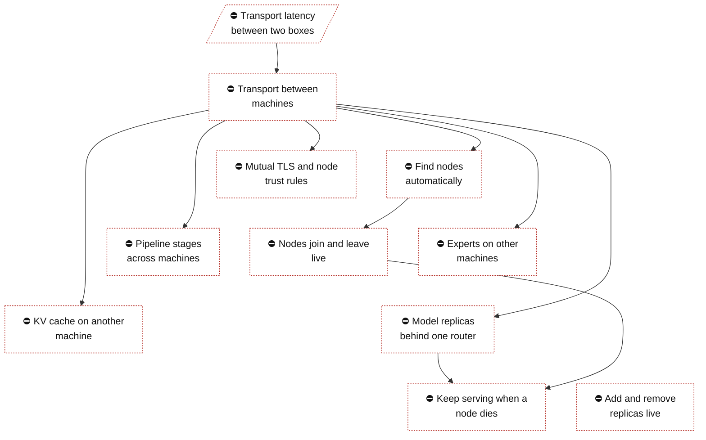

<!-- Generated by build.py from roadmap/nodes.yaml. Do not edit. -->

# cluster - multi-node cluster

Scope: Phase 6 and on: transport, discovery, mTLS, replicas, failover, stages, experts and KV across machines.

[Back to the page](../../roadmap.md) · [legend](../../roadmap.md#legend)

<!-- BEGIN GENERATED: track-cluster -->

<!-- END GENERATED: track-cluster -->

## Node table

<!-- BEGIN GENERATED: table-cluster -->
| id | title | kind | lane | state | outcome | start | end | depends_on | replaced_by | qualified_by | headline | evidence |
|---|---|---|---|---|---|---|---|---|---|---|---|---|
| `cluster-transport-wan` | Transport latency between two boxes | experiment | cluster | blocked | unrated |  |  | bench-m2-report |  |  |  |  |
| `cluster-owner-transport` | Owner picks the network transport | owner-decision | owner | blocked | n/a |  |  | cluster-transport-wan |  |  |  |  |
| `cluster-transport` | Transport between machines | feature | cluster | blocked | unrated |  |  | bench-m2-report, cluster-owner-transport |  |  |  |  |
| `cluster-mtls` | Mutual TLS and node trust rules | feature | cluster | blocked | unrated |  |  | cluster-transport |  |  |  |  |
| `cluster-discovery` | Find nodes automatically | feature | cluster | blocked | unrated |  |  | cluster-transport |  |  |  |  |
| `cluster-join-leave` | Nodes join and leave live | feature | cluster | blocked | unrated |  |  | cluster-discovery |  |  |  |  |
| `cluster-pipeline-nodes` | Pipeline stages across machines | feature | cluster | blocked | unrated |  |  | cluster-transport |  |  |  |  |
| `cluster-experts-nodes` | Experts on other machines | feature | cluster | blocked | unrated |  |  | cluster-transport |  |  |  |  |
| `cluster-remote-kv` | KV cache on another machine | feature | cluster | blocked | unrated |  |  | cluster-transport |  |  |  |  |
| `cluster-replicas` | Model replicas behind one router | feature | cluster | blocked | unrated |  |  | cluster-transport |  |  |  |  |
| `cluster-failover` | Keep serving when a node dies | feature | cluster | blocked | unrated |  |  | cluster-replicas, cluster-join-leave |  |  |  |  |
| `cluster-replica-scaling` | Add and remove replicas live | feature | cluster | blocked | unrated |  |  | cluster-replicas, bench-m3-report |  |  |  |  |

### Details per node

| id | title | verdict | headline | in plain words | notes | confirmed | waiting on | queue order | order reason |
|---|---|---|---|---|---|---|---|---|---|
| `cluster-transport-wan` | Transport latency between two boxes |  |  | Measure QUIC, TCP with TLS and plain TCP between two rented boxes, so the transport between machines is chosen on real network numbers, not only localhost ones (ADR 0023). | Done when: ADR 0023 holds WAN numbers for 8 KB and 1 MB messages with AES and ChaCha, plus Linux same-datacenter numbers. Needs two instances for about an hour; blocked behind M2 because the verdict sessions hold the box budget, not for a technical reason. RDMA is not on Vast. Source: ADR 0023 (Pending), plan.md Open decisions. |  |  |  |  |
| `cluster-owner-transport` | Owner picks the network transport |  |  | The owner chooses the transport between machines from the measured numbers; ADR 0023 leans to TCP with TLS for per-layer expert traffic and keeps QUIC for bulk and lossy links. | Done when: ADR 0023 is Accepted with a chosen transport. Source: ADR 0018, ADR 0023, plan.md Open decisions. |  |  |  |  |
| `cluster-transport` | Transport between machines |  |  | Phase 6: one transport trait for point-to-point and collective traffic between nodes, with trace context crossing nodes (plan feature 16). | Done when: two nodes exchange activations through the trait on the chosen protocol, with metrics, a dashboard panel and an alert (rule 6). Blocked behind the M2 report and the transport choice. Source: plan.md feature 16, Phase 6. |  |  |  |  |
| `cluster-mtls` | Mutual TLS and node trust rules |  |  | Every node proves its identity with a certificate (mutual TLS, certificates from step-ca), and rules say which node may see which data (plan feature 20). | Done when: a node without a valid certificate is refused, and a forbid rule keeps a unit off a node. Blocked behind the M2 report and the transport choice. Source: plan.md feature 20. |  |  |  |  |
| `cluster-discovery` | Find nodes automatically |  |  | Nodes come from a static list or are found on the local network (mDNS), and the profiler measures each link (plan feature 17). | Done when: a second node on the LAN is found and measured without configuration. Blocked behind the M2 report and the transport choice. Source: plan.md feature 17. |  |  |  |  |
| `cluster-join-leave` | Nodes join and leave live |  |  | A node can join or leave while the others keep serving; membership changes trigger a replan (plan feature 18). | Done when: a node joins and leaves under load with no failed request on the other nodes. Blocked behind the M2 report and the transport choice. Source: plan.md feature 18. |  |  |  |  |
| `cluster-pipeline-nodes` | Pipeline stages across machines |  |  | A model's layers are split into stages on different machines; only one activation per stage boundary crosses the network (plan feature 8, Phase 6 half). | Done when: logit parity across a two-node split, and tok/s within the planner's prediction band. Blocked behind the M2 report and the transport choice. Source: plan.md feature 8, Parallel shapes across slow links. |  |  |  |  |
| `cluster-experts-nodes` | Experts on other machines |  |  | Each machine computes the experts it holds and only activations cross the network, one round trip per MoE layer (plan feature 9, Phase 6 half; Linux only, ADR 0008). | Done when: logit parity with experts on two nodes, and the per-layer round trip within the measured transport latency. Blocked behind the M2 report and the transport choice. Source: plan.md feature 9, Experts across nodes. |  |  |  |  |
| `cluster-remote-kv` | KV cache on another machine |  |  | KV cache and cached prefixes can live on another node and be fetched instead of recomputed, so a prefix computed on one node serves requests on another (plan features 3 and 4, Phase 6 halves). | Done when: a prefix hit served from a remote node cuts time to first token against recomputing it. Blocked behind the M2 report and the transport choice. Source: plan.md features 3 and 4. |  |  |  |  |
| `cluster-replicas` | Model replicas behind one router |  |  | Copies of a model on several nodes behind one router; independent requests need no traffic between them, so any link latency is fine (plan feature 11). | Done when: two replicas serve one endpoint and throughput adds up within the band. Blocked behind the M2 report and the transport choice. Source: plan.md feature 11. |  |  |  |  |
| `cluster-failover` | Keep serving when a node dies |  |  | When a node fails, new requests go to the remaining replicas and in-flight requests on it fail cleanly (plan feature 19). | Done when: the Phase 6 kill test passes in CI on simulated nodes. Blocked behind the M2 report and the transport choice. Source: plan.md feature 19. |  |  |  |  |
| `cluster-replica-scaling` | Add and remove replicas live |  |  | Replicas are added or removed under load as traffic changes (plan feature 39). | Done when: a load step adds a replica and a quiet period removes it, with no failed request. Phase 7, blocked behind the M3 report. |  |  |  |  |

### Folded items per node

- `cluster-pipeline-nodes`: Pipeline stages across machines
  - No ggml_backend_tensor_copy_async binding yet; pipeline peer copies need it (m2-plan, E1 note)
- `cluster-failover`: Keep serving when a node dies
  - Sticky CUDA errors are detected by message text until the backend trait carries a sticky signal (m2-plan, E9 follow-ups)
<!-- END GENERATED: table-cluster -->
