<!-- Generated by build.py from roadmap/nodes.yaml. Do not edit. -->

# cluster - multi-node cluster

Scope: Phase 6 and on: transport, discovery, mTLS, replicas, failover, stages, experts and KV across machines.

[Back to the page](../../roadmap.md) · [legend](../../roadmap.md#legend)

```mermaid
flowchart TB
    cluster_transport_wan[/"✔ Transport latency<br/>between two boxes"/]
    cluster_transport["✔ Transport between<br/>machines"]
    cluster_planner["✔ Plans and<br/>predictions across<br/>nodes"]
    cluster_mtls["✔ Node certificates<br/>and trust rules"]
    cluster_discovery["✔ Node list, health<br/>and probes"]
    cluster_pipeline_nodes["✔ Pipeline stages<br/>across machines"]
    cluster_replicas["✔ Model replicas<br/>behind one router"]
    cluster_integration["✔ Cluster serving end<br/>to end"]
    cluster_join_leave["✔ Nodes join and leave<br/>live"]
    cluster_remote_kv["○ KV cache on another<br/>machine"]
    cluster_failover["✔ Keep serving when a<br/>node dies"]
    cluster_planner_hardening>"✔ Harden the cluster<br/>planner inputs"]
    cluster_pipeline_prefill["✔ Prefill pipelined<br/>across stages"]
    cluster_step_tokens_from_plan>"✔ Replica step size<br/>from the plan"]
    cluster_judged_round_cmd["✔ Judged round across<br/>two nodes"]
    cluster_mode1_detection>"✔ Head learns of a<br/>killed replica engine<br/>at once"]
    cluster_discovery_disk_names>"✔ Discovery names the<br/>builder disk"]
    cluster_failover_bound[/"✔ Failover bound per<br/>Case F mode"/]
    cluster_rejoin_after_restore>"✔ Head does not<br/>restart a replica<br/>after its node is<br/>restored"]
    cluster_prefix_fetch_not_triggered>"✔ No prefix fetch<br/>between replicas on<br/>two GPU nodes"]
    cluster_plan_source_gpu_segments>"✔ Planner proposes no<br/>plan for two real GPU<br/>boxes"]
    cluster_drain_without_plan>"✔ Node drain does not<br/>move load without a<br/>cluster plan"]
    cluster_head_led_plan_ignores_segments>"✔ A plan led by the<br/>head runs the whole<br/>model in process"]
    cluster_sharded_model_id["✔ One model id for a<br/>split GGUF on every<br/>node"]
    cluster_probe_control_idle>"✔ cluster probe to 64<br/>MiB dies on the daemon<br/>control-idle limit"]
    cluster_case_s_ready["✔ Case S readiness,<br/>covering pick, stage<br/>order and a real-<br/>binary dry run"]
    cluster_case_s_checks["✔ Case S checks, peak<br/>GPU memory rule and<br/>bit-identical judged<br/>prediction"]
    cluster_leader_move["⏸ Move a replica's<br/>leader"]
    cluster_experts_nodes["⏸ Experts on other<br/>machines"]
    cluster_replica_scaling["⛔ Add and remove<br/>replicas live"]
    cluster_profile_gpu_cap["○ Cap a node's GPU<br/>memory"]
    cluster_prefix_fetch_not_observed>"⚠ Prefix fetch between<br/>real processes not<br/>demonstrated"]
    cluster_second_cold_request_empty>"⚠ Second cold request<br/>through a split plan<br/>returns an empty<br/>stream"]
    cluster_transport_wan ~~~ cluster_transport
    cluster_transport_wan ~~~ cluster_planner
    cluster_transport ~~~ cluster_mtls
    cluster_planner ~~~ cluster_discovery
    cluster_mtls ~~~ cluster_pipeline_nodes
    cluster_discovery ~~~ cluster_replicas
    cluster_pipeline_nodes ~~~ cluster_integration
    cluster_replicas ~~~ cluster_join_leave
    cluster_replicas ~~~ cluster_remote_kv
    cluster_integration ~~~ cluster_failover
    cluster_join_leave ~~~ cluster_planner_hardening
    cluster_remote_kv ~~~ cluster_pipeline_prefill
    cluster_failover ~~~ cluster_step_tokens_from_plan
    cluster_planner_hardening ~~~ cluster_judged_round_cmd
    cluster_pipeline_prefill ~~~ cluster_mode1_detection
    cluster_step_tokens_from_plan ~~~ cluster_discovery_disk_names
    cluster_judged_round_cmd ~~~ cluster_failover_bound
    cluster_mode1_detection ~~~ cluster_rejoin_after_restore
    cluster_discovery_disk_names ~~~ cluster_prefix_fetch_not_triggered
    cluster_failover_bound ~~~ cluster_plan_source_gpu_segments
    cluster_rejoin_after_restore ~~~ cluster_drain_without_plan
    cluster_prefix_fetch_not_triggered ~~~ cluster_head_led_plan_ignores_segments
    cluster_plan_source_gpu_segments ~~~ cluster_sharded_model_id
    cluster_drain_without_plan ~~~ cluster_probe_control_idle
    cluster_head_led_plan_ignores_segments ~~~ cluster_case_s_ready
    cluster_sharded_model_id ~~~ cluster_case_s_ready
    cluster_probe_control_idle ~~~ cluster_case_s_ready
    cluster_case_s_ready ~~~ cluster_case_s_checks
    cluster_case_s_ready ~~~ cluster_leader_move
    cluster_case_s_ready ~~~ cluster_experts_nodes
    cluster_case_s_checks ~~~ cluster_replica_scaling
    cluster_leader_move ~~~ cluster_profile_gpu_cap
    cluster_experts_nodes ~~~ cluster_prefix_fetch_not_observed
    cluster_replica_scaling ~~~ cluster_second_cold_request_empty
    cluster_profile_gpu_cap ~~~ cluster_second_cold_request_empty
    cluster_prefix_fetch_not_observed ~~~ cluster_second_cold_request_empty
    cluster_transport_wan --> cluster_transport
    cluster_transport_wan --> cluster_planner
    cluster_transport --> cluster_mtls
    cluster_planner --> cluster_mtls
    cluster_transport --> cluster_discovery
    cluster_planner --> cluster_pipeline_nodes
    cluster_discovery --> cluster_pipeline_nodes
    cluster_discovery --> cluster_replicas
    cluster_replicas --> cluster_integration
    cluster_pipeline_nodes --> cluster_integration
    cluster_replicas --> cluster_join_leave
    cluster_replicas --> cluster_remote_kv
    cluster_join_leave --> cluster_failover
    cluster_planner --> cluster_planner_hardening
    cluster_pipeline_nodes --> cluster_pipeline_prefill
    cluster_pipeline_prefill --> cluster_step_tokens_from_plan
    cluster_pipeline_prefill --> cluster_judged_round_cmd
    cluster_mode1_detection --> cluster_failover_bound
    cluster_judged_round_cmd --> cluster_case_s_ready
    cluster_sharded_model_id --> cluster_case_s_ready
    cluster_case_s_ready --> cluster_case_s_checks
    classDef vsucc fill:#2e9e4f,stroke:#1b6b34,color:#fff
    classDef succ fill:#bfe8c8,stroke:#2e9e4f,color:#111
    classDef mixed fill:#ffd37a,stroke:#c98a00,color:#111
    classDef bad fill:#f28b82,stroke:#b3261e,color:#111
    classDef dead fill:#e6e6e6,stroke:#777,stroke-dasharray:5 5,color:#555
    classDef inprog fill:#a8cdf5,stroke:#1f6fc5,color:#111
    classDef next fill:#fff,stroke:#333,color:#111
    classDef blocked fill:#fff,stroke:#b3261e,stroke-dasharray:2 2,color:#111
    classDef parked fill:#f3f3f3,stroke:#999,color:#555
    classDef unrated fill:#fff,stroke:#333,stroke-dasharray:1 3,color:#111
    classDef gate fill:#d9c2f0,stroke:#7b3fb5,color:#111
    classDef decided fill:#ece0f7,stroke:#7b3fb5,stroke-dasharray:2 2,color:#111
    classDef finding fill:#ffe0b2,stroke:#d84315,stroke-width:2px,color:#111
    classDef waiting fill:#e3f2fd,stroke:#1f6fc5,stroke-dasharray:5 5,color:#111
    class cluster_transport_wan,cluster_transport,cluster_planner,cluster_mtls,cluster_discovery,cluster_pipeline_nodes,cluster_replicas,cluster_integration,cluster_join_leave,cluster_failover,cluster_pipeline_prefill,cluster_judged_round_cmd,cluster_failover_bound,cluster_sharded_model_id,cluster_case_s_ready,cluster_case_s_checks unrated
    class cluster_remote_kv,cluster_profile_gpu_cap next
    class cluster_planner_hardening,cluster_step_tokens_from_plan,cluster_mode1_detection,cluster_discovery_disk_names,cluster_rejoin_after_restore,cluster_prefix_fetch_not_triggered,cluster_plan_source_gpu_segments,cluster_drain_without_plan,cluster_head_led_plan_ignores_segments,cluster_probe_control_idle succ
    class cluster_leader_move,cluster_experts_nodes parked
    class cluster_replica_scaling blocked
    class cluster_prefix_fetch_not_observed,cluster_second_cold_request_empty finding
```

<!-- BEGIN GENERATED: track-cluster -->

<!-- END GENERATED: track-cluster -->

## Node table

<!-- BEGIN GENERATED: table-cluster -->
| id | title | kind | lane | state | outcome | start | end | depends_on | replaced_by | qualified_by | headline | evidence |
|---|---|---|---|---|---|---|---|---|---|---|---|---|
| `cluster-transport-wan` | Transport latency between two boxes | experiment | cluster | done | unrated | 2026-11-23 | 2026-11-23 | bench-m2-report |  |  | WAN 90 ms: 8 KB equal within noise; 1 MB QUIC 196 ms vs TLS 274 to 300 ms (untuned TCP); same host 8 KB TLS 0.41 vs QUIC 0.58 ms | bench/results/transport-wan-20261123/README.md; docs/adr/0023-transport-spike.md; scripts/transport_wan_bench.sh |
| `cluster-owner-transport` | Owner picks the network transport | owner-decision | owner | done | n/a | 2026-11-23 | 2026-11-23 | cluster-transport-wan |  |  | TCP+TLS chosen | docs/adr/0023-transport-spike.md |
| `cluster-transport` | Transport between machines | feature | cluster | done | unrated | 2026-11-23 | 2026-11-23 | bench-m2-report, cluster-owner-transport |  |  |  | docs/adr/0091-phase6-multi-node.md; crates/transport/src/frame.rs; crates/transport/src/identity.rs; crates/transport/src/mem.rs; crates/transport/src/tls_transport.rs; crates/transport/tests/tls.rs; crates/transport/tests/mem.rs; crates/tetraeder/tests/frame_golden.rs; crates/tetraeder/tests/worker_mem.rs; deploy/alerts/cluster.yml; deploy/grafana/dashboards/cluster.json |
| `cluster-owner-phase6-design` | Owner accepts the Phase 6 design | owner-decision | owner | done | n/a | 2026-11-23 | 2026-11-23 | cluster-owner-transport |  |  | ADR 0091 accepted | docs/adr/0091-phase6-multi-node.md |
| `cluster-planner` | Plans and predictions across nodes | feature | ci | done | unrated | 2026-11-23 | 2026-11-23 | cluster-owner-transport |  |  | planner first prediction for the 235B, decode 3.62 tok/s on the WAN pair and 5.43 on the same host, one node 0.49 (uniform routing prior) | docs/adr/0091-phase6-multi-node.md; crates/planner/tests/cluster.rs; crates/plan/tests/cluster.rs; crates/costmodel/src/cluster/tests.rs; crates/planner/tests/single_node_identity.rs |
| `cluster-mtls` | Node certificates and trust rules | feature | cluster | done | unrated | 2026-11-23 | 2026-11-24 | cluster-transport, cluster-planner, cluster-owner-phase6-design |  |  | done in steps 1 and 2 | docs/adr/0091-phase6-multi-node.md; crates/transport/src/tls_transport.rs |
| `cluster-integration` | Cluster serving end to end | feature | ci | done | unrated | 2026-11-24 | 2026-11-24 | cluster-replicas, cluster-pipeline-nodes |  |  | serve --cluster runs as a process with a head that leads no replica, replicas derived from a cluster plan, a pipeline replica across two daemons equals the one-node run, the real prefix cache is fetched and restored, and a planned drain of a replica across nodes fails no request; the planner cannot plan CPU nodes and a lost leader is not retargeted | docs/adr/0091-phase6-multi-node.md; crates/tetraeder/tests/cluster_integration.rs; crates/control/tests/planned_drain.rs; crates/control/tests/specs_from_plan.rs; crates/control/tests/router_props.rs |
| `cluster-step-tokens-from-plan` | Replica step size from the plan | defect | ci | done | unrated | 2026-11-25 | 2026-11-25 | cluster-pipeline-prefill |  |  | a replica steps the tokens its plan priced | docs/adr/0091-phase6-multi-node.md; crates/tetraeder/src/replica.rs |
| `cluster-mode1-detection` | Head learns of a killed replica engine at once | defect | ci | done | unrated | 2026-11-25 | 2026-11-25 | bench-phase6-rehearsal |  |  | a slow reap of a killed engine no longer delays the in-flight errors | bench/results/phase6-rehearsal-20261125/README.md; docs/adr/0091-phase6-multi-node.md; crates/control/tests/case_f.rs |
| `cluster-discovery-disk-names` | Discovery names the builder disk | defect | ci | done | unrated | 2026-11-25 | 2026-11-25 | bench-phase6-rehearsal |  |  | an unedited cluster profile graph gives the 235B its spanning candidate | docs/adr/0091-phase6-multi-node.md; crates/planner/tests/cluster_discovered_ram_experts.rs; crates/profiler/src/discover.rs |
| `cluster-failover-bound` | Failover bound per Case F mode | experiment | ci | done | unrated | 2026-11-25 | 2026-11-25 | cluster-mode1-detection |  |  | worst case 2.13 s at the default, under the 3 s rule | docs/adr/0091-phase6-multi-node.md; crates/control/tests/case_f.rs; crates/control/src/cluster.rs |
| `cluster-leader-move` | Move a replica's leader | feature | ci | parked | unrated |  |  | bench-phase6-exit |  |  |  |  |
| `cluster-judged-round-cmd` | Judged round across two nodes | tooling | ci | done | unrated | 2026-11-25 | 2026-11-25 | cluster-pipeline-prefill |  |  | one judged round and the graph merge are tetraeder subcommands | docs/adr/0091-phase6-multi-node.md; crates/tetraeder/tests/judged_round.rs; crates/tetraeder/src/judged.rs; crates/tetraeder/src/hw_merge.rs |
| `cluster-planner-hardening` | Harden the cluster planner inputs | defect | ci | done | unrated | 2026-11-25 | 2026-11-25 | cluster-planner |  |  | inputs refused, not panicked | docs/adr/0091-phase6-multi-node.md; crates/planner/tests/cluster_hardening.rs |
| `cluster-discovery` | Node list, health and probes | feature | cluster | done | unrated | 2026-11-24 | 2026-11-24 | cluster-transport |  |  | node daemon, membership and probes done; killed daemon rejoins within node_down_after plus one heartbeat on MemTransport and loopback TLS; step 1 review fixes in | docs/adr/0091-phase6-multi-node.md; crates/control/tests/sim.rs; crates/control/tests/tls_loopback.rs; crates/transport/tests/hardening.rs |
| `cluster-join-leave` | Nodes join and leave live | feature | cluster | done | unrated | 2026-11-24 | 2026-11-24 | cluster-discovery, cluster-replicas |  |  | a node whose replica answers one probe step joins the router, a node that goes down or a broken connection takes it out, and a restored node or a restarted engine rejoins without manual action, on simulated nodes and two real node processes; the drain and restart of a pipeline over nodes is not built | docs/adr/0091-phase6-multi-node.md; crates/control/tests/case_f.rs; crates/control/tests/router_props.rs; crates/control/tests/replica_daemon.rs; crates/tetraeder/tests/replica_smoke.rs |
| `cluster-pipeline-nodes` | Pipeline stages across machines | feature | cluster | done | unrated | 2026-11-24 | 2026-11-24 | cluster-planner, cluster-discovery |  |  | two-node splits match the one-node run at every layer boundary of the 4-layer dense and the tiny MoE with the head on either node, over MemTransport and loopback TLS; two real node processes decode through a PipelineBackend; prefill is not pipelined across segments yet | docs/adr/0091-phase6-multi-node.md; crates/model/tests/segments.rs; crates/tetraeder/tests/pipeline_parity.rs; crates/tetraeder/tests/pipeline_smoke.rs; crates/tetraeder/tests/pipeline_contract.rs; crates/planner/tests/segment_shape.rs |
| `cluster-pipeline-prefill` | Prefill pipelined across stages | feature | ci | done | unrated | 2026-11-25 | 2026-11-25 | cluster-pipeline-nodes |  |  | a prefill step is cut into micro-batches in flight across the segments of a PipelineBackend, as the flow-shop price of predict_cluster assumes; on a slowed link it took 0.69 of the walk time (0.75 on Windows) (four micro-batches, a 0.85 limit), with the same logits and greedy tokens | docs/adr/0091-phase6-multi-node.md; crates/tetraeder/src/pipeline.rs; crates/tetraeder/tests/pipeline_parity.rs; crates/tetraeder/tests/pipeline_contract.rs |
| `cluster-experts-nodes` | Experts on other machines | feature | cluster | parked | unrated |  |  | bench-phase6-exit |  |  |  |  |
| `cluster-remote-kv` | KV cache on another machine | feature | cluster | next | unrated | 2026-11-24 | 2026-11-24 | cluster-replicas |  |  | the priced fetch rule and the fetch between two replica leaders over the transport work on simulated nodes with fake prefix stores; the real scheduler has no prefix store yet, so a fetched prefix is not decoded and no real prefix is fetched | docs/adr/0091-phase6-multi-node.md; crates/control/tests/kv_sim.rs |
| `cluster-replicas` | Model replicas behind one router | feature | cluster | done | unrated | 2026-11-24 | 2026-11-24 | cluster-discovery |  |  | two replicas serve one endpoint behind a router with prefix affinity then least outstanding, a remote replica sends one small frame per token, and a real tiny MoE replica process gives the in-process tokens; replicas that span nodes and serve --cluster are not run by a test yet | docs/adr/0091-phase6-multi-node.md; crates/control/tests/case_f.rs; crates/control/tests/router_props.rs; crates/control/tests/replica_daemon.rs; crates/tetraeder/tests/replica_smoke.rs; crates/control/tests/kv_sim.rs; crates/gateway/tests/wire.rs; crates/tetraeder/tests/pipeline_contract.rs |
| `cluster-failover` | Keep serving when a node dies | feature | cluster | done | unrated | 2026-11-24 | 2026-11-24 | cluster-replicas, cluster-join-leave |  |  | in-flight requests on the lost replica end with one error each within node_down_after plus 1 s for a killed engine, a killed daemon and a blackholed link, an engine that fails its steps keeps its replica in the router, no request on the other replica fails and later requests succeed, on simulated nodes with a 1 s node_down_after | docs/adr/0091-phase6-multi-node.md; crates/control/tests/case_f.rs; crates/control/tests/router_props.rs; crates/control/tests/replica_daemon.rs; crates/tetraeder/tests/replica_smoke.rs |
| `cluster-replica-scaling` | Add and remove replicas live | feature | cluster | blocked | unrated |  |  | cluster-replicas, bench-m3-report |  |  |  |  |
| `cluster-owner-routing-input` | Routing trace as prediction input | owner-decision | owner | done | n/a | 2026-11-24 | 2026-11-24 | bench-235b-stream-predict |  |  | trace allowed | docs/notes/stream-predict-diagnosis.md |
| `cluster-rejoin-after-restore` | Head does not restart a replica after its node is restored | defect | cluster | done | unrated | 2026-11-25 | 2026-11-25 | bench-phase6-rehearsal |  |  | a replica that loads slower than the hello wait joins again | bench/results/phase6-rehearsal-20261125/README.md; docs/adr/0091-phase6-multi-node.md; crates/control/tests/join_loop.rs |
| `cluster-prefix-fetch-not-triggered` | No prefix fetch between replicas on two GPU nodes | defect | cluster | done | unrated | 2026-11-25 | 2026-11-25 | bench-phase6-rehearsal |  |  | the head replica now reports its KV size and serves its cache | bench/results/phase6-rehearsal-20261125/README.md; docs/adr/0091-phase6-multi-node.md; crates/control/tests/local_holder_fetch.rs |
| `cluster-plan-source-gpu-segments` | Planner proposes no plan for two real GPU boxes | defect | cluster | done | unrated | 2026-11-25 | 2026-11-25 | bench-phase6-rehearsal |  |  | the planner prices an all-GPU segment and proposes splits for two GPU boxes | bench/results/phase6-rehearsal-20261125/README.md; docs/adr/0091-phase6-multi-node.md; crates/planner/tests/cluster_gpu_segments.rs |
| `cluster-drain-without-plan` | Node drain does not move load without a cluster plan | defect | cluster | done | unrated | 2026-11-25 | 2026-11-25 | bench-phase6-rehearsal |  |  | a drained node takes no new request without a plan | bench/results/phase6-rehearsal-20261125/README.md; docs/adr/0091-phase6-multi-node.md; crates/control/tests/join_loop.rs |
| `cluster-profile-gpu-cap` | Cap a node's GPU memory | feature | ci | next | unrated |  |  | bench-phase6-exit-s |  |  |  |  |
| `cluster-prefix-fetch-not-observed` | Prefix fetch between real processes not demonstrated | defect | cluster | next | unrated |  |  | bench-phase6-rehearsal-2 |  |  | a fetch priced to win was not seen, no grant log line, no readable counter | bench/results/phase6-rehearsal-2-20261125/README.md |
| `cluster-head-led-plan-ignores-segments` | A plan led by the head runs the whole model in process | defect | cluster | done | unrated | 2026-11-25 | 2026-11-25 | bench-phase6-rehearsal-2 |  |  | a split replica the head leads starts through the head own daemon and computes on both nodes | bench/results/phase6-rehearsal-2-20261125/README.md; crates/tetraeder/tests/cluster_integration.rs |
| `cluster-second-cold-request-empty` | Second cold request through a split plan returns an empty stream | defect | cluster | next | unrated |  |  | bench-phase6-rehearsal-2 |  |  | after one cold 2048-token request the next cold one ends with nothing | bench/results/phase6-rehearsal-2-20261125/README.md |
| `cluster-sharded-model-id` | One model id for a split GGUF on every node | feature | cluster | done | unrated | 2026-11-25 | 2026-11-25 | bench-phase6-rehearsal-2 |  |  | a split GGUF has one 64 hex id, a manifest of its shards, checked on every node before anything starts | bench/results/phase6-rehearsal-2-20261125/README.md; crates/model/tests/model_id.rs; crates/control/tests/check_model.rs; crates/tetraeder/tests/cluster_integration.rs |
| `cluster-probe-control-idle` | cluster probe to 64 MiB dies on the daemon control-idle limit | defect | cluster | done | unrated | 2026-11-25 | 2026-11-25 | bench-phase6-rehearsal-2 |  |  | a probe connection is cut after 300 s without a byte, not 30 s between frames | bench/results/phase6-rehearsal-2-20261125/README.md; crates/control/tests/probe_limits.rs |
| `cluster-case-s-ready` | Case S readiness, covering pick, stage order and a real-binary dry run | tooling | ci | done | unrated | 2026-11-25 | 2026-11-25 | cluster-judged-round-cmd, cluster-sharded-model-id |  |  | the judged Case S pick is a covering plan within the measured budgets, a refused pick costs no download, and the real binaries run the dry run | docs/adr/0091-phase6-multi-node.md; docs/notes/phase6-rule-changes.md; docs/box-driver.md; crates/planner/tests/cluster_discovered_ram_experts.rs; crates/planner/tests/tiny_case_s_plan.rs; crates/tetraeder/tests/model_split.rs; scripts/phase6_exit_s.sh; scripts/phase6_loopback_check_s.py; .github/workflows/ci.yml |
| `cluster-case-s-checks` | Case S checks, peak GPU memory rule and bit-identical judged prediction | tooling | ci | done | unrated | 2026-11-26 | 2026-11-26 | cluster-case-s-ready |  |  | the Case S summary checks the fitted-rate link gate, the 24 GiB peak GPU memory rule on GPU segments only, and the micro-batch offload pricing | docs/adr/0091-phase6-multi-node.md; docs/adr/0092-costmodel-6-streamed-moe-segments.md; scripts/phase6_exit_s.sh; crates/planner/tests/cluster_discovered_ram_experts.rs |

### Details per node

| id | title | verdict | headline | in plain words | notes | confirmed | waiting on | queue order | order reason |
|---|---|---|---|---|---|---|---|---|---|
| `cluster-transport-wan` | Transport latency between two boxes | Status: clean. WAN set is thin (3 repetitions, 300 round trips per size, so p99 is the third slowest sample); loopback and same-host sets follow ADR 0023's size (2000 round trips, 5 repetitions). | WAN 90 ms: 8 KB equal within noise; 1 MB QUIC 196 ms vs TLS 274 to 300 ms (untuned TCP); same host 8 KB TLS 0.41 vs QUIC 0.58 ms | Measured QUIC, TCP with TLS and plain TCP between two rented boxes (Connecticut and Germany, 90 ms), on one host and on Linux loopback; ADR 0023 holds the numbers, and no same-datacenter pair on different hosts was on offer. | Done when: ADR 0023 holds WAN numbers for 8 KB and 1 MB messages with AES and ChaCha, plus Linux same-datacenter numbers. Needs two instances for about an hour; blocked behind M2 because the verdict sessions hold the box budget, not for a technical reason. RDMA is not on Vast. Source: ADR 0023 (Pending), plan.md Open decisions. |  |  |  |  |
| `cluster-owner-transport` | Owner picks the network transport | TCP with TLS (mTLS) for Phase 6, QUIC kept as a later option for bulk and WAN, behind a transport trait (owner 2026-11-23) | TCP+TLS chosen | The owner chooses the transport between machines from the measured numbers; ADR 0023 leans to TCP with TLS for per-layer expert traffic and keeps QUIC for bulk and lossy links. | Done when: ADR 0023 is Accepted with a chosen transport. Source: ADR 0018, ADR 0023, plan.md Open decisions. |  |  |  |  |
| `cluster-transport` | Transport between machines | CI cluster-transport run 45179950926, test (ubuntu-24.04) success, test (windows-latest) success, golden-byte frame test, TLS and Mem transport tests (refusals, pinned and CA anchors, buffers read back) and RemoteBackend cases over MemTransport pass (not measured) |  | Phase 6 step 1 (ADR 0091), one transport trait with a TLS implementation (mutual authentication against trust anchors) and an in-process one with injected faults; the worker protocol runs over it unchanged (plan feature 16). | Done when (ADR 0091, build order 1), a golden-byte test shows the moved frame code writes the same frames as remote_backend, frame property tests pass, unknown and wrong certificates are refused, pinned self-signed and CA anchors are both accepted, the effective socket buffer sizes are read back and logged (an explicit size on Linux is capped at net.core.rmem_max and turns autotuning off, so the size is measured per link, not fixed), a loopback TLS round trip works, and the RemoteBackend restart tests and the Phase 5 parity and golden tests pass; link metrics, the links panel row and the TLS-rejected alert in the same change. CI only. Phase 6 code stays on its branch until bench-regression-gate has run on main. |  |  |  |  |
| `cluster-owner-phase6-design` | Owner accepts the Phase 6 design | Vast WAN pair, pinned self-signed certificates, 64 GB emulated by the balloon, mDNS out of M3, no HA gateway, remote experts after the exit (owner 2026-11-23) | ADR 0091 accepted | The owner accepts ADR 0091 and answers its open questions (exit hardware, Vast pair or homelab; how nodes get certificates; the emulated RAM budget; mDNS in or out of M3; the other scope cuts). | Gates the certificate tooling and the box sessions only; the simulated steps (transport, planner) start before it. |  |  |  |  |
| `cluster-planner` | Plans and predictions across nodes | test the_235b_spans_both_nodes_on_every_two_node_fixture ... ok (CI run 45178068154, ubuntu-24.04) | planner first prediction for the 235B, decode 3.62 tok/s on the WAN pair and 5.43 on the same host, one node 0.49 (uniform routing prior) | The planner sees nodes and the measured links between them, cuts a model into per-node segments, and predicts their speed as the sum of each node's own prediction plus the network hops (ADR 0091). | Done when (ADR 0091, build order 2), plan, segment and prediction property tests pass on every simulated cluster fixture, and one-node plans predict bit-identically to today. CI only, crates profiler, plan, costmodel and planner; runs in parallel with the transport step. |  |  |  |  |
| `cluster-mtls` | Node certificates and trust rules | Delivered by steps 1 and 2 - tetraeder cluster cert, pinned self-signed anchors through one verifier, forbid node in the validator (CI runs 45179950926 and 45178068154) | done in steps 1 and 2 | Each node gets a certificate the way the owner picks (pinned self-signed, own CA or step-ca), and a forbid rule keeps units, and the request content they see, off a node (plan feature 20). | Done when (ADR 0091), the certificate tooling of the owner's choice exists, a node with another certificate is refused on the rehearsal boxes, and plans with a forbid node rule never use that node (planner property test). |  |  |  |  |
| `cluster-integration` | Cluster serving end to end | prefix fetch real scheduler fetched_cached_tokens 145 recomputed_cached_tokens 6 tokens_equal true; planned drain pipeline replica dense4 failed_requests 0 ok_requests 114 tokens_equal true; cluster plan pipeline replica dense4 greedy_equal_one_node true (CI run 45476953829) | serve --cluster runs as a process with a head that leads no replica, replicas derived from a cluster plan, a pipeline replica across two daemons equals the one-node run, the real prefix cache is fetched and restored, and a planned drain of a replica across nodes fails no request; the planner cannot plan CPU nodes and a lost leader is not retargeted | The step 5 gaps - serve --cluster and its head run in a test, a head without a replica of its own, replicas.toml derived from the cluster plan, a pipeline replica across nodes run through the daemons end to end, the real scheduler prefix store served and installed over the transport, NodeChange replanning and a planned drain of a segmented replica. | cluster-remote-kv and cluster-join-leave were marked done on CI-scoped terms (fake prefix stores; a whole-replica restart instead of a planned drain); this node carries what the rehearsal needs. |  |  |  |  |
| `cluster-step-tokens-from-plan` | Replica step size from the plan | the_step_is_the_plans_micro_batches_times_its_ubatch gave 4 micro-batches at ubatch 2048 give 8192, at ubatch 512 give 2048 (CI of branch cluster-preexit) | a replica steps the tokens its plan priced | The replica now sets its scheduler step tokens from the plan's micro-batches times its ubatch (an explicit --step-tokens still wins), so pipelined prefill runs the flow shop the planner priced; the Case S pick of 4 micro-batches at ubatch 2048 steps 8192 tokens. |  |  |  |  |  |
| `cluster-mode1-detection` | Head learns of a killed replica engine at once | case_f_a_child_that_is_slow_to_be_reaped_does_not_delay_the_errors gave errors under 500 ms with a 3 s reap, 3.002 s before the fix (CI of branch cluster-preexit) | a slow reap of a killed engine no longer delays the in-flight errors | The daemon waited for the killed engine to be reaped before it dropped the head's connection, and a process with a CUDA context takes seconds to leave (rehearsal mode 1 took 2.79 s against 1 ms simulated); it now drops the connection first. The cause on the real box is inferred from the code and the logs, not measured. |  |  |  |  |  |
| `cluster-discovery-disk-names` | Discovery names the builder disk | case_s_candidate pick=c00 stages=2 ubatch=Some(2048) ram_expert_stages=2, discovery_gives_the_235b_a_spanning_candidate_with_ram_experts ok (CI of branch cluster-discovery-disks) | an unedited cluster profile graph gives the 235B its spanning candidate | Discovery named every disk disk0 and gave the device no read rate, so the planner homed every 235B expert in RAM and the validator rejected all candidates; the volume that holds the node's models dir is now nvme0 with its link prior as the rate, and the test builds the graph from recorded volumes with no edit. The RAM budget of a judged session is still a graph edit unless the box's RAM is the budget. |  |  |  |  |  |
| `cluster-failover-bound` | Failover bound per Case F mode | case_f_bound mode=KillWorker worst_error_s=0.001 computed_bound_s=0.000, mode=KillDaemon 0.001 and 0.000, mode=Blackhole worst_error_s=1.044 computed_bound_s=1.067 at node_down_after 1 s (CI of branch cluster-discovery-disks) | worst case 2.13 s at the default, under the 3 s rule | The worst time from a node fault to the in-flight error on the head, from the code, a killed engine or daemon closes the connection with no timer, a partition costs node_down_after plus the tick plus one pause step, 2.13 s at 2 s, plus one one-way delay on a real link. Simulated nodes confirm each mode within its bound. Findings, an engine that hangs with its daemon alive has no timer, and a receiver that does not drain delays the errors by up to 60 s each. |  |  |  |  |  |
| `cluster-leader-move` | Move a replica's leader |  |  | A replan that moves a replica's leader node replaces the replica (drain the old one, start a new id on the new leader, no prefix carried), as ADR 0091 decides; ClusterControl::restart refuses such a plan today. Parked until after the exit, which needs no leader move. |  |  |  |  |  |
| `cluster-judged-round-cmd` | Judged round across two nodes | CI run 45640528598 ubuntu and windows - test cpu_a_judged_round_across_two_loopback_nodes_writes_the_files_the_summary_reads ... ok; test a_replica_being_replaced_keeps_the_requests_waiting_until_the_new_one_joins ... ok | one judged round and the graph merge are tetraeder subcommands | A Rust command that runs one judged Case S round across the two nodes (pp2048 then tg128 with the warm request, no prefix reuse, per-segment counters, the plan's own slot counts) and writes the JSON phase6_exit_s.sh reads through JUDGED_ROUND_CMD; the node graph merge also moves from the Python overlay into a Rust reader checked in CI. |  |  |  |  |  |
| `cluster-planner-hardening` | Harden the cluster planner inputs | CI run 45527752415 ubuntu and windows - test a_node_name_is_one_path_segment ... ok; test forbid_node_also_rules_out_kv_workspace_and_slot_caches ... ok | inputs refused, not panicked | Review findings on step 2 - validate node names at load (no slash, not empty, no duplicates), cap enumerate_cluster's node-order search, flag empty stage devices when nodes are involved, enforce forbid node on KV and slot caches too, and turn slice panics on malformed layouts into errors. | From the read-only review of 81d4ecc4..51738939 (2026-11-24); none reachable without a malformed cluster.toml or layout. The transport findings of the same review went to cluster-discovery. |  |  |  |  |
| `cluster-discovery` | Node list, health and probes | test a_killed_and_restarted_daemon_rejoins_within_down_after_plus_one_heartbeat ... ok (CI run 45305038491, ubuntu and windows, with the membership fault tests and two loopback TLS daemons profiling and probing each other) | node daemon, membership and probes done; killed daemon rejoins within node_down_after plus one heartbeat on MemTransport and loopback TLS; step 1 review fixes in | Nodes come from a static cluster file; a node daemon on each box answers heartbeats, reports its hardware and starts workers, and a probe measures every link through the real transport (plan feature 17; mDNS later, ADR 0091). | Done when (ADR 0091, build order 3), membership property tests pass under every simulated fault, and two node daemons on loopback TLS profile and probe each other (autotuned and explicit buffers); cluster cert generates keys on the box that never enter the repo or a pushed HEAD, and the session driver builds cluster.toml after create and uploads it; panel rows and alerts in the same change. CI only, crates control and tetraeder. |  |  |  |  |
| `cluster-join-leave` | Nodes join and leave live | case_f mode=Blackhole requests=185 in_flight_errors=3 max_error_s=1.030 bound_s=2.0 moved=2 ok_after_bound=18 rejoin_s=0.739 (CI run 45424566387, ubuntu and windows) | a node whose replica answers one probe step joins the router, a node that goes down or a broken connection takes it out, and a restored node or a restarted engine rejoins without manual action, on simulated nodes and two real node processes; the drain and restart of a pipeline over nodes is not built | A node can join or leave while the others keep serving; a replica joins the router once loaded and probed and leaves when its node goes down, and a pipeline over nodes is drained and restarted with a new plan (plan feature 18; live resharding is Phase 7). | Done when (ADR 0091), on simulated nodes a node joins and leaves under load with no failed request on the other nodes, and a restored node rejoins without manual action. Done as built (ADR 0091 History, step 5) for replicas of one node; since step 6 (cluster-integration) a node change replans the replicas that span it and a planned change drains the replica first (its requests finish), while a node that goes down still fails the requests in flight on it. |  |  |  |  |
| `cluster-pipeline-nodes` | Pipeline stages across machines | pipeline parity dense4 cut 2 head on_leader nodes a_then_b transport tls max_logit_diff 0e0 bit_equal true (CI run 45321864540, ubuntu and windows, with every other cut, head placement and node order over MemTransport, and a smoke test of two real node processes) | two-node splits match the one-node run at every layer boundary of the 4-layer dense and the tiny MoE with the head on either node, over MemTransport and loopback TLS; two real node processes decode through a PipelineBackend; prefill is not pipelined across segments yet | A model's layers are split into stages on different machines; only one activation per stage boundary crosses the network (plan feature 8, Phase 6 half). | Done when (ADR 0091, build order 4), two-node splits match the one-node run within tol_batch at the first, middle and last layer boundary, with the head on either node, on simulated CPU nodes in CI; segment residuals, the pipeline panel row and the segment-drift alert in the same change. Builders take and return hidden rows; the head drives segments in order. Done as built (ADR 0091 History, step 4): scheduler path only, the executor paths refuse a segment, prefill walks the segments one chunk at a time, and the residual metric is wired when serve takes a cluster (step 5). |  |  |  |  |
| `cluster-pipeline-prefill` | Prefill pipelined across stages | pipelined prefill slow link walk 1.312 s pipelined 0.904 s ratio 0.69 (CI run 45526039702, ubuntu; windows 1.266 s and 0.951 s, ratio 0.75) | a prefill step is cut into micro-batches in flight across the segments of a PipelineBackend, as the flow-shop price of predict_cluster assumes; on a slowed link it took 0.69 of the walk time (0.75 on Windows) (four micro-batches, a 0.85 limit), with the same logits and greedy tokens | A long prompt is cut into chunks that run on different machines at the same time, so the stages are not idle while one chunk crosses the network (ADR 0077 across nodes). | Done when (ADR 0091, build order 4, the part step 4 left), several micro-batches are in flight across the segments of a PipelineBackend, with parity against the sequential walk on CPU nodes in CI and the predicted flow-shop time of predict_cluster checked on a simulated slow link; the executor paths take hidden rows in the same change if the exit needs them. |  |  |  |  |
| `cluster-experts-nodes` | Experts on other machines |  |  | Each machine computes the experts it holds and only activations cross the network, one round trip per MoE layer (plan feature 9, Phase 6 half; Linux only, ADR 0008). | Parked after the Phase 6 exit (ADR 0091), since neither exit case needs it and over the measured WAN one round trip per MoE layer costs about 5.4 s per token. Done when, later, remote experts match local ones within tol_batch on simulated CPU nodes and the round trip on a box pair is within the probe curve; it gets its own ADR addendum. |  |  |  |  |
| `cluster-remote-kv` | KV cache on another machine | kv fetch=fetched bytes=1000 served=1 puts=1 and kv fetch=recomputed served=0 puts=0 (CI run 45424566387, ubuntu and windows) | the priced fetch rule and the fetch between two replica leaders over the transport work on simulated nodes with fake prefix stores; the real scheduler has no prefix store yet, so a fetched prefix is not decoded and no real prefix is fetched | A prefix that one replica holds is fetched by another only when moving its snapshot is predicted faster than recomputing it; otherwise it is recomputed (plan features 3 and 4, Phase 6 halves; ADR 0091). | Done when (ADR 0091), in CI a simulated replica fetches or recomputes a prefix held by the other exactly as the priced rule says, and a fetched prefix decodes equal; on the rehearsal boxes time to first token of a fetch is measured against recompute. KV tiers on a remote node during attention are out of M3. Step 5 did it with fake stores; the real scheduler prefix store (cache entry or idle sequence) is now served and installed over the Prefix purpose and a fetched prefix decodes equal to a recomputed one (ADR 0091 History, step 6, cluster-integration). Open before the rehearsal measures a fetch on GPU boxes. Reopened 2026-11-25 (advisor) - the prefix fetch was never seen through a real head in either rehearsal and the existing test bypasses the head policy; needs decision logging and a test through the head HTTP endpoint; gates the M3 report, not the box sessions. |  |  |  |  |
| `cluster-replicas` | Model replicas behind one router | replica moe smoke processes 2 transport tls tokens_equal_in_process true rejoin_s 0.5 (CI run 45424566387, ubuntu and windows; case_f and router_props on simulated nodes) | two replicas serve one endpoint behind a router with prefix affinity then least outstanding, a remote replica sends one small frame per token, and a real tiny MoE replica process gives the in-process tokens; replicas that span nodes and serve --cluster are not run by a test yet | Copies of a model on several nodes behind one router; each replica runs its scheduler and sampling on its own node and returns only tokens, and a conversation stays on the replica that holds its prefix (plan feature 11). | Done when (ADR 0091, build order 5), two simulated replicas serve one endpoint through the router with prefix affinity before least-outstanding, a remote replica sends events of a few bytes per token, and the router property tests pass; router metrics, panel row and the replica-out alert in the same change. Can run in parallel with the pipeline step; the shared serve wiring lands last. Done as built (ADR 0091 History, step 5) the router, the replica protocol, RemoteEngine, tetraeder replica and the head wiring serve --cluster with replicas.toml; its panel row and TetraederReplicaOut are in the same change; a head without its own replica, plan derived replicas and a replica across nodes through a daemon are open. |  |  |  |  |
| `cluster-failover` | Keep serving when a node dies | case_f mode=KillDaemon requests=173 in_flight_errors=3 max_error_s=0.001 bound_s=2.0 moved=2 ok_after_bound=18 rejoin_s=0.076 (CI run 45424566387, ubuntu and windows) | in-flight requests on the lost replica end with one error each within node_down_after plus 1 s for a killed engine, a killed daemon and a blackholed link, an engine that fails its steps keeps its replica in the router, no request on the other replica fails and later requests succeed, on simulated nodes with a 1 s node_down_after | When a node fails, new requests go to the remaining replicas and in-flight requests on it fail cleanly (plan feature 19). | Done when (ADR 0091, Case F), the kill test passes in CI on simulated nodes for a killed worker, a killed node and a silent node, with every in-flight request on it ending in one clean error within node_down_after plus 1 s. Done as built (ADR 0091 History, step 5) on simulated nodes; the boxes repeat it in the rehearsal and the exit test (SIGSTOP instead of the blackhole). |  |  |  |  |
| `cluster-replica-scaling` | Add and remove replicas live |  |  | Replicas are added or removed under load as traffic changes (plan feature 39). | Done when: a load step adds a replica and a quiet period removes it, with no failed request. Phase 7, blocked behind the M3 report. |  |  |  |  |
| `cluster-owner-routing-input` | Routing trace as prediction input | Allow the frozen exit prompt routing trace (owner 2026-11-24) | trace allowed | The owner decides whether the routing trace of the frozen exit prompt, recorded before the judged runs, may price the judged prediction (recommended, ADR 0092 draft). |  |  |  |  |  |
| `cluster-rejoin-after-restore` | Head does not restart a replica after its node is restored | rejoin case=cold load_s=6.5 rejoin_s=6.6 bound_s=16.5; rejoin case=kill_engine load_s=6.5 rejoin_s=7.1 bound_s=16.5; rejoin case=kill_daemon load_s=6.5 rejoin_s=7.2 bound_s=16.5 (CI run 45565416727) | a replica that loads slower than the hello wait joins again | The join call waited for the replica forever once the head had cut the connection while the engine was still loading (11 s on the 30B), so a restored node never rejoined and the cold start stalled; the link now ends the wait, each try is logged and counted, and the head rejoins an engine that takes 6.5 s to load within 7.2 s of the restore in both kill modes. |  |  |  |  |  |
| `cluster-prefix-fetch-not-triggered` | No prefix fetch between replicas on two GPU nodes | local_holder_fetch fetched=1 served=1 puts=1 tokens_equal=true (CI run 45565416727) | the head replica now reports its KV size and serves its cache | The head process never gave the router its own replica snapshot format and size, never set the grants for fetches from it, and nothing served its cache to other nodes; now it does all three and a remote replica fetches from the head replica with equal tokens; the head replica as the fetcher stays unreachable and a real-process run of the relay is open. |  |  |  |  |  |
| `cluster-plan-source-gpu-segments` | Planner proposes no plan for two real GPU boxes | gpu_segments hand_split pp_tps=2415.1 tg_tps=10.11; gpu_segments proposed=40 best_pp_tps=4144.7 best_tg_tps=11.37 (CI run 45565416727) | the planner prices an all-GPU segment and proposes splits for two GPU boxes | An all-GPU segment is read as every expert resident and a placement that the graph cannot price no longer aborts the whole search, so the rehearsal profile now gives the hand split a price and 40 candidates; tetraeder-plan candidates --cluster writes them, and a replan that changes a replica leader is still refused by the control. |  |  |  |  |  |
| `cluster-drain-without-plan` | Node drain does not move load without a cluster plan | drain_without_plan drained_after_s=0.18 in_flight_ok=6 later_on_other=10 (CI run 45565416727) | a drained node takes no new request without a plan | With a replicas file a node told to drain now takes no new request on its replica within 0.2 s, what it had in flight finishes, and the other replica serves the rest; the ADR states this and what happens when every replica drains. |  |  |  |  |  |
| `cluster-profile-gpu-cap` | Cap a node's GPU memory |  |  | The cluster profile cannot plan an A6000 or A40 node against 24 GiB, and an unknown card has no compute prior, so those cards (allowed by ADR 0091 answer 9) cannot join a Case S pair. | Evidence: bench/results/phase6-exit-s-20261126/README.md (plan stage). Needs a per-node option on cluster profile and merge (capacity and the 3090 prior), an ADR line and a planner test. |  |  |  |  |
| `cluster-prefix-fetch-not-observed` | Prefix fetch between real processes not demonstrated | prefix: no fetch line, x2 recomputed (common=0) with declared prefill 5 tok/s and --cluster-hw (bench/results/phase6-rehearsal-2-20261125/README.md, step 2) | a fetch priced to win was not seen, no grant log line, no readable counter | With the graph given and the node-state flag fixed the target still recomputed; the head offers no log line for a grant and /metrics returned nothing, so whether a fetch was attempted is unread. |  |  |  |  |  |
| `cluster-head-led-plan-ignores-segments` | A plan led by the head runs the whole model in process | test cpu_a_plan_led_by_the_head_computes_on_both_nodes_like_one_node ... ok (local run 2026-11-25, workers_a 2 workers_b 1; before the fix workers_a 0 workers_b 0 and the test failed) | a split replica the head leads starts through the head own daemon and computes on both nodes | A replica the head leads that spans nodes now runs as a child of the head own daemon with its segments on the other nodes; only a whole model replica on the head node runs in process. The 235B pick leads from node a, the head, so it needed this. The plan of a split replica also reaches the leader now (it was sent empty). |  |  |  |  |  |
| `cluster-second-cold-request-empty` | Second cold request through a split plan returns an empty stream | round r2 and r3: status 200, no token (bench/results/phase6-rehearsal-2-20261125/split30, runs 2 to 4) | after one cold 2048-token request the next cold one ends with nothing | Read from the committed admit lines: the replica evicted the first request idle 2177 token sequence and its snapshot over the WAN took 5.05 s against a 5 s reply floor, which kills the segment worker; the failure is an error event that the round script does not record. Not confirmed, because the leader log of that window was not kept. Hardened with a bulk deadline (120 s) for snapshots, restores and prefill steps, a loopback eviction test and logging; the node stays open until a box run shows it. | Not reproduced on CPU with the tiny MoE: cpu_two_cold_long_prompts_in_a_row_through_a_split_plan_both_answer_like_one_node (cluster_integration.rs) sends three cold prompts of about 2000 tokens, then three streamed with ignore_eos, through serve --cluster-plan at 4 micro-batches of 512, ctx 4096 and 4 sequences, and every answer equals one node. What differs from rehearsal 2 is the 30B with expert slots, CUDA and a WAN link, so the cause is still open; the test stays as the guard. |  |  |  |  |
| `cluster-sharded-model-id` | One model id for a split GGUF on every node | test cpu_a_split_model_runs_through_the_daemons_like_the_whole_file ... ok and test a_split_model_has_one_id_that_both_nodes_resolve_and_load ... ok (local run 2026-11-25, three shards of the 4-layer fixture, tokens equal the whole file) | a split GGUF has one 64 hex id, a manifest of its shards, checked on every node before anything starts | The 235B is five GGUF shards while the daemon named a model by the sha256 of one file. The id of a split model is now the sha256 of a manifest of its shards, kept as a folder with the shards beside it; the daemon checks the manifest and the shard sizes and the head asks every node before it starts (serve and judged-round); tetraeder cluster model-id makes the id and the layout. The exit scripts still name sha256.gguf for the 235B and need cluster model-id --install. |  |  |  |  |  |
| `cluster-probe-control-idle` | cluster probe to 64 MiB dies on the daemon control-idle limit | test a_bulk_probe_frame_on_a_slow_link_arrives_within_the_probe_limit ... ok and test the_old_limit_cuts_that_same_probe ... ok (local run 2026-11-25, MemTransport slow-link fault) | a probe connection is cut after 300 s without a byte, not 30 s between frames | Every byte received restarts the clock of another node probe connection and the limit is 300 s, so a 64 MiB frame on a slow link arrives; the MemTransport slow-link test fails with the old limit and passes with the new one. |  |  |  |  |  |
| `cluster-case-s-ready` | Case S readiness, covering pick, stage order and a real-binary dry run | P6_LOOPBACK_S real binaries, tiny MoE in 3 shards under one id on 2 nodes, pinned head-led plan with covering slots 4+8; one real judged-round accepted by the summary round check (CI run 45704517742, step phase 6 Case S loopback) | the judged Case S pick is a covering plan within the measured budgets, a refused pick costs no download, and the real binaries run the dry run | On two 3090 nodes at 59.4 GB the planner now picks a covering 0..44 and 44..94 split at 32 + 96 slots; the driver measures the budget and plans before the link gate and the download, prices that pick in the gate, takes each node slots from it, and a CI step runs the real model split, model id, calibration, merge and one judged round on a tiny MoE (the same code is the dryrun stage on the boxes); no verdict was measured. |  |  |  |  |  |
| `cluster-case-s-checks` | Case S checks, peak GPU memory rule and bit-identical judged prediction | P6_LOOPBACK_S one real judged-round accepted by the summary round check (CPU runner, wiring only) | the Case S summary checks the fitted-rate link gate, the 24 GiB peak GPU memory rule on GPU segments only, and the micro-batch offload pricing | The Case S summary and driver gain the advisor checks of 2026-11-26 (link gate on fitted rates, balloon released for the download, budget re-measured after install, peak GPU memory under 24,576 MiB on cards over 24 GiB, n/a for CPU-only segments), the cost model prices each micro-batch chunk as a ubatch of its own, and the Case F trigger is fixed; no verdict was measured. |  |  |  |  |  |

### Folded items per node

- `cluster-pipeline-nodes`: Pipeline stages across machines
  - No ggml_backend_tensor_copy_async binding yet; pipeline peer copies need it (m2-plan, E1 note)
- `cluster-failover`: Keep serving when a node dies
  - Sticky CUDA errors are detected by message text until the backend trait carries a sticky signal (m2-plan, E9 follow-ups)
<!-- END GENERATED: table-cluster -->
