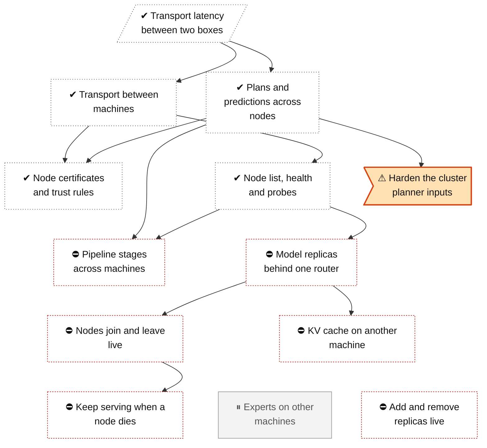

<!-- Generated by build.py from roadmap/nodes.yaml. Do not edit. -->

# cluster - multi-node cluster

Scope: Phase 6 and on: transport, discovery, mTLS, replicas, failover, stages, experts and KV across machines.

[Back to the page](../../roadmap.md) · [legend](../../roadmap.md#legend)

<!-- BEGIN GENERATED: track-cluster -->

<!-- END GENERATED: track-cluster -->

## Node table

<!-- BEGIN GENERATED: table-cluster -->
| id | title | kind | lane | state | outcome | start | end | depends_on | replaced_by | qualified_by | headline | evidence |
|---|---|---|---|---|---|---|---|---|---|---|---|---|
| `cluster-transport-wan` | Transport latency between two boxes | experiment | cluster | done | unrated | 2026-11-23 | 2026-11-23 | bench-m2-report |  |  | WAN 90 ms: 8 KB equal within noise; 1 MB QUIC 196 ms vs TLS 274 to 300 ms (untuned TCP); same host 8 KB TLS 0.41 vs QUIC 0.58 ms | bench/results/transport-wan-20261123/README.md; docs/adr/0023-transport-spike.md; scripts/transport_wan_bench.sh |
| `cluster-owner-transport` | Owner picks the network transport | owner-decision | owner | done | n/a | 2026-11-23 | 2026-11-23 | cluster-transport-wan |  |  | TCP+TLS chosen | docs/adr/0023-transport-spike.md |
| `cluster-transport` | Transport between machines | feature | cluster | done | unrated | 2026-11-23 | 2026-11-23 | bench-m2-report, cluster-owner-transport |  |  |  | docs/adr/0091-phase6-multi-node.md; crates/transport/src/frame.rs; crates/transport/src/identity.rs; crates/transport/src/mem.rs; crates/transport/src/tls_transport.rs; crates/transport/tests/tls.rs; crates/transport/tests/mem.rs; crates/tetraeder/tests/frame_golden.rs; crates/tetraeder/tests/worker_mem.rs; deploy/alerts/cluster.yml; deploy/grafana/dashboards/cluster.json |
| `cluster-owner-phase6-design` | Owner accepts the Phase 6 design | owner-decision | owner | done | n/a | 2026-11-23 | 2026-11-23 | cluster-owner-transport |  |  | ADR 0091 accepted | docs/adr/0091-phase6-multi-node.md |
| `cluster-planner` | Plans and predictions across nodes | feature | ci | done | unrated | 2026-11-23 | 2026-11-23 | cluster-owner-transport |  |  | planner first prediction for the 235B, decode 3.62 tok/s on the WAN pair and 5.43 on the same host, one node 0.49 (uniform routing prior) | docs/adr/0091-phase6-multi-node.md; crates/planner/tests/cluster.rs; crates/plan/tests/cluster.rs; crates/costmodel/src/cluster/tests.rs; crates/planner/tests/single_node_identity.rs |
| `cluster-mtls` | Node certificates and trust rules | feature | cluster | done | unrated | 2026-11-23 | 2026-11-24 | cluster-transport, cluster-planner, cluster-owner-phase6-design |  |  | done in steps 1 and 2 | docs/adr/0091-phase6-multi-node.md; crates/transport/src/tls_transport.rs |
| `cluster-planner-hardening` | Harden the cluster planner inputs | defect | ci | next | unrated |  |  | cluster-planner |  |  |  |  |
| `cluster-discovery` | Node list, health and probes | feature | cluster | done | unrated | 2026-11-24 | 2026-11-24 | cluster-transport |  |  | node daemon, membership and probes done; killed daemon rejoins within node_down_after plus one heartbeat on MemTransport and loopback TLS; step 1 review fixes in | docs/adr/0091-phase6-multi-node.md; crates/control/tests/sim.rs; crates/control/tests/tls_loopback.rs; crates/transport/tests/hardening.rs |
| `cluster-join-leave` | Nodes join and leave live | feature | cluster | blocked | unrated |  |  | cluster-discovery, cluster-replicas |  |  |  |  |
| `cluster-pipeline-nodes` | Pipeline stages across machines | feature | cluster | blocked | unrated |  |  | cluster-planner, cluster-discovery |  |  |  |  |
| `cluster-experts-nodes` | Experts on other machines | feature | cluster | parked | unrated |  |  | bench-phase6-exit |  |  |  |  |
| `cluster-remote-kv` | KV cache on another machine | feature | cluster | blocked | unrated |  |  | cluster-replicas |  |  |  |  |
| `cluster-replicas` | Model replicas behind one router | feature | cluster | blocked | unrated |  |  | cluster-discovery |  |  |  |  |
| `cluster-failover` | Keep serving when a node dies | feature | cluster | blocked | unrated |  |  | cluster-replicas, cluster-join-leave |  |  |  |  |
| `cluster-replica-scaling` | Add and remove replicas live | feature | cluster | blocked | unrated |  |  | cluster-replicas, bench-m3-report |  |  |  |  |

### Details per node

| id | title | verdict | headline | in plain words | notes | confirmed | waiting on | queue order | order reason |
|---|---|---|---|---|---|---|---|---|---|
| `cluster-transport-wan` | Transport latency between two boxes | Status: clean. WAN set is thin (3 repetitions, 300 round trips per size, so p99 is the third slowest sample); loopback and same-host sets follow ADR 0023's size (2000 round trips, 5 repetitions). | WAN 90 ms: 8 KB equal within noise; 1 MB QUIC 196 ms vs TLS 274 to 300 ms (untuned TCP); same host 8 KB TLS 0.41 vs QUIC 0.58 ms | Measured QUIC, TCP with TLS and plain TCP between two rented boxes (Connecticut and Germany, 90 ms), on one host and on Linux loopback; ADR 0023 holds the numbers, and no same-datacenter pair on different hosts was on offer. | Done when: ADR 0023 holds WAN numbers for 8 KB and 1 MB messages with AES and ChaCha, plus Linux same-datacenter numbers. Needs two instances for about an hour; blocked behind M2 because the verdict sessions hold the box budget, not for a technical reason. RDMA is not on Vast. Source: ADR 0023 (Pending), plan.md Open decisions. |  |  |  |  |
| `cluster-owner-transport` | Owner picks the network transport | TCP with TLS (mTLS) for Phase 6, QUIC kept as a later option for bulk and WAN, behind a transport trait (owner 2026-11-23) | TCP+TLS chosen | The owner chooses the transport between machines from the measured numbers; ADR 0023 leans to TCP with TLS for per-layer expert traffic and keeps QUIC for bulk and lossy links. | Done when: ADR 0023 is Accepted with a chosen transport. Source: ADR 0018, ADR 0023, plan.md Open decisions. |  |  |  |  |
| `cluster-transport` | Transport between machines | CI cluster-transport run 45179950926, test (ubuntu-24.04) success, test (windows-latest) success, golden-byte frame test, TLS and Mem transport tests (refusals, pinned and CA anchors, buffers read back) and RemoteBackend cases over MemTransport pass (not measured) |  | Phase 6 step 1 (ADR 0091), one transport trait with a TLS implementation (mutual authentication against trust anchors) and an in-process one with injected faults; the worker protocol runs over it unchanged (plan feature 16). | Done when (ADR 0091, build order 1), a golden-byte test shows the moved frame code writes the same frames as remote_backend, frame property tests pass, unknown and wrong certificates are refused, pinned self-signed and CA anchors are both accepted, the effective socket buffer sizes are read back and logged (an explicit size on Linux is capped at net.core.rmem_max and turns autotuning off, so the size is measured per link, not fixed), a loopback TLS round trip works, and the RemoteBackend restart tests and the Phase 5 parity and golden tests pass; link metrics, the links panel row and the TLS-rejected alert in the same change. CI only. Phase 6 code stays on its branch until bench-regression-gate has run on main. |  |  |  |  |
| `cluster-owner-phase6-design` | Owner accepts the Phase 6 design | Vast WAN pair, pinned self-signed certificates, 64 GB emulated by the balloon, mDNS out of M3, no HA gateway, remote experts after the exit (owner 2026-11-23) | ADR 0091 accepted | The owner accepts ADR 0091 and answers its open questions (exit hardware, Vast pair or homelab; how nodes get certificates; the emulated RAM budget; mDNS in or out of M3; the other scope cuts). | Gates the certificate tooling and the box sessions only; the simulated steps (transport, planner) start before it. |  |  |  |  |
| `cluster-planner` | Plans and predictions across nodes | test the_235b_spans_both_nodes_on_every_two_node_fixture ... ok (CI run 45178068154, ubuntu-24.04) | planner first prediction for the 235B, decode 3.62 tok/s on the WAN pair and 5.43 on the same host, one node 0.49 (uniform routing prior) | The planner sees nodes and the measured links between them, cuts a model into per-node segments, and predicts their speed as the sum of each node's own prediction plus the network hops (ADR 0091). | Done when (ADR 0091, build order 2), plan, segment and prediction property tests pass on every simulated cluster fixture, and one-node plans predict bit-identically to today. CI only, crates profiler, plan, costmodel and planner; runs in parallel with the transport step. |  |  |  |  |
| `cluster-mtls` | Node certificates and trust rules | Delivered by steps 1 and 2 - tetraeder cluster cert, pinned self-signed anchors through one verifier, forbid node in the validator (CI runs 45179950926 and 45178068154) | done in steps 1 and 2 | Each node gets a certificate the way the owner picks (pinned self-signed, own CA or step-ca), and a forbid rule keeps units, and the request content they see, off a node (plan feature 20). | Done when (ADR 0091), the certificate tooling of the owner's choice exists, a node with another certificate is refused on the rehearsal boxes, and plans with a forbid node rule never use that node (planner property test). |  |  |  |  |
| `cluster-planner-hardening` | Harden the cluster planner inputs |  |  | Review findings on step 2 - validate node names at load (no slash, not empty, no duplicates), cap enumerate_cluster's node-order search, flag empty stage devices when nodes are involved, enforce forbid node on KV and slot caches too, and turn slice panics on malformed layouts into errors. | From the read-only review of 81d4ecc4..51738939 (2026-11-24); none reachable without a malformed cluster.toml or layout. The transport findings of the same review went to cluster-discovery. |  |  |  |  |
| `cluster-discovery` | Node list, health and probes | test a_killed_and_restarted_daemon_rejoins_within_down_after_plus_one_heartbeat ... ok (CI run 45305038491, ubuntu and windows, with the membership fault tests and two loopback TLS daemons profiling and probing each other) | node daemon, membership and probes done; killed daemon rejoins within node_down_after plus one heartbeat on MemTransport and loopback TLS; step 1 review fixes in | Nodes come from a static cluster file; a node daemon on each box answers heartbeats, reports its hardware and starts workers, and a probe measures every link through the real transport (plan feature 17; mDNS later, ADR 0091). | Done when (ADR 0091, build order 3), membership property tests pass under every simulated fault, and two node daemons on loopback TLS profile and probe each other (autotuned and explicit buffers); cluster cert generates keys on the box that never enter the repo or a pushed HEAD, and the session driver builds cluster.toml after create and uploads it; panel rows and alerts in the same change. CI only, crates control and tetraeder. |  |  |  |  |
| `cluster-join-leave` | Nodes join and leave live |  |  | A node can join or leave while the others keep serving; a replica joins the router once loaded and probed and leaves when its node goes down, and a pipeline over nodes is drained and restarted with a new plan (plan feature 18; live resharding is Phase 7). | Done when (ADR 0091), on simulated nodes a node joins and leaves under load with no failed request on the other nodes, and a restored node rejoins without manual action. |  |  |  |  |
| `cluster-pipeline-nodes` | Pipeline stages across machines |  |  | A model's layers are split into stages on different machines; only one activation per stage boundary crosses the network (plan feature 8, Phase 6 half). | Done when (ADR 0091, build order 4), two-node splits match the one-node run within tol_batch at the first, middle and last layer boundary, with the head on either node, on simulated CPU nodes in CI; segment residuals, the pipeline panel row and the segment-drift alert in the same change. Builders take and return hidden rows; the head drives segments in order. |  |  |  |  |
| `cluster-experts-nodes` | Experts on other machines |  |  | Each machine computes the experts it holds and only activations cross the network, one round trip per MoE layer (plan feature 9, Phase 6 half; Linux only, ADR 0008). | Parked after the Phase 6 exit (ADR 0091), since neither exit case needs it and over the measured WAN one round trip per MoE layer costs about 5.4 s per token. Done when, later, remote experts match local ones within tol_batch on simulated CPU nodes and the round trip on a box pair is within the probe curve; it gets its own ADR addendum. |  |  |  |  |
| `cluster-remote-kv` | KV cache on another machine |  |  | A prefix that one replica holds is fetched by another only when moving its snapshot is predicted faster than recomputing it; otherwise it is recomputed (plan features 3 and 4, Phase 6 halves; ADR 0091). | Done when (ADR 0091), in CI a simulated replica fetches or recomputes a prefix held by the other exactly as the priced rule says, and a fetched prefix decodes equal; on the rehearsal boxes time to first token of a fetch is measured against recompute. KV tiers on a remote node during attention are out of M3. |  |  |  |  |
| `cluster-replicas` | Model replicas behind one router |  |  | Copies of a model on several nodes behind one router; each replica runs its scheduler and sampling on its own node and returns only tokens, and a conversation stays on the replica that holds its prefix (plan feature 11). | Done when (ADR 0091, build order 5), two simulated replicas serve one endpoint through the router with prefix affinity before least-outstanding, a remote replica sends events of a few bytes per token, and the router property tests pass; router metrics, panel row and the replica-out alert in the same change. Can run in parallel with the pipeline step; the shared serve wiring lands last. |  |  |  |  |
| `cluster-failover` | Keep serving when a node dies |  |  | When a node fails, new requests go to the remaining replicas and in-flight requests on it fail cleanly (plan feature 19). | Done when (ADR 0091, Case F), the kill test passes in CI on simulated nodes for a killed worker, a killed node and a silent node, with every in-flight request on it ending in one clean error within node_down_after plus 1 s. |  |  |  |  |
| `cluster-replica-scaling` | Add and remove replicas live |  |  | Replicas are added or removed under load as traffic changes (plan feature 39). | Done when: a load step adds a replica and a quiet period removes it, with no failed request. Phase 7, blocked behind the M3 report. |  |  |  |  |

### Folded items per node

- `cluster-pipeline-nodes`: Pipeline stages across machines
  - No ggml_backend_tensor_copy_async binding yet; pipeline peer copies need it (m2-plan, E1 note)
- `cluster-failover`: Keep serving when a node dies
  - Sticky CUDA errors are detected by message text until the backend trait carries a sticky signal (m2-plan, E9 follow-ups)
<!-- END GENERATED: table-cluster -->
