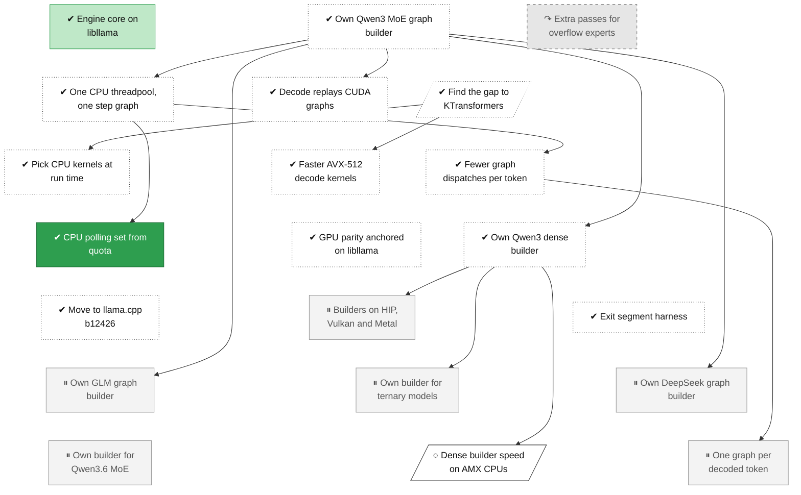

<!-- Generated by build.py from roadmap/nodes.yaml. Do not edit. -->

# engine - engine and builders

Scope: ggml patch queue, model builders (dense, MoE), kernels, parity against libllama.

[Back to the page](../../roadmap.md) · [legend](../../roadmap.md#legend)

<!-- BEGIN GENERATED: track-engine -->

<!-- END GENERATED: track-engine -->

## Node table

<!-- BEGIN GENERATED: table-engine -->
| id | title | kind | lane | state | outcome | start | end | depends_on | replaced_by | qualified_by | headline | evidence |
|---|---|---|---|---|---|---|---|---|---|---|---|---|
| `engine-libllama` | Engine core on libllama | feature | none | done | successful | 2026-10-29 | 2026-10-31 | ops-foundations |  |  | tg 0.987 | docs/adr/0026-phase1-engine-on-libllama.md |
| `engine-moe-builder` | Own Qwen3 MoE graph builder | feature | none | done | unrated | 2026-10-31 | 2026-10-31 | planner-plan-ir |  |  |  | docs/adr/0030-own-moe-graph-builder.md |
| `engine-overflow-passes` | Extra passes for overflow experts | feature | none | abandoned | superseded | 2026-11-01 | 2026-11-01 | memory-tiers | memory-pair-groups |  |  | docs/adr/0034-expert-slots-at-least-top-k.md |
| `engine-cpu-threadpool` | One CPU threadpool, one step graph | feature | none | done | unrated | 2026-11-01 | 2026-11-02 | engine-moe-builder |  |  |  | docs/adr/0036-cpu-threadpool-and-whole-step-graph.md; docs/adr/0039-no-cpu-repack-of-expert-weights-for-now.md |
| `engine-cuda-graphs` | Decode replays CUDA graphs | feature | none | done | unrated | 2026-11-02 | 2026-11-02 | engine-moe-builder |  |  |  | commit 710c907472 |
| `engine-kt-gap` | Find the gap to KTransformers | experiment | none | done | unrated | 2026-11-03 | 2026-11-09 | bench-phase2-exit |  |  |  | docs/adr/0045-phase2-exit-verdict.md |
| `engine-isa-dispatch` | Pick CPU kernels at run time | feature | none | done | unrated | 2026-11-09 | 2026-11-09 | engine-kt-gap |  |  |  | docs/adr/0052-runtime-cpu-isa-dispatch.md; patches |
| `engine-iqk-kernels` | Faster AVX-512 decode kernels | feature | none | done | unrated | 2026-11-09 | 2026-11-09 | engine-kt-gap |  |  |  | docs/adr/0053-iqk-avx512-vnni-q4k-decode-kernel.md |
| `engine-decode-dispatch` | Fewer graph dispatches per token | feature | none | done | unrated | 2026-11-12 | 2026-11-14 | engine-cpu-threadpool |  |  |  | docs/adr/0064-decode-dispatch-segment-scheduler-and-one-graph-per-token.md |
| `engine-cpu-poll` | CPU polling set from quota | feature | none | done | very-successful | 2026-11-12 | 2026-11-15 | engine-cpu-threadpool |  |  | decodes 1.30x | docs/adr/0061-cpu-threadpool-polling-from-the-cgroup-quota.md; bench/results/20261112e/README.md |
| `engine-dense-builder` | Own Qwen3 dense builder | feature | none | done | unrated | 2026-11-14 | 2026-11-16 | engine-moe-builder |  |  |  | docs/adr/0066-own-qwen3-dense-builder.md; docs/adr/0072-dense-builder-cpu-weights-in-extra-buffer-types.md |
| `engine-gpu-tolerance` | GPU parity anchored on libllama | feature | none | done | unrated | 2026-11-15 | 2026-11-17 |  |  |  |  | docs/adr/0071-gpu-logit-tolerance-relative-anchored-to-libllama.md |
| `engine-pin-b12426` | Move to llama.cpp b12426 | feature | none | done | unrated | 2026-11-16 | 2026-11-18 | bench-pin-ab |  |  |  | docs/adr/0073-engine-pin-b12426.md; vendor/PIN |
| `engine-backend-parity` | Builders on HIP, Vulkan and Metal | feature | none | parked | unrated |  |  | engine-dense-builder, engine-moe-builder |  |  |  |  |
| `engine-glm-builder` | Own GLM graph builder | feature | none | parked | unrated |  |  | engine-moe-builder |  |  |  |  |
| `engine-deepseek-builder` | Own DeepSeek graph builder | feature | none | parked | unrated |  |  | engine-moe-builder |  |  |  |  |
| `engine-bitnet-builder` | Own builder for ternary models | feature | none | parked | unrated |  |  | engine-dense-builder |  |  |  |  |
| `engine-qwen35moe-builder` | Own builder for Qwen3.6 MoE | feature | local | parked | unrated |  |  | bench-strata-q36 |  |  |  |  |
| `engine-exit-segment-harness` | Exit segment harness | tooling | ci | done | unrated | 2026-11-24 | 2026-11-24 | bench-235b-stream-predict |  |  | span, dump and warm protocol built | docs/adr/0092-costmodel-6-streamed-moe-segments.md; crates/model/tests/exit_regime.rs; crates/model/tests/common/exit_segment.rs |
| `engine-one-graph-per-token` | One graph per decoded token | feature | local | parked | unrated |  |  | engine-decode-dispatch |  |  |  |  |
| `engine-dense-amx` | Dense builder speed on AMX CPUs | experiment | ci | next | unrated |  |  | engine-dense-builder |  |  |  |  |

### Details per node

| id | title | verdict | headline | in plain words | notes | confirmed | waiting on | queue order | order reason |
|---|---|---|---|---|---|---|---|---|---|
| `engine-libllama` | Engine core on libllama | gate-tetraeder-cuda-dense: pp ratio 0.993, tg 0.987 (band -5%), Ok. | tg 0.987 | Phase 1: Rust drives llama.cpp's library (libllama) for dense models; the exit test asks for prompt and generation speed within 5% of llama.cpp. |  |  |  |  |  |
| `engine-moe-builder` | Own Qwen3 MoE graph builder |  |  | Tetraeder builds the compute graph of the Qwen3 mixture-of-experts (MoE) model itself in Rust, one segment per MoE layer, so it can place and stream experts on its own. |  |  |  |  |  |
| `engine-overflow-passes` | Extra passes for overflow experts | Superseded by ADR 0035: pair groups need no mask, parking entries or distinct-slot rule and allow any slot count again. |  | When a token needs more experts than there are GPU slots, run extra exact passes; bitwise correct, but replaced two days later by expert pair groups. |  |  |  |  |  |
| `engine-cpu-threadpool` | One CPU threadpool, one step graph |  |  | CPU work shares one threadpool and a fully resident step runs as one graph, which fixed a CPU path that got slower with more threads; ADR 0039 kept CPU expert weights unrepacked for now. |  |  |  |  |  |
| `engine-cuda-graphs` | Decode replays CUDA graphs |  |  | The builder's decode step had never used CUDA graphs (recorded GPU work replayed with little CPU overhead); step graphs are now reused so ggml can capture and replay them. |  |  |  |  |  |
| `engine-kt-gap` | Find the gap to KTransformers | decode 1.34x behind KTransformers at a 26-core quota, the logit offset is fused-kernel rounding over a different batching |  | Diagnosis of why the builder decoded slower than KTransformers (another engine for MoE models on CPU plus GPU) on some CPUs, and fixes for the decode gap found on an RTX A6000 box. |  |  |  |  |  |
| `engine-isa-dispatch` | Pick CPU kernels at run time |  |  | One binary carries CPU kernels for several instruction sets (AVX2, AVX-512) and picks the best at start, as a ggml patch (patch 0001). |  |  |  |  |  |
| `engine-iqk-kernels` | Faster AVX-512 decode kernels |  |  | AVX-512 VNNI kernels for 4- and 6-bit weights taken from ik_llama.cpp, as ggml patch 0002, to close the CPU decode gap. |  |  |  |  |  |
| `engine-decode-dispatch` | Fewer graph dispatches per token |  |  | Cuts the fixed cost of launching many small graph segments per decoded token; steps 0 and 1 built, the floor measured on a CI runner. |  |  |  |  |  |
| `engine-cpu-poll` | CPU polling set from quota | cpu_poll 0 removes quota throttling (0.80-0.98 to 0.05) and decodes 1.30x, tq4 and huge pages do not help | decodes 1.30x | Rented boxes limit CPU time by a container quota; busy-polling worker threads burned that quota and got throttled. Turning polling off under a quota removed the throttling and sped up decode. |  |  |  |  |  |
| `engine-dense-builder` | Own Qwen3 dense builder | parity tests against libllama (bitwise on CPU) |  | Phase 4: Tetraeder's own graph builder for dense Qwen3 models (the judged path of the Phase 4 test), sharing one attention module with the MoE builder and matching libllama's logits. |  |  |  |  |  |
| `engine-gpu-tolerance` | GPU parity anchored on libllama | gpu-smoke2's failures are F16 kernel noise at the fixtures' logit scale (11 to 15) |  | GPU logits never match the CPU bit for bit; the parity tests now allow the gap libllama itself shows between CUDA and CPU, relative to the logit scale. |  |  |  |  |  |
| `engine-pin-b12426` | Move to llama.cpp b12426 |  |  | The engine is built on a pinned llama.cpp release; moving the pin from b11976 to b12426 picked up upstream speedups the baseline already had. |  |  |  |  |  |
| `engine-backend-parity` | Builders on HIP, Vulkan and Metal |  |  | The own graph builders run on AMD (HIP), Vulkan and Apple (Metal) GPUs, with parity tests per backend; this is also when mixed GPU vendors in one setup arrive (plan features 14 and Phase 8). | Parked: Phase 8 runs in parallel with M3 and M4, after M2 (plan.md, Roadmap); nothing is scheduled. Needs AMD and Apple hardware, which Vast does not rent here. Done when: parity per backend and split point. |  |  |  |  |
| `engine-glm-builder` | Own GLM graph builder |  |  | An own graph builder for the GLM model family, with parity against libllama (plan.md, Phase 8). | Parked: Phase 8 runs in parallel with M3 and M4, after M2 (plan.md, Roadmap); nothing is scheduled. Done when: logit parity against libllama on CUDA and CPU. |  |  |  |  |
| `engine-deepseek-builder` | Own DeepSeek graph builder |  |  | An own graph builder for DeepSeek-style MoE models, with a KV cache shaped for their compressed attention (MLA, multi-head latent attention) (plan.md, Phase 8). | Parked: Phase 8 runs in parallel with M3 and M4, after M2 (plan.md, Roadmap); nothing is scheduled. Done when: logit parity against libllama on CUDA and CPU. |  |  |  |  |
| `engine-bitnet-builder` | Own builder for ternary models |  |  | An own builder with faster kernels for natively ternary models such as BitNet b1.58, which libllama already runs (plan feature 51, Phase 9 half). | Parked: Phase 9 (breadth) runs in parallel with M3 and M4, after M2 (plan.md, Roadmap); nothing is scheduled. Done when: parity against libllama and faster decode. |  |  |  |  |
| `engine-qwen35moe-builder` | Own builder for Qwen3.6 MoE |  |  | An own graph builder for qwen35moe (GatedDeltaNet layers, 256 experts, shared expert, MTP block), the first model both Tetraeder and Strata run (ADR 0085; own ADR first). | Parked by the owner 2026-11-23 in favour of serving-mtp-libllama (MTP drafts through libllama first). Design question when it resumes: recurrent state in the KV pool, seq_rm and the prefix cache (ADR 0051). |  |  |  |  |
| `engine-exit-segment-harness` | Exit segment harness | ci::cpu_two_span_run_matches_the_whole_run ... ok (CI run 45421446213, Windows and Linux, tol_batch) | span, dump and warm protocol built | The exit harness runs a span of layers without the head, takes hidden rows from a file or a fixed seed, dumps them at a layer boundary from a whole-model run, and runs warm requests before a timed one that recomputes every token and reports its disk bytes (a covering plan that reads any is flagged unclean). |  |  |  |  |  |
| `engine-one-graph-per-token` | One graph per decoded token |  |  | Step 2 of ADR 0064: one graph per decoded token with a host callback per layer, instead of one graph segment per MoE layer. | Parked with Track B (m2-plan, B4). Done when: judged by segment_overhead in a paired run (ADR 0064). |  |  |  |  |
| `engine-dense-amx` | Dense builder speed on AMX CPUs |  |  | Measure whether the dense builder's prompt speed on Intel AMX CPUs now matches libllama's, with weights in libllama's extra buffer types (ADR 0072). | Built (ADR 0072, DenseOptions::extra_bufts default true); only the speed is pending. Done when: step_shapes engines dense against dense_norepack and llama against llama_norepack on an AMX runner, then the owner accepts or reopens ADR 0072. |  |  |  |  |

### Folded items per node

- `engine-libllama`: Engine core on libllama
  - Phase 1 engine on libllama and exit (2026-10-30, commit 9c26860e34, commit 38e37cb323, commit 43134b90ad, commit 1c10d89462, commit cd9d3c1ed5)
  - Split llama.rs and engine/gateway submodules (2026-10-31, commit d911825d7a, commit c598ef2d3f, commit 2e37f90575)
  - Engine and plan review fixes (2026-10-31, commit dbbd80b216, commit a58e77e2e6, commit ff7e3939b3, commit d60e2c7918, commit a425dfabf8, commit 2b7f2c02ad)
- `engine-moe-builder`: Own Qwen3 MoE graph builder
  - Qwen3 MoE builder and safe ggml surface (2026-10-31, commit 5c289e066b, commit 7082123add, commit 7bede0f2a8, commit ff7400a210, commit d2eabef27c)
- `engine-overflow-passes`: Extra passes for overflow experts
  - Exact overflow passes (ADR 0034) (2026-11-01, commit 591497606e, commit c9387023d4, commit d1d96ef0c9, commit cd053a7d7f, commit aaaed6fdea, commit 4d46d3629e, commit 0d8fdc92f6, commit cefb2245f4, commit 510e405d8e, commit d33bb80cfc, commit 006bc314d0, commit 2c5e420524, commit 60cdfb9bea, commit 9776e222b4, commit 1ee51a228d)
- `engine-cpu-threadpool`: One CPU threadpool, one step graph
  - CPU speed: one threadpool and one-graph resident step (ADR 0036) (2026-11-01, commit 52992a4f5e, commit ecaab3e693, commit 70525df941, commit d244828d56, commit 433a4f4a07, commit 4609a35814)
  - CUDA topk-moe fusion fix for the one-graph step (2026-11-01, commit 97de4e6ac5, commit 8136c48f52, commit e8d4bed484, commit d50c5c6af6)
  - ADR 0039: no AVX2 repack of builder CPU weights (2026-11-02, commit e0e74f702a)
- `engine-cuda-graphs`: Decode replays CUDA graphs
  - CUDA graph replay via set_rows and step graph reuse (2026-11-02, commit 710c907472, commit 5785ad8cc3, commit 23d010d97c)
- `engine-kt-gap`: Find the gap to KTransformers
  - KTransformers decode gap and 235B logit offset (ADR 0045 addendum) (2026-11-03, commit e740d5016f, commit db37d90e6f, commit 94c03fba9a, commit 2a950be6e2, commit 6eb030e8bb, commit e7418cb64c, commit 171f1f7628, commit 913926a0cd, commit 70ee3b3b8c, commit e9669eeeee, commit 999d584b14)
  - KTransformers decode design read from source (2026-11-08, session record)
  - A6000 decode gap fixes and decode profile (2026-11-09, commit 506e0f3417, commit 62ef137701, commit 8e4cf07114, commit 530df65f34, commit f7c3a2ddd0, commit 64003d5ee9, commit 7647828027, commit 4ce5ef3bac, commit 54345dd3cf, commit 88cc6c6d7b, commit d2d7bd6595)
  - Diagnose the KTransformers decode gap (2026-11-09, commit 37d9eb29c2, commit cc307f2816, commit 8a94dd5fd3)
- `engine-isa-dispatch`: Pick CPU kernels at run time
  - Runtime CPU ISA dispatch (ADR 0052, patch 0001) (2026-11-09, commit b9104ecedc, commit fd9174f78f, commit 7d958f2946, commit ad52b10408, commit f78de9ee2e, commit d85bc00365, commit 47049e73dc, commit b6513be461, commit 48534c2eb3, commit 778c669a94, commit d17323d984, commit 9615203fc2)
- `engine-iqk-kernels`: Faster AVX-512 decode kernels
  - iqk AVX-512 VNNI Q4_K/Q6_K decode kernels as patch 0002 (ADR 0053) (2026-11-09, commit bf3cf1add4, commit a802dd4d81, commit c4c55a2d6f, commit 03c4aa1f43, commit a4cdaa9617, commit 95d2681b3a, commit 8ae706393f, commit 6cbd3a8a55, commit b4a632b569, commit 87f3e8a580, commit ed872bccbd)
- `engine-decode-dispatch`: Fewer graph dispatches per token
  - ADR 0064 decode dispatch: segment scheduler and one graph per token (2026-11-12, commit 05881948fb, commit a85689c7bc, commit 1388e40e52, commit 33ce62d455, commit 3ad43e4da7, commit 8784fb23e3, commit 2fac23e10d, commit a051162be3, commit 27f1f1a80a, commit 1c3996748e)
  - Dispatch floor on the CI runner (ADR 0064) (2026-11-14, commit 775347fa37, commit daaa1891f4, commit d104794bf9)
- `engine-cpu-poll`: CPU polling set from quota
  - CI poll bench for ggml polling under a CPU quota (ADR 0061) (2026-11-12, commit 9ad7786600, commit 27db57e384, commit 15194481cb, commit 667b181567, commit 271cd10ca3)
  - CPU threadpool polling chosen from the cgroup quota (ADR 0061 phase 2) (2026-11-12, commit 9abb8988cb, commit 16a4bbb120, commit c35a3d7292)
  - pool_pause: pause CPU threadpool in GPU-only segments (2026-11-12, commit 1d4fbbdf88)
  - Session 20261112e levers: poll 0 removes throttling, 1.30x decode (2026-11-12, commit f3e2ec59c9, commit e8b51d007e)
  - RAM tier huge pages A/B switch (ADR 0035 addendum) (2026-11-12, commit f278a3855c, commit 7ae50324c5, commit 563d63001a)
  - Point-1 class session 20261115p1 on EPYC 7702 and RTX 4090 (2026-11-15, commit 4dfe8b7d60, commit 79dac2aed3, commit df20096fbf, commit 99893e04d9)
- `engine-dense-builder`: Own Qwen3 dense builder
  - Shared attention module for dense and MoE builders (C1.5) (2026-11-14, commit da975ce81b, commit 7529eb796f, commit 5d8b91e9f1, commit 56924953f3)
  - Qwen3 dense builder and DenseBackend (C5) (2026-11-15, commit 981b3ec34c, commit 4819c77137, commit b9201adfcf, commit 6c0c25e989, commit b170d0e7f8, commit 7f36209582, commit f6d711fe64, commit c86f5fb0c5, commit 51d664982a, commit 847f90ebc5)
  - Dense builder: per-sequence attention and extra buffer types (ADR 0072) (2026-11-16, commit 84e4bebacc, commit 2307ead717, commit 290f1da2f0, commit ac1e7e6e83, commit 6ca3644352, commit 02d77d9b24, commit c586573abf)
- `engine-gpu-tolerance`: GPU parity anchored on libllama
  - GPU parity smoke boxes and relative CUDA tolerance (ADR 0071) (2026-11-16, commit 7fa9f56f46, commit ccb295dbe9, commit fde4066965, commit db7887c71a, commit 6ab7d82fe1, commit 030d1f34ab, commit ca9e4a67af, commit 116f839839, commit 5389bf961e, commit 8ac8664dd6, commit e620987121, commit 78a65ec84e, commit ab1a31adb4, commit 48aee5a414, commit a6aa63423b, commit c3c4f90de4, commit 636f806988, commit bb2515ee70, commit 5db3eaf1e1, commit 1759c23244, commit 57e1d1b3f1)
  - Real-model batched parity anchor on CUDA (gpu_real_batched) (2026-11-16, commit ee9417c06a, commit b3b0465226, commit 31687299ec, commit f9ecb47160, commit 78b534e4ca, commit be418ea370)
  - MoE multi-seq GPU test anchored on libllama gap (ADR 0071) (2026-11-17, commit 22c27c72ac, commit a0e714a537, commit 784dd809cb, commit e9630c9c51)
- `engine-pin-b12426`: Move to llama.cpp b12426
  - Engine pin move to llama.cpp b12426 (ADR 0073) (2026-11-16, commit 1fd23a671b, commit af492b0878, commit 58567d82c1, commit 877ed4f71f, commit 6c8f5fd30c, commit d2e8696d5b, commit 29f7f57bc9, commit f6889b47e4, commit c174cddc2d, commit adaf829f12, commit 99251de8a9, commit f1aa91c4fc, commit 26b0805d09, commit 759ca1d89f, commit 86663aef34)
  - AVX2 batch drift diagnostics at the pin move (2026-11-16, commit 1046b72550, commit eecd9586ee, commit cb32c6b70f, commit 4ad2a2a564, commit 05d02fc2bf, commit e1e3c482cb, commit 751c0f12d6)
  - vendor/llama.cpp gitlink follows the pin (2026-11-18, commit 255eaf72f0, commit f9af174861, commit 9e47f214b4, commit 734222261e, commit 51a86e2ff0)
- `engine-backend-parity`: Builders on HIP, Vulkan and Metal
  - Phase 0 spike: two ggml backends in one process; moot for M1 (plan.md, Open decisions)
  - Risk: parity across backends; per-backend tolerances (plan.md, Risks)
- `engine-one-graph-per-token`: One graph per decoded token
  - Small-RAM fusion-off drift check in CI (m1-open item 10)
<!-- END GENERATED: table-engine -->
