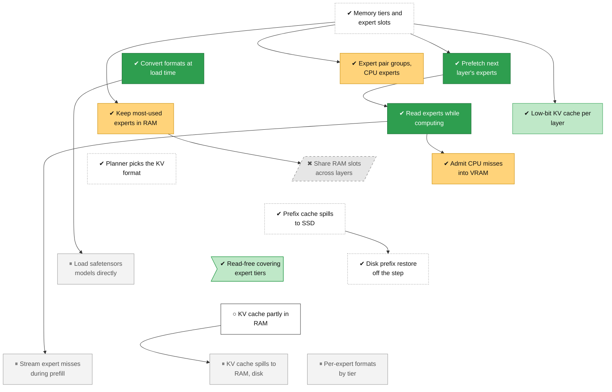

<!-- Generated by build.py from roadmap/nodes.yaml. Do not edit. -->

# memory - memory and streaming

Scope: expert streaming, RAM and disk tiers, VRAM fill, slot policies, replay.

[Back to the page](../../roadmap.md) · [legend](../../roadmap.md#legend)

<!-- BEGIN GENERATED: track-memory -->

<!-- END GENERATED: track-memory -->

## Node table

<!-- BEGIN GENERATED: table-memory -->
| id | title | kind | lane | state | outcome | start | end | depends_on | replaced_by | qualified_by | headline | evidence |
|---|---|---|---|---|---|---|---|---|---|---|---|---|
| `memory-tiers` | Memory tiers and expert slots | feature | none | done | unrated | 2026-10-31 | 2026-11-03 | engine-moe-builder |  |  |  | docs/adr/0031-arenas-tiers-slot-cache-direct-io.md; docs/adr/0037-split-gguf-and-slot-tiers-from-byte-budgets.md |
| `memory-pair-groups` | Expert pair groups, CPU experts | feature | none | done | mixed | 2026-11-01 | 2026-11-01 | memory-tiers |  |  |  | docs/adr/0035-expert-pair-groups-and-cpu-experts.md |
| `memory-prefetch` | Prefetch next layer's experts | feature | none | done | very-successful | 2026-11-02 | 2026-11-03 | memory-tiers |  |  | 235B decode +8.4% | docs/adr/0038-predicted-next-layer-expert-prefetch.md; bench/results/20261102/README.md |
| `memory-conversion` | Convert formats at load time | feature | none | done | very-successful | 2026-11-03 | 2026-11-03 | planner-quality |  |  | 15% faster than llama-quantize | docs/adr/0047-formats-per-role-and-load-time-conversion-cache.md |
| `memory-io-service` | Read experts while computing | feature | none | done | very-successful | 2026-11-08 | 2026-11-11 | memory-prefetch |  |  | overlap decode 1.38-1.40x | docs/adr/0054-expert-reads-io-service-and-arrival-order-compute.md; docs/adr/0050-decode-levers-overlap-low-bit-kv-frequency-tiers.md |
| `memory-low-bit-kv` | Low-bit KV cache per layer | feature | none | done | successful | 2026-11-09 | 2026-11-10 | memory-tiers |  |  |  | docs/adr/0050-decode-levers-overlap-low-bit-kv-frequency-tiers.md |
| `memory-ram-freq` | Keep most-used experts in RAM | feature | none | done | mixed | 2026-11-09 | 2026-11-12 | memory-tiers |  |  |  | docs/adr/0050-decode-levers-overlap-low-bit-kv-frequency-tiers.md |
| `memory-ram-pool` | Share RAM slots across layers | experiment | none | abandoned | dead-end | 2026-11-14 | 2026-11-14 | memory-ram-freq |  |  |  | docs/adr/0050-decode-levers-overlap-low-bit-kv-frequency-tiers.md; bench/results/replay-20261114-v26 |
| `memory-adaptive-tier` | Admit CPU misses into VRAM | feature | none | done | mixed | 2026-11-12 | 2026-11-12 | memory-io-service |  |  |  | docs/adr/0059-adaptive-compute-tier-admission.md; bench/results/20261112c/README.md |
| `memory-safetensors` | Load safetensors models directly | feature | local | parked | unrated |  |  | memory-conversion |  |  |  |  |
| `memory-kv-tiers` | KV cache spills to RAM, disk | feature | local | parked | unrated |  |  | memory-kv-host |  |  |  |  |
| `memory-kv-host` | KV cache partly in RAM | feature | local | next | unrated |  |  | serving-kv-layout |  |  |  |  |
| `memory-kv-auto` | Planner picks the KV format | feature | local | done | unrated | 2026-11-23 | 2026-11-23 | serving-kv-layout |  |  |  | docs/adr/0086-kv-format-auto.md; crates/planner/tests/kv_auto.rs; docs/notes/strata-parity.md |
| `memory-prefix-disk-async` | Disk prefix restore off the step | feature | local | done | unrated | 2026-11-23 | 2026-11-23 | memory-prefix-ssd |  |  |  | docs/adr/0087-prefix-cache-disk-tier.md; crates/scheduler/src/prefix_cache.rs; crates/scheduler/src/prefix_disk.rs; crates/scheduler/src/scheduler.rs |
| `memory-prefix-ssd` | Prefix cache spills to SSD | feature | local | done | unrated | 2026-11-23 | 2026-11-23 | serving-prefix-cache |  |  |  | docs/adr/0087-prefix-cache-disk-tier.md; crates/scheduler/src/prefix_cache.rs; crates/scheduler/src/prefix_disk.rs |
| `memory-ram-tier-complement` | Read-free covering expert tiers | defect | ci | done | unrated | 2026-11-24 | 2026-11-24 | bench-235b-stream-predict |  |  |  | crates/memory/tests/replay.rs; crates/model/tests/cpu_experts.rs; crates/memory/src/replay/sim.rs |
| `memory-prefill-misses` | Stream expert misses during prefill | feature | local | parked | unrated |  |  | memory-io-service |  |  |  |  |
| `memory-typed-slots` | Per-expert formats by tier | feature | local | parked | unrated |  |  | serving-kv-layout, planner-quality |  |  |  |  |

### Details per node

| id | title | verdict | headline | in plain words | notes | confirmed | waiting on | queue order | order reason |
|---|---|---|---|---|---|---|---|---|---|
| `memory-tiers` | Memory tiers and expert slots |  |  | Per-device memory arenas, a cache of expert slots on the GPU, a RAM tier and direct disk reads, so a MoE model larger than RAM can run with experts streamed in. |  |  |  |  |  |
| `memory-pair-groups` | Expert pair groups, CPU experts | Phase 2 step 3 GPU run: pair groups correct, CPU path slow |  | Experts missing from GPU slots run on the CPU in groups instead of extra GPU passes; correct on the GPU run, but the CPU path was slow at first. |  |  |  |  |  |
| `memory-prefetch` | Prefetch next layer's experts | ADR 0038 accepted: 235B decode +8.4%, prefill +6% with prefetch (accuracy 0.85), output-neutral in every pair | 235B decode +8.4% | While one layer computes, predict which experts the next layer will need and start reading them early. |  |  |  |  |  |
| `memory-conversion` | Convert formats at load time | pipelined conversion 13 and 15% faster than llama-quantize (8B, 30B BF16 to Q4_K_M, byte-identical) | 15% faster than llama-quantize | Weights are converted to the format the plan picks per tensor role when loading, with a disk cache; the converter is faster than llama.cpp's and byte-identical. |  |  |  |  |  |
| `memory-io-service` | Read experts while computing | overlap decode 1.38-1.40x main-prefetch | overlap decode 1.38-1.40x | An I/O service reads missing experts in the background and computes experts in the order they arrive, so disk reads overlap compute; on by default in serve. |  |  |  |  |  |
| `memory-low-bit-kv` | Low-bit KV cache per layer | (b) built; its KL acceptance passes under the gate on the cost above the floor (`20261110d`). |  | The KV cache (the stored attention keys and values) can use fewer bits per attention layer; the quality gate first failed, then was fixed to score unseen text and the cost above the unquantized floor. |  |  |  |  |  |
| `memory-ram-freq` | Keep most-used experts in RAM | frequency pins met the replay bar (`20261112c`) and are built, off by default (slow disks only) |  | Record which experts a real workload routes to and pin the most used ones in the RAM tier; judged on a replay of the routing trace, built but off by default. |  |  |  |  |  |
| `memory-ram-pool` | Share RAM slots across layers | a pool across layers missed its build threshold and is not built |  | One RAM expert pool shared by all layers instead of one per layer; the replay gain stayed under the bar set before measuring, so it was not built. |  |  |  |  |  |
| `memory-adaptive-tier` | Admit CPU misses into VRAM | admission raises the decode VRAM share as designed, but the synchronous uploads cost more than the compute they save, so `admit_share` stays off. |  | During decode, copy a share of experts that ran on the CPU into GPU slots; it worked as designed, but the uploads cost more than they saved, so it stays off. |  |  |  |  |  |
| `memory-safetensors` | Load safetensors models directly |  |  | Load Hugging Face safetensors files with a tensor-name map per architecture, converting at load time, instead of needing a GGUF file (plan feature 49). | Parked: no milestone or exit test needs it; every model in use ships as GGUF. Checked 2026-11-21: no safetensors loader in crates/ (only the KTransformers baseline script reads safetensors). Done when: Qwen3 dense and MoE load from safetensors with logit parity against the GGUF path. |  |  |  |  |
| `memory-kv-tiers` | KV cache spills to RAM, disk |  |  | Live KV cache rows can spill to NVMe or a remote tier for very long contexts (plan feature 3); the RAM half is memory-kv-host (ADR 0084). | Parked: no exit test needs it. Checked 2026-11-21: crates/kvcache has no RAM or disk tier; the prefix cache keeps whole snapshots in RAM. Done when: a long context beyond VRAM decodes with KV partly in RAM, paired against all in VRAM. |  |  |  |  |
| `memory-kv-host` | KV cache partly in RAM |  |  | Contexts too long for VRAM run with part of the KV in host memory, first through libllama's --no-kv-offload, then by putting chosen layers' KV and attention on the CPU in the own builders (ADR 0084, Proposed). | Planned 2026-11-23 with the advisor after Strata 0.2.20 (position split over mapped host memory, only 8 global layers of Inkling 2 Mini). Every Qwen3 layer is full attention, so host KV is a fit lever, not a speed lever. Done when: ADR 0084 pairs A and B pass. Order against the parity groups is the owner's. |  |  |  |  |
| `memory-kv-auto` | Planner picks the KV format | CI run 45097627980 on 948b770 passed cargo test on Linux and Windows, including kv_auto (9 tests, the fixture sweep and the memory proptest). Built, CI-tested, not measured. |  | serve --kv auto and the planner pick the first of F16, Q8_0, Q8_0/Q4_0 that fits the context, on the GPU before the CPU, with the reason in the plan notes (ADR 0086); not measured, the default stays F16. | Formats exist (ADR 0050 b); judged by a paired run on a model we run. Measured 2026-11-23 (regression-gate-20261123) - on the 30B auto keeps f16 up to ctx 229376 and picks q8_0 at 262144 where f16 does not start; at ctx 32768 q8_0 over f16 is 0.92 at c4 and 0.86 at c1. |  |  |  |  |
| `memory-prefix-disk-async` | Disk prefix restore off the step | CI memory-prefix-disk-async run 45115915312: test (ubuntu-24.04) success, test (windows-latest) success; disk restore no longer stalls a running sequence, matches a RAM restore, falls back on a failed read, keeps the file on cancel (not measured) |  | A prefix restored from disk is now read in the background while the waiting request queues without a slot, so other sequences keep decoding (ADR 0087 addendum); no speed number yet. | A 20K-token Qwen3-8B snapshot is about 2.9 GB, about a second of NVMe read that stalled every sequence before. The tests use a gated reader on a fake backend. A paired run of disk restore against recompute on a box is still open. |  |  |  |  |
| `memory-prefix-ssd` | Prefix cache spills to SSD | CI memory-prefix-ssd run 45091422684: test (ubuntu-24.04) success, test (windows-latest) success; the spill, restore, budget, replacement, cleanup and write-failure tests and the scheduler restore test pass (not measured) |  | Saved conversation state that no longer fits in RAM is written to a disk folder in the background and read back on the next turn (--cache-disk, ADR 0087); no speed number yet. | Default off. A paired speed run on a box (disk restore against recompute) is a later item. |  |  |  |  |
| `memory-ram-tier-complement` | Read-free covering expert tiers | CI run 45415720514 ubuntu test cpu_covering_slots_read_nothing_after_the_refresh ... ok; test covering_slots_leave_the_ram_tier_holding_the_complement ... ok |  | When VRAM and RAM slots together hold every expert, the hot-set refresh leaves the RAM tier holding exactly the other experts, so from the second request on nothing is read from disk (today about 16% of the tier is read again). |  |  |  |  |  |
| `memory-prefill-misses` | Stream expert misses during prefill |  |  | During a long prefill, missed experts are read through the I/O service and computed as they land, instead of read synchronously on the main thread (ADR 0038 follow-up, amends 0054). | Parked with Track B (m2-plan, Track B: candidate first item when it resumes). Done when: one timed box run of the prefill buckets first, then a paired run of the 235B 32K prefill. |  |  |  |  |
| `memory-typed-slots` | Per-expert formats by tier |  |  | Expert slots carry their own weight format, so hot experts stay at high precision in VRAM and cold ones are smaller in RAM or on disk (m1-open item 10). | Parked: was waiting for the KV and slot layout (C6, decided chunked 2026-11-14); nothing schedules it now. Done when: a mix of slot formats passes parity and the quality gate. |  |  |  |  |

### Folded items per node

- `memory-tiers`: Memory tiers and expert slots
  - Memory arenas, expert slot cache and RAM tier (2026-10-31, commit aa9b1b41d5, commit 69d587aef9, commit 60653a6d4d, commit 149408bfd0, commit e2e7c64b8b, commit fe1fd388e7, commit efada42617)
  - Lessons from a 125B MoE tuning log (2026-10-31, session record)
  - Phase 2 exit prep: split GGUF, byte-budget slot tiers, miss reads (ADR 0037) (2026-11-01, commit 8665efa643, commit 4c9b322b62, commit 35324d6ce9, commit ab2027bbab, commit dc7b530816, commit 14b787e547, commit 7cfe3b6b75, commit e6794c3325, commit 93eb854401)
  - Dio test ranges (2026-11-03, commit de62a00d7a)
- `memory-pair-groups`: Expert pair groups, CPU experts
  - Expert pair groups and CPU experts (ADR 0035) (2026-11-01, commit d88353e5e3, commit b40de96d02, commit 09f257b705, commit 2f8736a3ae, commit 489f71fa8d, commit 300ee64d59, commit 1add6e8ff3, commit 6fb443d285, commit cef79f252e, commit 39a5837b22, commit a26e2d7a5f)
  - On-demand expert upload too slow, move to CPU experts (2026-11-01, session record)
- `memory-prefetch`: Prefetch next layer's experts
  - Predicted next-layer expert prefetch (ADR 0038) (2026-11-02, commit bda72c808a, commit 32070d9dba, commit a21c2fc737, commit d4ddf3bbf7, commit 4a7f3eba2c, commit 6bdb04519e, commit d45786b636, commit 5c614db366, commit 7281dab9c0, commit b2a9408f91, commit 0b2bd1ed43, commit 64096b65c8, commit 0956ccf4a5)
  - Prefetch levers and default on (ADR 0038) (2026-11-03, commit 8a8d5bd3fd, commit c6ca86fb6a, commit 08ac97262c, commit 13d918adde, commit a56cf077d2, commit 9b386322fd)
- `memory-conversion`: Convert formats at load time
  - Formats per role and load-time conversion cache (ADR 0041/0047) (2026-11-03, commit c53bdb9c42, commit 22c48b07c1, commit 9fa6970c91, commit 6b2e9d9ca9, commit d969a679c7)
  - Quality profiles and conversion speed on 8B and 30B (box rounds) (2026-11-03, commit 0698777192, commit 916b00b53b, commit d33e444091, commit 4593939c51, commit 9e4a74b5be, commit d8add49d07, commit ae8e95aa3b, commit f452e4f4aa, commit 418d50dea4)
- `memory-io-service`: Read experts while computing
  - ADR 0050 decode levers and briefs (2026-11-09, commit c7b0fc66fc, commit f9636ed2bf, commit 60efb7e976)
  - I/O service and arrival-order expert compute (ADR 0054) (2026-11-09, commit d03f7f96db, commit 117ce205d3, commit 816c3154c5, commit 88e61fe74c, commit 4bb68ad3bc, commit 94ccfcf773, commit b98f8ca07a, commit 1654234802)
  - b1b-levers session on box 60057461 (ADR 0054 levers) (2026-11-10, commit 35f424d40a, commit 023f2ccc51, commit 29b0535f15, commit 8c9bc11057)
  - serve: prefetch, io-service and overlap on by default with a RAM tier (2026-11-10, commit 15d19832d6, commit 542e2b4f3b, commit f6bcdb9767, commit 80d595be85, commit 1c253be936, commit cc07a06c0b, commit f0a06df252, commit 13e55686dc)
  - Hidden share: urgent_first option and read-wait split by class (2026-11-11, commit a656c438b2, commit 85112ee387, commit 0f61576fff, commit f502e01f2f, commit de99f01d17, commit be86632b77, commit c905906c0f)
- `memory-low-bit-kv`: Low-bit KV cache per layer
  - KV Hadamard rotation for a quantized KV cache (ADR 0050 addendum) (2026-11-09, commit 0c0fe35df9, commit 97acf90365, commit 13eea1658e, commit 878a74a294)
  - Low-bit KV per attention unit (ADR 0050 b) (2026-11-09, commit f21d738c34, commit 5798b47a76, commit cdaccea1a8, commit c755357f69)
  - b2-proxy rerun on box 60050186 after ADR 0057 (2026-11-10, commit 626f940a73, commit 6a8f3badd9, commit cc4e7cc71b)
  - kv-quality scored a verbatim repeat at 32K; now scores unseen text (2026-11-10, commit 2b1c10cbff, commit 6bff309921, commit 83838fb0e5, commit 5f60ea7972)
  - kv-quality gates on cost above the F16-with-rotation floor (2026-11-10, commit 541bd5e4ec, commit bc813cbfc6, commit 5b8cd51fdb)
  - b2-proxy on box 59998776 (A6000): proxy parity, kv-quality fails at 8K (2026-11-10, commit 521c5160cb, commit 158e8501b0)
- `memory-ram-freq`: Keep most-used experts in RAM
  - Routing trace recorder and RAM-tier replay scorer (ADR 0050 c) (2026-11-09, commit cea185807c, commit fb0f15224a, commit 3b4717a188, commit 5fbecb0bdd)
  - ram_policy freq: pin the most routed RAM experts (2026-11-12, commit 9fc0fbde63, commit 4ccc4c83bd, commit 11e7e306ea)
  - Replay of VRAM-tier policies (static, prefill, lru, freq) (2026-11-12, commit b3f8aebc2b, commit aed86e24e1, commit c6b6fa6cea, commit 5276afbb1e)
- `memory-ram-pool`: Share RAM slots across layers
  - RAM-tier policies across layers in the replay (ADR 0050 c) (2026-11-14, commit f826d155be, commit 767f75e3af, commit 87a099b717, commit a92a0f64be, commit 34cc7ada46, commit d1f47d4416, commit 09e61ee743)
- `memory-adaptive-tier`: Admit CPU misses into VRAM
  - Async admission uploads (ADR 0059 addendum) (2026-11-12, commit 798ab4500a, commit c6bc2e12dd, commit 37598aa658, commit 865e7f0111)
  - Session 20261112c: adaptive tier at 0.1 loses to its uploads (2026-11-12, commit 6a2ddc500a, commit eca4dd0094, commit 5e0c25067f)
  - Adaptive compute tier: decode admits CPU misses into VRAM slots (ADR 0059) (2026-11-12, commit 2f84f0f82c, commit 363a308048, commit 4cf66fd48c, commit a7e310c949)
- `memory-kv-tiers`: KV cache spills to RAM, disk
  - Strata lever: KV partly in RAM, only the most-read part in VRAM (plan.md, Levers)
- `memory-prefill-misses`: Stream expert misses during prefill
  - Kinetic Flywheel study: CPU run or copy-in for a missing expert, against our miss path (m2-plan, Track B)
  - InferSSD as an expert-streaming baseline: report only, if it runs a shared model on Linux CUDA (m2-plan, Track B)
<!-- END GENERATED: table-memory -->
