<!-- Generated by build.py from roadmap/nodes.yaml. Do not edit. -->

# multi - multi-GPU executor

Scope: own executor, rank programs, tensor, pipeline and expert parallel, NCCL.

[Back to the page](../../roadmap.md) · [legend](../../roadmap.md#legend)

```mermaid
flowchart TB
    multi_prefill_no_capture["✔ Prefill runs without<br/>graph capture"]
    classDef vsucc fill:#2e9e4f,stroke:#1b6b34,color:#fff
    classDef succ fill:#bfe8c8,stroke:#2e9e4f,color:#111
    classDef mixed fill:#ffd37a,stroke:#c98a00,color:#111
    classDef bad fill:#f28b82,stroke:#b3261e,color:#111
    classDef dead fill:#e6e6e6,stroke:#777,stroke-dasharray:5 5,color:#555
    classDef inprog fill:#a8cdf5,stroke:#1f6fc5,color:#111
    classDef next fill:#fff,stroke:#333,color:#111
    classDef blocked fill:#fff,stroke:#b3261e,stroke-dasharray:2 2,color:#111
    classDef parked fill:#f3f3f3,stroke:#999,color:#555
    classDef unrated fill:#fff,stroke:#333,stroke-dasharray:1 3,color:#111
    classDef gate fill:#d9c2f0,stroke:#7b3fb5,color:#111
    classDef decided fill:#ece0f7,stroke:#7b3fb5,stroke-dasharray:2 2,color:#111
    classDef finding fill:#ffe0b2,stroke:#d84315,stroke-width:2px,color:#111
    classDef waiting fill:#e3f2fd,stroke:#1f6fc5,stroke-dasharray:5 5,color:#111
    class multi_prefill_no_capture unrated
```

<!-- BEGIN GENERATED: track-multi -->

<!-- END GENERATED: track-multi -->

## Node table

<!-- BEGIN GENERATED: table-multi -->
| id | title | kind | lane | state | outcome | start | end | depends_on | replaced_by | qualified_by | headline | evidence |
|---|---|---|---|---|---|---|---|---|---|---|---|---|
| `multi-prefill-no-capture` | Prefill runs without graph capture | feature | local | done | unrated | 2026-11-20 | 2026-11-20 |  |  |  |  | docs/adr/0081-prefill-steps-are-not-captured.md; patches/0006-graph-no-capture.patch; bench/results/s3f2-20261120/README.md |
| `multi-accept-adr-0081` | Accept the prefill capture fix | owner-decision | owner | next | n/a |  |  | multi-prefill-no-capture |  |  |  |  |

### Details per node

| id | title | verdict | headline | in plain words | notes | confirmed | waiting on | queue order | order reason |
|---|---|---|---|---|---|---|---|---|---|
| `multi-prefill-no-capture` | Prefill runs without graph capture |  |  | Every judged prefill had timed the call in which ggml records a CUDA graph, which serialized the pipeline stages; prefill steps now run directly and decode keeps graph replay. |  |  |  |  |  |
| `multi-accept-adr-0081` | Accept the prefill capture fix |  |  | ADR 0081 is Proposed; its GPU test and the s3f2 confirmation passed, so it waits for the owner's acceptance. |  |  |  |  |  |
<!-- END GENERATED: table-multi -->
