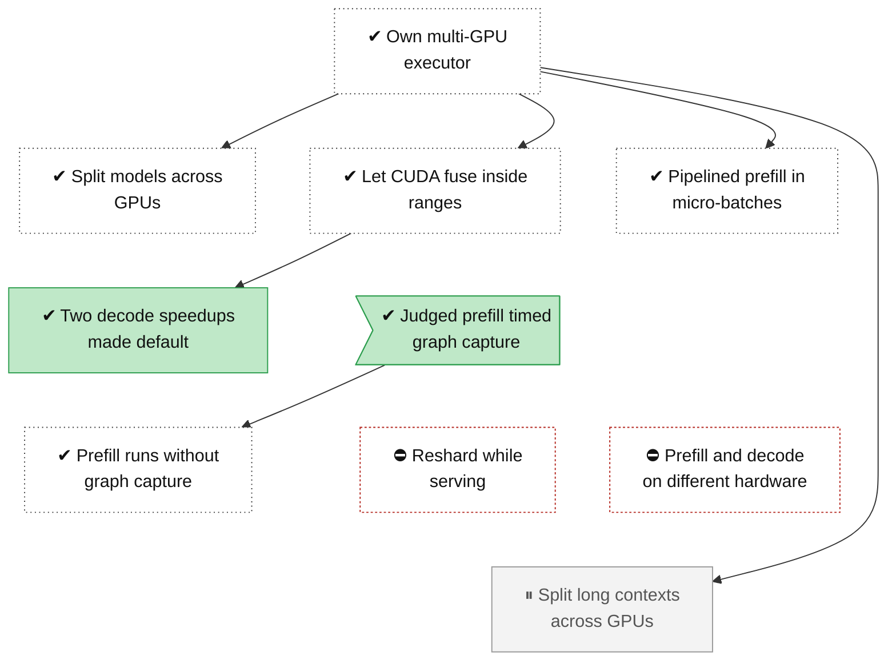

<!-- Generated by build.py from roadmap/nodes.yaml. Do not edit. -->

# multi - multi-GPU executor

Scope: own executor, rank programs, tensor, pipeline and expert parallel, NCCL.

[Back to the page](../../roadmap.md) · [legend](../../roadmap.md#legend)

<!-- BEGIN GENERATED: track-multi -->

<!-- END GENERATED: track-multi -->

## Node table

<!-- BEGIN GENERATED: table-multi -->
| id | title | kind | lane | state | outcome | start | end | depends_on | replaced_by | qualified_by | headline | evidence |
|---|---|---|---|---|---|---|---|---|---|---|---|---|
| `multi-prefill-no-capture` | Prefill runs without graph capture | feature | local | done | unrated | 2026-11-20 | 2026-11-20 | multi-defect-capture |  |  |  | docs/adr/0081-prefill-steps-are-not-captured.md; patches/0006-graph-no-capture.patch; bench/results/s3f2-20261120/README.md |
| `multi-executor` | Own multi-GPU executor | feature | none | done | unrated | 2026-11-15 | 2026-11-16 | engine-dense-builder |  |  |  | docs/adr/0069-own-executor-rank-programs.md; docs/adr/0068-phase5-verdict-rules.md |
| `multi-sharded` | Split models across GPUs | feature | none | done | unrated | 2026-11-15 | 2026-11-16 | multi-executor |  |  |  | docs/adr/0070-parallel-shapes-and-their-cost.md; patches |
| `multi-graph-views` | Let CUDA fuse inside ranges | feature | none | done | unrated | 2026-11-17 | 2026-11-17 | multi-executor |  |  |  | docs/adr/0075-executor-ranges-are-graph-views.md |
| `multi-pipelined-prefill` | Pipelined prefill in micro-batches | feature | none | done | unrated | 2026-11-18 | 2026-11-19 | multi-executor |  |  |  | docs/adr/0077-pipelined-prefill-micro-batches.md |
| `multi-decode-toggles` | Two decode speedups made default | feature | none | done | successful | 2026-11-19 | 2026-11-19 | multi-graph-views |  |  |  | docs/adr/0069-own-executor-rank-programs.md; bench/results/s3c-20261119-decode-decode |
| `multi-defect-capture` | Judged prefill timed graph capture | defect | none | done | unrated | 2026-11-19 | 2026-11-20 | bench-s3-rehearsal |  |  |  | bench/results/s3d-20261120/README.md; bench/results/s3e-20261120/README.md; docs/m2-plan.md |
| `multi-accept-adr-0081` | Accept the prefill capture fix | owner-decision | owner | next | n/a |  |  | multi-prefill-no-capture, bench-s3f2 |  |  |  |  |
| `multi-live-reshard` | Reshard while serving | feature | local | blocked | unrated |  |  | bench-m3-report |  |  |  |  |
| `multi-split-hardware` | Prefill and decode on different hardware | feature | cluster | blocked | unrated |  |  | planner-split-layouts, cluster-remote-kv |  |  |  |  |
| `multi-context-parallel` | Split long contexts across GPUs | feature | none | parked | unrated |  |  | multi-executor |  |  |  |  |

### Details per node

| id | title | verdict | headline | in plain words | notes | confirmed | waiting on | queue order | order reason |
|---|---|---|---|---|---|---|---|---|---|
| `multi-prefill-no-capture` | Prefill runs without graph capture |  |  | Every judged prefill had timed the call in which ggml records a CUDA graph, which serialized the pipeline stages; prefill steps now run directly and decode keeps graph replay. |  |  |  |  |  |
| `multi-executor` | Own multi-GPU executor |  |  | Phase 5: Tetraeder runs its own executor instead of ggml's backend scheduler: one program per GPU (rank), NCCL collectives, and the engine in a worker process. |  |  |  |  |  |
| `multi-sharded` | Split models across GPUs |  |  | The dense and MoE builders load weights and KV per GPU for tensor, pipeline and expert parallel; a CUDA patch lets an expert id of -1 mean no expert. |  |  |  |  |  |
| `multi-graph-views` | Let CUDA fuse inside ranges |  |  | The executor's ranges (parts of a step between collectives) become views of one graph, so CUDA's operator fusion works inside them (patch 0005). |  |  |  |  |  |
| `multi-pipelined-prefill` | Pipelined prefill in micro-batches |  |  | With layers split across GPUs, prompt processing is cut into micro-batches so all stages work at once (GPipe schedule), issued in llama.cpp's order, with splits balanced for it. |  |  |  |  |  |
| `multi-decode-toggles` | Two decode speedups made default | Both decode toggles meet the ADR 0069 keep rule on the 30B in both rounds |  | Two executor options for layer-split decode (range ids for graph reuse, asynchronous inputs) met their keep rule and are on by default. |  |  |  |  |  |
| `multi-defect-capture` | Judged prefill timed graph capture |  |  | ggml-cuda records a CUDA graph on a range's second call; every judged prefill timed that recording call, which with an NCCL kernel pending serialized the pipeline stages, so earlier prefill verdicts measured a slow state serving never sees. |  |  |  |  |  |
| `multi-accept-adr-0081` | Accept the prefill capture fix |  |  | ADR 0081 is Proposed; its GPU test and the s3f2 confirmation passed, so it waits for the owner's acceptance. |  |  |  |  |  |
| `multi-live-reshard` | Reshard while serving |  |  | Change the parallel layout under load: a plan diff compiles to a migration plan of ordered moves, drained first and finished with a two-phase commit (plan feature 38). | Done when: the property test that every migration ends in its target plan passes on every fixture, and a reshard under load fails no request. Risk (plan.md): live reshard bugs; migrations are data, simulator first, drain before move. Phase 7, blocked behind the M3 report. |  |  |  |  |
| `multi-split-hardware` | Prefill and decode on different hardware |  |  | Prompts are processed on one device or machine and decoding runs on another; the KV cache moves once per request (plan feature 13). | Done when: long prompts gain time to first token or goodput against one machine doing both. Phase 7, blocked behind the M3 report. |  |  |  |  |
| `multi-context-parallel` | Split long contexts across GPUs |  |  | One long sequence's attention is split across GPUs and the partial results merged (context parallel, plan feature 10). | Parked: Phase 9 (breadth) runs in parallel with M3 and M4, after M2 (plan.md, Roadmap); nothing is scheduled. Done when: parity against one GPU at long context. |  |  |  |  |

### Folded items per node

- `multi-prefill-no-capture`: Prefill runs without graph capture
  - Prefill without CUDA graph capture (patch 0006, ADR 0081) (2026-11-20, commit d858e83acf, commit 3b683c8cce, commit 98ba67c377, commit 7222482147, commit 34402e5d9f, commit f7ad9ee4d8)
- `multi-executor`: Own multi-GPU executor
  - Phase 5 design: verdict rules, own executor, parallel shapes (ADRs 0068 to 0070) (2026-11-15, commit 151c27deea, commit feb030b81a, commit 30b4823ea2, commit 59598526b7)
  - Phase 5 E1: ggml-sys executor bindings and NCCL build (2026-11-15, commit 3ee3c17743, commit beddf703e9, commit 43d70cee5f, commit 95c02985cd)
  - Phase 5 E5: executor core, fallback all-reduce and comm-probe (2026-11-16, commit 3b3d77a5d1, commit bccf579f00, commit 558a82fb51, commit 5307887026, commit 501b1f5210, commit 3e99dd3f57, commit fcd5edd715, commit d19dfdbe40)
  - Phase 5 E9: worker process behind RemoteBackend (2026-11-16, commit adceba6c68, commit 39f451ce0e, commit cee1271394, commit 67a01b343b, commit 255a1d9118)
- `multi-sharded`: Split models across GPUs
  - Phase 5 E4: CUDA mul_mat_id skips expert id -1 (patch 0004) (2026-11-16, commit 47c97b4647, commit 17b4cefa8f, commit af3be14649)
  - Phase 5 E6: sharded dense builder on the executor (2026-11-16, commit eb5cb4e10d, commit fecf9d3da0, commit 56084e4ef7, commit 8db9239702, commit 72fa1befe3, commit 2bfaa210a6, commit 07c9274147, commit db0e22dfee, commit 484569ba8d, commit 9a053e2acf, commit d310281e58, commit f532e1a4fd, commit f10d517706, commit 65d68ab972)
  - Phase 5 E7: sharded resident MoE builder (2026-11-16, commit 10a71b63e2, commit e125e338ac, commit 521dd3b5e8, commit 6e8b4fe62f, commit 33f3559f7e, commit 2247916dc3, commit bc594a8376, commit 43a59a7668)
- `multi-graph-views`: Let CUDA fuse inside ranges
  - Executor ranges as graph views (patch 0005, ADR 0075) (2026-11-17, commit 3869e29253, commit 170a5eb7f1, commit ef9a810689, commit c0d8a309c6)
- `multi-pipelined-prefill`: Pipelined prefill in micro-batches
  - Pipelined layer-N prefill (ADR 0077) (2026-11-19, commit 9d2378e4ad, commit 476e61edc8, commit 3122c8d3e2, commit 41a6f3a9db, commit db13d38031, commit 4ac86df2ea, commit 9d6752f6b0, commit 9ddf12fecb, commit b8b4b33981)
  - GPipe issue order: later stages first (2026-11-19, commit fa9e66cbae, commit bee403b014, commit d8b415d60f, commit 5fc04555d6)
  - Layer split balances pipelined prefill (2026-11-19, commit dcbf57cb81, commit 8ba650c29c, commit 02a92fe050)
- `multi-decode-toggles`: Two decode speedups made default
  - Layer-N decode toggles (ADR 0069, 0075) (2026-11-19, commit 3f21e333ad, commit 30b8644b27, commit fe9513cc45, commit 17a044c0cd, commit a94d6e2044, commit c4ab5809f5)
  - S3c decode toggle check and 4-GPU rehearsal (2026-11-19, commit 490a9be466, commit b8b15dcb5b, commit 8c6143c067)
- `multi-defect-capture`: Judged prefill timed graph capture
  - S3d tp2-pp2 overlap probes and decode traces (2026-11-20, commit 3d898f76a9, commit d0bf6ec305, commit f15204f86e, commit a8a0ff8c02, commit c3e091a4ad, commit c376a54454, commit d68be78570, commit 5d84e74e9d, commit e01f5fb56c, commit 59bf8b2c65, commit 1adad15eb8, commit e6100d1773)
  - S3e graph-state diagnostic (2026-11-20, commit 245a9b7be3, commit 3ada436ad0, commit fddb502dca, commit ad0d0d0ca9, commit 24fe20e125, commit d4daaade98)
- `multi-context-parallel`: Split long contexts across GPUs
  - ggml patch: attention returning log-sum-exp, to merge partial attention (plan.md, patch queue)
<!-- END GENERATED: table-multi -->
