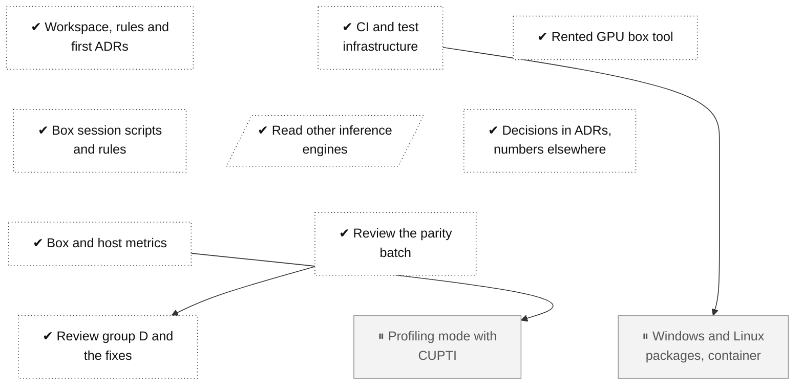

<!-- Generated by build.py from roadmap/nodes.yaml. Do not edit. -->

# ops - operations

Scope: CI, box tooling (taxameter), telemetry, dashboards, alerts, docs.

[Back to the page](../../roadmap.md) · [legend](../../roadmap.md#legend)

<!-- BEGIN GENERATED: track-ops -->

<!-- END GENERATED: track-ops -->

## Node table

<!-- BEGIN GENERATED: table-ops -->
| id | title | kind | lane | state | outcome | start | end | depends_on | replaced_by | qualified_by | headline | evidence |
|---|---|---|---|---|---|---|---|---|---|---|---|---|
| `ops-foundations` | Workspace, rules and first ADRs | tooling | none | done | unrated | 2026-10-29 | 2026-10-30 |  |  |  |  | docs/plan.md; AGENTS.md; docs/adr/0001-own-rust-engine-on-ggml.md |
| `ops-ci` | CI and test infrastructure | tooling | none | done | unrated | 2026-10-30 | 2026-11-19 |  |  |  |  | .github/workflows |
| `ops-taxameter` | Rented GPU box tool | tooling | none | done | unrated | 2026-10-30 | 2026-11-20 |  |  |  |  | docs/adr/0029-gpu-tooling-from-taxameter.md; taxameter.toml |
| `ops-box-driver` | Box session scripts and rules | tooling | none | done | unrated | 2026-11-03 | 2026-11-20 |  |  |  |  | docs/box-driver.md; docs/sessions.md |
| `ops-telemetry` | Box and host metrics | feature | none | done | unrated | 2026-11-12 | 2026-11-14 |  |  |  |  | docs/adr/0060-box-host-metrics-as-otel.md; docs/adr/0063-genai-request-metrics-and-tier-transfer-family.md |
| `ops-docs` | Decisions in ADRs, numbers elsewhere | tooling | none | done | unrated | 2026-11-09 | 2026-11-20 |  |  |  |  | docs/sources.md; docs/m2-plan.md; AGENTS.md |
| `ops-external-reads` | Read other inference engines | experiment | none | done | unrated | 2026-11-05 | 2026-11-20 |  |  |  |  | docs/notes/external-reads.md |
| `ops-owner-caps` | Owner raises box price caps | owner-decision | owner | done | n/a | 2026-11-09 | 2026-11-13 |  |  |  |  | AGENTS.md |
| `ops-owner-4gpu-cap` | Owner allows dearer four-GPU boxes | owner-decision | owner | done | n/a | 2026-11-15 | 2026-11-15 |  |  |  |  | AGENTS.md |
| `ops-owner-v4a-cap` | One dearer box for verdict | owner-decision | owner | done | n/a | 2026-11-20 | 2026-11-20 |  |  |  |  | AGENTS.md; docs/notes/phase5-rule-changes.md |
| `ops-owner-accepts-adrs` | Owner accepts nine design records | owner-decision | owner | done | n/a | 2026-11-19 | 2026-11-19 |  |  |  |  | docs/adr/0052-runtime-cpu-isa-dispatch.md; docs/adr/0075-executor-ranges-are-graph-views.md |
| `ops-review-parity-batch` | Review the parity batch | refactor | local | done | unrated | 2026-11-23 | 2026-11-23 | serving-parity-endpoints, memory-prefix-disk-async, memory-kv-auto, serving-recurrent-reuse |  |  | 13 of 14 findings fixed | docs/adr/0087-prefix-cache-disk-tier.md; docs/notes/llamacpp-parity.md; crates/scheduler/tests/no_suffix_cut.rs; crates/gateway/tests/fields.rs |
| `ops-packages` | Windows and Linux packages, container | tooling | none | parked | unrated |  |  | ops-ci |  |  |  |  |
| `ops-profiling-mode` | Profiling mode with CUPTI | feature | box-later | parked | unrated |  |  | ops-telemetry |  |  |  |  |
| `ops-review-group-d` | Review group D and the fixes | refactor | local | done | unrated | 2026-11-23 | 2026-11-23 | serving-parity-libllama, ops-review-parity-batch |  |  |  | docs/notes/llamacpp-parity.md; tests/conformance/parity/test_parity_lib.py |

### Details per node

| id | title | verdict | headline | in plain words | notes | confirmed | waiting on | queue order | order reason |
|---|---|---|---|---|---|---|---|---|---|
| `ops-foundations` | Workspace, rules and first ADRs |  |  | Phase 0: the Cargo workspace with crate stubs from the plan, the agent rules in AGENTS.md and the first design records (ADRs 0001 to 0029). |  |  |  |  |  |
| `ops-ci` | CI and test infrastructure |  |  | Builds and tests on Windows and Linux, CUDA compile jobs, sccache, per-OS golden outputs and required model and GPU tests; small fixes and cleanups are folded here. |  |  |  |  |  |
| `ops-taxameter` | Rented GPU box tool |  |  | taxameter is the project's own tool to rent and drive Vast.ai GPU boxes: price and age caps, several boxes per project, multi-GPU offers, key redaction. |  |  |  |  |  |
| `ops-box-driver` | Box session scripts and rules |  |  | The scripts and written rules a box session follows: stage budgets, abort gates, host skip list, resume after a dropped connection, keep a working box. |  |  |  |  |  |
| `ops-telemetry` | Box and host metrics |  |  | Box and host samplers export through the same OpenTelemetry path as the engine (OpenTelemetry: the standard metrics and traces format), plus request metrics and tier transfer counters. |  |  |  |  |  |
| `ops-docs` | Decisions in ADRs, numbers elsewhere |  |  | Documentation conventions: every outside source listed, the M2 plan, ADRs hold decisions while measurements live in each session's README, and audits that bring documents to the current state. |  |  |  |  |  |
| `ops-external-reads` | Read other inference engines |  |  | Read-only studies of other engines (Surogate, InferSSD, Speedy, Kinetic, Basalt, QuixiInfer) for ideas, each ranked with the test and the ADR it would change. |  |  |  |  |  |
| `ops-owner-caps` | Owner raises box price caps | Caps (raised by the user 2026-11-13): 0.90 USD/h per box all-in and two instances for this project |  | The owner raised the per-box and account price caps for rented GPU boxes, which allowed larger boxes and two at once. |  |  |  |  |  |
| `ops-owner-4gpu-cap` | Owner allows dearer four-GPU boxes | Exception (user, 2026-11-15): a box with 4 GPUs may cost up to 1.20 USD/h all-in (Phase 5 four-GPU sessions) |  | Phase 5 needs four-GPU boxes, which cost more than the standing cap; the owner allowed up to 1.20 USD/h for those. |  |  |  |  |  |
| `ops-owner-v4a-cap` | One dearer box for verdict | One-off exception (user, 2026-11-20): one 4-GPU box for the D4 verdict session (V4a) on a host other than 20210 may cost up to 1.70 USD/h all-in |  | The only usable four-GPU host so far (20210) throttles one GPU, so the owner allowed one four-GPU verdict box (V4a) elsewhere at up to 1.70 USD/h, run alone. Never used; 20210 was re-admitted on 2026-11-21 and ran V4a at the standard cap. |  |  |  |  |  |
| `ops-owner-accepts-adrs` | Owner accepts nine design records | ADRs 0052, 0053, 0056, 0066, 0067, 0070, 0071, 0073, 0075 accepted (owner) |  | The owner moved nine Proposed ADRs (CPU dispatch, AVX-512 kernels, disk cost term, dense builder, KV layout, parallel shapes, GPU tolerance, engine pin, executor graph views) to Accepted. |  |  |  |  |  |
| `ops-review-parity-batch` | Review the parity batch | CI run 45138471418 green on all jobs (test ubuntu-24.04 and test windows-latest passed); the new test of finding 2 failed before its fix | 13 of 14 findings fixed | A fresh reviewer read the code seven workers merged on 2026-11-23 and found 14 bugs; 13 are fixed (unbounded n, recurrent prefix entries destroyed, disk tier files deleted by a replan, aborted reads, disk budget, cut streams, completions default, top_k, penalty windows, empty key file, seeds, native logprob trim), one already matched llama-server, and five duplicated helpers were merged. |  |  |  |  |  |
| `ops-packages` | Windows and Linux packages, container |  |  | Installable packages for Windows and Linux, and a container image (plan feature 37, Phase 9 half). | Parked: Phase 9 (breadth) runs in parallel with M3 and M4, after M2 (plan.md, Roadmap); nothing is scheduled. Done when (plan.md, Phase 9 exit test): packages install cleanly on both systems. |  |  |  |  |
| `ops-profiling-mode` | Profiling mode with CUPTI |  |  | A profiling mode that records per-kernel GPU timings from outside the engine with CUPTI (NVIDIA) or rocprof (AMD), on top of the step timing and calibration runs that exist (plan feature 43). | Parked: no exit test needs it; Phase 5 diagnoses used sync traces and graphs-off runs. Checked 2026-11-21: no CUPTI or rocprof code in crates/. Done when: a profiling run writes per-kernel times for one step without changing production timing. |  |  |  |  |
| `ops-review-group-d` | Review group D and the fixes | 795 passed, 2 skipped, 6 xfailed in 97.55s (0:01:37) |  | The second review of group D found 11 findings, 10 fixed and 1 dropped with evidence (the pin does not truncate over-long prompts under context shift), and the audit of ADR 0083 decision 6 covers all 165 appendix rows, 75 with a case, 74 scoped out and 16 covered by unit tests, with 6 strict gap cases under serving-parity-remaining; CI run 45256815014 ran the parity suite at 795 passed, 2 skipped and 6 xfailed. | The first review found 13 real bugs. |  |  |  |  |

### Folded items per node

- `ops-foundations`: Workspace, rules and first ADRs
  - Phase 0 scaffold, CI and cleanup (2026-10-30, commit 68c6b4b5c9, commit ca1653abfd, commit a3599bb7a4, commit c4765b209c, commit 4389bf8464, commit 594956ef68, commit 65a720b99c)
- `ops-ci`: CI and test infrastructure
  - CI and build fixes for CUDA, MSVC and Linux (2026-10-31, commit 00924734aa, commit 641025ac9b, commit 5180538c19, commit 26e148befd, commit c83b217cb1, commit 4f9b7cf103)
  - Phase 2 cleanup (2026-11-03, commit 0024814412, commit 3338d4e2fd, commit 14b806f9b2)
  - Test infra: sccache, required model and GPU tests (track aa) (2026-11-09, commit de42378025, commit 572e83467a, commit aab7f53d80, commit 1d10a30fa6, commit 17f7ef502c, commit 87a836f22d, commit 7670e1d247, commit 110267f75a, commit 022203e8c6, commit b3c0113396, commit 3033405c9a, commit 4d5684d902, commit 708624ccb0)
  - Small items: planner, memory trace and builder fixes (track t) (2026-11-09, commit cec18fca8c, commit 6b9eaa0f05, commit 31ca2f5e16, commit b6fddd643d, commit 0920b49eae, commit 6bd1127f5d, commit 93624ea89f)
  - CI follow-up: shared ggml build dir, per-OS goldens (2026-11-10, commit 5ad876774e, commit 11c06dec11, commit 4bb9fb85b4)
  - gitattributes: every text file LF (2026-11-12, commit 3841ed67f0, commit 0e276df0b2)
  - cpu_bench read freed memory after its scheduler dropped (2026-11-13, commit 8842eff3e6)
  - CI runner and workflow fixes (2026-11-16, commit 5a14317307, commit a4ec02c398, commit ddda74c33b, commit e747040902, commit 35c29bd041, commit 23e9075ac4)
  - dense_serve test threads start together (2026-11-19, commit 17338a9871, commit b08c6816a4)
- `ops-taxameter`: Rented GPU box tool
  - taxameter Vast tooling and box caps (2026-11-02, commit dadea72f33, commit 7a2963f212, commit 344be5963b, commit 1eebcd8402, commit 04be980f06, commit 8feadb5a9b, commit 718aca47b3)
  - taxameter v0.3.0: several boxes per project (2026-11-02, session record)
  - taxameter 0.3.0 to 0.3.2 and box sizing (2026-11-03, commit 02206886d9, commit 6e286b92b7, commit 5816341381, commit 340ab494a4, commit 03a4d423bf, commit ee24a0184f)
  - taxameter 0.3.3 and 0.3.4 (num-gpus, offer retry, box hours) (2026-11-20, commit 640223bf6f, commit b2edfa74f2)
- `ops-box-driver`: Box session scripts and rules
  - Box sessions B1 to B3 plan and script review fixes (2026-11-09, commit c6c989e37d, commit 76bd734b05, commit 776fc53a1f, commit 57c6a76948, commit e454308c8c, commit 0890685270, commit b812ec4951, commit 908f838fba, commit 52729f70d4, commit 373b0e77e7)
  - Hold on starting new GPU box runs, then lifted (2026-11-09, session record)
  - Box scripts without vendor git, box lib path, run headers (2026-11-10, commit 145589f2d4, commit b04f8de4fe, commit ed5c868a10)
  - exit_run.sh sccache start fixes (2026-11-10, commit 2655832972, commit 5185ea987f)
  - exit_run.sh: cache stage budget and tuner on the 235B (2026-11-11, commit b04b7a1d37, commit 1610c3fee3, commit e426f8ecc9)
  - Box harness wave 20261112: stage minutes, guards, fetch fixes (2026-11-13, commit 8f58b44b49, commit c7de070361, commit 5b9d9fde95, commit cb461df77c, commit 7fd4ea1f56, commit 882761a419, commit 2c6b7e9c0a)
  - Box-driver policy: host skips, abort gates, machine choice (2026-11-13, commit 890b0927c2, commit 6168f9a682, commit 806ca51381, commit 1f538fa554, commit 52f57341d0, commit fadf871160, commit 85990d9217)
  - Box rehearsal CI job (2026-11-13, commit 1fdac9eabb, commit a5e5fb1ca5)
  - Box tooling: session.sh budget and box-driver disk (2026-11-14, commit 0cab5d1ced)
  - Box-driver host skip list (2026-11-19, commit 0606d95b3c, commit 96c5e3e9d6, commit 5085adde52, commit 36521fc205, commit a1ada597ba, commit 9b8f80e683, commit 50674af163)
  - Box-driver rules: idle gate, aging, fail-soft, keep a working box (2026-11-20, commit 3406fc4b78, commit ddd760d8ec, commit 0a093864b1, commit f3e1c4e2f8, commit 98fa8a8060)
- `ops-telemetry`: Box and host metrics
  - Tier transfer metrics and GenAI semconv names (ADR 0063) (2026-11-12, commit 2a1f96315c, commit b514ca75fc, commit 763a9e88dc, commit dc88899a73)
  - engine_sample CPU attribution and thread clamp (2026-11-12, commit 72ca4af267, commit 37151f9f89)
  - Box and host metrics as OTel metrics (ADR 0060) (2026-11-12, commit e7711c6989, commit 8916e845b6, commit 827ba95017, commit 9b1448f92c, commit 245cdfdccf, commit ddc91b79ad, commit db1925b2fc)
  - OTLP box files compressed with zstd (2026-11-13, commit 3b734f7511, commit 7cd4ffcb4e, commit 92cf090a43)
  - Decode stall investigation (ADR 0060 addendum) (2026-11-14, commit 2d4b2c3805, commit ec779cb622)
- `ops-docs`: Decisions in ADRs, numbers elsewhere
  - Docs: sources.md complete list of external sources (2026-11-09, commit cbd6ac4db9, commit 7200ab691f)
  - M2 plan and housekeeping docs (2026-11-16, commit 7579a00260, commit e67d9163fc, commit 758f735de0, commit 0cf081e2bb, commit 9e72fe2540, commit c3b2523087, commit 3de5b6463a, commit 448ce92579, commit 7f9b67f393)
  - ADRs hold decisions, measurements move to session READMEs (2026-11-18, commit aa3d313ed3, commit 956437b7d0, commit 0de09131f2, commit ed6aa99e47, commit 1324b72c9f, commit 98f216ba17, commit dca3fe0cd5, commit aa01bd8feb, commit 6be899ada5, commit 5dffd123ba, commit d983a30e90, commit ce4c496876, commit 5324d1bfbf, commit 30b71ceb4d, commit 7428a28607, commit b75f925048, commit a9c79d71af, commit aeac1bfbc8, commit 86a0178d54, commit 12b9795eda, commit 2434a4e26f)
  - Docs audit: documents brought to current state (2026-11-19, commit 1f75190ed9, commit 715f320f27, commit 662413f007, commit 2f833f0ab7, commit 32a69c360e, commit 7e5624c8af, commit c9f92e7329, commit 21c66577ca, commit 3641f78508, commit 47615a94ac, commit 144c61176e, commit ae0607422a, commit 42013ffb80, commit 46a92063b7, commit e78b43af92, commit dd830e0d65, commit a4cd4d886d, commit 25083c22bb)
  - Tech tree config and generated pages (2026-11-20, commit fd674031d4)
  - AGENTS local-file rules and worktree gc (2026-11-20, commit 7cf3fd91a8)
- `ops-external-reads`: Read other inference engines
  - Review of Strata and Unsloth inference engines, docs updated (2026-11-05, session record)
  - Read-only study of Surogate (expert cache, multi-GPU, prefix cache) (2026-11-17, commit 6325416704, commit 93bc2a9f15, commit 2f04b14898)
  - InferSSD study notes (2026-11-19, commit 6ec88d18b0, commit 9b0d7b0b5a, commit 7b69981d5d, commit 6788ac4efb)
  - NanoQuant sub-1-bit quantization parked for Phase 9 (2026-11-19, session record)
  - External reads notes (Speedy, Kinetic, Basalt, QuixiInfer) (2026-11-20, commit 8fecfc2a37, commit 2248d2e04a, commit db28821add, commit 70f2d43cc4)
- `ops-owner-caps`: Owner raises box price caps
  - Box price caps raised for the proxy session and account (2026-11-09, session record)
  - Box price caps raised (2026-11-13, commit 5aa238e30e, commit e44b24b7ac)
- `ops-owner-4gpu-cap`: Owner allows dearer four-GPU boxes
  - Owner decision: 4-GPU boxes may cost up to 1.20 USD per hour (2026-11-15, commit 236236f457)
- `ops-owner-v4a-cap`: One dearer box for verdict
  - Phase 5 notes and owner cap for V4a (2026-11-20, commit c14ff4bacd, commit 278cd1101d, commit a9f4145f8f, commit e495ac2b66)
- `ops-owner-accepts-adrs`: Owner accepts nine design records
  - Owner accepts ADRs 0052 to 0080 (2026-11-19, commit 905931382b, commit b1de379f0b)
<!-- END GENERATED: table-ops -->
