<!-- Generated by build.py from roadmap/nodes.yaml. Do not edit. -->

# planner - planner and cost model

Scope: placement plans, candidates, cost model and calibration, profiler.

[Back to the page](../../roadmap.md) · [legend](../../roadmap.md#legend)

```mermaid
flowchart TB
    planner_cost_model_v5["○ Price decode at<br/>measured clocks"]
    classDef vsucc fill:#2e9e4f,stroke:#1b6b34,color:#fff
    classDef succ fill:#bfe8c8,stroke:#2e9e4f,color:#111
    classDef mixed fill:#ffd37a,stroke:#c98a00,color:#111
    classDef bad fill:#f28b82,stroke:#b3261e,color:#111
    classDef dead fill:#e6e6e6,stroke:#777,stroke-dasharray:5 5,color:#555
    classDef inprog fill:#a8cdf5,stroke:#1f6fc5,color:#111
    classDef next fill:#fff,stroke:#333,color:#111
    classDef blocked fill:#fff,stroke:#b3261e,stroke-dasharray:2 2,color:#111
    classDef parked fill:#f3f3f3,stroke:#999,color:#555
    classDef unrated fill:#fff,stroke:#333,stroke-dasharray:1 3,color:#111
    classDef gate fill:#d9c2f0,stroke:#7b3fb5,color:#111
    classDef decided fill:#ece0f7,stroke:#7b3fb5,stroke-dasharray:2 2,color:#111
    classDef finding fill:#ffe0b2,stroke:#d84315,stroke-width:2px,color:#111
    classDef waiting fill:#e3f2fd,stroke:#1f6fc5,stroke-dasharray:5 5,color:#111
    class planner_cost_model_v5 next
```

<!-- BEGIN GENERATED: track-planner -->

<!-- END GENERATED: track-planner -->

## Node table

<!-- BEGIN GENERATED: table-planner -->
| id | title | kind | lane | state | outcome | start | end | depends_on | replaced_by | qualified_by | headline | evidence |
|---|---|---|---|---|---|---|---|---|---|---|---|---|
| `planner-cost-model-v5` | Price decode at measured clocks | feature | local | next | unrated |  |  |  |  |  |  |  |

### Details per node

| id | title | verdict | headline | in plain words | notes | confirmed | waiting on | queue order | order reason |
|---|---|---|---|---|---|---|---|---|---|
| `planner-cost-model-v5` | Price decode at measured clocks |  |  | A GPU kept partly idle by a layer split runs at a lower clock than one GPU alone, so the 30B four-way layer split decodes slower than predicted wherever the single GPU boosts; the cost model has to price decode at the clock each layout actually gets. | Done when: version 5 reproduces s3c's 30B layer-4 tg within 15% and leaves s3f2 and the other candidates within 0.01 (ADR 0070 History). |  |  |  |  |
<!-- END GENERATED: table-planner -->
