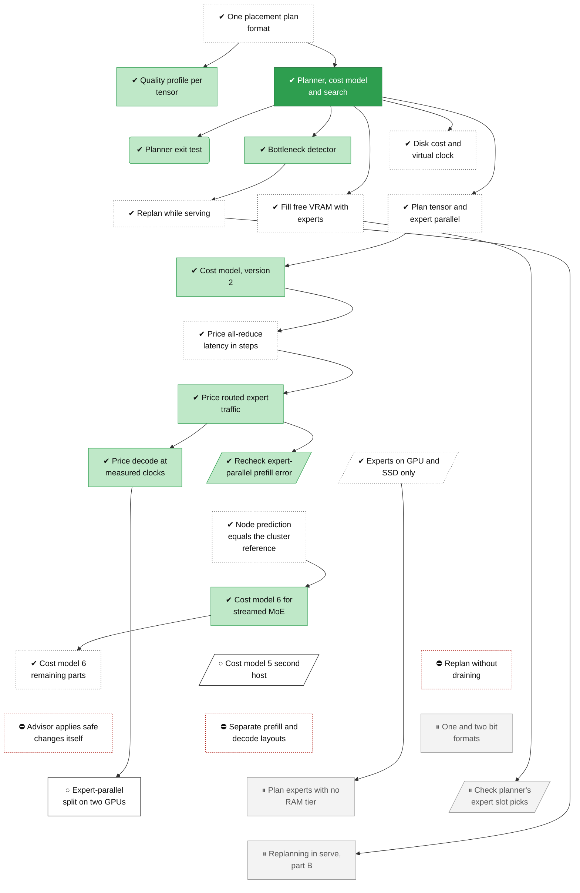

<!-- Generated by build.py from roadmap/nodes.yaml. Do not edit. -->

# planner - planner and cost model

Scope: placement plans, candidates, cost model and calibration, profiler.

[Back to the page](../../roadmap.md) · [legend](../../roadmap.md#legend)

<!-- BEGIN GENERATED: track-planner -->

<!-- END GENERATED: track-planner -->

## Node table

<!-- BEGIN GENERATED: table-planner -->
| id | title | kind | lane | state | outcome | start | end | depends_on | replaced_by | qualified_by | headline | evidence |
|---|---|---|---|---|---|---|---|---|---|---|---|---|
| `planner-plan-ir` | One placement plan format | feature | none | done | unrated | 2026-10-29 | 2026-10-31 | ops-foundations |  |  |  | docs/adr/0006-one-placement-plan-ir.md; docs/adr/0027-placement-plan-ir-shape.md |
| `planner-quality` | Quality profile per tensor | feature | none | done | successful | 2026-10-29 | 2026-11-10 | planner-plan-ir |  |  |  | docs/adr/0024-quantization-per-unit-and-quality-profile.md; docs/adr/0048-quality-profile-file-and-calibration-job.md |
| `planner-core` | Planner, cost model and search | feature | none | done | very-successful | 2026-11-03 | 2026-11-03 | planner-plan-ir |  |  | pick 3.14 s vs llama.cpp fit 4.52 s | docs/adr/0040-planner-candidates-calibration-and-scoring.md; docs/adr/0007-measured-cost-model.md |
| `planner-exit` | Planner exit test | session | none | done | successful | 2026-11-03 | 2026-11-10 | planner-core |  |  | Spearman 0.997 | bench/results/20261110/README.md; docs/adr/0040-planner-candidates-calibration-and-scoring.md |
| `planner-detector` | Bottleneck detector | feature | none | done | successful | 2026-11-08 | 2026-11-12 | planner-core |  |  | 30/30 | docs/adr/0041-detector-observation-faults-and-limits.md; docs/adr/0062-cpu-quota-throttle-fault.md |
| `planner-tier-cost` | Disk cost and virtual clock | feature | none | done | unrated | 2026-11-09 | 2026-11-10 | planner-core |  |  |  | docs/adr/0056-tier-and-disk-cost-term-virtual-clock-calibration-ledger.md |
| `planner-replan` | Replan while serving | feature | none | done | unrated | 2026-11-09 | 2026-11-12 | planner-detector |  |  |  | docs/adr/0055-replanning-wired-into-serve.md; docs/adr/0042-slo-burn-rate-alerts-and-drain-restart-replanning.md |
| `planner-fill-tier` | Fill free VRAM with experts | feature | none | done | unrated | 2026-11-14 | 2026-11-15 | planner-core |  |  |  | crates/planner |
| `planner-parallel-shapes` | Plan tensor and expert parallel | feature | none | done | unrated | 2026-11-15 | 2026-11-16 | planner-core |  |  |  | docs/adr/0070-parallel-shapes-and-their-cost.md |
| `planner-cost-v2` | Cost model, version 2 | feature | none | done | successful | 2026-11-18 | 2026-11-19 | planner-parallel-shapes, multi-pipelined-prefill |  | multi-defect-capture |  | docs/adr/0070-parallel-shapes-and-their-cost.md; bench/results/s2g-20261118/README.md |
| `planner-cost-v3` | Price all-reduce latency in steps | feature | none | done | unrated | 2026-11-19 | 2026-11-19 | planner-cost-v2 |  |  |  | docs/adr/0078-allreduce-in-step-latency.md |
| `planner-cost-v4` | Price routed expert traffic | feature | none | done | successful | 2026-11-19 | 2026-11-19 | planner-cost-v3 |  | multi-defect-capture | +0.09 | docs/adr/0080-routed-slot-activation-traffic.md |
| `planner-cost-model-v5` | Price decode at measured clocks | feature | local | done | successful | 2026-11-20 | 2026-11-21 | planner-cost-v4 |  |  |  | bench/results/s3c-20261119/costmodel-v5/README.md; bench/results/s3g-20261121/README.md; bench/results/v4a-20261121/README.md |
| `planner-cost-model-v5-host2` | Cost model 5 second host | experiment | box-later | next | unrated |  |  | bench-m2-report |  |  |  |  |
| `planner-live-replan` | Replan without draining | feature | local | blocked | unrated |  |  | multi-live-reshard |  |  |  |  |
| `planner-advisor-auto` | Advisor applies safe changes itself | feature | local | blocked | unrated |  |  | bench-m3-report |  |  |  |  |
| `planner-split-layouts` | Separate prefill and decode layouts | feature | local | blocked | unrated |  |  | bench-m3-report |  |  |  |  |
| `planner-low-bit-formats` | One and two bit formats | feature | none | parked | unrated |  |  | planner-quality, memory-conversion |  |  |  |  |
| `planner-ep-split` | Expert-parallel split on two GPUs | feature | local | next | unrated |  |  | planner-cost-model-v5 |  |  |  |  |
| `planner-low-ram-modes` | Experts on GPU and SSD only | experiment | local | done | unrated | 2026-11-23 | 2026-11-23 | memory-tiers |  |  |  | crates/planner/tests/low_ram_modes.rs; docs/notes/strata-parity.md |
| `planner-ram-slots-zero` | Plan experts with no RAM tier | feature | local | parked | unrated |  |  | planner-low-ram-modes |  |  |  | crates/planner/tests/low_ram_modes.rs |
| `planner-node-predict-check` | Node prediction equals the cluster reference | tooling | ci | done | unrated | 2026-11-24 | 2026-11-24 | bench-235b-stream-predict |  |  |  | crates/planner/tests/cluster.rs; crates/costmodel/src/predict.rs; docs/notes/stream-predict-diagnosis.md |
| `planner-costmodel-stream-terms` | Cost model 6 for streamed MoE | feature | ci | done | successful | 2026-11-24 | 2026-11-24 | bench-235b-stream-predict, planner-node-predict-check, cluster-owner-routing-input |  |  | D2 tg -0.10 in sample | bench/results/stream-predict-20261124/costmodel-v6/README.md; docs/adr/0092-costmodel-6-streamed-moe-segments.md |
| `planner-costmodel-v6-rest` | Cost model 6 remaining parts | feature | ci | done | unrated | 2026-11-25 | 2026-11-25 | planner-costmodel-stream-terms |  |  | seven ADR 0092 parts built | docs/adr/0092-costmodel-6-streamed-moe-segments.md; crates/planner/tests/cluster_judged.rs; crates/model/tests/replay_segments.rs |
| `planner-slot-campaign` | Check planner's expert slot picks | experiment | box-later | parked | unrated |  |  | planner-fill-tier |  |  |  |  |
| `planner-replan-part-b` | Replanning in serve, part B | feature | local | parked | unrated |  |  | planner-replan |  |  |  |  |
| `planner-ep-prefill-recheck` | Recheck expert-parallel prefill error | experiment | local | done | successful | 2026-11-21 | 2026-11-21 | planner-cost-v4, multi-prefill-no-capture |  |  | ep-4 pp 0.959 | bench/results/v4a-20261121/README.md; bench/results/v2c-20261121/README.md |
| `planner-owner-layer-anchor` | Approve the low-clock anchor | owner-decision | owner | done | n/a | 2026-11-21 | 2026-11-21 |  |  |  |  | docs/notes/phase5-rule-changes.md; docs/adr/0068-phase5-verdict-rules.md |

### Details per node

| id | title | verdict | headline | in plain words | notes | confirmed | waiting on | queue order | order reason |
|---|---|---|---|---|---|---|---|---|---|
| `planner-plan-ir` | One placement plan format |  |  | Every placement (which layer, expert and cache goes on which device and tier) is one plan in one format, with a validator and migration steps between plans, property-tested on every hardware fixture. |  |  |  |  |  |
| `planner-quality` | Quality profile per tensor | m1-open, ADR 0048: Phase 3a met against ik_llama quant types |  | A measured profile of how much each tensor loses at each bit width lets the planner mix formats; at the same bytes the mix beats llama.cpp's presets and ik_llama.cpp's types. |  |  |  |  |  |
| `planner-core` | Planner, cost model and search | MoE fixture score: regret 0.000, Spearman 0.997, pick 3.14 s vs llama.cpp fit 4.52 s | pick 3.14 s vs llama.cpp fit 4.52 s | Phase 3a: the planner enumerates candidate placements, prices each with a cost model calibrated on the machine, and explains, diffs and answers what-if questions. |  |  |  |  |  |
| `planner-exit` | Planner exit test | planner dense exit test PASS (24 candidates, regret 0, Spearman 0.997) | Spearman 0.997 | The planner's predicted ranking against measured runs of 24 candidates on a box: its pick was the real best (regret 0) and the ranks agreed. |  |  |  |  |  |
| `planner-detector` | Bottleneck detector | detector exit test PASS on real faults (30/30, 0/10, 9/9) | 30/30 | Names the bottleneck of a running setup (paging, disk, CPU quota throttling and others) from its metrics; passed its exit test on real injected faults. |  |  |  |  |  |
| `planner-tier-cost` | Disk cost and virtual clock |  |  | The cost model learns a disk and tier term, keeps a ledger of calibration runs, and replays plans on a virtual clock so tests run fast. |  |  |  |  |  |
| `planner-replan` | Replan while serving |  |  | When latency goals are missed, serve drains, switches to a new plan and restarts (drain and restart replanning). |  |  |  |  |  |
| `planner-fill-tier` | Fill free VRAM with experts |  |  | The planner offers the largest number of GPU expert slots that fits in free VRAM; this vramfill setting is the builder configuration the owner counted for M1. |  |  |  |  |  |
| `planner-parallel-shapes` | Plan tensor and expert parallel |  |  | Phase 5: the planner enumerates multi-GPU shapes (layer split, tensor parallel, expert parallel, pipelines of tensor groups) and prices them. |  |  |  |  |  |
| `planner-cost-v2` | Cost model, version 2 | All seven 2-GPU candidates within 15% out of sample (`s2g-20261118`). |  | Version 2 prices experts, the output head, all-reduce latency and pipelined prefill separately; on a two-GPU rehearsal every candidate came within the 15% the Phase 5 test allows. |  |  |  |  |  |
| `planner-cost-v3` | Price all-reduce latency in steps |  |  | Version 3 adds the latency of all-reduces (the sums tensor-parallel GPUs exchange every layer) inside a step, with calibration on four-GPU anchors. |  |  |  |  |  |
| `planner-cost-v4` | Price routed expert traffic | Cost model 4 (ADR 0080, routed-slot activation bytes) brings M4 ep-4 pp to +0.09. | +0.09 | Version 4 prices the activation bytes that expert parallel moves per routed expert, which brought the four-GPU expert-parallel prefill prediction close. |  |  |  |  |  |
| `planner-cost-model-v5` | Price decode at measured clocks | passes with k applied to the 30B: 1800 against 1695, -0.024 |  | A GPU kept partly idle by a layer split runs at a lower clock than one GPU alone, so the 30B four-way layer split decodes slower than predicted wherever the single GPU boosts; the cost model has to price decode at the clock each layout actually gets. | Done when (ADR 0082, The check): 30B layer-4 e_tg within 0.08 on s3, s3b and s3c and the s3c layer-4/single tg ratio within 0.03 of measured, with host-20210 clocks; s3f2 bit-identical to v4 and its L36 within 0.03; every other candidate moved by at most 0.005; Rust and replica within 1%. Design: ADR 0082 (Proposed), brief V5 in docs/phase5-briefs.md. Offline check passes (branch track-cost-model-v5): layer-4/single tg within 0.03 and e_tg +0.001/-0.003/+0.067 on s3/s3b/s3c, s3f2 bit-identical with L36 230.9 against 231.8, 32B layer-4 moves 0.011, others 0; Rust-replica agreement pending CI. s3g-20261121 (first box run, host 20210 not clock-limited: busy 1800, low 1695): layer anchor held-out tg +0.019, 30B layer-4 e_tg +0.045, tp2-pp2 decode tail 1800 MHz; offline with the 30B busy clock the held-out is -0.021 and e_tg -0.001. Box check (item 5) passed on v4a-20261121 with k = 1.062 applied to the 30B (held-out -0.024, 30B layer-4 tg 1.007 measured over predicted). Layer anchor stays behind LAYER_ANCHOR=1 on 2 GPUs. |  |  |  |  |
| `planner-cost-model-v5-host2` | Cost model 5 second host |  |  | Cost model 5 (clock-aware decode) is fitted and confirmed only on host 20210; check its predictions on a second 4-GPU host when one is usable. |  |  |  |  |  |
| `planner-live-replan` | Replan without draining |  |  | Replanning applies a new plan live instead of drain and restart (ADR 0009 until Phase 7), cheap moves first (plan feature 24, Phase 7 half). | Done when: a replan under load switches with zero failed requests and respects the switch limit. Phase 7, blocked behind the M3 report. |  |  |  |  |
| `planner-advisor-auto` | Advisor applies safe changes itself |  |  | The advisor applies cheap, reversible changes (batch limits, KV budget, hot set) on its own, verifies the gain and rolls back what misses (plan feature 42, Phase 7 half). | Done when: an injected regression is rolled back, and advisor accuracy (predicted against achieved gain) is a metric. Risk (plan.md): advisor harm. Phase 7, blocked behind the M3 report. |  |  |  |  |
| `planner-split-layouts` | Separate prefill and decode layouts |  |  | The planner may choose one layout for prefill and another for decode, sharing the weights (plan feature 40). | Done when: the planner picks split layouts where they win, and parity holds across the switch. Phase 7, blocked behind the M3 report. |  |  |  |  |
| `planner-low-bit-formats` | One and two bit formats |  |  | Formats near one or two bits per weight (IQ1, IQ2, TQ, Q1_0) become planner choices, which needs an importance matrix from calibration text (plan feature 50). | Parked to Phase 9 (m2-plan, m1-open item 10); no exit test needs them. Checked 2026-11-21: crates/plan/src/format.rs lists the formats, but conversion rejects formats that need an importance matrix (ADR 0047) and profile v1 measures none below IQ4_XS (ADR 0048). Done when: the imatrix input lands in conversion and profile, and the planner picks such a format where the profile allows. |  |  |  |  |
| `planner-ep-split` | Expert-parallel split on two GPUs |  |  | A new plan shape where each of two GPUs holds a share of every MoE layer's experts, as Strata's --ep-split does, priced by the cost model and tested on every hardware fixture (ADR 0085). | Rules 4 and 5; judged against layer-2 on the 30B. |  |  |  |  |
| `planner-low-ram-modes` | Experts on GPU and SSD only | CI run 45097627980 on 948b770 passed low_ram_modes (6 tests). Gap found: both modes are refused below the floors, the refusal now names the missing tier, a plan with ram_slots 0 is not planned. |  | On a 235B layout the planner has no plan without a RAM expert tier (builder floor of top-k slots per layer, CPU placement needs all weights in RAM); it refuses and names the tier, and ram_slots 0 stays unplanned. | Simulated fixtures first; a box only if a gap shows. |  |  |  |  |
| `planner-ram-slots-zero` | Plan experts with no RAM tier |  |  | Enumerate, lower and score a builder plan with ram_slots 0 (experts read from NVMe into VRAM), which the engine already runs and the planner never offers. | Needs recognize, lower and score to carry ram_slots 0; tests on every fixture (rules 4 and 5). |  |  |  |  |
| `planner-node-predict-check` | Node prediction equals the cluster reference | CI run 45415720514 ubuntu test a_reference_equals_its_node_run ... ok; the_reader_copy_rate_does_not_depend_on_the_thread_quota ignored until ADR 0092 |  | A test pins that the single-node prediction tool and the cluster reference price the same plan bit for bit, and a second test pins that the reader copy rate does not depend on the thread count (fails until the cost-model fix). |  |  |  |  |  |
| `planner-costmodel-stream-terms` | Cost model 6 for streamed MoE | IN_SAMPLE D2 trace v6 - tg 2.3703 tok/s (meas 2.6360, e -0.101) | D2 tg -0.10 in sample | ADR 0092 makes routing an input from a trace replay, fits anchors with their own measured shares, prices the reader copy at a measured single-thread rate and the prefill offload copy per chunk, and gives the planner the RAM budget the balloon really leaves. |  |  |  |  |  |
| `planner-costmodel-v6-rest` | Cost model 6 remaining parts | cluster_judged 6 passed 0 failed; replay_segments 1 passed (per layer pairs 80, shares equal to 1e-12); budget property 4 passed | seven ADR 0092 parts built | The ADR 0092 parts not built in the first pass - predict --cluster with the judged refusal, prefill disk bytes from the replay, per-segment tier replay, the routing-gate fixture, a footprint-within-budget property, the anchor fit-back test and a replay against engine segment counter test. |  |  |  |  |  |
| `planner-slot-campaign` | Check planner's expert slot picks |  |  | Run the planner's builder candidates with different expert slot counts on Qwen3-30B-A3B and score its picks. | Parked with Track B (m2-plan B4, m1-open item 6). Done when: scripts/planner_builder_campaign.sh results committed as planner-moe-builder. |  |  |  |  |
| `planner-replan-part-b` | Replanning in serve, part B |  |  | Part B of ADR 0055: switch libllama's op offload, take the builder's prefill chunk from the plan and join the scheduler on shutdown, then time a switch on a box. | Parked with Track B (m2-plan B4, m1-open item 10). Done when: switch time and refused requests, paired against restarting llama-server. |  |  |  |  |
| `planner-ep-prefill-recheck` | Recheck expert-parallel prefill error | \| M4 \| ep-4 \| 0.959 \| 1.057 \| 1.203 / 1.230 \| | ep-4 pp 0.959 | Expert-parallel prefill was over-predicted (ep-2, ep-4) while every judged prefill timed the graph capture call; after the capture fix it reads 0.959 (ep-4, V4a) and 0.995 (ep-2, V2c) of prediction, so no cost model term was needed. | recheck against V4a; likely closed by the capture fix. Source: m2-plan, Phase 5 open item 2; ADR 0081. |  |  |  |  |
| `planner-owner-layer-anchor` | Approve the low-clock anchor |  |  | One more calibration run on boxes with three or more GPUs (a layer split cut to half depth) measures the clock of a mostly idle GPU for cost model 5; decided by delegation to the advisor, to be confirmed with the M2 report. |  |  |  |  |  |

### Folded items per node

- `planner-plan-ir`: One placement plan format
  - Phase 2 plan IR, validator and migration DAG (2026-10-31, commit 7c17b8f854, commit b222af4348, commit eb78211fcc, commit ebdfab43a3, commit a663f051a2, commit 081a1bb194, commit 87fa825558, commit 34c5040f91)
- `planner-quality`: Quality profile per tensor
  - Design: per-unit quantization and quality profiles (2026-10-29, commit 1e22c82ed5)
  - Quality profile, log-power correction and mix at budget (ADR 0040/0048) (2026-11-09, commit 8cea744a77, commit 7de39f4717, commit 8cffa0b049, commit 48e1cc0c89, commit 0250d11e13, commit 5cf985057a)
  - Importance-matrix quantization deferred until after M1 (2026-11-09, session record)
  - Phase 3a profile mix vs ik_llama IQ4_KS and IQ4_K on Qwen3-8B (2026-11-10, commit 98fc0b4498, commit 234d43c5bb, commit 1d29c6648e, commit 9f2e6174df, commit ce3cd00162, commit 2d79c5a548)
- `planner-core`: Planner, cost model and search
  - Phase 3a planner, cost model, detector and replanner (ADRs 0040-0042) (2026-11-03, commit 16ddde9537, commit 883befee1d, commit 4b7c7aefea, commit 929c514d19, commit 17e55524eb, commit 0b8320c11e, commit fdf82b1e8a, commit 6813d51624, commit 9e41df11e2, commit 6314b62c30, commit 9d0da73bd4, commit 4d450acf7e, commit 7a7e7e04cf, commit e84564c0b9, commit b0873da89f, commit c71add4dbb, commit 3c2cf326e7, commit e4dcf1bcbd, commit 7ff41f0b2b, commit bc8578b135, commit 87144fd64f)
  - Planner search, explain, diff and what-if (2026-11-03, commit 95cdddd7a4, commit 59581dca25, commit 9c4ba9211a, commit fc9f4d0a0c, commit f8387d35a1, commit 729335b6fe, commit 18f2d57217, commit bd6309fb83, commit 971592e694)
- `planner-exit`: Planner exit test
  - Phase 3a planner exit test on measured MoE and dense fixtures (ADR 0040) (2026-11-03, commit 29fc4eceb2, commit cf18cf9486, commit 2123524af0, commit 5441b550a6, commit c5d02a60a9, commit 36bef359b8, commit f6217abd6c, commit 948d324736, commit 1dc7f7f9be, commit 43d071db56)
  - b3-planner session on box 59977867: dense exit test (2026-11-10, commit 04e61d334c, commit 33a24a9201)
- `planner-detector`: Bottleneck detector
  - Detector campaign scorer and CI exit test (2026-11-09, commit a14077aacf, commit 764cbdafb1)
  - Nightly fault testbed and swapping detector (ADR 0041 addendum) (2026-11-09, commit b2b4fe07b6, commit 012dac2d1b, commit cd434d030f, commit 1c06f0ccb5, commit cd4216b4a3, commit 7263c2a405, commit 6bd12f8f8a)
  - Fault testbed finds detector gaps the simulator hid (2026-11-09, session record)
  - b3-detector session on box 59978288: detector exit test (2026-11-10, commit 24a5111617, commit 69aac57a0d)
  - cpu_quota_throttle fault class and testbed injection (ADR 0062) (2026-11-12, commit d33e1c1bab, commit ef0726dea1, commit dcc72bdb48, commit 7e8628c064, commit 8906aef3f3, commit 5fd244667d)
- `planner-tier-cost`: Disk cost and virtual clock
  - ADR 0056 cost model design: tier and disk term, virtual clock, ledger (2026-11-09, commit db4e67706b, commit c7422cce05, commit 502f487956)
  - ADR 0056 parts A-C: calibration ledger, tier term, replay output (2026-11-09, commit 34e827b5a3, commit 220959dd65, commit 50ecdcb3e1, commit 250870c7aa, commit ac59a94d86, commit dfcf3f0a34, commit bdd745f0d9)
  - ADR 0056 parts D-F: virtual-clock replay, replanner clock, box stages (2026-11-09, commit 0b9e2d05aa, commit bcad0084c9, commit 3af675ba8e, commit 7050a3fed3, commit 648113580e, commit 20367eded8, commit f9a94ba8f0, commit 08bae73407, commit d3053f935d, commit 7ed905684e, commit 15c65eef1f)
  - Cost model predicted different RAM-tier sizes as equal (2026-11-09, session record)
  - ADR 0056 parts D-F: virtual clock, replan clock, restart cut wait (2026-11-10, commit 8835c9db5a, commit 74a22bc214, commit c874f2b677)
- `planner-replan`: Replan while serving
  - Replanning wired into serve (ADR 0055) (2026-11-09, commit 202c8be165, commit fc64f37597, commit 52a5ea7674, commit 9d0d0a8ebb, commit 3cdae4c533, commit e11b8bca5d, commit 475d5024a2, commit a87ea10810, commit ed2c9ce8ac)
  - Replan engine test flake fixes (2026-11-12, commit a96d65bed3, commit 1171e3fe11)
- `planner-fill-tier`: Fill free VRAM with experts
  - Planner fill tier (largest VRAM slot count that fits) (2026-11-15, commit 01e62d6765, commit d54ca828e9, commit 7a9b0f2b18, commit 397e17900b, commit 2d2551cd0e, commit f11b579026, commit 102d2f43e8)
- `planner-parallel-shapes`: Plan tensor and expert parallel
  - Phase 5 E2: tensor and expert parallel shapes in the planner (2026-11-15, commit ef8575a863, commit 4d9c3c48f6, commit 069d990ffb, commit 6814f9c817, commit 57f77f69e5, commit 70c841d9f0, commit 9421501668, commit 1c2f66e22b)
  - Phase 5 E3: multi-GPU cost model and enumeration (2026-11-16, commit 8a5ee5095e, commit d41c8d420f, commit 3f3cab0727, commit e068b403ea, commit f823dd123f, commit 39b16d7da2, commit 5e6b605264, commit c92690b3f9, commit 6a4f60a3a3)
  - Phase 5 S2 prep: plan hw, NVML and CLI tests (2026-11-16, commit cfe86fe4a8)
- `planner-cost-v2`: Cost model, version 2
  - Cost model v2 (ADR 0070) (2026-11-18, commit e8d8b3f021, commit 1d7279d821, commit b78c206ebe, commit a65b83b6cf, commit 46ec3b0546, commit af893ec1d1)
  - S2g rehearsal with cost model v2 and pipelined prefill (2026-11-19, commit 912f27f6ae, commit 83413848b2)
- `planner-cost-v3`: Price all-reduce latency in steps
  - Cost model v3 (ADR 0078) (2026-11-19, commit 4fb8ea79f5, commit 7aa72480ec, commit 5d8f578cea, commit 09d60133d9, commit 7883865ab9, commit 7b90e52de4, commit 5fe8f363e8, commit 02de94a1cb)
- `planner-cost-v4`: Price routed expert traffic
  - Cost model v4 and comm probe warm-up (ADR 0080) (2026-11-19, commit d7e5b5d6e8, commit f363bc6822, commit 7b0ab515f4, commit ad1f0fc0bb, commit 08e948a02d, commit 07003e7dd5, commit c01a354de7, commit 0116a014a6)
- `planner-cost-model-v5`: Price decode at measured clocks
  - s3g-20261121 box rehearsal on host 20210 (2026-11-21, commit 17249fa; R1 to R4 pass but the 30B busy clock was withheld for under 25 tail samples, so k = 1 there)
  - v4a-20261121 verdict session on host 20210 (2026-11-21, commit 692947a; the 30B busy clock 1800 against low 1695 gave k = 1.062, held-out layer anchor tg -0.024, 30B layer-4 tg measured over predicted 1.007; box check (item 5) passes)
- `planner-replan-part-b`: Replanning in serve, part B
  - DRAIN_S and RELOAD_S are guesses; measure them with part B (m1-open item 10)
<!-- END GENERATED: table-planner -->
