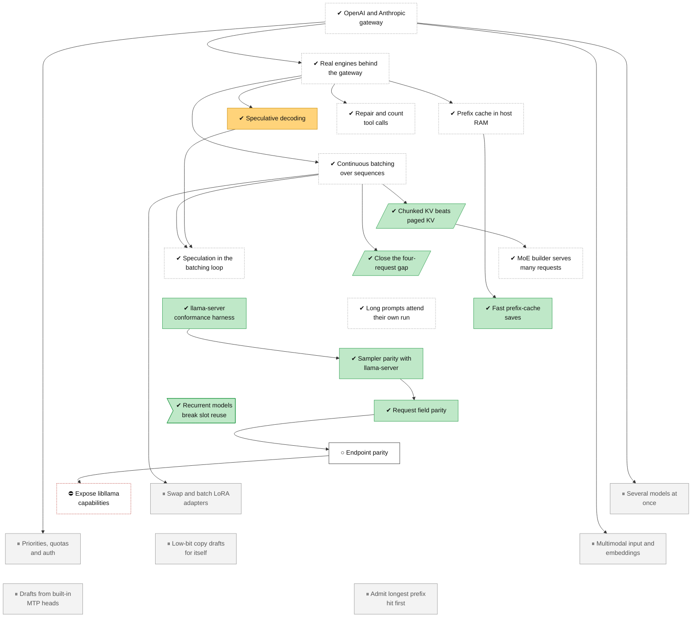

<!-- Generated by build.py from roadmap/nodes.yaml. Do not edit. -->

# serving - serving

Scope: scheduler, KV cache, prefix cache, gateway, TTFT, speculative decoding.

[Back to the page](../../roadmap.md) · [legend](../../roadmap.md#legend)

<!-- BEGIN GENERATED: track-serving -->

<!-- END GENERATED: track-serving -->

## Node table

<!-- BEGIN GENERATED: table-serving -->
| id | title | kind | lane | state | outcome | start | end | depends_on | replaced_by | qualified_by | headline | evidence |
|---|---|---|---|---|---|---|---|---|---|---|---|---|
| `serving-gateway` | OpenAI and Anthropic gateway | feature | none | done | unrated | 2026-10-29 | 2026-10-31 | ops-foundations |  |  |  | docs/adr/0028-gateway.md |
| `serving-real-engines` | Real engines behind the gateway | feature | none | done | unrated | 2026-11-03 | 2026-11-03 | serving-gateway, engine-libllama |  |  |  | docs/adr/0046-serving-real-engines-behind-the-gateway.md |
| `serving-prefix-cache` | Prefix cache in host RAM | feature | none | done | unrated | 2026-11-03 | 2026-11-15 | serving-real-engines |  |  |  | docs/adr/0049-multi-entry-prefix-cache-and-lenient-anthropic-input.md |
| `serving-tool-calls` | Repair and count tool calls | feature | none | done | unrated | 2026-11-09 | 2026-11-11 | serving-real-engines |  |  |  | docs/adr/0051-no-prompt-checkpoints-tool-call-outcomes.md; docs/adr/0057-qwen-xml-arguments-typed-from-python-literals.md |
| `serving-speculative` | Speculative decoding | feature | none | done | mixed | 2026-11-03 | 2026-11-03 | serving-real-engines |  |  |  | docs/adr/0043-speculative-decoding-in-the-scheduler.md; docs/adr/0044-op-offload-by-step-tokens.md |
| `serving-batching` | Continuous batching over sequences | feature | none | done | unrated | 2026-11-14 | 2026-11-15 | serving-real-engines |  |  |  | docs/adr/0065-phase4-verdict-multi-sequence-backend-continuous-batching.md |
| `serving-kv-layout` | Chunked KV beats paged KV | experiment | none | done | successful | 2026-11-14 | 2026-11-18 | serving-batching |  |  | paged saves 35.8% | docs/adr/0067-kv-layout-experiment-chunked-vs-paged.md |
| `serving-moe-batch` | MoE builder serves many requests | feature | none | done | unrated | 2026-11-15 | 2026-11-16 | serving-batching, serving-kv-layout |  |  |  | docs/adr/0065-phase4-verdict-multi-sequence-backend-continuous-batching.md |
| `serving-c4-gap` | Close the four-request gap | experiment | none | done | successful | 2026-11-15 | 2026-11-16 | serving-batching |  |  |  | docs/adr/0065-phase4-verdict-multi-sequence-backend-continuous-batching.md |
| `serving-spec-batching` | Speculation in the batching loop | feature | none | done | unrated | 2026-11-15 | 2026-11-16 | serving-speculative, serving-batching |  |  |  | crates/scheduler |
| `serving-prefix-save` | Fast prefix-cache saves | feature | none | done | successful | 2026-11-17 | 2026-11-20 | serving-prefix-cache |  |  |  | docs/adr/0074-prefix-save-through-pinned-staging.md; bench/results/20261117h/README.md |
| `serving-own-run-attention` | Long prompts attend their own run | feature | none | done | unrated | 2026-11-19 | 2026-11-19 | engine-dense-builder |  |  |  | docs/adr/0079-one-input-steps-attend-over-their-own-run.md |
| `serving-parity-harness` | llama-server conformance harness | feature | ci | done | successful | 2026-11-22 | 2026-11-22 | bench-m2-report |  |  | 15 pass, 25 gaps | tests/conformance/parity/cases.yaml; docs/notes/llamacpp-parity.md |
| `serving-parity-sampling` | Sampler parity with llama-server | feature | local | done | successful | 2026-11-23 | 2026-11-23 | serving-parity-harness |  |  | 5 gaps closed, 20 left | tests/conformance/parity/cases.yaml; docs/notes/llamacpp-parity.md; crates/scheduler/src/sample.rs; crates/scheduler/tests/sampler_dry.rs |
| `serving-parity-fields` | Request field parity | feature | local | done | successful | 2026-11-23 | 2026-11-23 | serving-parity-sampling |  |  | 8 gaps closed, 12 left | tests/conformance/parity/cases.yaml; docs/notes/llamacpp-parity.md; docs/adr/0088-request-fields-group-b.md; crates/gateway/tests/fields.rs; crates/scheduler/tests/fields.rs; crates/ggml-sys/tests/schema.rs |
| `serving-parity-endpoints` | Endpoint parity | feature | local | next | unrated |  |  | serving-parity-fields |  |  |  |  |
| `serving-parity-libllama` | Expose libllama capabilities | feature | local | blocked | unrated |  |  | serving-parity-endpoints |  |  |  |  |
| `serving-parity-owner-scope` | LoRA, multimodal, multi-model scope | owner-decision | owner | blocked | n/a |  |  | serving-parity-libllama |  |  |  |  |
| `serving-multi-model` | Several models at once | feature | none | parked | unrated |  |  | serving-gateway, planner-core |  |  |  |  |
| `serving-multi-lora` | Swap and batch LoRA adapters | feature | none | parked | unrated |  |  | serving-batching |  |  |  |  |
| `serving-auth-quotas` | Priorities, quotas and auth | feature | none | parked | unrated |  |  | serving-gateway |  |  |  |  |
| `serving-multimodal` | Multimodal input and embeddings | feature | none | parked | unrated |  |  | serving-gateway |  |  |  |  |
| `serving-owner-drafters` | Owner decides on more drafter kinds | owner-decision | owner | blocked | n/a |  |  | bench-spec-rerun |  |  |  |  |
| `serving-mtp-drafts` | Drafts from built-in MTP heads | feature | local | parked | unrated |  |  | serving-owner-drafters, engine-qwen35moe-builder |  |  |  |  |
| `serving-self-spec` | Low-bit copy drafts for itself | feature | local | parked | unrated |  |  | serving-owner-drafters |  |  |  |  |
| `serving-strata-owner-scope` | Which Strata model families to add | owner-decision | owner | next | n/a |  |  |  |  |  |  |  |
| `serving-recurrent-reuse` | Recurrent models break slot reuse | defect | local | done | unrated | 2026-11-23 | 2026-11-23 | bench-strata-q36 |  |  |  | bench/results/strata-q36-20261123/README.md; crates/scheduler/tests/no_suffix_cut.rs; crates/gateway/tests/openai.rs; crates/gateway/tests/anthropic.rs |
| `serving-prefix-first` | Admit longest prefix hit first | feature | local | parked | unrated |  |  | bench-ttft |  |  |  |  |

### Details per node

| id | title | verdict | headline | in plain words | notes | confirmed | waiting on | queue order | order reason |
|---|---|---|---|---|---|---|---|---|---|
| `serving-gateway` | OpenAI and Anthropic gateway |  |  | Phase 3b: an HTTP gateway with OpenAI- and Anthropic-style APIs, streaming, tool calls, chat templates and structured output. |  |  |  |  |  |
| `serving-real-engines` | Real engines behind the gateway |  |  | The gateway serves real models through libllama and the MoE builder, with an SDK conformance suite and paired runs against llama-server. |  |  |  |  |  |
| `serving-prefix-cache` | Prefix cache in host RAM |  |  | Saved model state for earlier prompts is kept in RAM, so a request that starts with a known prefix skips recomputing it; later also reused from running sequences. |  |  |  |  |  |
| `serving-tool-calls` | Repair and count tool calls |  |  | The gateway repairs malformed tool calls Qwen models emit (empty calls, Python-literal arguments, a missing opening tag) and counts each outcome per request. |  |  |  |  |  |
| `serving-speculative` | Speculative decoding | Measured 2026-11-03 (`20261103`): not a gain yet in the exit regime, see Results. |  | A cheap drafter guesses several tokens and the model checks them in one step; exact, but slower on the 235B with streamed experts until an op-offload fix, rerun still open. |  |  |  |  |  |
| `serving-batching` | Continuous batching over sequences |  |  | Phase 4: the scheduler admits and retires requests every step and decodes several sequences in one batched step, on libllama and the own builders. |  |  |  |  |  |
| `serving-kv-layout` | Chunked KV beats paged KV | step 1 gives chunked (paged saves 35.8%, reads cost 5.6 to 18%) | paged saves 35.8% | Experiment for the KV cache layout: paged blocks saved memory but cost too much on reads, so each sequence keeps one contiguous chunk; paged was refuted at the threshold set beforehand. |  |  |  |  |  |
| `serving-moe-batch` | MoE builder serves many requests |  |  | The MoE builder becomes a native batch backend with the shared KV pool, so the streamed 30B MoE can serve four requests at once and count on the own builder. |  |  |  |  |  |
| `serving-c4-gap` | Close the four-request gap | ADR 0065: step budget 2048, spare sequence slots not adopted |  | At concurrency 4 (c4) Tetraeder trailed llama-server; a CPU loop bench found benchmark artifacts and one-prompt-per-step admission, fixed with a 2048-token step budget. |  |  |  |  |  |
| `serving-spec-batching` | Speculation in the batching loop |  |  | serve --spec runs speculative decoding inside the continuous batching loop; self-speculation with a low-bit copy and MTP heads were parked until after the Phase 4 verdict. |  |  |  |  |  |
| `serving-prefix-save` | Fast prefix-cache saves | The save bar is met in `bench/results/20261117h/` |  | Saving a sequence's KV for later reuse stalled admissions; saves go through pinned staging and a pool of spare buffers prepared off the admission path, and saves nobody reuses are skipped. |  |  |  |  |  |
| `serving-own-run-attention` | Long prompts attend their own run |  |  | A step with a single input attends only over its own KV run instead of the masked shared pool, with the mask buffer reused, which sped up long-context prefill. |  |  |  |  |  |
| `serving-parity-harness` | llama-server conformance harness | 15 conformant cases (31 runs over auto, dense and moe) pass and 25 gap cases xfail strictly (sampling 5, fields 8, endpoints 12) | 15 pass, 25 gaps | One request set runs against the baseline llama-server and tetraeder serve on the tiny fixture in CI, comparing response shape and, at temperature 0, tokens; every parity row gets a failing case first (ADR 0083). |  |  |  |  |  |
| `serving-parity-sampling` | Sampler parity with llama-server | 612 passed, 2 skipped, 20 xfailed in 99.06s (pytest, test ubuntu-24.04, CI run 45091508137); the 5 sampling gap cases pass and the seeded case passes | 5 gaps closed, 20 left | The sampler runs llama-server's chain in its order with its defaults (min-p 0.05, penalties, dry, xtc, typical-p, logit bias, random seed), so the same settings sample the same way (ADR 0083, group A). |  |  |  |  |  |
| `serving-parity-fields` | Request field parity | 630 passed, 2 skipped, 12 xfailed in 76.08s (pytest, test ubuntu-24.04, CI run 45103474572); the 8 group B gap cases pass | 8 gaps closed, 12 left | Requests and responses carry the fields llama-server has (optional model, end token in the count, logprobs, n above 1, GBNF grammar and JSON schema, timings, fingerprint, reasoning effort), and the ones it does not support are rejected with 400 (ADR 0083, group B). |  |  |  |  |  |
| `serving-parity-endpoints` | Endpoint parity |  |  | Health, metrics, props, tokenize, detokenize, apply-template, native completion, Responses API, infill and API keys, as llama-server serves them (ADR 0083, group C). |  |  |  |  |  |
| `serving-parity-libllama` | Expose libllama capabilities |  |  | Embeddings, rerank, KV cache types, context shift, slot save and restore and CPU-MoE flags, which libllama has and the gateway does not expose yet (ADR 0083, group D). |  |  |  |  |  |
| `serving-parity-owner-scope` | LoRA, multimodal, multi-model scope |  |  | The owner decides from the gap matrix whether and in which order LoRA, several models, multimodal and audio, and other GPU backends are built, each with its own ADR (ADR 0083, group E). | The matrix is docs/notes/llamacpp-parity.md. |  |  |  |  |
| `serving-multi-model` | Several models at once |  |  | The gateway serves several models and loads them on demand, with the planner sharing the hardware between them (plan feature 29). | Parked: Phase 9 (breadth) runs in parallel with M3 and M4, after M2 (plan.md, Roadmap); nothing is scheduled. Done when: a feature test loads a second model on request and serves both. |  |  |  |  |
| `serving-multi-lora` | Swap and batch LoRA adapters |  |  | LoRA adapters (small fine-tuned add-ons to a model) are swapped live, and many of them run in one batch (plan feature 30). | Parked: Phase 9 (breadth) runs in parallel with M3 and M4, after M2 (plan.md, Roadmap); nothing is scheduled. Done when: a batch mixing adapters matches each adapter run alone. |  |  |  |  |
| `serving-auth-quotas` | Priorities, quotas and auth |  |  | The gateway authenticates callers, enforces quotas and schedules by priority (plan feature 31). | Parked: Phase 9 (breadth) runs in parallel with M3 and M4, after M2 (plan.md, Roadmap); nothing is scheduled. Done when: feature tests for each. |  |  |  |  |
| `serving-multimodal` | Multimodal input and embeddings |  |  | Image input through llama.cpp's multimodal library and an embeddings endpoint (plan feature 34). | Parked: Phase 9 (breadth) runs in parallel with M3 and M4, after M2 (plan.md, Roadmap); nothing is scheduled. Done when: feature tests for each. |  |  |  |  |
| `serving-owner-drafters` | Owner decides on more drafter kinds |  |  | From the rerun, the owner decides whether more drafter kinds (MTP heads, a low-bit copy) are worth building, and whether ADR 0043 is Accepted. | Source: m2-plan (Phase 4 deliverables without a step: the rerun decides), ADR 0043 Proposed. |  |  |  |  |
| `serving-mtp-drafts` | Drafts from built-in MTP heads |  |  | Models that ship extra prediction layers (MTP, multi-token prediction) draft their own next tokens for speculative decoding (plan feature 27). | Parked until after the Phase 4 verdict (m2-plan, 2026-11-15), then behind the rerun. Checked 2026-11-21: no MTP code in crates/. Done when: acceptance per pass and a paired gain on a model with MTP heads. |  |  |  |  |
| `serving-self-spec` | Low-bit copy drafts for itself |  |  | A low-bit copy of the same model drafts tokens and the full model checks them, so output is unchanged at a speed between the two (plan feature 52). | Parked until after the Phase 4 verdict (m2-plan, 2026-11-15), then behind the rerun. Checked 2026-11-21: no low-bit draft copy in crates/scheduler. Done when: the planner weighs it as a plan option and a paired run shows a gain. |  |  |  |  |
| `serving-strata-owner-scope` | Which Strata model families to add |  |  | The owner decides whether Inkling 2 Mini, Hy4-Flash, Qwen3.8-Flash-Next, vision input and the AMD, Intel and Apple backends come in, each with its own ADR (ADR 0085). | Matrix docs/notes/strata-parity.md, class 3. |  |  |  |  |
| `serving-recurrent-reuse` | Recurrent models break slot reuse | no_suffix_cut: 3 passed, 0 failed (cargo test, test ubuntu-24.04 and windows-latest, CI run 45101237756); engine_error_before_a_token_is_not_an_empty_success ok in openai and anthropic |  | A model whose memory cannot drop a suffix (Qwen3.6) now reuses only a prefix it keeps whole and otherwise clears the sequence and prefills the prompt, counted in tetraeder.kv.prefix.fallbacks; an engine error now ends an OpenAI stream with an error frame and DONE, is logged at error level with the request id, and no longer passes as an empty success. Checked with a fake backend only, no recurrent model fixture. |  |  |  |  |  |
| `serving-prefix-first` | Admit longest prefix hit first |  |  | When several requests wait, admit first the one with the longest cached prefix (idea from QuixiInfer). | Parked: worth a run only if time to first token under contention misses the bar again (m2-plan, TTFT idea 2026-11-20). |  |  |  |  |

### Folded items per node

- `serving-gateway`: OpenAI and Anthropic gateway
  - Phase 3b gateway with OpenAI and Anthropic APIs (2026-10-30, commit 880d223f61, commit 1a0a423757, commit 6760388da8, commit 6294648a47)
  - Gateway review cleanup (2026-10-31, commit 5bcc7cdbb9, commit 96b01e6f9d, commit 4c39601abf, commit db2b0e5c12, commit 35a92b0ad8, commit 7079fcadab)
- `serving-real-engines`: Real engines behind the gateway
  - Lenient Anthropic input in the gateway (2026-11-03, commit e1cba91cdc, commit c3338c2c23)
  - Phase 3b: real engines behind the gateway (ADR 0046) (2026-11-03, commit 3994874d70, commit 4d8ce5cefc, commit 19acfdc6fc, commit 7a9b0e7bb1, commit 912077c21c, commit 0172183223, commit 635bd76abf, commit 73a3f40891, commit e5c10d8e2d)
  - Phase 3b gateway exit run on RTX 3090 (2026-11-03, commit 37dc752365, commit f2a34f7e55, commit b1784ed9b1)
- `serving-prefix-cache`: Prefix cache in host RAM
  - Multi-entry prefix cache in host RAM (ADR 0049) (2026-11-03, commit 5e3c0fe6cd, commit 9c892f411b, commit 499644b23b, commit b0288883a9)
  - C3b: prefix reuse from busy sequences (2026-11-15, commit d91ffce275, commit 8902aadfa7, commit d7bd88b470)
- `serving-tool-calls`: Repair and count tool calls
  - Gateway tool-call outcomes and empty-call repair (ADR 0051) (2026-11-09, commit a9383ebc45, commit a713ba6194, commit 4d69150e43, commit 4697d658d3, commit 09e835ab15, commit 725d6348ed, commit 165915cf7a, commit 8b3b90f992, commit a3b6068b4b)
  - Qwen3-Coder Python-literal tool arguments typed per schema (ADR 0057) (2026-11-10, commit 7ee3a766f5, commit 8fcfc333ba, commit c7fc979c35)
  - Phase 3b proxy gaps: Qwen XML call without opener, tool-error classes (2026-11-11, commit d7823a037a, commit 0e5501f616, commit 9e7efd9088, commit 351ad3c444)
  - Tool-call outcome counts in request log and proxy summary (2026-11-11, commit 0994e7622b, commit 63738c70f4)
- `serving-speculative`: Speculative decoding
  - Op offload gated by step tokens (ADR 0044) (2026-11-03, commit 49e34ead2f)
  - Speculative decoding in the scheduler (ADR 0043) (2026-11-03, commit 6312a410ad, commit 400ad46898, commit 06defa62bd, commit 834ab9b03a, commit 09c59c7c99, commit 44863074d1, commit 4556359efd, commit 3a1b1e3c4d, commit f60bf1e189, commit 0ffdcdba7d, commit 4f6f866f28)
  - Speculation results on the 235B (ADR 0043) (2026-11-03, commit d6e15a3017, commit f87ffc2434, commit 98422d6a28, commit 0d00c1daa2)
- `serving-batching`: Continuous batching over sequences
  - BatchBackend trait and step planner (C2a) (2026-11-14, commit a026f7b1e8, commit 525a8e8724)
  - Continuous batching loop and multi-sequence libllama (C2b) (2026-11-14, commit 47081fa249, commit 2f4f972818)
  - Phase 4 design: ADRs 0065 to 0067 and settled points (2026-11-14, commit 7068a16c3f, commit 0cfc685aef, commit f75a2afd8f, commit fb1290b51c)
  - Review fixes after C2b, C3b, C4 and C5 (2026-11-15, commit 8004383f91, commit 93c8a398f8, commit 1ee262dc5f, commit 40da69bef2, commit f13ca65621, commit 365c1a0310, commit 70f118b0a6)
- `serving-kv-layout`: Chunked KV beats paged KV
  - KV layout experiment: chunked against paged (ADR 0067 step 1) (2026-11-14, commit 51523c8469, commit 9f540efdb7, commit f0be3f4b0e)
  - Lone request whose KV run cannot grow (ADR 0067) (2026-11-18, commit ab337db024, commit e4c640b408, commit 68bcd166d8, commit 42a63c2850)
- `serving-moe-batch`: MoE builder serves many requests
  - MoE follow-ups: step graph cache, hot set, rollback via KvPool (2026-11-15, commit e298a3dfb7, commit b76e299a7d, commit 73ba05d4ad, commit a5bd13e6a3, commit 295228ef8f)
  - C4: MoE builder as a native batch backend (2026-11-16, commit 6d9b3f81e6, commit 97ebfd1758, commit 76beda6d07, commit 71149d0914, commit 0619b5751c, commit 2d06d3e363, commit 7e1674aff5, commit a15394b81c, commit 9a3c2f993b, commit 77251050d7)
  - MoE selects output rows before the last layer's FFN (2026-11-16, commit 60b7a66d21, commit aae7d49891, commit 56779de690, commit 459e9218f1, commit 30a2e0ee84, commit 5e32610bb1, commit 73a7bcbf94, commit 3a1de18d52, commit 6a4ba6aec1, commit 3ad4fa397c, commit d5e9510054, commit 86c05deeae)
- `serving-c4-gap`: Close the four-request gap
  - Loop-bench workflow: scheduler loop against llama-server on CPU (2026-11-15, commit 31a293c15c, commit 185723a843, commit 4147db80d1, commit 2c2a43f501, commit 98c1fc6717, commit 7bef0300bb, commit 981b62bac1, commit b5c5844248, commit 5833567057, commit fb832e5285, commit 95227b7bef, commit b69672034f, commit e3ba66a6a2)
  - C4 gap diagnosis: decoders and prompt chunks as separate CPU calls (2026-11-15, commit c3a56d3255, commit 929f25bb9a, commit e061ac786b, commit 1fee0755c7)
  - Scheduler step budget of 2048 tokens (2026-11-16, commit 0446bb1c3b, commit 8f1a10c6a5)
- `serving-spec-batching`: Speculation in the batching loop
  - Self-speculative decoding and MTP parked until after the Phase 4 verdict (2026-11-15, session record)
  - Speculative decoding in the batching loop (serve --spec) (2026-11-16, commit e0aae8afb1, commit f9e64ed991, commit ad76785ada, commit be0993b520, commit 16a7360cd3, commit b445a02f47, commit f718e94395, commit 00fcf36c1e, commit 3d069bf386)
- `serving-prefix-save`: Fast prefix-cache saves
  - Prefix save through pinned staging (ADR 0074) (2026-11-17, commit ee89ac1d2b, commit 50ce56a73e, commit 8ec7f5591e, commit ecf9fee5cd, commit 86f57887b1)
  - Huge-page advice on the fresh snapshot, then off by default (2026-11-17, commit 99988e3f2c, commit d234c1a72d, commit ac69da154f)
  - Snapshot buffer pool off the admission path (ADR 0074) (2026-11-17, commit f011e588a7, commit ad679ab881, commit 632f32ebf0, commit afda512a5b, commit 150e62c2ed)
  - Dense backend reports kv_row_bytes (2026-11-17, commit c56b184551, commit f45f2ce2f7)
  - Box 20261117h: kv-save2 passes ADR 0074 bar, D2a probes stop (2026-11-17, commit 7e150fba8f)
  - Overlapping the prefix save with the next step rejected (2026-11-17, session record)
  - No save when a live hit keeps the cut (ADR 0074) (2026-11-18, commit bc49c20a60, commit 7149b30d4a, commit a8902fc038, commit 00e756cb7a, commit c63a5ed615, commit 938f04c1c3)
  - New conversation takes a free slot (ADR 0074) (2026-11-19, commit ec914aeaa3, commit b822c044f8, commit 9fdaa3e73b, commit 7d78147d0b, commit 91480cde81, commit 8eacaac472)
  - Admission-path outlier fixes from ttft4 (2026-11-19, commit c69acd0b99, commit ba4fa0e572, commit b8fe02952e, commit 345b72f344, commit 7677555d48, commit c528d32d62)
  - Snapshot spares grow instead of replaced (2026-11-19, commit f015938cf1, commit 254f63f11d, commit 4165b4025d)
  - Save metrics: preparer bytes and in-step saves (2026-11-20, commit 159b62c3be, commit 8cb851b5d7)
- `serving-own-run-attention`: Long prompts attend their own run
  - Long-context prefill: own-run attention, mask reuse (ADR 0079) (2026-11-19, commit b39db8df9f, commit 6a21e33dc0, commit 366d42a8d0)
- `serving-multi-lora`: Swap and batch LoRA adapters
  - ggml patch: batched multi-LoRA matmul (plan.md, patch queue)
- `serving-prefix-first`: Admit longest prefix hit first
  - SAVE_MIN_TOKENS for short prompts (m2-plan, c4 gap on CPU)
<!-- END GENERATED: table-serving -->
